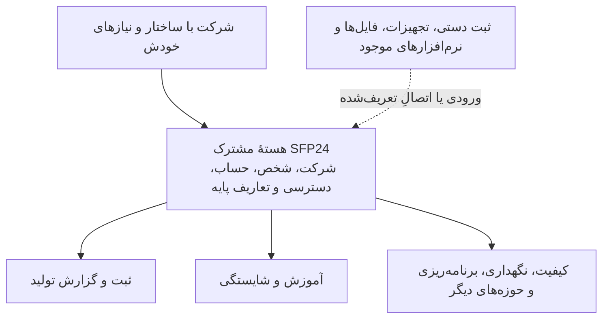

# SFP24 — بستر ماژولار مدیریت و یکپارچه‌سازی عملیات شرکت‌ها

**SFP24** نرم‌افزاری در حال توسعه است که هدف آن فراهم‌کردن یک محیط مشترک برای **ثبت، پیگیری، مدیریت و مرتبط‌کردن فعالیت‌ها و اطلاعات عملیاتی شرکت‌ها** است؛ بدون اینکه همهٔ شرکت‌ها مجبور باشند ساختار سازمانی، روش انجام کار یا نرم‌افزارهای یکسانی داشته باشند.

**دامنهٔ استفادهٔ موردنظر، از یک کارگاه بسیار کوچک تا یک سازمان بزرگ و چندسایتی است.** در ساده‌ترین حالت، ممکن است تمام نیاز یک کارگاه این باشد که هر نفر در صفحهٔ شخصی یا محیط کاری خودش، فعالیت‌های انجام‌شده، زمان کار و تعداد تولید روزانه را در یک فرم ساده ثبت کند و مسئول مربوط بتواند گزارش‌ها را ببیند. در سوی دیگر، یک شرکت بزرگ ممکن است چند واحد سازمانی، چند محل فعالیت یا سایت، مسئولیت‌های متفاوت، تجهیزات متعدد و نرم‌افزارهای موجود داشته باشد و بخواهد بخش‌های موردنیازش را با اطلاعات و قواعد دسترسی مشترک به هم مرتبط کند. **یک محصول برای طیف زیادی از تنوع ها بااستفاده از قابلیتهای ماژولار و شخصی سازی برای انواع پروفایلهای کاربری ** طراحیِ صفحهٔ شخصیِ نهایی، پشتیبانی کامل چندسایتی و اتصال عمومی سامانه‌ها هنوز نباید قابلیت آمادهٔ نسخهٔ فعلی فرض شوند؛ [وضعیت واقعی ساخت](docs/STATUS.fa.md) و [مسائل باز هسته](docs/core/OPEN-QUESTIONS.md) مرجع‌اند.

در این رویکرد، اطلاعات مشترک مانند اشخاص، تجهیزات و مجوزها در **هسته** مدیریت می‌شوند و هر **ماژول** مسئول یک کار تخصصی است؛ برای مثال ثبت تولید، آموزش و شایستگی یا نگهداری تجهیزات. شرکت می‌تواند از بخش‌های موردنیازش استفاده کند و در صورت فراهم‌بودن اتصال معتبر، با تجهیزات و سامانه‌های موجود خود نیز تبادل داده داشته باشد.

**عنوان توصیفی انگلیسی:** Modular Operations Platform. این عنوان، پیشنهاد ما برای معرفی جهت محصول است؛ **نام یک رده‌بندی استاندارد، گواهی یا ادعای آماده‌بودن تمامی قابلیت‌ها نیست**. خاستگاه SFP24 صنعتی است، اما [دامنهٔ مورد بررسی](docs/modules/CATALOG.fa.md) به تولید محدود نمی‌شود و فعالیت‌های خدماتی، پشتیبانی و کارکنان را نیز در بر می‌گیرد.

> **مرز مهم:** این صفحه «هدف محصول» و «وضعیت ساخته‌شده» را جدا می‌کند. برای دانستن آنچه واقعاً پیاده‌سازی یا آزموده شده، به [وضعیت نسخهٔ بررسی‌شده](docs/STATUS.fa.md) مراجعه کنید. وجود نام یک ماژول یا یک پیکان در نمودار، به معنی آماده‌بودن آن نیست.

## چه مسئله‌ای قرار است حل شود؟

در یک شرکت، اطلاعات کار ممکن است میان دفتر و کاغذ، افراد، دستگاه‌ها، فایل‌ها و چند نرم‌افزار پراکنده باشد. در نتیجه ثبت یک اتفاق، تشخیص منبع معتبر آن، یافتن مسئول اقدام و پیگیری نتیجه می‌تواند دشوار شود. SFP24 می‌خواهد با **هویت‌ها و قواعد مشترک، ماژول‌های تخصصی و ارتباطات تعریف‌شده** این فاصله را کمتر کند.

برای مثال، یک تجهیز می‌تواند در هسته یک شناسهٔ مشترک داشته باشد؛ گزارش تولید، سابقهٔ تعمیر و وضعیت آموزش فردی که با آن کار می‌کند، در صورت استفاده از ماژول‌های مربوط، به آن شناسه‌ها ارجاع دهند. این به معنی ادغام تمام اطلاعات در یک جدول یا فعال‌بودن خودکار همهٔ قابلیت‌ها نیست. [تعریف محصول و نمونه‌های تفصیلی](docs/PRODUCT.fa.md)، [هویت و دسترسی](docs/core/IDENTITY-AND-ACCESS.fa.md) و [قواعد داده](docs/core/DATA-AND-PARAMETERS.fa.md) مرزها را توضیح می‌دهند.

### SFP24 از نظر مفهومی چگونه سازمان می‌یابد؟

**راهنمای شکل:** این یک **نقشهٔ مفهومیِ هدف محصول** است، نه دیاگرام استقرار یا مجموعهٔ اتصال‌های پیاده‌سازی‌شده. هسته اطلاعات و خدمات مشترک را در اختیار حوزه‌های تخصصی قرار می‌دهد؛ هر ماژول منطق، داده و نتیجهٔ تخصصی خود را دارد. اطلاعات ممکن است دستی یا از یک منبع خارجی دریافت شوند، ولی نوع منبع، اعتبار نتیجهٔ عملیاتی را به‌تنهایی اثبات نمی‌کند. [معماری موجود](docs/core/ARCHITECTURE.fa.md)، [مرزهای پیشنهادی](docs/core/CANONICAL-BOUNDARIES.fa.md) و [قراردادهای موجود و پیش‌نویس](docs/contracts/README.md) را جدا بخوانید.

## دو شیوهٔ متفاوت استفاده، نه دو مرحلهٔ اجباری رشد

**کارگاه کوچک با ثبت دستی:** هر فرد می‌تواند در تجربهٔ کاربریِ موردنظر، از صفحهٔ شخصی یا میز کاری خود گزارش کوتاه کار روزانه، زمان، تعداد و ضایعات را ثبت کند؛ یا سرپرست مجاز این اطلاعات را وارد کند. شکل نهایی این صفحه هنوز موضوع طراحی است. ممکن است نه برنامهٔ رسمی تولید داشته باشد، نه تگ دستگاه و نه نرم‌افزار انبار. نباید برای ثبت اولین گزارش مجبور به خرید یا راه‌اندازی همهٔ این‌ها شود. بخشی از مسیر ثبت تولید در نسخهٔ بررسی‌شده پیاده شده است؛ [محدودیت‌های دقیق](docs/STATUS.fa.md) و [راهنمای ثبت تولید](docs/modules/production/README.md) مرجع‌اند.

**شرکت بزرگ، چندواحدی یا چندسایتی با نرم‌افزارهای موجود:** ممکن است بخش‌های مختلف سازمان در چند محل فعالیت کنند، مسئولیت‌ها و مجوزهای متفاوت داشته باشند و سفارش و موجودی نیز در سامانهٔ دیگری مدیریت شوند. در این حالت شرکت می‌تواند بخواهد بخشی از عملیات، کیفیت، نگهداری یا آموزش را در SFP24 انجام دهد. در این حالت باید مشخص شود کدام سامانه مالک هر داده است، چه اطلاعاتی با چه قرارداد و مجوزی ردوبدل می‌شود و قطع ارتباط چه اثری دارد. **این سناریو هدف طراحی است، نه ادعای آماده‌بودن اتصال عمومی ERP یا همهٔ ماژول‌ها.** [سناریوهای محصول](docs/PRODUCT.fa.md) و [قراردادهای ارتباطی](docs/contracts/README.md).

همچنین آموزش و شایستگی قرار نیست به خرید ماژول تولید وابسته باشد؛ کاربری اداری یا خدماتی نیز می‌تواند نیازمند آموزش باشد. [طراحی ماژول آموزش](docs/modules/training/README.md).

## چه چیزی هسته است و چه چیزی ماژول؟

| بخش | مسئولیت | چه چیزی را نباید از آن نتیجه گرفت؟ |
|---|---|---|
| **هسته** — Core | شرکت و جداسازی داده‌ها، شخص و حساب، احراز هویت، مجوز و محدوده، تعاریف و زیرساخت مشترک | هر قابلیت تخصصی یا موتور عمومی نصب افزونه از قبل آماده است |
| **ماژول** — Module | قواعد و عملیات یک حوزه مانند ثبت تولید، آموزش، تعمیرات یا محاسبهٔ شاخص | صرف داشتن صفحه یا کارت در منو، موتور عملیاتی آن حوزه را می‌سازد |
| **اتصال و داده** | دریافت و مصرف مجاز داده با نوع، زمان، واحد، منبع و قواعد اعتبار | تگ دستگاه به‌تنهایی گزارش رسمی تولید، توقف یا OEE را اثبات می‌کند |
| **محیط کار و نمایش** | دسترسی به صفحات، میزها و اطلاعات متناسب با مجوز | انتخاب میز، صفحه یا نمودار مجوز عملیاتی جدید صادر می‌کند |

برای تعریف دقیق به [نقشهٔ اسناد هسته](docs/core/README.md)، [ماژول‌ها](docs/modules/README.md)، [داده و پارامترها](docs/core/DATA-AND-PARAMETERS.fa.md) و [فضای کاری و میزها](docs/core/WORKSPACES.fa.md) مراجعه کنید. **ساختار اجراییِ بررسی‌شده یک برنامه با بخش‌های تخصصی و مرزهای مشخص است؛ SDK عمومی و نصب مستقل همهٔ ماژول‌ها هنوز پیاده نشده است.** [شواهد معماری](docs/core/ARCHITECTURE.fa.md).

## جایگاه SFP24 در کنار اصطلاحات شناخته‌شده

برای اینکه با نام‌گذاری یک دسته از نرم‌افزارها، دامنهٔ SFP24 را اشتباه محدود نکنیم:

- **برنامه‌ریزی منابع سازمان** — Enterprise Resource Planning (ERP): معمولاً فرایندهایی مانند مالی، خرید، فروش، منابع انسانی و زنجیرهٔ تأمین را در یک سامانهٔ سازمانی به هم مرتبط می‌کند. **SFP24 امروز ERP کامل نیست**؛ ممکن است با ERP مشتری ارتباط بگیرد یا در برخی حوزه‌ها با آن هم‌پوشانی داشته باشد.[^erp]
- **مدیریت عملیات تولید** — Manufacturing Operations Management (MOM): حوزه‌ای برای مدیریت فعالیت‌های عملیاتی تولید و تبادل اطلاعات با سامانه‌های دیگر. استاندارد ISA-95 / IEC 62264 چارچوبی برای شناخت فعالیت‌ها و ارتباط سطح عملیات تولید با برنامه‌ریزی سازمان ارائه می‌کند. بخش صنعتی چشم‌انداز SFP24 به این حوزه مرتبط است، ولی همهٔ خدمات غیرصنعتی محصول را تعریف نمی‌کند.[^isa95]
- **انقلاب صنعتی چهارم / صنعت ۴٫۰** — Industry 4.0: مفهوم پیوند فناوری‌های دیجیتال، تجهیزات و فرایندهای صنعتی برای داده‌برداری، تحلیل، ارتباط و در موارد مناسب اتوماسیون است؛ **نام یک ماژول یا شاخص بلوغ قطعی SFP24 نیست**. داشتن هوش مصنوعی یا نمای سه‌بعدی، به‌خودی‌خود تحقق این مفهوم را اثبات نمی‌کند.[^industry4]

بنابراین عبارت **«بستر ماژولار مدیریت و یکپارچه‌سازی عملیات شرکت‌ها»** توصیف جهت محصول در اسناد SFP24 است، نه طبقه‌بندی رسمی تأییدشده توسط یک نهاد استاندارد. شرح گسترده‌تر و مرزهای این اصطلاحات در [تعریف محصول](docs/PRODUCT.fa.md#erp-position) آمده است.

## اکنون چه چیزهایی واقعاً وجود دارند؟

در **نسخهٔ مرجع بررسی‌شدهٔ کد**، بخشی از مدیریت شرکت و حساب، مجوزها و اطلاعات پایه، دریافت محدود داده، ثبت و گزارش تولید و تنظیم و تخصیص میزهای کاری وجود دارد. محتوای عملیاتی همهٔ میزها کامل نیست؛ بخشی پیش‌نمایش است. موتورهای کامل OEE، نگهداری و تعمیرات، برنامه‌ریزی، LMS و نصب مستقل عمومی ماژول‌ها نباید اجراشده فرض شوند.

این بند **خلاصهٔ گزارش وضعیت نسخهٔ مشخص** است، نه تأیید مستقل عملکرد محیط فعلی یا آخرین استقرار. برای جزئیات و کامیت مبنای شواهد، [وضعیت ساخت](docs/STATUS.fa.md) و [معماری همان نسخه](docs/core/ARCHITECTURE.fa.md) را بخوانید. فناوری‌های واقعی و محل استفادهٔ آن‌ها در [مرجع فناوری](docs/TECHNOLOGY.fa.md) ثبت شده‌اند. کد اجرایی در [مخزن جداگانهٔ محصول](https://github.com/hossein-aghaie/pouyeshgar-workshop) نگهداری می‌شود.

## از کجا شروع کنم؟ راهنمای مستقیم برای خواننده و توسعه‌دهنده

| می‌خواهید بدانید یا انجام دهید | سندی که باید ابتدا بخوانید |
|---|---|
| شناخت هدف و مثال‌های کاربردی محصول | [تعریف و چشم‌انداز محصول](docs/PRODUCT.fa.md) |
| تشخیص قابلیت ساخته‌شده از پیش‌نمایش و پیشنهاد | [وضعیت واقعی ساخت](docs/STATUS.fa.md) |
| شناخت فناوری‌ها و ساختار جاری سرور، داده و رابط | [فناوری‌ها](docs/TECHNOLOGY.fa.md) و [معماری موجود](docs/core/ARCHITECTURE.fa.md) |
| توسعه یا اصلاح بخشی از هسته | [نقشهٔ هسته و مالک هر مفهوم](docs/core/README.md)، سپس [مسائل باز](docs/core/OPEN-QUESTIONS.md) |
| طراحی یک ماژول جدید یا ادامهٔ ماژول موجود | [فهرست ماژول‌ها](docs/modules/README.md)، سپس `README.md` و `RECORDS.md` همان ماژول |
| فهم اتصال‌ها و قراردادهای واقعی یا پیشنهادی | [مرجع قراردادها](docs/contracts/README.md) |
| بررسی اینکه چرا هاب داده فعلاً تجمیع شده و چه زمانی ممکن است جدا شود | [تصمیم و شرایط بازنگری هاب](docs/decisions/ADR-0003-HUB-CONSOLIDATION.md)، سپس [معماری فعلی](docs/core/ARCHITECTURE.fa.md) |
| یافتن گفتگو، فکر خام، ایدهٔ معوق یا تجربهٔ شکست‌خورده | [اتاق فکر مشترک](docs/journal/README.md) یا `RECORDS.md` حوزه، همراه [سیاست ثبت و حفظ اصل گفتگو](docs/governance/DOCUMENTATION-POLICY.md) |
| بررسی دلیل تصمیم‌های مصوب، ردشده یا جایگزین‌شده | [فهرست تصمیم‌های معماری و محصول](docs/decisions/README.md) |
| اعلام نیاز به تغییر هسته یا وابستگی میان ماژول‌ها | [گردش تغییر](docs/governance/CHANGE-WORKFLOW.md) و [درخواست‌های مشترک](docs/governance/REQUESTS.md) |
| تبدیل تصمیم تأییدشده به کار قابل پیاده‌سازی و آزمون | [مشخصات کار اجرایی](docs/implementation/README.md) و [قاعدهٔ نگهداری اسناد کنار کد](docs/governance/CODE-AND-DOCS.fa.md) |
| راه‌اندازی، نگهداری یا بررسی منابع تاریخی | [راهنمای عملیات](docs/operations/README.md) و [منابع و منشأ اسناد](docs/sources/README.md) |

اگر برای اولین بار وارد مخزن شده‌اید، [راهنمای شروع و استفاده از اسناد](docs/START-HERE.md) را بخوانید. دستیارهای توسعه باید [قواعد مخزن](AGENTS.md) را هم رعایت کنند. **خواندن کل آرشیو تاریخی پیش‌نیاز هر کار نیست**؛ ابتدا سند مالک موضوع، تصمیم‌ها و شواهد مرتبط با همان تغییر را بخوانید.

## چرا تاریخچهٔ تصمیم‌ها در این مخزن مهم است؟

هدف این مخزن فقط شرح آخرین وضعیت نرم‌افزار نیست؛ می‌خواهد نشان دهد **چرا یک روش انتخاب شد، چه گزینه‌هایی بررسی یا رد شدند، کدام آزمایش شکست خورد و چه شرایطی می‌تواند تصمیم را تغییر دهد**. برای نمونه، تصمیم نگهداری فعلی هاب و امکان جداسازی آینده در [ADR-0003](docs/decisions/ADR-0003-HUB-CONSOLIDATION.md) با دلیل و شرط بازنگری ثبت شده است؛ از این تصمیم نمی‌توان بدون بررسی تازه، دستور تبدیل هاب به میکروسرویس استخراج کرد.

[اتاق فکر](docs/journal/README.md) منبع تاریخچهٔ گفتگو و فرضیه‌هاست؛ [تصمیم‌ها](docs/decisions/README.md) وضعیت رسمی انتخاب‌ها را نگه می‌دارند؛ [قراردادها](docs/contracts/README.md) حدود ارتباط فنی را توضیح می‌دهند و [مخزن کد](https://github.com/hossein-aghaie/pouyeshgar-workshop) مرجع اجرای واقعی و آزمون همان نسخه است. **فکر خام، متن واقعی گفتگو، بازسازی تحلیلی، تصمیم تأییدشده و قابلیت پیاده‌سازی‌شده نباید به جای یکدیگر استفاده شوند.**

## منابع فنی برای اصطلاحات و مقایسه‌ها

تعریف SFP24، تقسیم مسئولیت هسته و ماژول‌ها و وضعیت اجرای آن **از اسناد همین پروژه** گرفته شده‌اند؛ منابع بیرونی زیر صرفاً برای روشن‌کردن اصطلاحات رایج صنعت و محدودهٔ مقایسه‌اند. این منابع به‌تنهایی اثبات نمی‌کنند که SFP24 استاندارد خاصی را اجرا یا قابلیت مشابهی را عرضه می‌کند.

[^erp]: **SAP — [What is ERP?](https://www.sap.com/products/erp/what-is-erp.html)**؛ توضیح تولیدکنندهٔ یک سامانهٔ ERP دربارهٔ دامنه و فرایندهای معمول آن. منبع معرفی محصول است، نه مطالعهٔ مستقل تطبیقی.
[^isa95]: **International Society of Automation (ISA) — [ISA-95 Standard: Enterprise-Control System Integration](https://www.isa.org/standards-and-publications/isa-standards/isa-95-standard)**؛ مرجع ناشر استاندارد دربارهٔ مدل فعالیت‌ها و مرز تبادل اطلاعات سازمان و عملیات تولید، از جمله بخش ۳ مرتبط با MOM.
[^industry4]: **National Institute of Standards and Technology (NIST) — [Cybersecurity and Industry 4.0: What You Need to Know](https://www.nist.gov/blogs/manufacturing-innovation-blog/cybersecurity-and-industry-40-what-you-need-know)**؛ شرح کاربرد اصطلاح انقلاب صنعتی چهارم و پیوند فناوری دیجیتال با عملیات صنعتی.

**روش استناد:** ارجاعات داخلی به سندهای موضوعی و وضعیت ثبت‌شدهٔ پروژه‌اند؛ ارجاعات بیرونی برای تعریف اصطلاحات آورده شده‌اند. لینک هر منبع قابل بازکردن است. ارجاعات بیرونی در ۳ نوامبر ۲۰۲۶ بررسی شدند.
