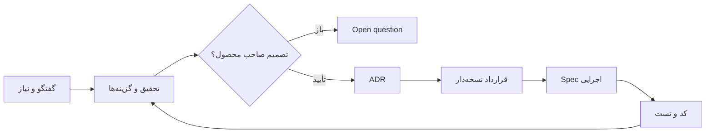

# SFP24 — Architecture Knowledge Base

> **Status:** در حال طراحی · **Type:** مستندات و تصمیم‌ها، نه کد اجرایی

این ریپازیتوری تاریخچه تفکر، چرایی تصمیم‌ها، مطالعات استاندارد و قراردادهای مشترک را برای هسته و ماژول‌های SFP24 نگه می‌دارد.

| نقطه شروع | لینک |
|---|---|
| مسیر مطالعه | [START-HERE](docs/START-HERE.md) |
| دستور واحد ایجنت‌ها | [AGENTS](AGENTS.md) |
| معماری هسته | [Core](docs/core/README.md) |
| قراردادها | [Contracts](docs/contracts/README.md) |
| طراحی ماژول‌ها | [Modules](docs/modules/README.md) |
| تصمیم‌های تصویب یا رد شده | [Decisions](docs/decisions/README.md) |
| سابقه و اتاق فکر | [Journal](docs/journal/README.md) |
| استانداردها و تحقیق | [Research](docs/research/README.md) |
| مشخصات اجرایی Codex | [Implementation](docs/implementation/README.md) |
| منشأ اسناد و کد | [Sources](docs/sources/README.md) |

**هشدار:** پیشنهاد، تصمیم مصوب و قابلیت پیاده‌شده سه وضعیت متفاوت‌اند.
