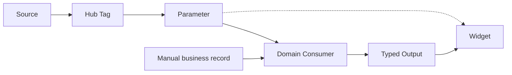

# Data Contract — Draft

> **Status:** Proposed · **Owner:** Core/Data · **Updated:** 2026-11-02

| لایه | معنای مسئولیت |
|---|---|
| Source/Adapter | اتصال و دریافت |
| Tag | مقدار typed با زمان، کیفیت، provenance و تاریخچه |
| Parameter | معنای شرکت، موضوع، واحد، منبع و تبدیل نسخه‌دار |
| Module record | ثبت عملیاتی با قواعد تخصصی |
| Computed output | شاخص دارای دامنه، بازه، روش و نسخه محاسبه |
| Display binding | نمایش مجاز، نه تغییر منبع رسمی عملیات |

ثبت دستی الزاماً Tag مصنوعی نیست. نبود داده مساوی صفر نیست. یک تگ می‌تواند چند مصرف‌کننده داشته باشد؛ انتخاب Widget نباید Source رسمی تولید را تغییر دهد. نوع زمان (gauge/interval/counter/event) و کیفیت داده باید صریح باشند.

[Sources: Work 11/12](../sources/README.md).
