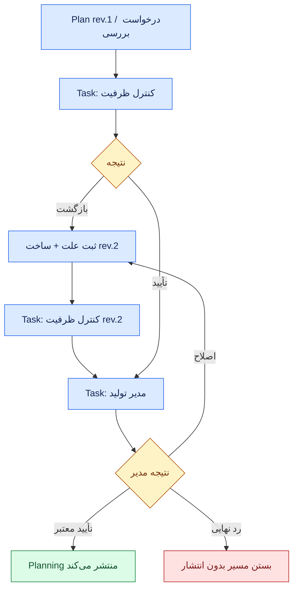
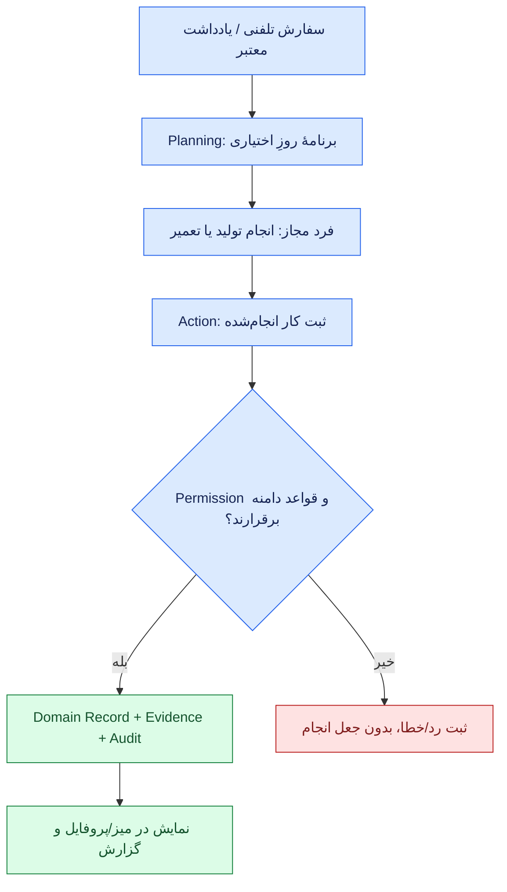

# قرارداد پیشنهادی تعامل ماژول‌های SFP24 — رکورد، اقدام، تصمیم، اعتبار، شاهد و بازیابی

> **Status:** Draft v0.1 · **Owner:** Core / cross-module boundaries · **Date:** 2026-11-05  
> **Authority:** **پیشنهاد فنی قابل نقد، نه تصمیم تأییدشده و نه API پیاده‌شده.** هیچ نام فیلد، enum، مسیر یا Schema این سند بدون ADR و تأیید صاحب محصول قراردادی برای کدنویسی نیست.  
> **Scope:** رفتار مشترک میان ماژول‌ها در یک Modular Monolith، همراه با مسیر توسعهٔ آینده. **نه طراحی همهٔ ماژول‌ها، نه Workflow/BPMN Engine، نه Message Broker، نه Plugin Runtime و نه موتور امضای قانونی.**  
> **Evidence:** [گزارش مستقلِ منتقل‌شده از سشن دیگر](../journal/2026-11-05/INDEPENDENT-ARCHITECTURE-REVIEW-SESSION.fa.md)، [طرح مبنای ۴۴ حوزه و ۱۸ سناریو](../journal/2026-11-05/CORE-OPERATIONS-UX-DESIGN-AND-REVIEW.fa.md)، [مرزهای معماری](../core/CANONICAL-BOUNDARIES.fa.md)، [سؤال‌های باز](../core/OPEN-QUESTIONS.md) و [وضعیت واقعی ساخت](../STATUS.fa.md).  
> **مرجع موضوعی موجود:** [Data Contract](DATA-CONTRACT-DRAFT.md)، [Module Contract](MODULE-CONTRACT-DRAFT.md)، [UI Contributions](UI-CONTRIBUTIONS-DRAFT.md)، [هویت](../core/IDENTITY-AND-ACCESS.fa.md)، [Source/Tag/Parameter](../core/DATA-AND-PARAMETERS.fa.md)، [Workspaces](../core/WORKSPACES.fa.md). این سند **فقط رفتار اتصال** را پیشنهاد می‌کند؛ تعریف Person، Tag، Parameter، UI Host یا Permission در سند مالک باقی می‌ماند.

## ۱. چرا این قرارداد لازم است؟

اگر کاربر از میز کار درخواست «تأیید برنامهٔ هفته» را بزند، شش سؤال باید جواب دقیق داشته باشد:

1. **موضوع دقیق چیست؟** کدام رکورد Planning و کدام نسخهٔ آن، در کدام شرکت؟
2. **چه کسی اقدام کرده است؟** هویت Account/Person واقعی، اختیار، سایت و در صورت وجود تفویض یا مسئولیت موقت.
3. **تصمیم متعلق به چه کسی است؟** خود Planning و Policy مرتبط؛ یا در مورد تعمیر، Maintenance/PTW؛ نه دکمهٔ میز.
4. **آیا شرایط هنوز معتبرند؟** تأیید برنامه یا Permit قبلی با تغییر شیفت، صلاحیت، تجهیز یا خطر ممکن است دیگر اجازهٔ انجام ندهد.
5. **اگر درخواست تکرار یا پاسخ گم شود چه می‌شود؟** ثبت دوباره یا فرض غلط شکست نباید ایجاد شود.
6. **ممیز بعداً چه چیزی می‌بیند؟** نسخهٔ موضوع، دلیل تصمیم، شواهد همان زمان و تاریخچهٔ تغییر، بدون ساخت تأیید صوری.

هدف قرارداد، **امکان تعریف پاسخ‌های قابل آزمون به این سؤال‌ها** است. اجزای این سند نباید صرفاً به دلیل «مشترک» بودن تبدیل به جدول مرکزی شوند.

### ۱.۱. حکم پیشنهادی دربارهٔ مالکیت

| داده یا رفتار | مالک نهایی تغییر وضعیت | نقش مجازِ زیرساخت مشترک |
|---|---|---|
| Plan و انتشار آن | Planning | احراز هویت/حق اقدام، ارتباط و پیگیری شواهد |
| Production Report و تعداد معتبر | Production | Context معتبر، مرجع typed، ثبت/حفاظت از سوابق |
| Maintenance Request و Work Order | Maintenance | ارتباط، Task/Decision در صورت نیاز و Audit |
| Stock Reservation / Inventory Movement | Inventory | درخواست/نتیجه/خطا؛ نه تعیین مانده یا انجام رزرو |
| Qualification | Training یا منبع صلاحیت معتبر | ارجاع و دسترسی مجاز؛ نه صدور صلاحیت |
| Permit / Suspension / Work Release | PTW/HSE | ثبت تصمیم و مرجع شرط؛ نه اعلام خودکارِ ایمن‌بودن |
| Test Result / Product Release | LIMS و Quality با مرز مشخص | دریافت نتیجه/شاهد؛ نه تفسیر آزمایش به‌جای صاحب دامنه |
| Task انسانی / Inbox | سرویس مشترک *اگر تصویب شود* یا مالک موقت ماژول | پیگیری اقدامِ انسانی، انتساب و موعد؛ **نه Domain State** |
| Desk، فرم، داشبورد، Profile، 3D | UI Host / توسعه‌دهندهٔ ماژول | نمایش مجاز و ارسال Action؛ نه ایجاد Permission/Ownership |

**وضعیت واقعی:** طبق اسناد قبلی، Production دارای کنترل نسخه/تراکنش و کار ثبت‌شده است، میز نسخه‌دار و قابل اختصاص ساخته شده، اما UI عمومی عملیاتی و چرخهٔ جهانی Workflow/Module SDK کامل نیست. این سند آن‌ها را «پیاده‌شده» اعلام نمی‌کند.

## ۲. واژگان و قرارداد مرزهای دامنه

### ۲.۱. Domain Record

رکوردی با هویت مستقل و مسئول تخصصی؛ مثال: `Plan`، `MaintenanceWorkOrder`، `QualityInspection`، `InventoryReservation`، `TrainingAssessment`. **Domain Record** به معنی یک کلاس/جدول سراسری که همهٔ رکوردها داخل آن ذخیره شوند نیست.

### ۲.۲. Action در برابر Task و Decision

- **Action:** درخواست اجرای یک عملیاتِ معنادار در ماژول صاحب رکورد؛ نتیجه می‌تواند فوری، ردشده، در انتظار یا برای درخواست‌دهنده نامعلوم باشد.
- **Task:** فعالیت انسانی که انجام‌دادنش از فرد یا گروهی انتظار می‌رود؛ ممکن است وجود نداشته باشد، با چند درخواست مرتبط باشد یا به Decision منتهی شود.
- **Decision:** نتیجهٔ بررسی/قضاوت روی موضوع و نسخهٔ مشخص تحت سیاست معتبر. ثبت Decision **به‌تنهایی** وضعیت تخصصی ماژول را تغییر نمی‌دهد.
- **Authorization:** «آیا Actor از نظر امنیت نرم‌افزار حق فراخوانی این Action را دارد؟» جدا از اینکه از نظر تخصصی صلاحیت دارد.
- **Validity:** «آیا پیش‌شرط‌های معتبر *در همین شرایط* برقرارند؟» ممکن است بعد از Decision قبلی تغییر کرده باشند.
- **Domain Outcome:** نتیجهٔ تخصصی اعمال‌شده توسط ماژول، مثلاً `stock_reservation_created` یا `permit_suspended`.

### ۲.۳. چه چیزهایی خودکار از هم نتیجه نمی‌شوند؟

`Tag value` ≠ خرابی اثبات‌شده؛ `Task completed` ≠ تجهیز سالم؛ `Approval recorded` ≠ اجازهٔ اجرای فعلی؛ `Module licensed` ≠ Module ready؛ `Desk assigned` ≠ Permission؛ `ACK received` ≠ فرمان فیزیکی با ایمنی اجرا شده؛ `Training completed` ≠ Qualification؛ `Evidence attached` ≠ انطباق اثبات‌شده.

## ۳. Typed Reference؛ مرجع زنده، نسخه‌دار و تاریخی

### ۳.۱. Envelope نامزد (نمونهٔ JSON توضیحی)

```json
{
  "ownerModule": "training",
  "entityType": "Qualification",
  "entityId": "qual-123",
  "tenantId": "tenant-A",
  "referenceMode": "revision",
  "revision": 7
}
```

این شکل قراردادِ **بین‌ماژولی** است؛ لزوماً شکل ذخیرهٔ فیزیکی کنونی یا کلید دیتابیس نیست. `tenantId` باید از زمینهٔ معتبر اتصال/سرور تأیید شود؛ حتی اگر در پیام وجود دارد، برای تغییر Tenant به محتوای ارسالی مرورگر اعتماد نمی‌کنیم.

### ۳.۲. سه الگوی خواندن

| نوع مرجع | برای چه استفاده می‌شود؟ | چه چیزی را **تضمین نمی‌کند**؟ |
|---|---|---|
| **live** | بررسی اعتبار **فعلی** صلاحیت، موجودی یا وضعیت تجهیز | معتبر بودن داده در لحظهٔ اجرای فیزیکیِ بعدی |
| **revision** | مشاهدهٔ نسخهٔ مشخصِ رکورد هنگام تصمیم قبلی | ادامهٔ اعتبار شرایط در زمان جدید |
| **evidence snapshot** | بازسازی مدارک ضروری هنگام ممیزی حتی اگر ماژول غیرفعال باشد | جایگزین کامل DB مالک یا دستیابی آزاد به داده‌های محرمانه |

پیشنهاد فنی: `DomainReference` شناسهٔ پایدار و مالک مشخص داشته باشد؛ `ResolvedReference` در پاسخ خود نسخه، زمان مشاهده، منبع و **وضعیت resolve** را نیز گزارش کند: `found`، `not_found`، `unavailable`، `access_denied` یا `retained_record`. مورد `not_found` با `unavailable` یکی نیست؛ برای کار حساس، هر دو ممکن است مانع اعتبارسنجی شوند ولی علتشان متفاوت است.

### ۳.۳. محدودیت مهم

اگر رابطهٔ تاریخی به Qualification نیاز داشته باشد، حذف/غیرفعال‌شدن Training نباید حقیقت تاریخیِ تصمیم PTW را جعل یا پاک کند. مرجع تاریخی، سند یا Snapshot حداقلیِ دارای نیاز قانونی/عملیاتی را حفظ می‌کند؛ **همهٔ دادهٔ Person/Training به PTW کپی نمی‌شود**. سیاست دسترسی، retention و داده‌های حساس باید در زمان Resolve و Export اعمال شوند.

## ۴. Action/Result؛ یک قرارداد برای تغییر معتبر، نه یک موتور جهانی عملیات

### ۴.۱. نمونهٔ درخواست (نمونهٔ فیلدها، بدون تعهد API)

```json
{
  "contractVersion": "draft.0.1",
  "requestId": "req-7001",
  "idempotencyKey": "inventory:reserve:wo-84:part-9:attempt-1",
  "correlationId": "wo-84",
  "action": "inventory.reserve",
  "subject": {
    "ownerModule": "inventory",
    "entityType": "StockItem",
    "entityId": "part-9",
    "tenantId": "tenant-A",
    "referenceMode": "live"
  },
  "expectedRevision": 12,
  "input": {
    "quantity": 1,
    "unit": "pcs",
    "purposeRef": {
      "ownerModule": "maintenance",
      "entityType": "WorkOrder",
      "entityId": "wo-84",
      "tenantId": "tenant-A",
      "referenceMode": "revision",
      "revision": 4
    }
  }
}
```

**امنیت:** Actor، نقش‌های مؤثر، Tenant جاری و حق اجرای Action از Session/Service Identity مورد اعتماد تعیین می‌شوند؛ JSON ارسالی کاربر نمی‌تواند با یک فیلد `actorId` خودش را مدیر جا بزند. روی پیام بین سرویس‌ها نیز هویت Service و زمینهٔ درخواست باید با مرز اعتماد مشخص اعتبارسنجی شوند.

### ۴.۲. نتیجه و خطا

```json
{
  "requestId": "req-7001",
  "status": "applied",
  "ownerModule": "inventory",
  "resultRef": {
    "ownerModule": "inventory",
    "entityType": "Reservation",
    "entityId": "res-90",
    "tenantId": "tenant-A",
    "referenceMode": "revision",
    "revision": 1
  },
  "resultRevision": 1
}
```

| Outcome قابل گزارش | معنای دقیق | رفتار مصرف‌کننده |
|---|---|---|
| `applied` | ماژول مالک تغییر را به‌طور پایدار اعمال کرده است | نتیجه را با شناسه/نسخه ذخیره یا مصرف کن؛ Action را تکراری اعمال نکن |
| `rejected` | ماژول مالک درخواست را با دلیل مشخص رد کرده است | علت را نشان بده؛ در صورت تغییر شرایط Action تازه |
| `conflict` | `expectedRevision` یا شرط هم‌زمانی برقرار نیست | دادهٔ تازه بگیر؛ خودسرانه Override نکن |
| `pending` | درخواست پذیرفته شده ولی هنوز پایان معتبر ندارد | با `requestId` وضعیت نهایی را استعلام کن |
| `unknown_to_caller` | پاسخی به درخواست‌دهنده نرسیده؛ ممکن است اعمال شده باشد | **همان شناسهٔ idempotency** را برای Retry/Status Inquiry استفاده کن؛ هرگز فرض شکست یا موفقیت نکن |

`unknown_to_caller` وضعیت **مشاهدهٔ مصرف‌کننده** است، نه لزوماً وضعیت ثبت‌شدهٔ Domain. در هر پاسخ باید نوع خطا از شرایطی مثل `permission_denied`، `module_unavailable`، `subject_missing`، `stale_revision`، `prerequisite_invalid`، `duplicate_key_payload_mismatch` و `retryable_failure` قابل تفکیک باشد. این رشته‌ها نامزدند، نه enum تأییدشده.

### ۴.۳. چهار قاعدهٔ غیرقابل حذف از بحث

1. **Idempotency:** یک `idempotencyKey` در محدودهٔ تعریف‌شده باید برای یک Actor/Action/Target و Payloadِ معادل فقط یک نتیجهٔ اثرگذار داشته باشد؛ همان کلید با Payload متناقض، خطای تعارض برگرداند. طول عمر کلید و نگهداری نتیجه باید متناسب با خطر هر عملیات تعریف شود.
2. **Optimistic concurrency:** در صورت داشتن `expectedRevision`، اعمال نتیجه روی نسخهٔ دیگر باید طبق قانون صاحب دامنه رد یا به بازبینی ارجاع شود؛ «آخرین نویسنده برنده است» برای تصمیم حساس مجاز نیست.
3. **Transaction ownership:** رزرو واقعی در تراکنش Inventory، ثبت تولید در تراکنش Production و آزادسازی محصول در Quality رخ می‌دهد؛ هیچ «تراکنش جهانی Task» وجود ندارد.
4. **Status recovery:** درخواست‌دهنده باید راهی برای پرسیدن «همان درخواست من چه سرنوشتی داشت؟» داشته باشد؛ قطع اتصال و Retry نباید یک عملیات دوم ناخواسته بسازد.

### ۴.۴. حد تضمین

اگر ماژول‌ها در یک DB/Process باشند، ممکن است Transaction Boundary مشترکِ محدود از نظر فنی ممکن باشد، ولی **به‌صورت قرارداد عمومی همهٔ ماژول‌ها فرض نمی‌شود**. در ارتباط بین سرویس‌ها، Transaction/Timeout/Compensation متفاوت است. Outbox و Inbox احتمالی فقط در کنار شناسهٔ پایدار و وضعیت صاحب عملیات مفیدند. **Exactly-once end-to-end** بدون محدودیت و آزمون خاص وعده داده نمی‌شود.

## ۵. Decision، Task و Workflow: رفتار قراردادی حداقلی

### ۵.۱. Decision Record پیشنهادی

```json
{
  "decisionId": "dec-55",
  "subject": {
    "ownerModule": "planning",
    "entityType": "Plan",
    "entityId": "plan-w42",
    "tenantId": "tenant-A",
    "referenceMode": "revision",
    "revision": 2
  },
  "policyId": "weekly-plan-review",
  "policyRevision": 3,
  "stepId": "production-manager-review",
  "taskId": "task-90",
  "actorPersonRef": "person-15",
  "outcome": "approved",
  "decidedAt": "2026-11-05T08:30:00Z",
  "reason": "Capacity verified",
  "evidenceRefs": []
}
```

در نسخهٔ اجرایی `actorPersonRef`، مسئولیت مؤثر و انتساب مجاز نباید فقط از متن ارسالی کاربر تعیین شوند. در بعضی حوزه‌ها `reason` برای رد یا اصلاح اجباری است؛ در حوزه‌های کم‌ریسک می‌تواند کوتاه‌تر باشد.

### ۵.۲. چه نتیجه‌هایی باید تمایز داشته باشند؟

| تصمیم/وضعیت | اثر پیشنهادی |
|---|---|
| `approved` | یک بازبین نتیجهٔ مثبت دربارهٔ همان نسخه ثبت کرده؛ **هنوز الزاماً به معنی انتشار، شروع یا ایمنی نیست** |
| `returned_for_changes` | همان درخواست به صاحب اصلاح برمی‌گردد؛ دلیل، نسخه و Task جدید مشخص باشند |
| `rejected_final` | مسیر فعلی رد شده؛ احیای بی‌ردپای همان Decision نامعتبر است |
| `cancelled` | درخواست/فرایند با علت توقف داده شده؛ از رد کیفی و انجام کامل متمایز است |
| `expired` | اعتبار زمانی یا شرط مقرر به پایان رسیده؛ تصمیم تاریخی پاک نمی‌شود |
| `suspended` | شرایط فعلی اجازهٔ ادامه نمی‌دهند؛ قواعد بررسی مجدد با دامنه است |
| `not_required` | طبق Policy معتبر، برای این Action مرحلهٔ تأیید لازم نیست؛ **رکورد ساختگی تأیید شخص از خودش ایجاد نشود** |

این جدول **یک enum جهانی برای همهٔ Domain Recordها نیست**؛ واژگان قابل بررسی برای Decision/Workflow هستند. وضعیت تخصصی PTW، Batch یا Work Order با این‌ها جایگزین نمی‌شود.

### ۵.۳. انتساب، کارتابل، تفویض و دسترسی

Task می‌تواند به فرد معین، گروه نامزد، موقعیت دارای مسئول مؤثر یا شرکت/سایت مربوط باشد، ولی باید **در لحظهٔ Claim/Decision، مجوز و انتساب معتبر شخص واقعی بررسی شود**. تفویض باید صاحب اختیار، محدوده، زمان آغاز/پایان، مجوز انجام، منع خودتأییدی در صورت لزوم و Audit مشخص داشته باشد.

یک شخص می‌تواند هم مسئول برنامه و هم تعمیرکار باشد؛ سیستم از عنوان شغلی به‌تنهایی استقلال یا تعارض منافع نتیجه نمی‌گیرد. اگر Policy اجازهٔ ثبت مستقیم دارد، مسیر بدون Task/Approval باشد. اگر فعالیت نیاز به بازبین مستقل دارد، همان شخص نمی‌تواند صرفاً به علت داشتن دو عنوان، شرط استقلال را دور بزند.

### ۵.۴. Approval ترتیبی و موازی



در این نمودار، تأیید ظرفیت برای `rev.1` نباید بدون کنترلِ مجدد روی `rev.2` معتبر فرض شود. جهت اختصار، شاخهٔ تأیید از `C` فقط مربوط به همان نسخهٔ جاری است؛ نمونهٔ اجرایی باید اتصال شناسهٔ Task/Revision را به‌طور دقیق ثبت کند.

برای موازی‌بودن، تعریف فرایند باید بتواند `all_required`، `any_one_of_eligible_group` یا تعداد `quorum` را مشخص کند؛ با قواعد جلوگیری از رأی تکراری یک Person و وضعیت تعویض مسئول. در PTW ممکن است «دو نفر از سه نفر» **اصلاً مجاز نباشد**؛ این قاعده را فقط دامنهٔ مربوط تأیید می‌کند.

## ۶. Validity: مسئلهٔ بحرانیِ تأیید در شرایط متغیر

### ۶.۱. چرا Subject Revision کافی نیست؟

`permit-17 rev.4` ساعت ۹ تأیید می‌شود. ساعت ۱۰ صلاحیت شخص منقضی، شیفت تغییر یا وضعیت ایزولاسیون تجهیز نامعتبر می‌شود. خودِ Permit هنوز `rev.4` است؛ پس صرف تطابق `subject.revision` نتیجهٔ غلط می‌دهد.

### ۶.۲. Validity Dependency پیشنهادی

برای **Action حساس و فقط به میزان موردنیاز**، دامنه فهرستی از شرط‌ها معرفی می‌کند:

| شرط نمونه | مرجع معتبر | چه چیزی برای تصمیم ثبت شود؟ |
|---|---|---|
| صلاحیت فرد برای کار معین | Training یا روش معتبر جایگزین | شخص، فعالیت، زمان/دامنه، مرجع نسخه‌دار و expiry |
| کنترل شرایط خطر | PTW/HSE و کنترل واقعی محل | محدودهٔ تجهیز/مکان/بازه، روش کنترل، زمان ارزیابی و نتیجه |
| برنامهٔ منتشرشده | Planning | `PlanRevision` و تاریخ اثر |
| موجودی رزروشده | Inventory | شناسهٔ Reservation و وضعیت فعلی آن |
| اعتبار ابزار آزمایش | Calibration | شناسهٔ ابزار، وضعیت و دامنهٔ گواهی در زمان آزمون |
| تأیید مستقل | Decision Service (اگر ساخته شود) | شناسهٔ تصمیم، Subject Revision، Policy Revision و استقلال Actor |

### ۶.۳. نتیجهٔ بررسی اعتبار

```json
{
  "status": "requires_recheck",
  "checkedAt": "2026-11-05T09:05:00Z",
  "subjectRevision": 4,
  "policyRevision": 3,
  "reasons": [
    "worksite_conditions_changed",
    "isolation_state_not_reconfirmed"
  ]
}
```

وضعیت‌های پیشنهادشده: `valid_now`، `requires_recheck`، `invalid` و `indeterminate`. در اقدام حساس، `indeterminate` به معنی «مجاز» نیست. در اطلاعات مدیریتی کم‌ریسک، رفتار متفاوت ممکن است بر اساس Policy انتخاب شود؛ اما تفاوت باید صریح باشد.

**قانون پیشنهادی:** وقتی پیش‌شرط مؤثر تغییر کرد، تاریخچهٔ Approval پاک نمی‌شود؛ صاحب عملیات می‌تواند **اثر اجرایی** را معلق یا نیازمند بررسی مجدد کند. Core معنای خطر، صحت ایزولاسیون یا روش کالیبراسیون را حدس نمی‌زند.

### ۶.۴. مشکل فاصلهٔ بررسی تا اجرا (TOCTOU)

حتی اگر سرویس ساعت ۹:۰۵ یک شرط را `valid_now` ببیند، نمی‌تواند بدون قید تا ساعت ۱۰ آن را معتبر بداند. تا حد امکان بررسی شرط محلی و انتقال وضعیت باید در مرز اتمیکِ ماژول انجام شود؛ برای شرط بیرونی، Snapshot زمان‌دار، TTL، رویداد ابطال، استعلام مجدد یا قرارداد رزرو/قفل تخصصی ممکن است لازم باشد. **هیچ بررسی نرم‌افزاری میان چند ماژول، اتمیک‌بودن وضعیت فیزیکی را تضمین نمی‌کند.** OT Interlock/کنترل واقعی ایمنی همچنان مرجع است.

### ۶.۵. تغییر سیاست، زمان و گردش باز

نمونهٔ Workflow باید به `workflowDefinitionRevision` و `policyRevision` مربوط باشد. تغییر تعریف در نیمهٔ کار، به‌صورت پیش‌فرض مراحل قبلی را بازنویسی نمی‌کند. سه مسیر **ادامه با نسخهٔ قبلی، مهاجرت آگاهانه و ثبت‌شده، یا توقف/بازبینی** نامزد هستند؛ انتخاب برای هر نوع فرایند باید با خطر و سازگاری تعیین شود.

## ۷. Typed Ports، رویداد و بازیابی

### ۷.۱. دو مسیر متفاوت

**Command/Request-Response:** وقتی مالک دامنه باید درخواست عملی دریافت و نتیجه مشخص بدهد؛ مثال `Inventory.Reserve`.

**Domain Event:** وقتی تغییر دامنه‌ای *قبلاً به‌طور معتبر ثبت شده* و مصرف‌کنندگان باید مطلع شوند؛ مثال `Inventory.ReservationCreated`. Event نباید به‌جای درخواست امنیتی اجرا یا اجازهٔ فیزیکی استفاده شود.

### ۷.۲. Event Envelope پیشنهادی

```json
{
  "eventId": "evt-100",
  "eventType": "inventory.reservation_created",
  "eventVersion": 1,
  "ownerModule": "inventory",
  "tenantId": "tenant-A",
  "aggregateRef": {
    "ownerModule": "inventory",
    "entityType": "Reservation",
    "entityId": "res-90",
    "tenantId": "tenant-A",
    "referenceMode": "revision",
    "revision": 1
  },
  "occurredAt": "2026-11-05T09:10:00Z",
  "correlationId": "wo-84",
  "causationRequestId": "req-7001",
  "payload": {
    "status": "reserved"
  }
}
```

**حریم و امنیت:** محتویات Event نباید به‌طور پیش‌فرض پروندهٔ محرمانه/مدارک شخصی حمل کنند. Event ID و ref برای استعلام مجاز ترجیح دارند. `occurredAt` باید از زمان واقعی/ثبت‌شدهٔ دامنه قابل تشخیص باشد؛ برای دادهٔ دستگاهی تمایز `observedAt` و `receivedAt` نیز به [Data Contract](DATA-CONTRACT-DRAFT.md) ارجاع می‌شود.

### ۷.۳. تضمین و شکست

- منتشرکننده باید نگذارد Event موفقیت پیش از Commit واقعی رکورد به‌عنوان خبر قطعی منتشر شود.
- مصرف‌کننده باید Event تکراری را با `eventId` یا کلید مؤثر تشخیص دهد و با نسخه/ترتیبِ حوزه‌ای درست رفتار کند.
- `at-least-once` یا `best-effort` باید صریح انتخاب شود؛ تضمین ساختگی `exactly-once` عمومی ممنوع است.
- در قطع ارتباط، امکان `pending retry`، `dead-letter/manual intervention` یا بازیابی قابل ممیزی لازم است؛ روش ذخیره/صف برحسب نیاز انتخاب می‌شود.
- عملیات چندماژولی بدون Transaction مشترک، با **سیاست جبران اختصاصی** کار می‌کنند. مثلاً رزرو قطعه پس از شروع مصرف فیزیکی ممکن است دیگر قابل لغو نباشد؛ جبران «همیشه rollback کن» نیست.

## ۸. Evidence، Audit و اعتبار تاریخی

### ۸.۱. حداقل ارتباط پیشنهادی

```json
{
  "evidenceId": "ev-9",
  "kind": "calibration_certificate",
  "ownerModule": "calibration",
  "subjectRef": {
    "ownerModule": "lims",
    "entityType": "TestResult",
    "entityId": "test-18",
    "tenantId": "tenant-A",
    "referenceMode": "revision",
    "revision": 2
  },
  "documentRevision": 3,
  "capturedAt": "2026-11-05T08:20:00Z",
  "contentDigest": "sha256:EXAMPLE_ONLY_NOT_A_REAL_HASH"
}
```

این مثال فقط نشان می‌دهد **چه رابطه‌ای لازم است**؛ هیچ Evidence Store یا Hash و Signature Engine آماده‌ای با آن اثبات نمی‌شود. در بعضی فعالیت‌های ساده، شاهد ممکن است توضیح و زمان باشد؛ در بعضی عملیات کنترل‌شده، مدرک تغییرناپذیر، نسخهٔ دقیق یا امضا لازم می‌شود. روش نگهداری و محرمانگی باید با الزامات واقعی هر حوزه انتخاب شود.

**Audit** می‌گوید چه کسی چه تغییری در سیستم ثبت کرد. **Evidence** نشان می‌دهد تصمیم یا نتیجه بر چه مدرکی استوار بوده است. یکی جای دیگری را نمی‌گیرد. یک `Audit event` خودبه‌خود امضای قانونی یا تأیید کیفیت نیست.

### ۸.۲. اصلاح مدرک و انقضای آن

اگر گواهی کالیبراسیون بعداً نامعتبر شناخته شد، نباید گواهی‌ای که در زمان آزمون استفاده شده بی‌ردپا حذف شود. باید وضعیت فعلی و سند تاریخی قابل تشخیص باشند و ماژول صاحب نتیجه بررسی کند آیا آزمون‌های قبلی باید دوباره ارزیابی شوند. در برخی حوزه‌ها قواعد زمان نگهداری و امضا تابع مقررات یا قرارداد مشتری‌اند؛ هسته نباید یک قانون جهانی اختراع کند.

## ۹. Module Lifecycle و UI Boundary — قیدهای مشترک مرتبط

### ۹.۱. غیرفعال‌سازی و نسخه

پیشنهاد: `licensed`، `enabled`، `ready` و `compatible` چهار شرط مفهومی متفاوت باشند. `moduleRelease`، `portContractVersion`، `dataSchemaRevision`، `companyPolicyRevision` و `workflowDefinitionRevision` نیز یکی نیستند.

هنگام غیرفعال‌سازیِ ماژول:
- Action تازهٔ وابسته به آن نباید بدون تصمیم معتبر اجرا شود.
- سوابق تاریخی و Evidence طبق Retention/Authorization قابل بازیابی باشند؛ حذف خودکار ممنوع.
- نمونه‌های Workflow باز باید **continue/pause/migrate** با سیاست مشخص داشته باشند؛ اجرای نامحدود بر ماژول خاموش فرض نمی‌شود.
- اگر صاحب رکورد در دسترس نباشد، `live resolve` می‌تواند `unavailable` شود؛ `historic evidence` لازم باید با مسیر مجاز حفظ شود.
- تغییر نسخهٔ قرارداد پورت باید تکلیف مصرف‌کنندهٔ قدیمی، دورهٔ سازگاری و Migration را روشن کند.

**این‌ها نامزد رفتار قراردادند؛ هیچ Runtime نصب مستقل یا Rollback عمومی فعلاً تعهد داده نمی‌شود.**

### ۹.۲. اتصال Form / Desk / Dashboard / Profile / 3D

نمای کاربر باید از **Query/Action Provider محدود به Scope** استفاده کند:
- Form معمولی `data schema` و `UI schema` دارد؛ شروط مهم سرور را نمی‌توان با حذف فیلد از فرم دور زد.
- فرم تخصصی می‌تواند Renderer مستقل و منطق Backend مالک ماژول داشته باشد.
- Desk چیدمان مجازِ Contributionهاست؛ حساب یا حق دسترسی جدید ایجاد نمی‌کند.
- Dashboard به Parameter/Metric/Domain Query معتبر متصل می‌شود؛ Graph یا Widget فرمول رسمی OEE را اختراع نمی‌کند.
- Profile Extension اطلاعات همان Person/Resource/Order را با مالکیت موجود نشان می‌دهد؛ کپی رکورد دوم نمی‌سازد.
- صفحهٔ تخصصی، ابزار Gantt یا LIMS و نمای سه‌بعدی باید از همان قواعد Authorization و دادهٔ مجاز استفاده کنند.
- Export و Search **همان محدودیت‌های دسترسی** UI و API را رعایت کنند.

این بند تکمیل قرارداد [UI Contributions](UI-CONTRIBUTIONS-DRAFT.md) را مطرح می‌کند؛ مشخصات Widget Registry یا Desk Builderِ فعلی را بازنویسی نمی‌کند.

## ۱۰. نمونهٔ اجرایی کامل از کارگاه کوچک تا کارخانهٔ پیچیده

### ۱۰.۱. کارگاه پویشگر؛ ثبت مستقیمِ بدون Approval صوری



**اصل:** ثبت نتیجه و مدرک لازم است، ولی Task ارجاع به خود یا خودتأییدیِ نمایشی لازم نیست مگر Policy فعالیت و الزامات واقعی ایجاب کند. «تعمیر ثبت شد» با «شرایط ایمنی برای همهٔ کارها تأیید شد» یکسان نیست.

### ۱۰.۲. برنامهٔ چندمرحله‌ای، اصلاح و انتشار

- Planning `Plan rev.1` را می‌فرستد؛ Task بررسی ظرفیت برای مسئول ایجاد می‌شود.
- مسئول «برگشت برای اصلاح» با دلیل می‌دهد؛ Decision قبلی محفوظ است.
- Planning `rev.2` می‌سازد؛ Task تازه برای مسئول ظرفیت و سپس مدیر تولید باز می‌شود.
- فقط پس از جمع‌شدن تصمیم‌های معتبر در policy همان نسخه، Planning می‌تواند نسخهٔ مصوب را منتشر کند.
- Production از نسخهٔ منتشرشده برای ساخت برنامهٔ شیفت استفاده می‌کند؛ تکمیل Task مدیر مستقیماً خط تولید را روشن نمی‌کند.

### ۱۰.۳. PTW؛ تصمیم تاریخیِ مثبت ولی اجازهٔ فعلیِ نامعتبر

- برای تعمیر `WO-84`، PTW نسخهٔ ۴ با دو تأیید مستقل صادر شده است.
- تغییر شیفت/شرایط کار طبق Policy PTW به‌عنوان تغییر مؤثر شناسایی می‌شود.
- Decisionها پاک نمی‌شوند؛ `Validity` در اجرای فعلی `requires_recheck` یا `invalid` است.
- سیستم نمی‌تواند صرفاً به این دلیل که `approved = true` است ادامهٔ کار پرخطر را مجاز کند.
- پس از ارزیابی واقعی خطر، احراز کنترل‌ها و صدور مجوز معتبر در دامنهٔ مربوط، اجازهٔ ادامه بررسی می‌شود؛ ضمانت ایمنی فیزیکی خارج از یک Approval نرم‌افزاری است.

### ۱۰.۴. رزرو قطعه با گم‌شدن پاسخ

- Maintenance برای آخرین قطعهٔ انبار، `req-7001` را می‌فرستد.
- Inventory با تراکنش/کنترل هم‌زمانی خودش فقط یک رزرو معتبر ایجاد می‌کند.
- پاسخ در شبکه گم می‌شود: Maintenance نتیجه را `unknown_to_caller` می‌بیند.
- Retry/Status Inquiry با **همان idempotency key**، نتیجهٔ `res-90` را برمی‌گرداند؛ قطعهٔ دوم رزرو نمی‌شود.
- اگر مصرف واقعی از رزرو شروع شده باشد، لغو برنامه به معنی مجازبودن لغوِ بی‌قید رزرو نیست؛ تصمیم با Inventory است.

## ۱۱. آزمون‌های پذیرش قراردادی؛ قبل از واگذاری به Codex

| شناسه | آزمون | شرط پذیرش |
|---|---|---|
| **AT-01** | کارگاه تک‌نفره، ثبت تعمیر مجاز | رکورد و شاهد و Audit معتبر؛ **بدون Task/Approval مصنوعی** |
| **AT-02** | فرد با دو مسئولیت اما منع خودتأییدی | اگر Policy استقلال لازم دارد، همان Person نتواند با تغییر عنوان/Desk شرط را دور بزند |
| **AT-03** | Plan rev.1 رد و rev.2 ارسال | Decision قدیم روی rev.1 بماند؛ rev.2 باید مسیر معتبر خودش را طی کند |
| **AT-04** | دو تأیید موازی | قاعدهٔ `all_required` یا quorum فقط یک بار و با هویت افراد مجاز اعمال شود |
| **AT-05** | PTW تأییدشده و بعد تغییر شیفت/شرایط | تصمیم تاریخی باقی بماند؛ Action حساس تا بررسی معتبرِ شرایط متوقف شود |
| **AT-06** | شرایط بیرونی در لحظهٔ بررسی در دسترس نیست | برای Action حساس `indeterminate` به معنی اجازهٔ اجرا نباشد |
| **AT-07** | ارسال دوبارهٔ ReserveStock با همان کلید | فقط یک اثر و یک نتیجهٔ پایدار؛ Payload متناقض خطای مشخص |
| **AT-08** | دو درخواست هم‌زمان برای یک موجودی | Inventory با تراکنش تخصصی دقیقاً از بیش‌رزرو جلوگیری کند؛ Workflow کافی نیست |
| **AT-09** | پاسخ گم‌شده بعد از Commit | Status inquiry/Retry بی‌خطر، نتیجهٔ قبلی را برگرداند؛ نه False Failure |
| **AT-10** | رویداد تکراری و دیررس | مصرف دوبارهٔ بی‌اثر؛ انتشار رویداد قبل از ثبت موفق قابل قبول نباشد |
| **AT-11** | غیرفعال‌سازی Training با PTW تاریخی | مرجع زنده ممکن است unavailable شود؛ شاهد تاریخیِ لازم با Scope مجاز باقی بماند |
| **AT-12** | ارتقای Contract/Workflow وسط نمونهٔ باز | اجرای قدیمی به‌طور پنهانی روی تعریف جدید تفسیر نشود |
| **AT-13** | Dashboard/Export با Scope محدود | ممنوعیت خواندن دادهٔ شرکت، سایت یا پروندهٔ نامجاز در API نیز اعمال شود |
| **AT-14** | نتیجهٔ آزمایش با گواهی کالیبراسیون نامعتبر | Task می‌تواند کامل باشد ولی Quality Release بدون نتیجهٔ معتبر صادر نشود |
| **AT-15** | فرمان OT با ACK اما بدون Observation | پاسخ «اجرا/امن تأییدشده» جعل نشود؛ وضعیت نامعلوم/نیازمند بررسی باشد |
| **AT-16** | Formula/OEE با Parameter ناقص | نبود داده مساوی صفر نشود؛ روش/نسخه/بازه و کیفیت خروجی قابل توضیح باشد |
| **AT-17** | ماژول اختصاصی فقط صفحهٔ LIMS اضافه می‌کند | بدون دست‌کاری غیرمجاز Shell و بدون دسترسی بی‌قید، Contribution صفحه/Action ارائه شود |
| **AT-18** | قطع سرویس بین دو ماژول و لغو درخواست | هیچ تراکنش جهانیِ فرضی ساخته نشود؛ مسئول جبران/بازیابی و نتیجهٔ نهایی معلوم باشد |

**مرز شواهد:** این‌ها **Test Specification پیشنهادی** هستند؛ گزارش پاس‌شدن تست نیستند. AT-08، AT-14، AT-15 و موارد مشابه ممکن است تا ساخته‌شدن ماژول مربوط تنها به شکل Contract Test با Fake/Stub قابل بررسی باشند؛ از Mock نمی‌توان نتیجه گرفت Inventory، LIMS یا PLC واقعی پیاده شده‌اند.

## ۱۲. تصمیم‌های باز که باید به صاحب محصول ارائه شوند

موضوعاتی که فنی‌اند باید ابتدا با بررسی شواهد و گزینه‌ها توسط معمار پاسخ داده شوند؛ صاحب محصول لازم نیست برای جزئیات بدون گزینه تصمیم تصادفی بگیرد.

| ID پیشنهادی | تصمیم باز | پیش‌فرض پیشنهادی تا زمان بررسی | اثر اگر عوض شود |
|---|---|---|---|
| **D-01** | شکل `DomainReference` و نحوهٔ Resolve | مرجع typed به مالک مشخص + live/revision/evidence | مهاجرت ارجاعات و گزارش‌های گذشته |
| **D-02** | تعریف Action Result و بازیابی | Outcome/Reason پایدار + idempotency مطابق ریسک | سازگاری API و جلوگیری از تکرار اثر |
| **D-03** | Validity و زمان/منبع شرط | بررسی در مالک دامنه؛ `indeterminate` در کار حساس مجاز نیست | امنیت و مجوزهای عملیاتی |
| **D-04** | Workflow و Task مشترک چقدر باشد؟ | فقط قرارداد و State Machine محدود؛ بدون BPMN Engine فراگیر | Runtime و UI کارتابل |
| **D-05** | شواهد تاریخی و Retention | حداقل دادهٔ لازم برای بازسازی تصمیم؛ بدون Snapshot نامحدود | حریم، هزینه، ممیزی |
| **D-06** | ارتباط و Delivery | Request/Response + Event با نسخه؛ Outbox/InBox فقط در صورت اثبات نیاز | دیتابیس، خطا و سازگاری |
| **D-07** | Module Disable/Upgrade در فرایندهای باز | توقف قابلیت تازه + حفظ سوابق + سیاست هر Workflow | Migration و استقرار |
| **D-08** | مرز امنیت UI و Query | API/Export حتماً Scoped و Server-validated | نشت داده و تجربهٔ کاربر |

## ۱۳. نقشهٔ انتقال به طراحی/کد — بدون تغییر خارج از اختیار

۱. **بازبینی همین Draft** روی کد واقعی و سه سناریوی بحرانی: PTWِ متغیر، Inventory با Retry و مرجع تاریخی Training/Quality. هر ادعا با `Observed / Proposed / Confirmed gap / Unknown` مشخص شود.

۲. **ثبت گزینه و تصمیم‌های تأییدشده در ADR** طبق [سیاست اسناد](../governance/DOCUMENTATION-POLICY.md)؛ تا آن زمان این فایل فقط پیشنهاد است.

۳. **اصلاح حداقلی اسناد مالک** بعد از تصویب: [Data Contract](DATA-CONTRACT-DRAFT.md)، [Module Contract](MODULE-CONTRACT-DRAFT.md) و [UI Contributions](UI-CONTRIBUTIONS-DRAFT.md) فقط برای بخش‌های متعلق به خودشان تغییر کنند؛ تعریف موازی در ماژول‌ها ساخته نشود.

۴. **مشخصات اجرایی هر بخش برای Codex** با فایل/ماژول هدف، رفتار موجود قابل حفظ، Migration، آزمون پذیرش، Rollback/Recovery و محدودیت تغییر ایجاد شود؛ هیچ دستور کلی «Core را بازنویسی کن» کافی نیست.

۵. **پیاده‌سازی مرحله‌ای پس از مجوز جداگانهٔ اجرا**. اجرای مرحلهٔ اول ممکن است تنها Action Envelope و DomainRef در مرز فعلی Product باشد؛ تصمیم اجرا از نگارش Draft نتیجه نمی‌شود.

### جمع‌بندی دقیق

این سند یک گام از «اسم مفاهیم» به «رفتار قابل سنجش» است؛ اما هنوز نباید آن را Contract v1 یا تصمیم تصویب‌شده نامید. **بزرگ‌ترین ریسک‌های طراحی**: استفاده از Approval قدیمی در شرایط تازه، گم‌شدن پاسخ و اجرای دوباره، و ازبین‌رفتن مرجع تاریخی. **هیچ‌کدام به معنی اثبات وجود باگ بحرانی در کد کنونی یا نیاز به بازنویسی فوری هسته نیستند.**
