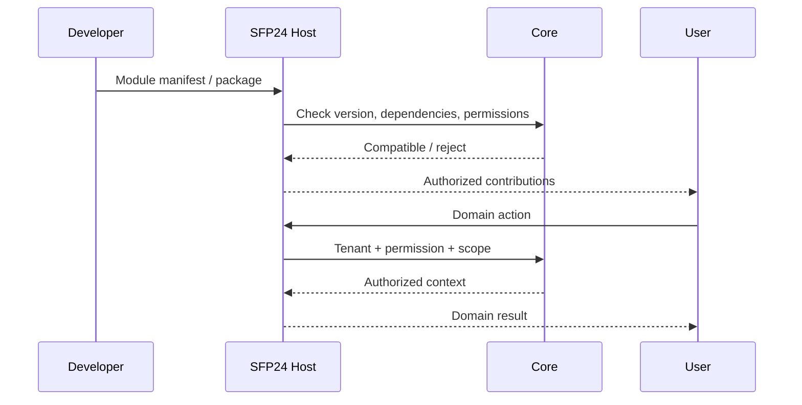

# Module & Capability Contract — Draft

> **Status:** Proposed, not implemented as universal SDK · **Owner:** Core · **Updated:** 2026-11-02

| حوزه | انتظار از قرارداد |
|---|---|
| Identity | ID، version، coreApi compatibility، dependencies |
| Ownership | Domain data، schema/migration، retention و disable |
| Security | Tenant، entitlement، permission، scope، actor |
| Contributions | Page، profile section، form/action، widget |
| Ports | Typed inputs/outputs، service API و events |
| Lifecycle | Install/upgrade، health، error و rollback |
| Verification | Tenant isolation، API authorization، backward compatibility |

JSON Manifest به‌تنهایی logic، database، UI یا کنترل امن نمی‌سازد. اجرای کد دلخواه مشتری هم‌ارز انتشار ماژول مورد اعتماد نیست. SDK/نصب و توزیع هنوز تصمیم اجرایی ندارد.
