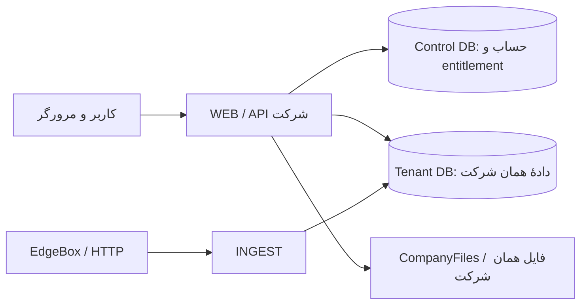

# معماری موجود و مرزهای پلتفرم

**وضعیت: Observed در کد b3f203b، بازبینی اسناد ۲۰۲۶-۱۱-۰۲.** این صفحه وضعیت موجود را توضیح می‌دهد؛ [مرزبندی هدف](CANONICAL-BOUNDARIES.fa.md) و SDK پیشنهادی هنوز تصمیم اجرایی نیستند.

## ساختار کلی

WEB رابط Vue/Three.js و API حساب‌ها و عملیات را در بر می‌گیرد. INGEST فرایند مستقل دریافت HTTP و نگهداری/پردازش بسته‌هاست. جدایی فرایند، استقلال از قطع دیتابیس tenant نیست. ساختار کسب‌وکار فعلاً modular monolith است؛ Plugin Engine یا microservice مستقل برای هر ماژول نداریم.

## هر بخش مالک چه چیزی است؟

| بخش کد | مسئولیت |
|---|---|
| src/App.vue، SceneView.vue و workspace | پوسته، صحنه و تجربهٔ نمایش |
| src/accounts و server/platform | ورود/نشست، شرکت، ظرفیت، خرید قابلیت و provision |
| src/company و server/operations | تعاریف، پارامتر، کار/تولید/گزارش و scope |
| src/telemetry و server/telemetry | مدیریت منبع، تگ، ویزارد و کنترل دریافت |
| services/ingest/edgebox و http-channels | HTTP جاری؛ دریافت، raw، پردازش و نمای تست |
| packages/telemetry-contract | snapshot واحد قرارداد صنعتی؛ [محدودهٔ اعتبار](../contracts/README.md) |
| external-simulator/v1 و v2 | ابزار خارجی ارسال HTTP؛ بدون وابستگی به WEB/DB |

## ذخیره و هویت

دیتابیس مرکزی از دیتابیس عملیاتی هر شرکت جداست. اشتراک پایگاه دادهٔ خام و عملیاتی در یک tenant، مجوز دسترسی بین شرکت‌ها یا نگارش بی‌قرارداد جدول‌های ماژول دیگر نیست. اتصال معتبر از actor سرور می‌آید، نه نام دیتابیس ارسالی مرورگر. [تعریف و قواعد هویت](IDENTITY-AND-ACCESS.fa.md).

فایل‌های شرکت زیر CompanyFiles با UUID شرکت قرار می‌گیرند؛ telemetry/sources و library/models دو مسیر موجودند. vault، کلید رمزگذاری و دیتابیس اجزای مستقل بازیابی‌اند. [راهنمای فایل‌ها و اجرا](../operations/README.md).

## رشد با ماژول

ماژول مالک اعتبارسنجی، داده و عملیات تخصصی خودش است. هسته هویت/دسترسی و مسیرهای موجود ثبت صفحه/تعریف را فراهم می‌کند. تغییر مجاز مشترک، scope و آزمون لازم دارد. نگارش مستقیم جدول دامنهٔ دیگر، هویت تکراری و بازنویسی پوسته برای هر قابلیت، راه اتصال پیش‌فرض نیستند. **قرارداد عمومی نصب ماژول هنوز ساخته نشده است.**

| موجود | پیشنهاد آینده |
|---|---|
| registryهای قابل اعتماد داخل کد، سرویس‌های TypeScript، دیتابیس tenant، کنترل مجوز API | Module SDK، contribution عمومی، event/task مشترک و lifecycle نصب مستقل |

جزئیات [داده](DATA-AND-PARAMETERS.fa.md)، [گسترش تعریف](EXTENSIONS.fa.md)، [میزها](WORKSPACES.fa.md) و [آموزش](../modules/training/README.md) در مرجع خودشان نگهداری می‌شوند.

## منبع

[متن کامل معماری مبنا](../source-material/work-12/docs/ARCHITECTURE.md) و [کد ثابت](https://github.com/hossein-aghaie/pouyeshgar-workshop/tree/b3f203bc74fe9ef92f6d0ef290fee44fb6a1932f). نسخه‌های lab، demo و قرارداد candidate را با Runtime جاری یکی ندانید. [وضعیت محصول](../STATUS.fa.md).
