# مرزهای معماری هسته و دامنه‌های تخصصی

> **Status:** Proposed synthesis, not an approved SDK · **Updated:** 2026-11-02

## حکم طراحی
Core باید قابلیت‌های عمومی و سیاست دسترسی مشترک را فراهم کند؛ Domain modules باید معانی عملیاتی خودشان را مالک باشند. این مرزبندی باید با حداقل یک ماژول واقعی جداگانه تست شود و تنها با عنوان «آینده‌نگر» نهایی نمی‌شود.

| Core candidate | Module owner | خطای رایج |
|---|---|---|
| Person/Account/Tenant + scoped assignments | Skill Evidence, Training enrollment | Person دوم برای هر ماژول |
| Authorization / entitlement / audit | OEE formulas and policies | تبدیل Job Title به Permission |
| Typed measurement envelope and provenance | رسمی‌سازی تولید، OEE، نیاز مواد | فرض اینکه هر Tag یک KPI است |
| UI host + contribution points | تخصصی‌کردن فرم/داشبورد ماژول | موتور فرم‌ساز همه‌چیزدان |
| Module registry + compatibility | Migration و عملیات تخصصی ماژول | فقط manifest بدون logic |
| Cross-module typed ports | Event interpretation/domain action | دسترسی مستقیم به دیتابیس ماژول دیگر |

```mermaid
flowchart TB
 subgraph PLATFORM["SFP24 Shared Platform"]
  ID["Identity & Tenant"]
  AUTH["Permission & Scope"]
  DATA["Typed Data & Provenance"]
  UI["UI Host / Contributions"]
  REG["Module Contract / Versioning"]
 end
 subgraph DOMAIN["Independent Domain Ownership"]
  P["Production"]
  T["Training"]
  O["OEE"]
  M["Maintenance"]
  PL["Planning"]
  MR["MRP"]
 end
 REG --> DOMAIN
 DATA --> DOMAIN
 AUTH --> UI
 DOMAIN --> UI
 DOMAIN --> REG
```

## تفاوت هدف و وضعیت موجود
کد فعلی به‌طور کامل از Core و ماژول‌های منتشرشونده مستقل تفکیک نشده است. **این صفحه توصیف ساختار هدف و دغدغه مرزهاست**. جزئیات آزمون/پیاده‌سازی جدید نیاز به بازبینی کد واقعی دارد.

## سؤال آزمون‌کننده
آیا می‌توانیم Training یا OEE را با قرارداد موجود به میز کار، Profile، Permission و داده متصل کنیم بدون شرط اجباری Production و بدون Patch کردن Core برای هر feature متعارف؟ اگر نه، شکل دقیق محدودیت باید ثبت و درباره اصلاح قرارداد تصمیم‌گیری شود.

[هویت](IDENTITY-AND-ENTITLEMENTS-AUDIT.fa.md) · [داده](DATA-AND-EXTENSIONS-AUDIT.fa.md) · [Open Questions](OPEN-QUESTIONS.md).
