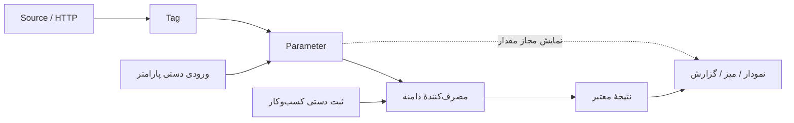

# منبع، تگ، پارامتر و مصرف داده

**مرجع موضوعی؛ رفتار موجود ب3f203b از قرارداد عمومی پیشنهادی جداست.** هدف، حفظ معنا و منشأ داده هنگام ورود دستی، سنسوری یا ترکیبی است.

| مفهوم | مسئولیت |
|---|---|
| Source / Adapter | اتصال و دریافت از دستگاه/درگاه؛ identity و credential منبع |
| Tag | هویت فنی سیگنال با نوع، زمان، جهت و کیفیت/منشأ قابل دسترس |
| Parameter | دادهٔ قابل استفادهٔ شرکت، موضوع، واحد، منبع/تبدیل و نسخه |
| Consumer / Module record | قواعد تخصصی استفاده، مثل گزارش رسمی تولید و حل تعارض |
| Computed output | نتیجهٔ محاسبه با دامنه، روش، نسخه و بازهٔ معلوم |
| Display binding | انتخاب نمایش مجاز؛ تغییر منبع رسمی گزارش نیست |

## مسیرهای داده

ثبت دستی گزارش نیاز به Tag مصنوعی ندارد. نرسیدن داده صفر نیست؛ قطع ارتباط مساوی خاموشی یا توقف فیزیکی دستگاه نیست. شمارندهٔ خام به‌تنهایی شخص، قطعه، OP یا تعداد سالم را اثبات نمی‌کند.

## سه محور متفاوت

| محور | مثال |
|---|---|
| نوع و واحد | integer، number، string، boolean؛ pcs، °C و غیره در دامنهٔ مجاز |
| ساختار زمانی | زمان یک مشاهده/رویداد یا پوشش بازه با شروع/پایان معلوم |
| معنای مقدار و مصرف | gauge، cumulative، interval_delta، event_delta، observed_delta یا state در مدل موجود |

دمای لحظه‌ای، تعداد همان یک دقیقه، شمارندهٔ تجمعی و رخداد تغییر وضعیت یک شیوهٔ جمع‌زدن ندارند. این تفکیک توضیح مفهوم است؛ هر ترکیب احتمالی یا منبع event اکنون پشتیبانی نمی‌شود. قرارداد ورودی و سرویس مصرف‌کننده باید قابلیت واقعی را کنترل کنند.

## چه چیز پیاده شده؟

منابع دستی و تگ برای پارامتر، واحد/نوع، تغییر نسخه و تبدیل محدود تک‌ورودی وجود دارند. فرمول چندپارامتری عمومی، eval/SQL دلخواه مشتری و اتصال عمومی همهٔ ماژول‌ها ساخته نشده است. مصرف شمارش تولید در production/parameter-inputs.ts با binding نسخه‌دار/زمان‌دار و شواهد گزارش انجام می‌شود؛ همهٔ نوع‌های پارامتر، ورودی معتبر تولید نیستند.

Tag با UUID ثابت و نام/کد خوانا شناخته می‌شود؛ TAG.IN. یا TAG.OUT. جهت نسبت به هاب را می‌گوید. HTTP جاری ورودی است؛ دریافت گزارش وضعیت خروجی دستگاه، خودِ فرمان خروجی نیست.

## قواعد مرزی برای توسعه

یک تگ می‌تواند چند مصرف‌کننده داشته باشد، بدون تکثیر بی‌دلیل raw/history. تغییر ویجت، منبع رسمی تولید را تغییر نمی‌دهد. تبدیل/نسخه و قواعد دامنه باید معلوم باشند. API مجاز خواندن داده جای دسترسی مستقیم به raw یا credential نیست. [گسترش تعاریف](EXTENSIONS.fa.md).

برای مشاهدهٔ محدودیت دقیق و تاریخچهٔ استدلال، [متن کامل داده و مصرف‌کننده‌ها](../source-material/work-11/docs/core/DATA-POINTS-AND-CONSUMERS.fa.md) محفوظ است. [راهنمای عملی هاب](../operations/DATA-HUB-WORKFLOW.fa.md) مسیر کاربری را توضیح می‌دهد؛ [قراردادهای ورودی موجود و Draft آینده](../contracts/README.md) جدا هستند.
