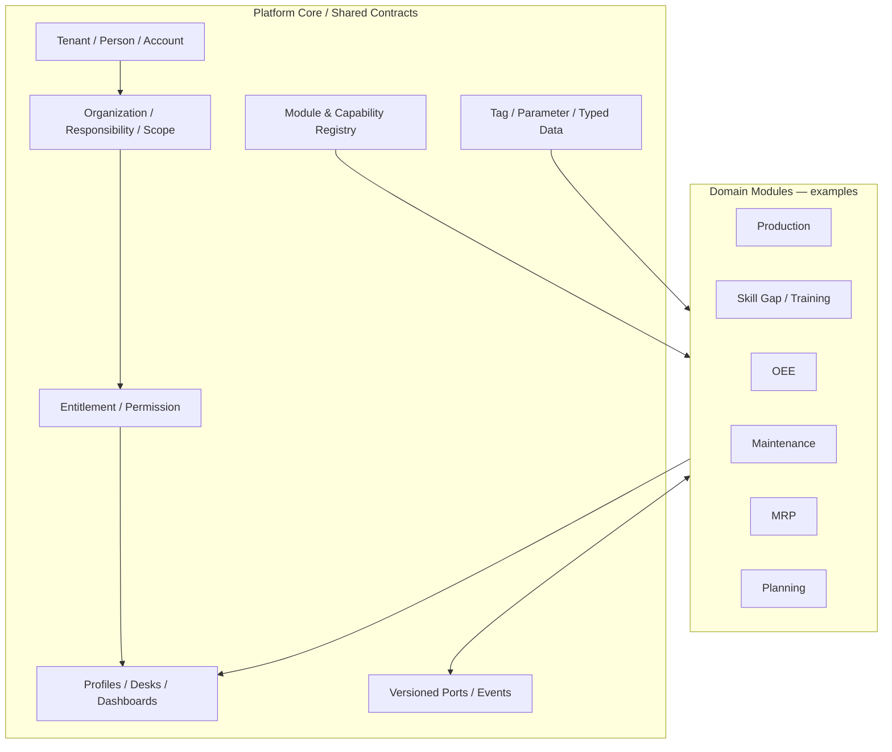

# نقشه مفهومی SFP24

> **Status:** Proposed · **Owner:** Core · **Updated:** 2026-11-02

**تفکیک حیاتی:** Person ≠ Account ≠ Position ≠ Responsibility ≠ Permission ≠ Qualification؛ Tag ≠ Parameter ≠ Business Record؛ Dashboard ≠ محاسبه رسمی KPI.

**آزمون فشار:** کارگاه بدون برنامه و بدون تگ، اضافه‌شدن EdgeBox، فرد چندمسئولیتی، شرکت چندسایتی، ماژول Skill Gap مستقل از Production، MRP با Forecast و Order، شرکت‌های مستقل با قرارداد تبادل.

این نمودار طراحی احتمالی است، **نه وضعیت ساخته‌شده**. [Open Questions](OPEN-QUESTIONS.md) · [Sources](../sources/README.md).
