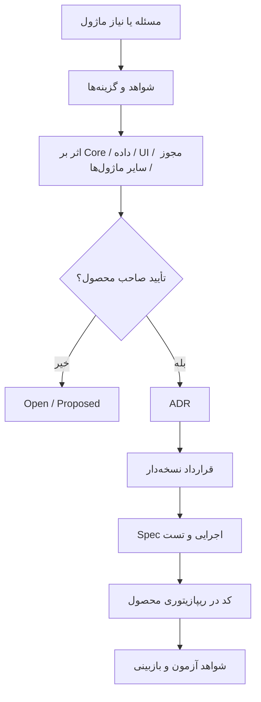

# گردش تغییر

برای هر تغییر مشترک بررسی کنید: کارگاه کوچک بدون چارت یا ماژول اضافی، سازمان بزرگ و مسئولیت چندگانه، Person/Account، Tenant/Scope، نوع و بازه داده، Permission سمت سرور، سازگاری و Migration، استفاده توسعه‌دهنده مستقل، رفتار ماژول غیرفعال و حفظ تاریخچه.

تغییر سند **به معنی پیاده‌سازی یا تست نیست**. گزارش هر PR باید پرونده تصمیم، لینک قرارداد، تغییر فایل‌ها و موضوعات باز را روشن کند.
