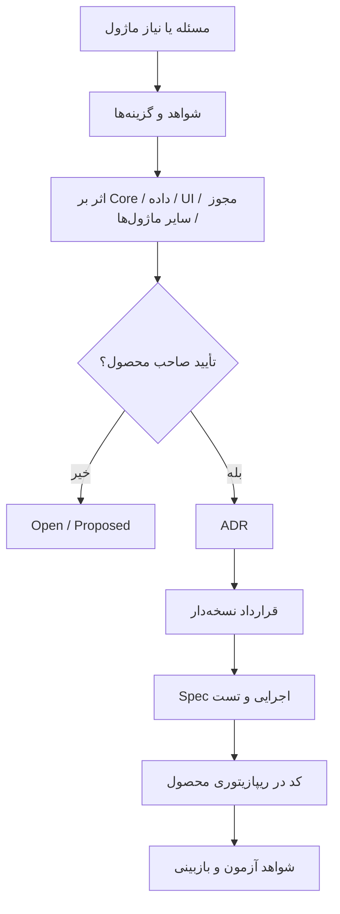

# گردش تغییر



برای هر تغییر مشترک بررسی کنید: کارگاه کوچک بدون چارت یا ماژول اضافی، سازمان بزرگ و مسئولیت چندگانه، Person/Account، Tenant/Scope، نوع و بازه داده، Permission سمت سرور، سازگاری و Migration، استفاده توسعه‌دهنده مستقل، رفتار ماژول غیرفعال و حفظ تاریخچه.

تغییر سند **به معنی پیاده‌سازی یا تست نیست**. گزارش هر PR باید پرونده تصمیم، لینک قرارداد، تغییر فایل‌ها و موضوعات باز را روشن کند.

## نیاز ماژول چگونه به هسته یا ماژول دیگر می‌رسد؟

۱. نویسنده ابتدا سند اصلی موضوع و وضعیت اجرای آن را می‌خواند؛ نبود API را با ساخت یک تعریف موازی جبران نمی‌کند.

۲. در پوشهٔ خودش درخواست `requests/REQ-<module>-NNNN-topic.md` می‌نویسد. شناسه در همان حوزه یکتا است؛ مثلاً `REQ-oee-0001`. درخواست به هسته یا یک ماژول مشخص خطاب می‌شود.

۳. فقط لینک همان فایل در [فهرست درخواست‌های مشترک](REQUESTS.md) و RECORDS ماژول ثبت می‌شود. متن پاسخ در چند جا کپی نمی‌شود. ثبت فایل به‌تنهایی پیام خودکار به سشن دیگر نمی‌فرستد؛ توسعه‌دهندهٔ بخش مقصد باید فهرست را هنگام شروع کار مرور کند و در تحویل، شناسهٔ درخواست را ذکر کند.

۴. بخش مقصد در همان فایل می‌نویسد: آیا اکنون پشتیبانی می‌شود؟ سند یا نسخهٔ کد کدام است؟ اگر تغییر لازم است، گزینه و اثر آن بر مصرف‌کنندگان چیست؟ اگر رد یا موکول شد، دلیل و شرط بازنگری ثبت می‌شود.

۵. صاحب محصول دربارهٔ تغییر رفتار یا دامنهٔ جدید تصمیم می‌گیرد. پرسش فنیِ قابل پاسخ از اسناد را به صاحب محصول پاس ندهید. اگر درخواست پذیرفته شد، پذیرش نیاز با تصویب API و اجازهٔ اجرا جدا ثبت می‌شود. قرارداد مشترک و سند هسته فقط در محل اصلی اصلاح می‌شوند.

۶. پس از اجرا، نسخهٔ کد و آزمون در درخواست لینک می‌شود. نویسندهٔ مصرف‌کننده نتیجهٔ اتصال را ثبت می‌کند؛ تا آن زمان «پیاده‌شده در هسته» با «آزموده‌شده در ماژول» یکی نیست.

### قالب درخواست

```markdown
# REQ-<module>-NNNN — عنوان روشن نیاز
تاریخ:
درخواست‌کننده / حوزه:
مقصد: core یا نام ماژول
وضعیت: ثبت‌شده / در بررسی / نیازمند تصمیم / پذیرفته / رد / موکول / اجراشده / اتصال آزموده‌شده

## سناریو و نیاز
چه کاری برای کدام کاربر متوقف است؟
## چیزی که بررسی شد
لینک سند اصلی، نسخه و کمبود دقیق؛ موارد نامعلوم را صریح بنویسید.
## ورودی و نتیجهٔ موردنیاز
نوع، زمان، واحد، دامنهٔ شرکت/تجهیز/فرد، خطا و نبود داده؛ بدون جعل API.
## اثر و گزینه‌ها
مجوز، داده، سایر ماژول‌ها، سازگاری و راه موقت احتمالی.
## پاسخ بخش مقصد
تاریخ، نویسنده، پشتیبانی فعلی یا پیشنهاد تغییر با دلیل.
## تصمیم
چه کسی، چه زمانی، چه چیزی را تأیید/رد کرد؟ لینک تصمیم؛ نامشخص اگر نداریم.
## نتیجه و آزمون
قرارداد/نسخهٔ کد، آزمون مقصد، آزمون مصرف‌کننده یا هنوز انجام نشده.
```

### ارتباط مستقیم دو ماژول

اگر OEE به نتیجهٔ تولید نیاز دارد، درخواست با مقصد `production` ثبت می‌شود. وابستگی باید صریح باشد: آیا بدون تولید هم کار می‌کند، ورودی جایگزین چیست و نبود ماژول چه رفتاری دارد؟ نتیجهٔ مشترک به قرارداد ارتباطی لینک می‌خورد. هیچ bus، API یا جدول اشتراکی صرفاً با این مثال ایجاد یا تأیید نمی‌شود. هر دو بخش به یک درخواست و یک تعریف معتبر ارجاع می‌دهند.

## پایان فاز و تحویل از شاخهٔ توسعه

طبق [قاعدهٔ کد و اسناد](CODE-AND-DOCS.fa.md)، کار در جریان می‌تواند کنار نسخهٔ کد بماند. تغییر قواعد مشترک پیش از اتکای مصرف‌کننده ثبت می‌شود؛ در پایان یا توقف فاز نیز تصمیم‌ها، شکست‌های مهم، شواهد و اصلاح سند جاری با لینک دوطرفه تعیین تکلیف می‌شوند. ادغام خودکار پوشه‌های اسناد یا تأیید هم‌زمان کد و طراحی از این روال نتیجه نمی‌شود.
