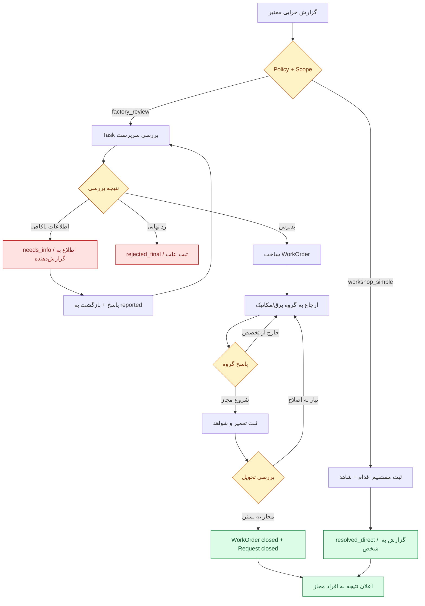

# SFP24 — مشخصات اجرایی پیشنهادی ۰۲: جریان‌ها، دیتابیس، API، UI و بسته‌های دقیق Codex

> **Status:** Proposed Codex-ready work specification (pending product decisions and separate coding authorization).  
> **Date:** ۲۰۲۶-۱۱-۰۵؛ **Code snapshot:** `pouyeshgar-workshop@5c7ac617f95ee8b84cbd32d7fa8e7474a073ec97`، شاخهٔ `codex/04-core-workspaces-dashboard`.  
> **Contracts:** [۰۱ — Core/Module/Data](01-CONTRACTS-AND-DATA.fa.md)، [۰۳ — Demo and Acceptance](03-DEMO-AND-ACCEPTANCE.fa.md)، [Domain Interaction Draft](../../contracts/DOMAIN-INTERACTION-CONTRACT-DRAFT.md).  
> **توجه:** شاخهٔ Stage 04 فعلاً مأموریت Discovery فقط‌خواندنی دارد؛ **هیچ بند این Spec به‌تنهایی آن ممنوعیت را لغو نمی‌کند**. پس از مجوز صریح، Codex باید در شاخهٔ جدیدِ جدا، با SHA قفل‌شده کار کند.  
> **طراحی از قبل انتخاب شده:** جایگزینی توده‌ای هسته، کنترل فیزیکی ماشین، خرید خودکار Maintenance، موتور BPMN عمومی و اجرای کد/SQL مشتری **ممنوع**. هر مسیری که در این فایل `new` نام دارد، هنوز وجودش در Runtime ادعا نمی‌شود.

## ۱. وضعیت واقعی و مرز تغییر فایل‌ها

**مشاهدهٔ موجود:**
- `server/platform/db.ts` دارای MariaDB Pool و Transaction است؛ `server/platform/migrations.ts` دارای migrations شماره‌دار و checksum، Control DB و Tenant DB است. جدیدترین Tenant Migration بررسی‌شده **v18** و Control **v9** است؛ هیچ Migration قدیمی نباید ویرایش شود.
- `server/operations/production/service.ts`، `server/operations/production/work.ts` و routes Production واقعی‌اند؛ `clientKey` و جلوگیری از تکرار/ویرایش/شمارشِ دوباره قبلاً وجود دارد.
- `server/operations/equipment-notes.ts` یادداشت/issue خصوصی یا مربوط به تجهیز می‌سازد؛ **نه** دستورکار و نه چت عمومی.
- `src/company/definition-catalog.ts` فیلدهای پایه و `masterDefinitionExtensions`/`requiredFor` را دارد؛ `MasterService` از تعریف مشترک برای سرور استفاده می‌کند.
- `server/operations/workspaces.ts` و `desk-assignments.ts` انتساب/نسخهٔ میزها را مدیریت می‌کنند؛ `src/company/AssignedDesk.vue` فعلاً `DeskExperiencePreview.vue` را نمایش می‌دهد و صریحاً می‌گوید دادهٔ نمایشی است.
- `src/company/module-catalog.ts`، `server/platform/catalog.ts`، `server/platform/accounts/service.ts` و `permission-catalog.ts` منطق نام ماژول/entitlement/permission را دارند؛ `maintenance` اکنون `pilot_only` است.
- `src/company/workspaces.ts` و `src/App.vue` مسیرها و `personal-desk` را کنترل می‌کنند؛ `production` به همراه `reports` بسته‌بندی مخصوص دارد.
- آزمون‌های `tests/desk-studio.test.ts`، `workspaces.test.ts`، `module-entitlements.test.ts`، `definition-catalog.test.ts`، `production-work-boundaries.test.ts` و `operational-domain.test.ts` وجود دارند و نباید با تغییر UX یا Permission شکسته شوند.

**دستور تغییر کلی:** همهٔ وضعیت‌های فوق را **حفظ** کن؛ فقط Adapter، نوع‌ها، Migrationهای افزایشی و UIهای واقعی لازم را اضافه کن. هیچ Drop، Truncate، جدول مشترک جهانی Domain Record، Rebuild کامل `src/App.vue` یا حذف Preview Studio انجام نشود.

## ۲. جریان‌های اجرایی Maintenance — حالت‌های نهایی پایلوت

### ۲.۱. Request

`RequestState` دقیقاً: `reported | needs_info | converted_to_work | resolved_direct | rejected_final | cancelled | closed`.

| Action | از وضعیت | به وضعیت | دادهٔ لازم | مجوز |
|---|---|---|---|---|
| `report` | — | `reported` | resource, description, optional sourceNoteId/priority/relatedProductionReportRef | `maintenance.request.create` |
| `request_info` | `reported` | `needs_info` | reason ≥ 8 char، recipient user | `maintenance.triage` |
| `reply_info` | `needs_info` | `reported` | reply، actor همان reporter یا delegate معتبر | `maintenance.request.reply` |
| `reject_final` | `reported` | `rejected_final` | reason ≥ 8 char | `maintenance.triage` |
| `convert_to_work` | `reported` | `converted_to_work` | policyRevision، assigneeGroup?/user?؛ WorkOrder جدید با UNIQUE(request_id) | `maintenance.triage` |
| `resolve_direct` | `reported` | `resolved_direct` | outcome + observedAt + evidence معتبر | `maintenance.resolve_direct` |
| `cancel` | `reported/needs_info` | `cancelled` | actor صاحب Request یا triage، reason | مجوز/Policy متناظر |
| `close_from_work` | `converted_to_work` | `closed` | نتیجهٔ WorkOrder در حالت `closed` | فراخوانی داخلی معتبر Maintenance |
| `cancel_from_work` | `converted_to_work` | `cancelled` | WorkOrder فقط طبق قاعدهٔ `cancel`، قبل از اجرای فنی، Cancel شده باشد | فراخوانی داخلی اتمیک Maintenance؛ Reason و Audit اجباری |

از وضعیت پایانی هیچ Action تغییردهنده‌ای مجاز نیست، جز اصلاح کنترل‌شدهٔ رکورد با Revision/History در طراحی بعدی (در پایلوت فعلاً ممنوع). گزارش مستقیم کارگاه `resolve_direct` **بدون ساخت Task/Approval یا WorkOrder صوری** عمل می‌کند؛ با این حال Actor، زمان، شرح کار، نتیجه و Evidence باید ثبت شوند.

### ۲.۲. WorkOrder

`WorkState` دقیقاً: `open | assigned | in_progress | work_completed | returned_for_rework | closed | cancelled`.

| Action | از | به | قاعده |
|---|---|---|---|
| `assign` | `open/assigned/returned_for_rework` | `assigned` | assign به user یا tenant group معتبر؛ هر reassignment دلیل و Audit |
| `start` | `assigned` | `in_progress` | فقط Actor مجاز/منتسب، Scope و resource معتبر |
| `record_complete` | `in_progress` | `work_completed` | work summary + completedAt + outcome/evidence؛ نه آزادسازی دستگاه |
| `review_close.approve` | `work_completed` | `closed` | مسئول دارای `maintenance.review_close`؛ در `factory_review` جدا از اجراکننده |
| `review_close.return` | `work_completed` | `returned_for_rework` | reason، Task جدید برای گروه/نفر |
| `cancel` | `open/assigned` | `cancelled` | reason و مسئول مجاز؛ بعد از شروع واقعی، لغو مستقیم ممنوع تا Policy جدید |
| `reassign_not_my_specialty` | `assigned` | `assigned` | ثبت Decision/Reason، تغییر گروه/نفر و Task؛ نه رد نهایی Request |

**قید ایمنی:** WorkOrder با پرچم `requires_external_safety_review`، بدون نتیجهٔ معتبرِ کنترل تخصصی نباید `start` شود؛ در Pilot چون PTW Runtime نداریم، از مسیر آن کار **فقط Demonstration غیرعملیاتی** داشته باشیم یا `prerequisite_invalid` بدهیم. این Spec هیچ Permit را جعلی «صادر» نمی‌کند.

### ۲.۳. دو Policy غیرقابل‌ویرایش آزاد

`workshop_simple@1`: حق ثبت/حل مستقیم برای فرد مجاز؛ هیچ Task اجباری.  
`factory_review@1`: Report → Triage Task → (Need Info / Reject / Convert) → Assign (برق، مکانیک یا تأسیسات) → Work Task → Review Close Task → (Return/Reassign/Close).  
`factory_review@1` در Review استقلال واقعی Person را بررسی می‌کند؛ شخصی با دو Role یا چند Desk نمی‌تواند کار خودش را برای استقلال دوبار امضا کند. Policyهای آینده نسخهٔ خود را دارند؛ پروندهٔ قدیمی به `policyRevision` ساخته‌شده متصل است، نه تفسیر زنده و متغیر.



## ۳. قرارداد Task، Decision و Notification در Pilot

### ۳.۱. Task/Workflow

- Task status: `open, claimed, completed, cancelled, superseded`؛ Task فقط یک `subjectRef` و `stepKey` مشخص دارد؛ تاریخچهٔ append-only Decision/Activity ذخیره شود.
- Candidate: `assigneeUserId` یا `assignmentGroupId`؛ هر دو هم‌زمان اگر باشد معنی OR ندارد، باید یکی انتخاب شود. Claim با Revision/Lock، عضویت گروه و Permission/Scope بررسی شود.
- Step modes: `sequential` و `all_required`؛ `any_one_of_eligible_group` برای Claim بین چند عضو یک گروه مجاز است؛ quorum عددی/یAML خارج از Pilot.
- Decision: `approved, returned_for_changes, rejected_final, reassigned, completed_work` همراه reason، Actor، SubjectRevision، PolicyRevision، TaskId و Timestamp؛ هر تصمیمی باید دقیقاً با `stepKey` مجاز سازگار باشد.
- Reassignment و Return نباید Decision یا Task قبلی را پاک کنند؛ Task قبلی `completed/superseded`، Task جدید با همان SubjectRevision فعلی و Step درست ایجاد شود.
- تغییر مؤثر SubjectRevision از زمان ایجاد Task باید `409 stale_revision` یا `superseded` بدهد؛ ادامه روی rev قبلی بدون بررسی ممنوع.
- برای شرکت کوچک اگر Policy می‌گوید `not_required`، Task/Approval مصنوعی ساخته نشود؛ Audit واقعی ثبت شود.

### ۳.۲. Notification

`Notification`: `id,recipientUserId,kind,subjectRef,sourceEventId,createdAt,readAt,payloadVersion`. `readAt` فقط وضعیت اعلان است و هیچ مرحلهٔ Workflow را جلو نمی‌برد. Title/Body برای Recipient بدون مجوز از دادهٔ محرمانه ساخته نشوند؛ هنگام خواندن مجدد Scope کنترل شود. Unique `(sourceEventId,recipientUserId,kind)` و Query `unread count` برای زنگوله.

`EquipmentNotes` فعلی باقی بماند؛ `note`/`issue`، پیام‌رسان عمومی یا WorkOrder نیست. Action اختیاری `maintenance.request.report` می‌تواند یک `sourceNoteId` معتبر را به Request تبدیل کند؛ UNIQUE این مرجع مانع ایجاد چند Request از یک Note شود؛ Note دست‌کاری نشود.

### ۳.۲.۱. فقط یک مسیر انتقال وضعیت در Backend

دو API زیر ممکن است در یک Workflow به یک عمل برسند: `/tasks/:id/decision` و `/maintenance/requests/:id/triage` (یا `/maintenance/work-orders/:id/review-close`). **نباید دو implementation مستقل از انتقال وضعیت وجود داشته باشد.** هر دو باید به یک تابع Domain Command Handler مورد اعتماد برسند که در یک تراکنش، expectedRevision و Authorization و PolicyValidity را بررسی کند، Decision/Task Outcome را ثبت کند و Domain State و Outbox را تغییر دهد. کلید Idempotency همان درخواست تا انتها منتقل شود. اگر Task جاری وجود دارد، فراخوانی مستقیم Domain Endpoint هم باید الزامات همان Task/Step را رعایت کند و راه دورزدن Approval نباشد.

### ۳.۲.۲. رویدادهای ثابت و مخاطب‌ها

در پایلوت فقط Eventهای زیر ثبت شوند. هر Event نوع، نسخه، aggregateRef، Actor زمینه‌ای و correlationId مشخص دارد و **بعد از Commit Domain** معتبر است. Eventها خبر هستند؛ Command نیستند.

| EventType Version 1 | چه زمان ثبت می‌شود؟ | Recipient نامزد/مصرف‌کننده |
|---|---|---|
| `maintenance.request_reported.v1` | ایجاد Request(reported) | گروه Triage واجد Scope در factory_review |
| `maintenance.request_info_requested.v1` | نیاز به اطلاعات بیشتر | Reporter مجاز |
| `maintenance.request_replied.v1` | پاسخ Reporter و بازگشت به reported | گروه Triage، بدون Request جدید |
| `maintenance.request_rejected.v1` | reject_final | Reporter |
| `maintenance.request_cancelled.v1` | cancel Request یا cancel_from_work | Reporter و مسئول مربوط |
| `maintenance.request_resolved_direct.v1` | resolved_direct با TechnicalAction/Evidence | Reporter/مسئول مجاز؛ aggregateRef **Request** |
| `maintenance.work_created.v1` | پذیرش Request و ایجاد WorkOrder یکتا | سرپرست تعمیرات |
| `maintenance.work_assigned.v1` | Assign به فرد/گروه | نامزد واجد Scope |
| `maintenance.work_reassigned.v1` | بازارجاع با دلیل not_my_specialty یا مشابه | گروه مقصد و سرپرست |
| `maintenance.work_started.v1` | transition واقعی به in_progress | مسئول و مصرف‌کنندگان مجاز |
| `maintenance.work_completed.v1` | ثبت اقدام فنی و work_completed | Reviewers مجاز |
| `maintenance.work_returned.v1` | رد تحویل برای Rework | اجراکننده/گروه مسئول |
| `maintenance.work_closed.v1` | Review Close معتبر + بسته‌شدن Request | Reporter، مسئول و Dashboard refresh |
| `maintenance.work_cancelled.v1` | Cancel قبل از شروع کار، همراه با cancel_from_work | Reporter و مسئول مربوط |

قانون: `maintenance.request_resolved_direct.v1` به WorkOrder اشاره نمی‌کند. `maintenance.work_closed.v1` فقط وقتی WorkOrder واقعاً وجود دارد. مصرف‌کننده Notification می‌تواند همهٔ این رویدادها را به Message از کلیدهای Localization مربوط تبدیل کند؛ نه متن آزاد ارسالی Client. هیچ EventType جدیدی را Codex بدون به‌روزرسانی Spec/Registry و اجازهٔ جدا ایجاد نکند.

### ۳.۳. Event/Recovery

در تراکنش هر Domain Change یک Outbox Event با `eventId,tenantId,eventType,eventVersion,ownerModule,aggregateRef,occurredAt,correlationId,payload` ثبت شود. Consumer سبکِ درون‌پردازه Inbox/Notification آن را با `(consumerId,eventId)` یکتا پردازش کند. تحویل at-least-once با پردازش idempotent، Retry کنترل‌شده و وضعیت `failed_requires_attention`. از Broker و Exactly-once سراسری در این فاز پرهیز. در خطای اعلان، درخواست خرابی **نباید Rollback شود**؛ اعلان باید قابل بازیابی باشد.


## ۴. طرح Schema و Migration افزایشی

**وضعیت واقعی کد بررسی‌شده:** Control DB تا Migration v9، Tenant DB تا v18. در همان مبنا افزودهٔ پیشنهادی `tenantMigration v19` است. Codex **قبل از اجرا** باید روی SHA مصوب شماره‌ها را بازبینی کند؛ هیچ Migration قبلی/Checksum را عوض نکند. Tenant Tables جدید به `tenantWritableTables` و append-onlyها به `tenantAppendOnlyTables` فعلی افزوده شوند. Control و Tenant DB جدا می‌مانند؛ FK بین دیتابیس‌ها نسازیم.

### ۴.۱. جدول‌های متعلق به Maintenance در Tenant DB

| جدول جدید | Schema پیشنهادی (ستون‌ها و نوع‌ها) | Constraint / Index |
|---|---|---|
| `maintenance_requests` | `id CHAR(36) PK`، `resource_id CHAR(36) NOT NULL`، `site_id CHAR(36) NOT NULL`، `reported_by_user_id CHAR(36)`، `source_note_id CHAR(36) NULL`، `related_production_report_id CHAR(36) NULL`، `description TEXT`، `priority VARCHAR(16)`، `status VARCHAR(32)`، `revision INT DEFAULT 1`، `observed_at_ms BIGINT NULL`، `created_at TIMESTAMP(3)`، `updated_at TIMESTAMP(3)` | FK resource؛ UNIQUE(source_note_id)؛ INDEX(site_id,status,created_at)، INDEX(reported_by_user_id,created_at). Production Report از طریق DomainRef بررسی شود، نه FK مستقیم |
| `maintenance_work_orders` | `id CHAR(36) PK`، `request_id CHAR(36) NOT NULL`، `resource_id CHAR(36)`، `status VARCHAR(32)`، `revision INT`، `assigned_user_id CHAR(36) NULL`، `assigned_group_id CHAR(36) NULL`، `policy_key VARCHAR(64)`، `policy_revision INT`، `requires_external_safety_review BOOLEAN`، `started_at_ms BIGINT NULL`، `completed_at_ms BIGINT NULL`، `closed_at_ms BIGINT NULL`، `created_at TIMESTAMP(3)` | UNIQUE(request_id)، FK request/resource، INDEX(status,assigned_group_id)، INDEX(status,assigned_user_id) |
| `maintenance_actions` | `id CHAR(36) PK`، `request_id CHAR(36) NOT NULL`، `work_order_id CHAR(36) NULL`، `performed_by_user_id CHAR(36)`، `action_kind VARCHAR(48)`، `outcome VARCHAR(48)`، `summary TEXT`، `performed_at_ms BIGINT`، `recorded_at TIMESTAMP(3)` | append-only، FK request/workorder، INDEX(request_id)، INDEX(work_order_id) |
| `maintenance_evidence` | `id CHAR(36) PK`، `action_id CHAR(36) NOT NULL`، `kind VARCHAR(24)`، `text_value TEXT NULL`، `numeric_value DECIMAL(18,6) NULL`، `unit VARCHAR(24) NULL`، `captured_at_ms BIGINT`، `recorded_by_user_id CHAR(36)`، `created_at TIMESTAMP(3)` | append-only، FK action، kind در پایلوت فقط `narrative/measurement`؛ نسخهٔ فایل/امضای قانونی در این مرحله وجود ندارد |
| `maintenance_policy_revisions` | `policy_key VARCHAR(64)`، `revision INT`، `definition_json MEDIUMTEXT`، `created_by_user_id CHAR(36)`، `created_at TIMESTAMP(3)` | PK(policy_key,revision)، immutable |
| `maintenance_policy_current` | `id TINYINT PK`، `policy_key VARCHAR(64)`، `revision INT`، `updated_at TIMESTAMP(3)` | یک ردیف id=1؛ CAS با expectedRevision و Audit |

### ۴.۲. جدول‌های هماهنگی عمومی در Tenant DB

| جدول جدید | ستون‌ها و Constraints اصلی | مسئولیت |
|---|---|---|
| `tenant_assignment_groups` | id PK CHAR(36)، code UNIQUE VARCHAR(48)، name، site_id NULL، active، revision | گروه کارِ همان Tenant؛ Role/Permission نمی‌دهد |
| `tenant_assignment_group_members` | group_id، user_id، active، created_at؛ PK(group_id,user_id) | UserId با Account فعال همان شرکت در Control DB تأیید شود |
| `tenant_workflow_instances` | id PK، owner_module، entity_type، entity_id، subject_revision، policy_key، policy_revision، definition_snapshot_json MEDIUMTEXT، status، created_at | نسخه و ترتیب Workflow ثابتِ زمان آغاز |
| `tenant_tasks` | id PK، workflow_id، step_key، assignee_user_id NULL، group_id NULL، claimed_by_user_id NULL، subject_revision، status، revision، created_at، completed_at NULL | Claim/Decision تراکنشی و scoped؛ INDEX برای status/assignee/group |
| `tenant_task_decisions` | id PK، task_id، actor_user_id، actor_person_id NULL، subject_revision، policy_revision، outcome، reason، decided_at | append-only؛ تصمیم نهایی دوباره با Lock/Status ممنوع |
| `tenant_action_receipts` | id PK، actor_user_id، action_key، idempotency_key، payload_sha256 CHAR(64)، result_json MEDIUMTEXT، created_at | UNIQUE(actor_user_id,action_key,idempotency_key) در Tenant DB؛ همان کلید با payload مختلف 409 |
| `tenant_domain_outbox` | event_id PK، owner_module، event_type، event_version، aggregate_type/id/revision، payload_json، correlation_id، occurred_at، delivery_status، attempt_count | رویداد پس از تغییر معتبر در همان transaction ایجاد شود |
| `tenant_event_consumptions` | event_id، consumer_key، processed_at؛ PK(event_id,consumer_key) | ضدتکرار مصرف‌کننده |
| `tenant_notifications` | id PK، recipient_user_id، event_id، kind، owner_module، entity_type/id، title_key، created_at، read_at NULL | UNIQUE(event_id,recipient_user_id,kind)، INDEX(recipient_user_id,read_at,created_at) |

**مرزهای دیتابیس:** `company_work_desks` موجود در Control DB بماند؛ `production_reports`، `work_sessions` و `equipment_notes` فعلی را به جدول جدید مهاجرت ندهیم. ستون `actor_user_id` در Tenant DB به User معتبر Control اشارهٔ منطقی دارد، نه FK بین دیتابیس. اطلاعات محرمانه را در Notification/Outbox JSON منتشر نکنیم. ویرایش یا حذف ردیف‌های append-only از API عمومی ممنوع.

**زمان و نسخه:** created/updated در UTC، `observed_at_ms` با زمان اعلام واقعی، `revision` افزایشی مثبت؛ ایندکس‌ها و FKهای پیشنهادی باید در MariaDB/InnoDB روی Migration موقت اجرا و صحتشان آزموده شود. برای کارهای حساس، شرط `indeterminate` و اتصال PTWِ پیاده‌نشده، fail closed است.

**سیاست داده:** Evidence در پایلوت متن و اندازه‌گیری است، نه ادعای «پروندهٔ کامل مدارک استاندارد/امضای حقوقی». اگر لازم شد عکس یا فایل پیوست واقعی بسازیم، قبل از آن باید API امن `CompanyFiles`، ACL، Digest، Retention، Malware/Size Limit و مهاجرتش در تسک مستقل تصویب شود.

### ۴.۳. Runtime و Lifecycle

در startup فقط Descriptorهای trusted ساخته شوند. ثبت Maintenance با وضعیت `pilot_only`، دسترسی مشتری تولیدی ایجاد نکند. تست داخلی می‌تواند فقط در Tenant/Control DB **Disposable** به‌طور صریح آماده‌بودن ماژول را Fixture کند؛ هیچ bypass entitlement در مسیر Runtime واقعی نسازیم. بعد از عبور تست‌های انتهابه‌انتها، تغییر `maintenance` از `pilot_only` به `ready` نیازمند تصمیم و PR جداست.

وقتی Maintenance خاموش شد، هیچ Action تازه اجرا نشود؛ Workflow باز می‌تواند `paused_module_unavailable` بگیرد، نه `closed`. تاریخچهٔ Subject، Decisions و Evidence حفظ و با دسترسی مجاز بازخوانی شود. بعد از فعال‌سازی، قبل از ادامه Revision/Policy/Qualification/Scope دوباره بررسی شوند.

### ۴.۴. بازیابی خطا

Receipt و Domain Mutation و Event Outbox در همان **Tenant Transaction** ثبت شوند. اگر پس از Commit پاسخ HTTP گم شد، Retry با همان `Idempotency-Key` همان نتیجه را می‌دهد؛ Payload متفاوت با همان کلید `409`. درخواست درگاه اعلان شکست بخورد، Maintenance Record نباید rollback یا از دست برود؛ Delivery قابل retry است. Exactly-once end-to-end وعده ندهیم. تغییر ساختار با Migration افزایشی؛ rollback با بازگشت نسخهٔ برنامه و خاموش‌کردن قابلیت، **نه Drop اطلاعات تاریخی**.


## ۵. قرارداد HTTP پایلوت (پیشنهاد دقیق، پس از تصویب اجرا شود)

تمام مسیرها زیر `/api/v1/company` هستند. Actor، Tenant و Effective Scope از Session؛ در Body هرگز `actorId`، `tenantId` یا `effectivePermissions` معتبر تلقی نشوند. Fastify Schema: `additionalProperties:false`، Enum و حدود طول/عدد، `Idempotency-Key` برای همهٔ POSTهای اثرگذار، `expectedRevision` برای تغییر رکورد. `GET`ها pagination با `limit <= 50` و Cursor پایدار؛ داده/آمار تنها در Scope مجاز Actor.

### ۵.۱. Registry و تنظیمات

| Endpoint | Body/Query | گیت و پاسخ |
|---|---|---|
| `GET /company/module-capabilities` | moduleKey اختیاری | Descriptorهای امن + `licensed/enabled/compatible/ready/issues`؛ بدون افشای دادهٔ سایرین |
| `GET /company/maintenance/policy` | — | Policy جاری و Revision با مجوز مشاهده |
| `PUT /company/maintenance/policy` | `{policyKey:"workshop_simple"|"factory_review", expectedRevision}` | `maintenance.policy.manage`؛ CAS، Revision، Audit، Snapshot برای Instanceهای قبلی |
| `GET /company/assignment-groups` | siteId? | فقط گروه‌های Tenant و Scope مجاز |
| `POST /company/assignment-groups` | `{code,name,siteId?,members[]}` | `assignment.groups.manage`؛ اعتبار عضویت همان شرکت |
| `PUT /company/assignment-groups/:id` | `{name?,members?,active?,expectedRevision}` | CAS + Audit، Task باز با سیاست مشخص بازبینی شود |

### ۵.۲. Maintenance domain API

| Endpoint | ورودی/نتیجه | مجوز |
|---|---|---|
| `POST /company/maintenance/requests` | `{resourceId,description,priority?:"normal"|"high",observedAt?,sourceNoteId?,relatedProductionReportId?}` → Request(reported) | `maintenance.request.create`، UUID معتبر Resource و Site |
| `GET /company/maintenance/requests` | `resourceId?,siteId?,status?,cursor?,limit?` | `maintenance.request.view_own` یا `maintenance.request.view_scope` |
| `GET /company/maintenance/requests/:id` | Request + history مجاز | Owner/Scope؛ 404 برای ناموجود یا نامجاز |
| `POST /company/maintenance/requests/:id/reply-info` | `{reply,expectedRevision}` → reported | `maintenance.request.reply`، reporter یا delegate معتبر |
| `POST /company/maintenance/requests/:id/triage` | `{outcome:"request_info"|"reject_final"|"convert_to_work",reason?,assigneeUserId?,groupId?,expectedRevision}` | `maintenance.triage`؛ برگشت/رد با دلیل حداقل ۸ نویسه؛ قبول → WorkOrder یکتا |
| `POST /company/maintenance/requests/:id/cancel` | `{reason,expectedRevision}` → cancelled (فقط reported/needs_info) | `maintenance.request.cancel`، reporter یا triage با مجوز، reason ≥۸ نویسه |
| `POST /company/maintenance/requests/:id/resolve-direct` | `{summary,outcome,performedAt,evidence:[...],expectedRevision}` → resolved_direct | `maintenance.resolve_direct` در Policy مجاز؛ بدون Task مصنوعی |
| `POST /company/maintenance/work-orders/:id/cancel` | `{reason,expectedRevision}` → cancelled (فقط open/assigned و قبل از انجام واقعی) | `maintenance.work.cancel` + Scope + reason؛ Request مرتبط با وضعیت جدا و قابل پیگیری باقی بماند |
| `GET /company/maintenance/work-orders/:id` | WorkOrder + history | `maintenance.work.view` |
| `POST /company/maintenance/work-orders/:id/assign` | `{assigneeUserId?,groupId?,reason?,expectedRevision}` → assigned | `maintenance.assign`؛ دقیقاً یکی از User/Group |
| `POST /company/maintenance/work-orders/:id/start` | `{expectedRevision}` → in_progress | `maintenance.perform`؛ انتساب معتبر + شرط اجرا |
| `POST /company/maintenance/work-orders/:id/complete` | `{summary,outcome,performedAt,evidence:[...],expectedRevision}` → work_completed | `maintenance.perform`؛ ساخت Task بررسی، نه آزادسازی دستگاه |
| `POST /company/maintenance/work-orders/:id/review-close` | `{outcome:"approve"|"return",reason?,expectedRevision}` → closed/returned_for_rework | `maintenance.review_close`؛ استقلال Actor در factory_review |
| `POST /company/maintenance/work-orders/:id/reassign` | `{reason,groupId?,assigneeUserId?,expectedRevision}` → assigned | `maintenance.assign`؛ `not_my_specialty` رد نهایی Request نیست |
| `GET /company/resources/:id/maintenance` | تاریخچهٔ Resource با cursor/limit | read Scope؛ برای Resource Profile |
| `GET /company/maintenance/summary` | `siteId?,resourceId?,from?,to?` | `maintenance.summary`؛ KPI واقعی با زمان و منشأ |

### ۵.۳. Task/Notification/UX API

| Endpoint | رفتار | گیت |
|---|---|---|
| `GET /company/tasks` | Tasks باز/Claim شدهٔ شخص یا گروه در Scope؛ cursor/limit | `tasks.read_own` |
| `POST /company/tasks/:id/claim` | `{expectedRevision}`؛ Claim idempotent | `tasks.claim` + عضویت/Scope و حق مرحله |
| `POST /company/tasks/:id/decision` | `{outcome,reason?,expectedRevision}`؛ Decision append-only، Domain owner مسئول اثر | `tasks.decide` + Permission مربوط به Action |
| `GET /company/notifications` | `unreadOnly?,cursor?,limit?`؛ فقط اعلان خود شخص | `notifications.read_own` |
| `GET /company/notifications/unread-count` | عدد خوانده‌نشده | recipient همان Actor |
| `POST /company/notifications/:id/read` | فقط `readAt`، بدون تغییر Domain/Task | recipient همان Actor |
| `GET /company/ui/contributions` | pageId? | فیلتر trusted registry، entitlement، readiness، permission |
| `GET /company/dashboard/production-and-maintenance` | `siteId?,from?,to?` | Query مجاز هر Domain، نه SQL آزاد کاربر |

**Cancellation در کارخانه:** لغو WorkOrderِ هنوز شروع‌نشده باید Taskهای باز را `cancelled` کند، Decision تاریخی را حفظ کند و Request مرتبط را **در همان Transaction** از `converted_to_work` به `cancelled` ببرد؛ صرفاً حذف WorkOrder مجاز نیست. در این Pilot لغو WorkOrder پس از `in_progress` مسیر امن آماده‌ای ندارد و باید `409 invalid_transition` برگرداند؛ Extension آینده پس از طراحی rollback واقعی ممکن است.

**Response:** همهٔ تغییرهای موفق `{id,revision,status,requestId}` یا ActionOutcome شناخته‌شده بازگردانند؛ خطا `{error,requestId?,retryable?}` با کدهای محدود. HTTP: 400 malformed، 401 session invalid، 403 forbidden/license، 404 record missing/invisible، 409 stale/state/conflict، 422 invalid prerequisite، 503 service unavailable. از Routeِ عمومی `/actions/execute` یا Dispatch JS دلخواه خودداری شود.

**Validation:** `description <= 3000`، `summary <= 2000`، `reason 8..500` در Reject/Return، `evidence <= 10` آیتم، body مرتبط <=64KiB، عدد Measurement متناهی و unit مجاز، تاریخ UTC ISO8601، priority enum. پیام خطای عدم Scope نباید وجود رکورد محرمانه را آشکار کند.

## ۶. Permissionهای جدید و سطح انتساب

به `server/platform/identity/permission-catalog.ts` با Domain Guard و آزمون اضافه شوند؛ **فقط افزودن label در UI کافی نیست**:

- `maintenance.request.create`، `maintenance.request.reply`، `maintenance.request.cancel`، `maintenance.request.view_own`، `maintenance.request.view_scope`، `maintenance.resolve_direct`؛
- `maintenance.triage`، `maintenance.assign`، `maintenance.perform`، `maintenance.work.cancel`، `maintenance.work.view`، `maintenance.review_close`، `maintenance.summary`، `maintenance.policy.manage`؛
- `tasks.read_own`، `tasks.claim`، `tasks.decide`، `notifications.read_own`، `assignment.groups.manage`.

Membership در گروه برق/مکانیک/تأسیسات Permission نمی‌دهد؛ Manager بودن در HR یا داشتن Desk نیز نمی‌دهد. برای هر Action: شرکت فعال + entitlement + Runtime ready + permission + Scope + Assignment معتبر (اگر لازم) + شرط Domain/Validity بررسی شود.

**پروفایل‌های Fixture، نه Roleهای اجباری محصول:** کارگاه ساده یک شخص با Production و Maintenance direct permissions؛ کارخانهٔ بزرگ Operator فقط گزارش، Maintenance Supervisor برای Triage/Assignment، Electrician برای Perform، Reviewer مستقل برای Review Close، Manager برای dashboard/management. RoleGrants و `initialAdminGrants` کنونی ممکن است Grants وسیع داشته باشند؛ Codex نباید بدون تصمیم عمومی امنیت نقش‌ها را یکجا بازنویسی کند. برای پایلوت با Rules صریح و Scope، و تست Deny، حداقل حق را اعطا کند. تغییر Permissionهای عملیاتی به شکل مخفی در UI نباید امنیت سرور را عوض کند.


## ۷. Form، Desk، Dashboard، Profile، Inbox و Bell — قرارداد UI پایلوت

**هدف تجربهٔ کاربری:** یک میز ساده برای فرد کارگاهی و یک میز چندنقشی برای کارخانهٔ بزرگ، هر دو با همان Domain API. UI صرفاً Renderer/Action Caller است، نه Authority.

### ۷.۱. Contribution Descriptor و Query Binding

```ts
type UIContribution = {
  id: string;                    // stable, namespaced e.g. "maintenance.request-form"
  ownerModule: string;
  kind: "form" | "desk_widget" | "dashboard_widget" |
        "profile_section" | "inbox_view" | "full_page" | "3d_overlay";
  requiredCapability: string;
  requiredPermission: string;
  contexts: Array<"person"|"resource"|"work_order"|"desk"|"company">;
  componentId: string;           // allowlisted Vue component, not arbitrary import
  queryPortId?: string;          // trusted scoped query
  actionPortIds?: string[];      // trusted domain actions
  version: 1;
};
type FieldSchema = {
  key: string; labelFa: string; labelEn: string;
  type: "text"|"textarea"|"select"|"number"|"date"|"ref";
  required?: boolean; maxLength?: number; options?:string[];
};
type FormDefinition = {
  schemaVersion: 1;
  id: string; ownerModule:string; fields:FieldSchema[];
  layout: Array<{sectionId:string;fieldKeys:string[]}>;
  submitActionPortId:string; 
};
```

برای این نسخه FormDefinition فقط ساختار trusted و فرم‌های معین دارد؛ ایجاد دیتابیس/ستون/Script دلخواه مشتری از UI Schema **ممنوع**. Validation سمت سرور مستقل از نمایش فیلد می‌ماند. Componentهای تخصصی PTW، LIMS یا Gantt در فازهای آینده به `full_page` اضافه می‌شوند، نه ساختن فرمول و منطقشان در Desk.

**Binding گسترش‌پذیر:** Desk/Widget فقط `contributionId`، `layout` و `queryConfig` از مجموعهٔ فیلترهای مجاز (زمان، سایت، Resource) ذخیره کند؛ Auth/Scope/Permission/SQL داخل definition میز ذخیره نشود. Dashboard queryها به تابع سرور allowlist وصل باشند؛ نمایش مقدارِ دیررس/ناقص باید Source و timestamp مناسب داشته باشد.

### ۷.۲. اجزای واقعی روی میز

- **Production current work:** UI به `GET/POST /company/production/work` موجود و `ProductionEditor`/`ProductionReports` مرتبط می‌شود. ثبت واقعی از سرویس Production می‌گذرد؛ `DeskExperiencePreview` فقط در Studio Preview باقی بماند.
- **Production history:** Query موجود با `production.view_own`/`view_others`؛ کاربر ساده فقط تاریخچهٔ مجاز خود را ببیند.
- **Maintenance report problem:** فرم Resource + شرح + optional priority؛ Submit → Action typed و Request ID؛ هیچ Task/Approval صوری روی Desk ساده.
- **Maintenance requests/Inbox:** فهرست Requests و Tasks با Owner/Group/Scope؛ قبول، ارجاع، برگشت، ثبت کار و تحویل فقط از API مربوط با Revision.
- **Bell:** unread count + فهرست اعلان‌های کاربر؛ read تنها `readAt`؛ کلیک → لینک رکورد مجاز، نه اجرای Action.
- **Resource profile:** `EquipmentNotes` موجود و Section `MaintenanceHistory` جدید با Query مجاز؛ Resource ID یکسان، بدون Duplicate Master.
- **Dashboard:** KPIهای واقعی `Production Summary`، `Maintenance Open/Closed/Pending` و روند تولید موجود؛ Metric فقط از Query صاحب دامنه. در Pilot سه گونه Widget مجاز `kpi`، `table` و `time_series`، با filter محدود و ثبت provenance.
- **3D:** فقط Context Resource انتخاب‌شده برای نمایش و بازکردن فرم/History مجاز؛ هیچ Tag.OUT یا انتقال وضعیت ماشین از SceneView نباشد.

### ۷.۳. دو حالت Desk

**کارگاه ساده:** `production work`، `good/scrap entry`، `my history`، `maintenance request`، `equipment notes`، `my notifications`. ترتیب ساده، صفحهٔ موبایل/لمسی، label فارسی روشن، هر اقدام اصلی قابل انجام در حداکثر چند گام. اگر شرکت Maintenance نخریده، کارت آن **وجود نداشته باشد**؛ Production همچنان کار کند.

**کارخانهٔ چندتیمی:** `my production assignment`، `equipment status`، `request fault`، `my tasks`، `review queue`، `maintenance history`، `notifications`، `production & maintenance metrics`. هر نفر مطابق Permission/Entitlement/Scope فقط Contributionهای خودش را می‌بیند؛ مدیر ممکن است میز گزارش داشته باشد، تکنسین میز اجرای WorkOrder.

**سازندهٔ میز:** `DeskStudioPreview.vue` و `desk-studio-model.ts` فعلی حفظ شود. Widget ID قدیمیِ `work`/`counts`/`history` و تخصیص `deskIds/primaryDeskId` با نسخهٔ ذخیره‌شده شکسته نشود. Widget قدیمیِ صرفاً Preview به نسخهٔ واقعی trusted Contribution نگاشت شود و **تنها وقتی Backend و Query/Action آماده و Licensed هستند** در AssignedDesk واقعی نمایش داده شود. در Studio همچنان Badge/متن واضح `Preview` برای موارد آماده‌نشده نشان داده شود؛ نه شبیه‌سازی عملیات واقعی.

### ۷.۴. Profile، اتاق و دامنهٔ مسئولیت

`Profile` یک Entity View با Sections است؛ مثلاً Person از `people.id`، Resource از `resources.id`. Maintenance بخش تاریخچهٔ تجهیز اضافه می‌کند؛ Training در آینده بخش صلاحیت Person را با Query مربوط اضافه می‌کند. **حذف بخش ماژول غیرفعال از UI نباید دادهٔ تاریخی را حذف کند.**

`Workspace/Room` فعلاً ناوبری و مجموعهٔ Deskهای قابل انتخاب است؛ جدول/موتور جدید `rooms` لازم نیست تا سناریوی مستقل و تصمیم معتبر داشته باشد. `Dashboard` می‌تواند صفحهٔ مستقل یا Widget در Desk باشد؛ اما در این Pilot یک صفحهٔ تجمیعی واقعی با کارت‌ها کافی است، نه Editor عمومی SQL و ۳۰ Chart Type.

### ۷.۵. امنیت Rendering

- `GET /company/ui/contributions` فهرست را به Actor در همان لحظه فیلتر کند؛ UI مجوز نهایی نیست.
- اگر Permission/Entitlement وسط کار سلب شد، Action API باید `403` بدهد حتی اگر Widget قبلاً Load شده است.
- Display Name، Timestamp و Description را escape/sanitize کنیم؛ `v-html` یا HTML/JS از پیام مشتری ممنوع.
- API پرمیشن `production.view_own` را به `view_others` ارتقا ندهد؛ Widget تاریخچه Query را با Role/Site/Resource Scope محدود اجرا کند.
- اگر Query خطا داد، Widget «داده در دسترس نیست» با Retry معنادار نشان دهد، نه صفر یا دادهٔ نمونه. **Preview و Runtime واقعی برچسب متفاوت داشته باشند.**

## ۸. فهرست دقیق فایل‌ها: اضافه، اصلاح، حفظ، ممنوع

**مسیرهای حاضر، در SHA مبنا مشاهده شده‌اند. مسیرهای `NEW` در این جدول نام‌های پیشنهادی پروندهٔ تازه‌اند.** قبل از شروع Codex باید وضعیت HEAD واقعی بررسی و در PR ثبت شود؛ اگر فایل دیگری واقعاً مالک بهتری بود، فقط پس از گزارش سازگاری و اجازهٔ محدوده‌ای تغییر مسیر شود.

| وضعیت | مسیر در مخزن کد | کار دقیق |
|---|---|---|
| **MODIFY** | `src/company/module-catalog.ts` و `server/platform/catalog.ts` | Descriptor شناخته‌شده و readiness Maintenance؛ **pilot_only تا پایان فاز**؛ Product module keys فعلی ثابت |
| **MODIFY** | `server/platform/identity/permission-catalog.ts` و `server/platform/identity/access.ts` | افزودن کلیدهای Section ۶ و استفاده از demand/Scope موجود؛ تعریف bypass جدید ممنوع |
| **MODIFY** | `server/platform/migrations.ts` | Tenant migration افزایشی طبق بخش ۴، ثبت writable/append-only؛ عدم تغییر شماره/Checksum گذشته |
| **MODIFY** | `server/operations/http.ts` | فقط register routeهای تازه با Validation و Guard؛ routeهای Production/Master/Notes موجود بمانند |
| **MODIFY** | `src/company/workspaces.ts` و `src/company/tenant-shell.ts` | eligibility جدید UI/Pages و فیلترها، بدون Grant مجوز از Workspace |
| **MODIFY** | `src/company/desk-studio-model.ts` و `src/company/AssignedDesk.vue` | اتصال Widgetهای واقعی و نگاشت Legacy ID؛ حفظ Schema میز نسخه‌دار |
| **MODIFY** | `src/company/DeskStudioPreview.vue` و `src/company/DeskExperiencePreview.vue` | Studio Preview باقی بماند؛ به کاربر واضح بگوید Mock است |
| **MODIFY** | `src/App.vue` | تزریق Context/API معتبر به AssignedDesk، Inbox/Bell/Page؛ بدون بازنویسی Shell و Router |
| **MODIFY ONLY IF NEEDED** | `src/company/EquipmentNotes.vue` و `server/operations/equipment-notes.ts` | دکمهٔ «ساخت درخواست رسمی» با sourceNoteId و Guard؛ Comment قبلی سالم بماند |
| **NEW** | `server/platform/module-registry.ts` و `src/company/ui-contribution-contract.ts` | trusted descriptors، validator و TypeScript types بدون Dynamic Code |
| **NEW** | `server/operations/module-capabilities.ts` | capability readiness + module integration، scoped response |
| **NEW** | `server/operations/maintenance/{model,service,validation,policy,http}.ts` | Domain entity، State Machine، Guards، Commands و HTTP typed |
| **NEW** | `server/operations/tasks/{model,service,http}.ts` | Task/Decision/Claim/Inbox، Membership و Scope |
| **NEW** | `server/operations/notifications/{service,http}.ts` | notification read, events fanout, dedupe و unread |
| **NEW** | `server/operations/events/{outbox,delivery}.ts` | durable outbox و consumer receipts؛ Worker سبک، no broker |
| **NEW** | `src/company/{DeskRuntime,MaintenanceRequestForm,MaintenanceQueue,MaintenanceWorkOrder,TaskInbox,NotificationBell,EquipmentMaintenanceHistory,OperationsDashboard}.vue` | UI واقعی متکی به OperationalApi؛ همهٔ داده‌ها scoped و بدون Dummy در Runtime |
| **NEW** | `tests/{module-registry,maintenance-domain,maintenance-policy,task-lifecycle,notification-contract,ui-contributions,core-module-pilot}.test.ts` | Contract/State/Scope/Retry/Schema/Legacy Regression |
| **NEW** | `scripts/core-module-pilot-qa.mjs` | Demo Disposable با دو Tenant و Snapshot قابل بازتولید؛ هیچ دادهٔ مشتری واقعی |
| **PRESERVE** | `server/operations/production/{service,work,validation}.ts`، `src/company/ProductionEditor.vue`، `ProductionReports.vue` | هیچ موتور تولید موازی یا تغییر معنای گزارش |
| **PRESERVE** | `server/operations/data-parameters.ts`، `server/telemetry/*`، `src/SceneView.vue` | حفظ Source/Tag/Parameter و 3D؛ بدون فرمان PLC و OEE جعلی |
| **PRESERVE** | `server/operations/master/*`، `src/company/definition-catalog.ts` | Master ID و Extensionهای موجود؛ بدون اضافه‌کردن حقوق یا صلاحیت به Person |
| **DO NOT TOUCH** | اسناد تاریخی snapshot، `main`، `demo/phase2`، Secrets، دادهٔ واقعی Tenant و شاخهٔ read-only Stage04 بدون اجازهٔ جدید | تغییر خارج از Scope ممنوع |

**دقتِ Migration:** هیچ دستور اجرای Drop یا پاک‌کردن `production_reports`، `equipment_notes`، `company_work_desks` مجاز نیست. پاک‌کردن یک جدول آزمایشی فقط در fixture Disposable و با opt-in صریح.


## ۹. بسته‌های اجرای Codex؛ هر مرحله قابل آزمون و بازگشت

**این بخش «مسیر آمادهٔ تحویل به Codex» است، نه فرمان فعلی برای اجرای کد.** پس از تأیید جداگانهٔ مالک محصول، برای هر بسته فقط یک محدودهٔ مشخص مجاز شود. Codex می‌تواند در همان محدوده Taskها را خرد کند؛ **حق تغییر معماری، معنای Permission، entitlement یا اسناد دیگر از این اجازه استنباط نمی‌شود.**

### WP-00 — Preflight / Baseline Read-only

**ورودی:** SHA مبنای این سند + SHA اسناد همین بسته؛ شاخهٔ کد `codex/04-core-workspaces-dashboard` در حال حاضر read-only discovery است.

**دستور:** قبل از هر کدنویسی، برنچ‌ها/HEAD، AGENTS، package scripts، schema migration versions، Routes، Permission Catalog، Desk persistence، Provisioning/Reset Tables و تست‌های موجود را بخوان. تفاوت HEAD با SHA `5c7ac...` را به‌صورت `changed/unchanged/unknown` گزارش کن. اگر HEAD فرق کرده یا محدودیت Stage04 هنوز مانع است، **اجرا را متوقف کن** تا مالک مبنا و شاخهٔ جدید را تأیید کند.

**بعد از اجازهٔ مستقل:** از SHA تصویب‌شده برنچ تازهٔ پیشنهادی `codex/core-module-pilot-v1` بساز؛ شاخهٔ `codex/04-core-workspaces-dashboard` و `main` را تغییر نده. هر Task/PR باید SHA مبنای کد و commit اسناد را ثبت کند.

**قبولی:** هیچ فایل یا جدول تغییر نکرده، فهرست واقعی مسیرها/تست‌ها/نسخه‌ها و اختلاف‌ها مشخص است.

### WP-01 — Trusted Registry + Readiness + DomainRef

**وابسته به WP-00 و تصمیم طراحی.** فایل‌ها: `server/platform/module-registry.ts` (NEW)، `server/operations/module-capabilities.ts` (NEW)، `src/company/ui-contribution-contract.ts` (NEW)، `server/operations/http.ts` و `src/company/module-catalog.ts` (MODIFY محدود).

- تولید ۲ Descriptor trusted برای Production/Reports و Maintenance، Validate Startup، بدون Import دلخواه مشتری.
- Typed `DomainRef` و CapabilityStatus؛ Tenant ID از Actor قابل اعتماد.
- Readiness View با تفکیک `licensed/enabled/compatible/ready`؛ `maintenance` هنوز `pilot_only`.
- Production Routes و entitlements موجود تغییر رفتاری نکنند.
- Contract Tests برای Duplicate ID، Missing Port، Unlicensed و Disabled، Unknown Module، Missing Master، No implicit permissions.

**قبولی WP-01:** تمام تست‌های قبلی Entitlement/Workspace/Master سبز؛ گیت License/Scope به ماژول غیرفعال دسترسی واقعی نمی‌دهد؛ هیچ Capability در UI زودتر از Backend نشان داده نمی‌شود.

### WP-02 — Maintenance Domain + Additive Migration

**وابسته به WP-01.** فایل‌ها و جدول‌های بخش ۴، کلاس‌های `maintenance/{model,service,validation,policy,http}.ts`، افزودن Routes/Guards.

- همهٔ Request و WorkOrder State Transitionهای بخش ۲، Lock/expectedRevision، Tenant Scope و Audit به‌طور اتمیک اجرا شوند.
- `sourceNoteId` یکتا؛ Note از بین نرود. `resolve_direct` بدون Task و با Evidence؛ `factory_review` با WorkOrder و Snapshot.
- Action Receipt و Idempotency در همان Tenant Transaction؛ اگر نتیجهٔ عملیات ثبت شد و پاسخ از دست رفت، Retry اثر دوم نداشته باشد.
- در این WP سیستم Customer-ready نیست؛ Fixture داخلیِ محدود برای Test می‌تواند entitlement/ready را در دیتابیس Disposable تنظیم کند. **بای‌پس دائمی Runtime برای `pilot_only` ممنوع**.

**قبولی WP-02:** State Matrix، Scope، No Duplicate, CAS, Cross-Tenant و بازخوانی تاریخچه سبز؛ Production و EquipmentNotesِ قدیمی بدون تغییر رفتار.

### WP-03 — Work Groups / Task / Decision / Events / Bell Backend

**وابسته به WP-02.** فایل‌ها: `tasks/*`، `notifications/*`، `events/*`، route additions و tenant migrations.

- Groupها همان Tenant و Scope و membership معتبر داشته باشند؛ افرادِ غیرعضو/نامجاز نمی‌توانند Claim کنند.
- Task و Decision به Domain Subject/Revision/Policy ثابت متصل باشند؛ Return/Reassign/Independent Review، و در صورت نیاز Stepهای `all_required`.
- Task Decision فقط از طریق Handler مالک Domain اثر ایجاد کند؛ نه تغییر مستقیم Status تخصصی از endpoint generic.
- Event در زمان Commit ثبت و با Dedup به Notification تبدیل شود؛ Fail/Retry و `failed_requires_attention` بدون ازدست‌دادن Domain Record.
- Bell فقط Notification برای Recipient جاری، read بدون Approve؛ بستن Task/خواندن Bell به‌تنهایی WorkOrder را نمی‌بندد.

**قبولی WP-03:** موازی/ترتیبی، منع خودتأییدی، return-for-info، reassign برق→مکانیک، Dedupe notification، ازدست‌رفتن پاسخ، invalidation و Tenant Scope در تست پوشش داده شوند.

### WP-04 — UI Runtime + Builder/Desk Integration

**وابسته به WP-03.** فایل‌های `src/company/*` مشخص‌شده در بخش ۸.

- `AssignedDesk.vue` به Runtime Component Registry trusted وصل شود؛ Studio Preview همچنان شبیه‌ساز باشد. Saved Deskهای فعلی بدون Migration اجباری و با شناسه‌های قدیمی باز شوند.
- Formهای معینِ Maintenance و اتصال فرم Production موجود به Action/Query واقعی؛ بدون جعل Form Builder عمومی که SQL یا JS دلخواه اجرا کند.
- Inbox، Bell، Resource Profile Section و Dashboard دو Domain؛ هر Widget نداشتن License/Scope را در Backend رعایت کند.
- UI برای مدیر/سرپرست/اپراتور ساده و پیچیده در Mobile و Desktop قابل استفاده باشد؛ empty/loading/error/retry و data freshness روشن باشد.
- تغییر 3D فقط انتخاب Resource و بازکردن Section/Action مجاز؛ هیچ TAG.OUT/PLC.

**قبولی WP-04:** ارسال از میز = درخواست واقعی Server؛ خواندن و رد/اصلاح = نتیجهٔ واقعی قابل بازیابی؛ Widgetهای Preview هیچ دادهٔ خیالی را به‌عنوان تولید واقعی نشان ندهند.

### WP-05 — کارخانه‌های ساختگی، Integration Tests، QA و انتخاب آمادگی عرضه

**وابسته به WP-04.** فقط روی Disposable Local/Staging، با Fixture نام و دادهٔ جعلی. دو Company، چند Actor، دو Policy، Production و Maintenance نصب‌شدهٔ تستی؛ مسیر کامل در [فایل ۰۳](03-DEMO-AND-ACCEPTANCE.fa.md).

**قبولی:** تمام GWTهای Critical/Must پاس شوند، Build و Typecheck و suiteهای موجود سبز، گزارش گردش داده و Screenshots اختیاری بدون دادهٔ واقعی، Migration از Snapshot قبلی تست، Crash/Retry تست، هیچ رکورد Tenant A در پاسخ Tenant B. بعد از گزارش و تأیید مالک، در PR **جداگانه** دربارهٔ تغییر `maintenance` به `ready` و امکان خرید/فعال‌سازی تصمیم گرفته شود.

### ترتیب PRهای کد و تحویل اجباری

| بسته | موضوع PR مستقل | حداقل گزارش لازم |
|---|---|---|
| 00 | گزارش Discovery، بدون PR اجرایی | SHA، وضعیت، File/Schema Map، خطرات و موضوعات نیازمند اجازه |
| 01 | Registry/Readiness/Contracts | Diff محدود، تست قرارداد، عدم تغییر Permission ضمنی |
| 02 | Maintenance tables/domain | Migration جدید، تست Domain، حالت‌های بازگشت و عدم حذف تاریخچه |
| 03 | Task/Decision/Notifications | Case tests، Idempotency/Outbox tests و مراقبت از عدم Transaction جهانی |
| 04 | Real Desk/UI Contributions | Regression فرم، پروفایل، زنگوله، داشبورد و Snapshot UI |
| 05 | Demo fixture/integration/release recommendation | Test matrix + log و فهرست واقعی موارد ناشناخته؛ readiness هنوز مستقل تأیید شود |

**در هر PR:** هدف و تکهٔ دقیق Spec، فایل‌های افزوده/تغییریافته/حذف‌شده، SHA code/docs مبنا، Migration، Permission، API، راه Replay/Recovery، نتیجهٔ تست، موضوعات Open، rollback strategy و Confirmation of no out-of-scope changes باید نوشته شوند.

## ۱۰. روش اجرا، Rollback و محدودیت‌های امنیتی

**محیط:** Node24 و pnpm11 از `package.json`؛ روی checkout تازه با `pnpm install --frozen-lockfile`، `pnpm typecheck`، `pnpm test`، `pnpm build`، `pnpm contract:check` و در صورت آماده‌بودن محیط `pnpm test:all`. آزمون Integration با MariaDB فقط در دیتابیس Disposable و فعال‌سازی صریح Fixture؛ Database واقعی مشتری، Hub زنده و PLC به تست متصل نشوند.

**مراقبت از Provision:** هر جدول تازه در `tenantWritableTables/tenantAppendOnlyTables` و هر مسیر Provisioning/Reset مجاز ثبت شود. اگر Schema v19 روی محیط نیمه‌کاره بود، از Mechanism فعلی Migration/checksum و Recovery مستند استفاده شود؛ Migration گذشته بازنویسی نشود.

**Rollback:** حداقل راه بازگشت، خاموش‌کردن Feature/Entitlement و بازگرداندن App Release سازگار بدون حذف Tenant Data است. دستور `DROP TABLE` یا پاک‌کردن دادهٔ ممیزی در محیط واقعی ممنوع. اگر نسخهٔ قدیمی App با Schema جدید سازگار نیست، قبل از Deploy باید برنامهٔ backward compatibility/rollback نوشته و آزموده شود؛ «Rollback آسان» بدون شاهد ادعا نشود.

**وقفه‌های اجباری:** Missing Permission semantics، تغییر Tenant Isolation، تغییر ساختار Person/Account، جدیدشدن Core base SHA، اصلاح Schema برخلاف Spec، اضافه‌شدن ارسال فرمان فیزیکی، پیاده‌سازیِ خودکار PTW یا تصمیم دربارهٔ فروش/قیمت‌گذاری، همگی باید **STOP → Report → New Approval** شوند. Codex حق ندارد «برای اینکه تست سبز شود» گیت دسترسی یا Validation سرور را حذف کند.

**گارانتی‌نکردن عمدی:** هیچ تضمین جهانی برای سازگاری همهٔ ۴۴ ماژول، Exactly-Once شبکه، انطباق ISO/IATF، اعتبار Legal e-signature یا ایمنی CNC از این Pilot نتیجه نمی‌شود. هدف تأیید واقعی مرزهای مشترک در دو دامنه و دو Company است.

## ۱۱. جملهٔ آمادهٔ مأموریت Codex پس از تصویب

> روی مخزن `hossein-aghaie/pouyeshgar-workshop` و **فقط پس از تأیید صریح شاخه و SHA مبنا**، اسناد `docs/implementation/core-module-pilot-v1/01...`، `02...` و `03...` را در کامیت قفل‌شدهٔ مخزن `sfp24-architecture` بخوان. نخست WP-00 را انجام بده و گزارش فایل‌های واقعی/اختلاف SHA و وضعیت Read-only Stage04 را بده. بدون مجوز مستقلِ مرحلهٔ بعد حتی یک فایل اجرایی را ویرایش نکن. پس از مجوز بستهٔ معین، فقط همان بسته را مطابق Schemas/Routes/Permissions/Tests نوشته‌شده اجرا کن. تصمیم معماری یا API جدید از خودت نساز؛ اگر اختلاف یا شکستِ Spec یافت شد با شواهد متوقف شو و Change Request بده. Production، هویت، Deskهای قدیمی و Tenant Isolation باید محفوظ بمانند. PR و گزارش تست دقیق، نه Merge/Deploy خودکار.

**تفاوت این دستور با «کل هسته را بنویس»:** اول قرارداد و محدوده معلوم است، سپس Codex اختیار اجرای فنی همان بسته را دارد، نه اختیار تصمیم محصول.
