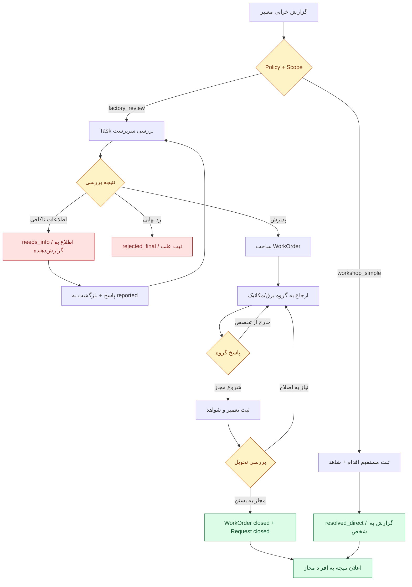

# SFP24 — مشخصات اجرایی پیشنهادی ۰۲: جریان‌ها، دیتابیس، API، UI و بسته‌های دقیق Codex

> **Status:** Proposed Codex-ready work specification (pending product decisions and separate coding authorization).  
> **Date:** ۲۰۲۶-۱۱-۰۵؛ **Code snapshot:** `pouyeshgar-workshop@5c7ac617f95ee8b84cbd32d7fa8e7474a073ec97`، شاخهٔ `codex/04-core-workspaces-dashboard`.  
> **Contracts:** [۰۱ — Core/Module/Data](01-CONTRACTS-AND-DATA.fa.md)، [۰۳ — Demo and Acceptance](03-DEMO-AND-ACCEPTANCE.fa.md)، [Domain Interaction Draft](../../contracts/DOMAIN-INTERACTION-CONTRACT-DRAFT.md).  
> **توجه:** شاخهٔ Stage 04 فعلاً مأموریت Discovery فقط‌خواندنی دارد؛ **هیچ بند این Spec به‌تنهایی آن ممنوعیت را لغو نمی‌کند**. پس از مجوز صریح، Codex باید در شاخهٔ جدیدِ جدا، با SHA قفل‌شده کار کند.  
> **طراحی از قبل انتخاب شده:** جایگزینی توده‌ای هسته، کنترل فیزیکی ماشین، خرید خودکار Maintenance، موتور BPMN عمومی و اجرای کد/SQL مشتری **ممنوع**. هر مسیری که در این فایل `new` نام دارد، هنوز وجودش در Runtime ادعا نمی‌شود.

## ۱. وضعیت واقعی و مرز تغییر فایل‌ها

**مشاهدهٔ موجود:**
- `server/platform/db.ts` دارای MariaDB Pool و Transaction است؛ `server/platform/migrations.ts` دارای migrations شماره‌دار و checksum، Control DB و Tenant DB است. جدیدترین Tenant Migration بررسی‌شده **v18** و Control **v9** است؛ هیچ Migration قدیمی نباید ویرایش شود.
- `server/operations/production/service.ts`، `server/operations/production/work.ts` و routes Production واقعی‌اند؛ `clientKey` و جلوگیری از تکرار/ویرایش/شمارشِ دوباره قبلاً وجود دارد.
- `server/operations/equipment-notes.ts` یادداشت/issue خصوصی یا مربوط به تجهیز می‌سازد؛ **نه** دستورکار و نه چت عمومی.
- `src/company/definition-catalog.ts` فیلدهای پایه و `masterDefinitionExtensions`/`requiredFor` را دارد؛ `MasterService` از تعریف مشترک برای سرور استفاده می‌کند.
- `server/operations/workspaces.ts` و `desk-assignments.ts` انتساب/نسخهٔ میزها را مدیریت می‌کنند؛ `src/company/AssignedDesk.vue` فعلاً `DeskExperiencePreview.vue` را نمایش می‌دهد و صریحاً می‌گوید دادهٔ نمایشی است.
- `src/company/module-catalog.ts`، `server/platform/catalog.ts`، `server/platform/accounts/service.ts` و `permission-catalog.ts` منطق نام ماژول/entitlement/permission را دارند؛ `maintenance` اکنون `pilot_only` است.
- `src/company/workspaces.ts` و `src/App.vue` مسیرها و `personal-desk` را کنترل می‌کنند؛ `production` به همراه `reports` بسته‌بندی مخصوص دارد.
- آزمون‌های `tests/desk-studio.test.ts`، `workspaces.test.ts`، `module-entitlements.test.ts`، `definition-catalog.test.ts`، `production-work-boundaries.test.ts` و `operational-domain.test.ts` وجود دارند و نباید با تغییر UX یا Permission شکسته شوند.

**دستور تغییر کلی:** همهٔ وضعیت‌های فوق را **حفظ** کن؛ فقط Adapter، نوع‌ها، Migrationهای افزایشی و UIهای واقعی لازم را اضافه کن. هیچ Drop، Truncate، جدول مشترک جهانی Domain Record، Rebuild کامل `src/App.vue` یا حذف Preview Studio انجام نشود.

## ۲. جریان‌های اجرایی Maintenance — حالت‌های نهایی پایلوت

### ۲.۱. Request

`RequestState` دقیقاً: `reported | needs_info | converted_to_work | resolved_direct | rejected_final | cancelled | closed`.

| Action | از وضعیت | به وضعیت | دادهٔ لازم | مجوز |
|---|---|---|---|---|
| `report` | — | `reported` | resource, description, optional sourceNoteId/priority/relatedProductionReportRef | `maintenance.request.create` |
| `request_info` | `reported` | `needs_info` | reason ≥ 8 char، recipient user | `maintenance.triage` |
| `reply_info` | `needs_info` | `reported` | reply، actor همان reporter یا delegate معتبر | `maintenance.request.reply` |
| `reject_final` | `reported` | `rejected_final` | reason ≥ 8 char | `maintenance.triage` |
| `convert_to_work` | `reported` | `converted_to_work` | policyRevision، assigneeGroup?/user?؛ WorkOrder جدید با UNIQUE(request_id) | `maintenance.triage` |
| `resolve_direct` | `reported` | `resolved_direct` | outcome + observedAt + evidence معتبر | `maintenance.resolve_direct` |
| `cancel` | `reported/needs_info` | `cancelled` | actor صاحب Request یا triage، reason | مجوز/Policy متناظر |
| `close_from_work` | `converted_to_work` | `closed` | نتیجهٔ WorkOrder در حالت `closed` | فراخوانی داخلی معتبر Maintenance |

از وضعیت پایانی هیچ Action تغییردهنده‌ای مجاز نیست، جز اصلاح کنترل‌شدهٔ رکورد با Revision/History در طراحی بعدی (در پایلوت فعلاً ممنوع). گزارش مستقیم کارگاه `resolve_direct` **بدون ساخت Task/Approval یا WorkOrder صوری** عمل می‌کند؛ با این حال Actor، زمان، شرح کار، نتیجه و Evidence باید ثبت شوند.

### ۲.۲. WorkOrder

`WorkState` دقیقاً: `open | assigned | in_progress | work_completed | returned_for_rework | closed | cancelled`.

| Action | از | به | قاعده |
|---|---|---|---|
| `assign` | `open/assigned/returned_for_rework` | `assigned` | assign به user یا tenant group معتبر؛ هر reassignment دلیل و Audit |
| `start` | `assigned` | `in_progress` | فقط Actor مجاز/منتسب، Scope و resource معتبر |
| `record_complete` | `in_progress` | `work_completed` | work summary + completedAt + outcome/evidence؛ نه آزادسازی دستگاه |
| `review_close.approve` | `work_completed` | `closed` | مسئول دارای `maintenance.review_close`؛ در `factory_review` جدا از اجراکننده |
| `review_close.return` | `work_completed` | `returned_for_rework` | reason، Task جدید برای گروه/نفر |
| `cancel` | `open/assigned` | `cancelled` | reason و مسئول مجاز؛ بعد از شروع واقعی، لغو مستقیم ممنوع تا Policy جدید |
| `reassign_not_my_specialty` | `assigned` | `assigned` | ثبت Decision/Reason، تغییر گروه/نفر و Task؛ نه رد نهایی Request |

**قید ایمنی:** WorkOrder با پرچم `requires_external_safety_review`، بدون نتیجهٔ معتبرِ کنترل تخصصی نباید `start` شود؛ در Pilot چون PTW Runtime نداریم، از مسیر آن کار **فقط Demonstration غیرعملیاتی** داشته باشیم یا `prerequisite_invalid` بدهیم. این Spec هیچ Permit را جعلی «صادر» نمی‌کند.

### ۲.۳. دو Policy غیرقابل‌ویرایش آزاد

`workshop_simple@1`: حق ثبت/حل مستقیم برای فرد مجاز؛ هیچ Task اجباری.  
`factory_review@1`: Report → Triage Task → (Need Info / Reject / Convert) → Assign (برق، مکانیک یا تأسیسات) → Work Task → Review Close Task → (Return/Reassign/Close).  
`factory_review@1` در Review استقلال واقعی Person را بررسی می‌کند؛ شخصی با دو Role یا چند Desk نمی‌تواند کار خودش را برای استقلال دوبار امضا کند. Policyهای آینده نسخهٔ خود را دارند؛ پروندهٔ قدیمی به `policyRevision` ساخته‌شده متصل است، نه تفسیر زنده و متغیر.

## ۳. قرارداد Task، Decision و Notification در Pilot

### ۳.۱. Task/Workflow

- Task status: `open, claimed, completed, cancelled, superseded`؛ Task فقط یک `subjectRef` و `stepKey` مشخص دارد؛ تاریخچهٔ append-only Decision/Activity ذخیره شود.
- Candidate: `assigneeUserId` یا `assignmentGroupId`؛ هر دو هم‌زمان اگر باشد معنی OR ندارد، باید یکی انتخاب شود. Claim با Revision/Lock، عضویت گروه و Permission/Scope بررسی شود.
- Step modes: `sequential` و `all_required`؛ `any_one_of_eligible_group` برای Claim بین چند عضو یک گروه مجاز است؛ quorum عددی/یAML خارج از Pilot.
- Decision: `approved, returned_for_changes, rejected_final, reassigned, completed_work` همراه reason، Actor، SubjectRevision، PolicyRevision، TaskId و Timestamp؛ هر تصمیمی باید دقیقاً با `stepKey` مجاز سازگار باشد.
- Reassignment و Return نباید Decision یا Task قبلی را پاک کنند؛ Task قبلی `completed/superseded`، Task جدید با همان SubjectRevision فعلی و Step درست ایجاد شود.
- تغییر مؤثر SubjectRevision از زمان ایجاد Task باید `409 stale_revision` یا `superseded` بدهد؛ ادامه روی rev قبلی بدون بررسی ممنوع.
- برای شرکت کوچک اگر Policy می‌گوید `not_required`، Task/Approval مصنوعی ساخته نشود؛ Audit واقعی ثبت شود.

### ۳.۲. Notification

`Notification`: `id,recipientUserId,kind,subjectRef,sourceEventId,createdAt,readAt,payloadVersion`. `readAt` فقط وضعیت اعلان است و هیچ مرحلهٔ Workflow را جلو نمی‌برد. Title/Body برای Recipient بدون مجوز از دادهٔ محرمانه ساخته نشوند؛ هنگام خواندن مجدد Scope کنترل شود. Unique `(sourceEventId,recipientUserId,kind)` و Query `unread count` برای زنگوله.

`EquipmentNotes` فعلی باقی بماند؛ `note`/`issue`، پیام‌رسان عمومی یا WorkOrder نیست. Action اختیاری `maintenance.request.report` می‌تواند یک `sourceNoteId` معتبر را به Request تبدیل کند؛ UNIQUE این مرجع مانع ایجاد چند Request از یک Note شود؛ Note دست‌کاری نشود.

### ۳.۳. Event/Recovery

در تراکنش هر Domain Change یک Outbox Event با `eventId,tenantId,eventType,eventVersion,ownerModule,aggregateRef,occurredAt,correlationId,payload` ثبت شود. Consumer سبکِ درون‌پردازه Inbox/Notification آن را با `(consumerId,eventId)` یکتا پردازش کند. تحویل at-least-once با پردازش idempotent، Retry کنترل‌شده و وضعیت `failed_requires_attention`. از Broker و Exactly-once سراسری در این فاز پرهیز. در خطای اعلان، درخواست خرابی **نباید Rollback شود**؛ اعلان باید قابل بازیابی باشد.

## ۴. طرح Schema و Migration افزایشی

**وضعیت واقعی کد بررسی‌شده:** Control DB تا Migration v9، Tenant DB تا v18. در همان مبنا افزودهٔ پیشنهادی `tenantMigration v19` است. Codex **قبل از اجرا** باید روی SHA مصوب شماره‌ها را بازبینی کند؛ هیچ Migration قبلی/Checksum را عوض نکند. Tenant Tables جدید به `tenantWritableTables` و append-onlyها به `tenantAppendOnlyTables` فعلی افزوده شوند. Control و Tenant DB جدا می‌مانند؛ FK بین دیتابیس‌ها نسازیم.

### ۴.۱. جدول‌های متعلق به Maintenance در Tenant DB

| جدول جدید | Schema پیشنهادی (ستون‌ها و نوع‌ها) | Constraint / Index |
|---|---|---|
| `maintenance_requests` | `id CHAR(36) PK`، `resource_id CHAR(36) NOT NULL`، `site_id CHAR(36) NOT NULL`، `reported_by_user_id CHAR(36)`، `source_note_id CHAR(36) NULL`، `related_production_report_id CHAR(36) NULL`، `description TEXT`، `priority VARCHAR(16)`، `status VARCHAR(32)`، `revision INT DEFAULT 1`، `observed_at_ms BIGINT NULL`، `created_at TIMESTAMP(3)`، `updated_at TIMESTAMP(3)` | FK resource؛ UNIQUE(source_note_id)؛ INDEX(site_id,status,created_at)، INDEX(reported_by_user_id,created_at). Production Report از طریق DomainRef بررسی شود، نه FK مستقیم |
| `maintenance_work_orders` | `id CHAR(36) PK`، `request_id CHAR(36) NOT NULL`، `resource_id CHAR(36)`، `status VARCHAR(32)`، `revision INT`، `assigned_user_id CHAR(36) NULL`، `assigned_group_id CHAR(36) NULL`، `policy_key VARCHAR(64)`، `policy_revision INT`، `requires_external_safety_review BOOLEAN`، `started_at_ms BIGINT NULL`، `completed_at_ms BIGINT NULL`، `closed_at_ms BIGINT NULL`، `created_at TIMESTAMP(3)` | UNIQUE(request_id)، FK request/resource، INDEX(status,assigned_group_id)، INDEX(status,assigned_user_id) |
| `maintenance_actions` | `id CHAR(36) PK`، `request_id CHAR(36) NOT NULL`، `work_order_id CHAR(36) NULL`، `performed_by_user_id CHAR(36)`، `action_kind VARCHAR(48)`، `outcome VARCHAR(48)`، `summary TEXT`، `performed_at_ms BIGINT`، `recorded_at TIMESTAMP(3)` | append-only، FK request/workorder، INDEX(request_id)، INDEX(work_order_id) |
| `maintenance_evidence` | `id CHAR(36) PK`، `action_id CHAR(36) NOT NULL`، `kind VARCHAR(24)`، `text_value TEXT NULL`، `numeric_value DECIMAL(18,6) NULL`، `unit VARCHAR(24) NULL`، `captured_at_ms BIGINT`، `recorded_by_user_id CHAR(36)`، `created_at TIMESTAMP(3)` | append-only، FK action، kind در پایلوت فقط `narrative/measurement`؛ نسخهٔ فایل/امضای قانونی در این مرحله وجود ندارد |
| `maintenance_policy_revisions` | `policy_key VARCHAR(64)`، `revision INT`، `definition_json MEDIUMTEXT`، `created_by_user_id CHAR(36)`، `created_at TIMESTAMP(3)` | PK(policy_key,revision)، immutable |
| `maintenance_policy_current` | `id TINYINT PK`، `policy_key VARCHAR(64)`، `revision INT`، `updated_at TIMESTAMP(3)` | یک ردیف id=1؛ CAS با expectedRevision و Audit |

### ۴.۲. جدول‌های هماهنگی عمومی در Tenant DB

| جدول جدید | ستون‌ها و Constraints اصلی | مسئولیت |
|---|---|---|
| `tenant_assignment_groups` | id PK CHAR(36)، code UNIQUE VARCHAR(48)، name، site_id NULL، active، revision | گروه کارِ همان Tenant؛ Role/Permission نمی‌دهد |
| `tenant_assignment_group_members` | group_id، user_id، active، created_at؛ PK(group_id,user_id) | UserId با Account فعال همان شرکت در Control DB تأیید شود |
| `tenant_workflow_instances` | id PK، owner_module، entity_type، entity_id، subject_revision، policy_key، policy_revision، definition_snapshot_json MEDIUMTEXT، status، created_at | نسخه و ترتیب Workflow ثابتِ زمان آغاز |
| `tenant_tasks` | id PK، workflow_id، step_key، assignee_user_id NULL، group_id NULL، claimed_by_user_id NULL، subject_revision، status، revision، created_at، completed_at NULL | Claim/Decision تراکنشی و scoped؛ INDEX برای status/assignee/group |
| `tenant_task_decisions` | id PK، task_id، actor_user_id، actor_person_id NULL، subject_revision، policy_revision، outcome، reason، decided_at | append-only؛ تصمیم نهایی دوباره با Lock/Status ممنوع |
| `tenant_action_receipts` | id PK، actor_user_id، action_key، idempotency_key، payload_sha256 CHAR(64)، result_json MEDIUMTEXT، created_at | UNIQUE(actor_user_id,action_key,idempotency_key) در Tenant DB؛ همان کلید با payload مختلف 409 |
| `tenant_domain_outbox` | event_id PK، owner_module، event_type، event_version، aggregate_type/id/revision، payload_json، correlation_id، occurred_at، delivery_status، attempt_count | رویداد پس از تغییر معتبر در همان transaction ایجاد شود |
| `tenant_event_consumptions` | event_id، consumer_key، processed_at؛ PK(event_id,consumer_key) | ضدتکرار مصرف‌کننده |
| `tenant_notifications` | id PK، recipient_user_id، event_id، kind، owner_module، entity_type/id، title_key، created_at، read_at NULL | UNIQUE(event_id,recipient_user_id,kind)، INDEX(recipient_user_id,read_at,created_at) |

**مرزهای دیتابیس:** `company_work_desks` موجود در Control DB بماند؛ `production_reports`، `work_sessions` و `equipment_notes` فعلی را به جدول جدید مهاجرت ندهیم. ستون `actor_user_id` در Tenant DB به User معتبر Control اشارهٔ منطقی دارد، نه FK بین دیتابیس. اطلاعات محرمانه را در Notification/Outbox JSON منتشر نکنیم. ویرایش یا حذف ردیف‌های append-only از API عمومی ممنوع.

**زمان و نسخه:** created/updated در UTC، `observed_at_ms` با زمان اعلام واقعی، `revision` افزایشی مثبت؛ ایندکس‌ها و FKهای پیشنهادی باید در MariaDB/InnoDB روی Migration موقت اجرا و صحتشان آزموده شود. برای کارهای حساس، شرط `indeterminate` و اتصال PTWِ پیاده‌نشده، fail closed است.

**سیاست داده:** Evidence در پایلوت متن و اندازه‌گیری است، نه ادعای «پروندهٔ کامل مدارک استاندارد/امضای حقوقی». اگر لازم شد عکس یا فایل پیوست واقعی بسازیم، قبل از آن باید API امن `CompanyFiles`، ACL، Digest، Retention، Malware/Size Limit و مهاجرتش در تسک مستقل تصویب شود.

### ۴.۳. Runtime و Lifecycle

در startup فقط Descriptorهای trusted ساخته شوند. ثبت Maintenance با وضعیت `pilot_only`، دسترسی مشتری تولیدی ایجاد نکند. تست داخلی می‌تواند فقط در Tenant/Control DB **Disposable** به‌طور صریح آماده‌بودن ماژول را Fixture کند؛ هیچ bypass entitlement در مسیر Runtime واقعی نسازیم. بعد از عبور تست‌های انتهابه‌انتها، تغییر `maintenance` از `pilot_only` به `ready` نیازمند تصمیم و PR جداست.

وقتی Maintenance خاموش شد، هیچ Action تازه اجرا نشود؛ Workflow باز می‌تواند `paused_module_unavailable` بگیرد، نه `closed`. تاریخچهٔ Subject، Decisions و Evidence حفظ و با دسترسی مجاز بازخوانی شود. بعد از فعال‌سازی، قبل از ادامه Revision/Policy/Qualification/Scope دوباره بررسی شوند.

### ۴.۴. بازیابی خطا

Receipt و Domain Mutation و Event Outbox در همان **Tenant Transaction** ثبت شوند. اگر پس از Commit پاسخ HTTP گم شد، Retry با همان `Idempotency-Key` همان نتیجه را می‌دهد؛ Payload متفاوت با همان کلید `409`. درخواست درگاه اعلان شکست بخورد، Maintenance Record نباید rollback یا از دست برود؛ Delivery قابل retry است. Exactly-once end-to-end وعده ندهیم. تغییر ساختار با Migration افزایشی؛ rollback با بازگشت نسخهٔ برنامه و خاموش‌کردن قابلیت، **نه Drop اطلاعات تاریخی**.
