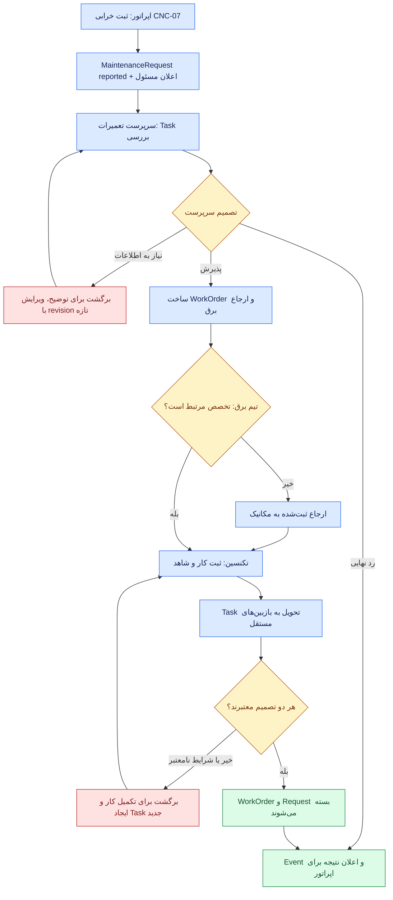

# SFP24 — مشخصات اجرایی پیشنهادی ۰۳: دو شرکت ساختگی، سناریوهای End-to-End و پذیرش

> **Status:** Proposed acceptance specification v0.1 — نه تست پاس‌شده، نه محیط آمادهٔ اجرا، نه ادعای انطباق ISO/IATF.  
> **تاریخ:** ۲۰۲۶-۱۱-۰۵ · **Code base inspected:** `pouyeshgar-workshop@5c7ac617f95ee8b84cbd32d7fa8e7474a073ec97`.  
> **Contract:** [۰۱ — Modules/Ports](01-CONTRACTS-AND-DATA.fa.md) · [۰۲ — Code/DB/API/UI](02-CODEX-WORK-PACKAGES.fa.md).  
> **هدف:** اجرای واقعی یک معماری مشترک، دو Company متفاوت و دو Domain (Production موجود + Maintenance سبک)، بدون ساخت موتورهای عمومی اثبات‌نشده.  
> **همهٔ نام‌ها، اعداد و اشخاص این فایل ساختگی‌اند.** این Fixture باید فقط در پایگاه دادهٔ Disposable و با Opt-in روشن اجرا شود.

## ۱. اصول Demo و محدودیت خطر

در `scripts/core-module-pilot-qa.mjs` که در بستهٔ ۰۲ پیشنهاد شد، فقط وقتی متغیر محیطی `SFP24_PILOT_FIXTURE_CREATE=1` و مشخصات Local/Disposable MariaDB صراحتاً درست‌اند، امکان ایجاد شرکت‌های آزمایشی وجود داشته باشد. نام کاربری/رمز تصادفی در محل امن خارج از Git ساخته شود؛ هیچ Credential یا Tenant واقعی وارد Repository نشود.

**ممنوع:** تغییر دادهٔ شرکت واقعی، استفاده از Database Production، اجرای فرمان PLC، اتصال اختیاریِ Hub به دستگاه واقعی، درج شواهد مشتری یا تأیید نمونه به‌عنوان گواهی ISO/IATF. همهٔ Widgetهای پایلوت باید منبع و وضعیت واقعی (نه نمونهٔ Preview) را درست نشان دهند.

### Fixture A — `DEMO-WORKSHOP-LITE`

- شرکت ساختگی با یک Site `WS-01`، یک Area `SHOP`، تجهیز `CNC-01` و یک Part `PART-A` و Operation `TURN-A`.
- یک Person دارای Account فعال `worker-a` با مسئولیت چندگانه؛ یک مدیر/کاربر جدا برای تنظیمات `admin-a` (می‌تواند همان شخص حقیقی باشد، ولی در Fixture برای تست مجوز دو Actor می‌سازیم).
- Shift رسمی **اختیاری**؛ کار روزانه می‌تواند از تماس/اطلاع شفاهی باشد. Production بدون Planning/OEE/Training فعال کار کند.
- Entitlement آزمایشی Production + Maintenance با Permissions حداقلی. Policy شرکت `workshop_simple@1`.
- میز `desk-workshop`: فقط کار جاری، ثبت `good/scrap`، گزارش خرابی، تاریخچهٔ خود و زنگوله. Dashboard بزرگ، فرم‌ساز آزاد و تأیید مستقل در UI نشان داده نشوند.
- نمونهٔ نتیجه: ۴۸ قطعه سالم، ۲ ضایعات، شناسهٔ کار و زمان ثبت معتبر؛ گزارش تعمیر سادهٔ تجهیز با شرح و Evidence متنی، **بدون ایجاد Task/Approval صوری**.

### Fixture B — `DEMO-FACTORY-QUALITY`

- شرکت ساختگی دوشیفتی با Site `FACTORY-01`، Areas `PROD` و `MAINT`، تجهیز `CNC-07` و Part `P-100`، Operation `OP-10`. شناسهٔ نمایشی سفارش `ORDER-52` صرفاً Context تست است؛ ماژول Planning و Order رسمی اجرا نشده است.
- اشخاص و Accountهای متمایز: `operator-b`، `prod-supervisor-b`، `maint-supervisor-b`، `electrician-b`، `mechanic-b`، `quality-viewer-b`، `admin-b`؛ دو گروه `ELECTRICAL` و `MECHANICAL` با اعضا و Site Scope مشخص.
- Policy `factory_review@1`؛ Tasks رسیدگی و تحویل، گروه‌های مسئول، Test مستقل دو بررسی‌کننده در گام Closure (سناریوی `all_required`) با منع خودتأییدی. این الگو **انتخاب آزمایشی شرکت فرضی** است نه الزام جهانی ISO.
- میز اپراتور: work/report/issue/my-history/my-notifications؛ میز Maintenance Supervisor: Triage/Work Orders/Inbox/Notification/EquipmentHistory؛ میز Manager: Dashboard/Review Tasks؛ میز Technician: Assigned WorkOrders/Task Results/EquipmentHistory.
- کارخانه «نظام کیفیت دارد» فقط به معنی سناریوی دارای شواهد و نقش‌های مرتبط است. ماژول واقعی QMS، PTW و Training در این Pilot ساخته نشده‌اند، پس هیچ عبارت «گواهی انطباق» یا «مجوز ایمنی صادر شد» در خروجی نباشد.

### نامنظورهایی که نباید از Fixture برداشت شوند

Policy `factory_review@1` نباید برای همهٔ کارخانه‌ها اجباری شود؛ حتی شرکت بزرگ می‌تواند مسیر ثبت مستقیم برای نوعی کار مجاز داشته باشد و کارگاه کوچک می‌تواند برای فعالیت پرخطر مسیر تخصصی نیاز داشته باشد. انتخاب Template به‌تنهایی bypass خطر/قانون نیست. `Production Report` با `MaintenanceRequest` و `EquipmentNote` سه رکورد مستقل هستند؛ ارتباطشان Typed Reference است.

## ۲. نمونهٔ Payloadهای واقعی‌نما

### ۲.۱. Production: حفظ مدل کنونی

از مسیر موجود `POST /api/v1/company/production/reports` با `{input:ProductionInput}` استفاده شود؛ اسم فیلد را برای پایلوت عوض نکنیم.

```json
{
  "input": {
    "siteId": "UUID_OF_WS_01",
    "reportDate": "2026-11-05",
    "startAt": "2026-11-05T06:00:00.000Z",
    "endAt": "2026-11-05T13:00:00.000Z",
    "notes": "Manual daily workshop production",
    "clientKey": "workshop-a-day-20261105",
    "lines": [
      {
        "resourceId": "UUID_OF_CNC_01",
        "partId": "UUID_OF_PART_A",
        "operationId": "UUID_OF_TURN_A",
        "good": 48,
        "scrap": 2,
        "unit": "pcs",
        "notes": "Two rejected in dimensional check",
        "scrapReasons": []
      }
    ]
  }
}
```

**شروط:** شناسه‌ها باید UUIDهای واقعاً Seedشده باشند؛ `reportDate`، Period، Unit، Resource/Part/OP و گیت‌های Report فعلی معتبر باشند. این مثال فرض نمی‌کند هر دادهٔ دلخواه بدون Validation در نسخهٔ موجود قابل ثبت است. اگر سرویس تولید `shiftId` یا `operatedBy` لازم دانست، از قرارداد واقعی آن استفاده شود؛ تغییر برای سبزکردن Fixture ممنوع. Run باید پاسخ/شناسهٔ رسمی تولید را تأیید کند.

### ۲.۲. Maintenance: ثبت خرابی

```json
{
  "resourceId": "UUID_OF_CNC_07",
  "description": "Machine stopped unexpectedly; operator observed unusual sound",
  "priority": "high",
  "observedAt": "2026-11-05T09:12:00.000Z",
  "relatedProductionReportId": "UUID_OF_EXISTING_REPORT_OR_OMIT"
}
```

برای `POST /api/v1/company/maintenance/requests` هدر `Idempotency-Key: factory-b-fault-001` پایدار باشد؛ سرور خودش از Session، `actorUserId` و Tenant را استخراج می‌کند. پاسخ مورد انتظار: Request با `id`، `revision:1` و `status:"reported"`. اگر Parent Report موجود نیست، Field را **حذف کنیم**، نه UUID ساختگی بفرستیم.

### ۲.۳. برگشت برای اصلاح و ایجاد WorkOrder

```json
{
  "outcome": "request_info",
  "reason": "Please provide the observed alarm and time of occurrence",
  "expectedRevision": 1
}
```

بعد از `reply-info` توسط همان Reporter، RequestRevision افزایش می‌یابد. تصمیم `convert_to_work` باید بر نسخهٔ تازه انجام شود، و دوباره‌فرستادن تصمیم قدیمی `409 stale_revision` برگرداند. برای WorkOrder، مسئول می‌تواند `groupId` تیم برق را بدهد؛ اگر کار برق نیست، با `reassign` و reason، Task جدید برای مکانیک باز کند، نه اینکه Request را `rejected_final` کند.

### ۲.۴. کارگاه ساده: اقدام مستقیم

```json
{
  "summary": "Replaced loose fastener and tested machine manually",
  "outcome": "resolved",
  "performedAt": "2026-11-05T09:45:00.000Z",
  "evidence": [
    {"kind": "narrative", "textValue": "Machine tested for 10 minutes without visible issue"}
  ],
  "expectedRevision": 1
}
```

در `workshop_simple`، `resolve-direct` باید رکورد TechnicalAction + Evidence + Audit بسازد و Request را `resolved_direct` کند؛ **هیچ Task/Decision جعلی** برای `worker-a` ایجاد نشود.

## ۳. مسیر کارخانهٔ پیچیده؛ کدام پنل چه می‌بیند؟



**فهم صحیح:** Event فقط خبرِ Domain Change است؛ Notification کار را انجام نمی‌دهد. تأیید دو مسئول فقط دربارهٔ WorkOrderRevision/Policy مشخص است. تحویل تجهیز با Quality Release محصول و مجوز ایمنی PLC یکی نیست. اگر شرط HSE واقعاً لازم باشد و PTW موجود نباشد، پایلوت در عمل حساس `fail closed` می‌شود؛ فرایند آموزشی نباید دستور انجام کار خطرناک بدهد.

| لحظه | میز اپراتور | میز تعمیرات | میز مدیر / Dashboard |
|---|---|---|---|
| خرابی ثبت شد | شناسهٔ Request، وضعیت گزارش‌شده | Task/Request باز، Scope تجهیز | تعداد موارد باز، نه نتیجهٔ قطعی تعمیر |
| برگشت برای اطلاعات | پیام/اعلان و فرم تکمیل | Task تاریخچه و علت | سابقه قابل جست‌وجو بدون اطلاعات محرمانهٔ غیرمجاز |
| ارجاع برق→مکانیک | وضعیت کلی در حد اجازه | Task قدیم بسته/ارجاع تازه؛ تاریخچه محفوظ | مشاهدهٔ تأخیر واقعی |
| تعمیر ثبت شد | هنوز «تجهیز آزاد» نشان نده | WorkOrder `work_completed`، Task بررسی | KPI «تعمیر تکمیل، تحویل باز» جدا از Closed |
| تحویل تأیید شد | اعلان و تاریخچهٔ مجاز | WorkOrder Closed با Evidence | نمودار و مقدار بسته‌شدهٔ واقعی |

## ۴. آزمون‌های پذیرش — Given / When / Then

**وضعیت:** همهٔ موارد زیر `SPECIFIED, NOT EXECUTED` هستند. کلید تست پایدار در گزارش Codex حفظ شود. تست UNIT برای Domain، API INTEGRATION با MariaDB Disposable و در موارد مشخص UI/browser لازم است. Stubهای PTW/Training/Inventory فقط قرارداد را می‌سنجند و قابلیت واقعی آن ماژول‌ها را اثبات نمی‌کنند.

| ID | Given / When | Then — شرط قبولی |
|---|---|---|
| **QA-01** | Company خالی با admin معتبر / Initialize | بدون Resource/3D/Planning ساخته شود؛ هیچ ماژولِ آماده‌نشده اجباری نشود |
| **QA-02** | Registry دارای دو Descriptor معتبر / startup | Production/Reports شناخته شوند؛ Maintenance در `pilot_only` به عنوان قابلیت قابل فروش عرضه نشود |
| **QA-03** | ثبت Duplicate ModuleKey یا Missing Port / startup | fail با خطای مشخص؛ بدون register جزئی/متناقض |
| **QA-04** | Production فقط خریداری شده / login operator | ثبت و تاریخچهٔ محدود مجاز؛ هیچ کارت Maintenance، OEE یا Monitoringِ بدون entitlement ظاهر نشود |
| **QA-05** | اپراتور Production بدون Desk Assignment / login | مسیر مجاز Production طبق Shell فعلی کار کند، کاربر در صفحهٔ خالی گیر نکند |
| **QA-06** | کارگاه کوچک با `workshop_simple` / گزارش خرابی و `resolve-direct` | Request/TechnicalAction/Evidence/Audit معتبر؛ **صفر Task/Approval مصنوعی** |
| **QA-07** | Tenant A و Tenant B با Resource مجزا / Actor A درخواست B را با UUID بخواند | 404/403 مناسب بدون افشای محتوا، حتی از Dashboard/Export/Bell |
| **QA-08** | Actor بدون `maintenance.request.create` / submit | 403، بدون ایجاد Request/Outbox/Notification |
| **QA-09** | Actor با Permission ولی خارج از Site/Resource Scope / submit | رد سمت سرور، نه فقط مخفی‌کردن دکمه |
| **QA-10** | Company Maintenance غیرفعال / create request | 403/409، بدون اثر؛ Production و Notes به کار خود ادامه دهند |
| **QA-11** | `sourceNoteId` مربوط به یک Note واقعی / دو بار تبدیل با همان key | یک Request، Note اصلی بدون تغییر |
| **QA-12** | Idempotency-Key تکراری و Payload برابر / دو POST | همان result ID/Revision، بدون دوبرابرکردن اثر |
| **QA-13** | همان Key با Payload متفاوت / POST | `409 key_payload_mismatch`، وضعیت قبلی بدون تغییر |
| **QA-14** | جواب HTTP پس از Commit گم شود / Retry همان key | نتیجهٔ پایدار قبلی قابل بازیابی، نه False Failure |
| **QA-15** | دو درخواست همزمان برای Triaging یک Revision / اجرای هم‌زمان | حداکثر یک Transition معتبر؛ دیگری `stale_revision` |
| **QA-16** | `reported` / Triage request_info با دلیل | `needs_info` و اعلان Reporter؛ Reason/Decision تاریخی ثبت شود |
| **QA-17** | Reporter جواب اطلاعات را بدهد / reply-info | Revision تازه و Task مناسب؛ Decision قبلی حذف نشود |
| **QA-18** | `reported` / reject_final | علت و Actor ثبت؛ هیچ WorkOrder جعلی ساخته نشود |
| **QA-19** | `reported` / convert_to_work | Request و WorkOrder یک‌به‌یک؛ Retry دوم WorkOrder دوم نسازد |
| **QA-20** | Assign به گروه برق / عضو خارج از گروه Claim کند | `403`، حتی اگر Resource را در Desk ببیند |
| **QA-21** | عضو گروه با Permission و Scope معتبر / claim/start | Task و WorkOrder با Revision معتبر جلو بروند؛ Actor درست ثبت شود |
| **QA-22** | تعمیرکار برق می‌گوید not_my_specialty / reassign | Request نه rejected، Task جدید مکانیک؛ تاریخچه و Reason محفوظ |
| **QA-23** | WorkOrder `work_completed` / قبل از Review Close | هر جا نشان داده شود `awaiting_review`، نه `equipment_released` |
| **QA-24** | انجام‌دهنده با دو عنوان شغلی / approval مستقل همان کار | `self_approval_forbidden`؛ هیچ بستن خودکار |
| **QA-25** | دو Task موازی all_required / تنها یکی approve | WorkOrder `work_completed` باقی بماند؛ Task دوم منتظر باشد |
| **QA-26** | یکی از بازبین‌ها return برای اصلاح / بعد از approve قبلی | Decisionهای تاریخی بمانند؛ عمل/Revision جدید و Review جدید لازم؛ Approval قدیمی به Revision جدید منتقل نشود |
| **QA-27** | همهٔ Reviewهای لازم برای Revision فعلی قبول شده‌اند / close | WorkOrder و Request بسته، Event بعد از Commit، اعلان به افراد مربوط |
| **QA-28** | Task توسط فرد نامجاز/در Group حذف‌شده / decide | 403؛ Group/Role/Desk مجوز تولید نمی‌کند |
| **QA-29** | Notification وصول شد / mark read | فقط `readAt` عوض شود؛ Task/Decision/Domain State ثابت |
| **QA-30** | یک Event دوبار تحویل شود / consume | یک Notification و یک نتیجهٔ مصرف؛ `eventId` anti-duplicate |
| **QA-31** | مصرف Notification خطا بدهد / retry after commit | Request/WorkOrder موفق باقی بماند؛ eventual notification بدون دوباره‌کاری |
| **QA-32** | یک Policy جدید هنگام WorkOrder باز منتشر شود | Instance قدیمی Snapshot/Revision قدیمی را حفظ کند؛ تغییر پنهانی Workflow ممنوع |
| **QA-33** | ماژول Maintenance هنگام Task باز Disable شود | Actionهای جدید Block؛ تاریخچه حفظ؛ resume نیازمند کنترل دوباره |
| **QA-34** | user صرفاً `production.view_own` / Query history | فقط گزارش مجاز خود را ببیند؛ افزایش فیلتر URL موجب افشای دیگران نشود |
| **QA-35** | Desk با Widget قدیمی ذخیره شده / کد UX جدید بالا بیاید | Desk هنوز Load/assign شود، Legacy ID به Renderer مجاز نگاشت شود؛ Schema شکسته نشود |
| **QA-36** | Studio Preview باز شود / تجربهٔ نمونه | متن واضح Preview؛ کلیک نمونه، گزارش واقعی یا فرمان ماشین نسازد |
| **QA-37** | AssignedDesk واقعی / ثبت خرابی | API واقعی صدازده شود، Request ID قابل مشاهده و بعد از Reload پایدار باشد |
| **QA-38** | کاربر Permission را از دست بدهد ولی UI هنوز Widget دارد / Submit | Backend 403؛ UI Error/Reload مناسب |
| **QA-39** | KPI Dashboard با Requestهای مختلف / Query | مقدار از DB معتبر، Scope و Timestamp؛ هیچ عدد ساختگیِ بدون label نباشد |
| **QA-40** | Equipment Profile / history | فقط همان Resource و فقط اطلاعات مجاز؛ Master Resource کپی نشده باشد |
| **QA-41** | Time Zone سایت و UTC متغیر / ثبت زمان | ذخیرهٔ پایدار UTC، نمایش محلی درست؛ رخداد دیررس با زمان ثبت اشتباه نشود |
| **QA-42** | Comment متنی شامل HTML/script / نمایش | XSS و HTML injection ممکن نباشد |
| **QA-43** | Method Body دارای actorId/tenantId ساختگی / Action | extra field 400؛ هویت از Session |
| **QA-44** | Fixture/Provision و cleanup روی Disposable / اجرا | جداول جدید کامل ایجاد/جمع‌بندی شوند؛ دادهٔ واقعی یا DB دیگر آسیب نبیند |
| **QA-45** | Schema v18 موجود / ارتقا به v19 | داده‌ها و migrations قبلی حفظ، checksum و schema نسخه جدید معتبر، بدون Drop |
| **QA-46** | بازگشت برنامه از release جدید / rollout ناموفق | Feature Off و App سازگار، بدون پاک‌کردن سوابق |
| **QA-47** | Input Device Parameter ارتباط ندارد / نمایش | unavailable/unknown، نه صفر یا خرابی قطعی |
| **QA-48** | در UI نمایش درخواست/Task/Permission از دو Tenant / Browser check | هیچ منوی دسترسی و هیچ API leak؛ ارتباط Tenant به Content دیگری ندارد |
| **QA-49** | Request در حالت reported/needs_info / cancel با reason معتبر | Request cancelled و Event/Notification مربوط فقط یک بار؛ درخواست لغو روی Revision قدیم 409 |
| **QA-50** | WorkOrder open/assigned و هنوز شروع‌نشده / cancel با reason | WorkOrder و Request مرتبط در همان تراکنش cancelled، Taskهای باز لغو؛ WorkOrder in_progress با cancel عمومی 409 |
| **QA-51** | Company Admin با Permission مناسب / Policy revision و مدیریت اعضای Group | فقط همان Tenant/Scope و CAS؛ UI قاعدهٔ دیگری را خرید/فعال یا Permission اضافه نکند |
| **QA-52** | کاربر بدون مجوز Company Admin / بازکردن ModuleCapabilities/PolicyEditor/GroupEditor و اجرای API | UI و API هم‌زمان محدود؛ نشت اطلاعات افراد و تیم‌های Tenant دیگر ممنوع |

### ۴.۱. اولویت آزمون‌ها

**Blocking Critical:** QA-06 تا QA-15، QA-19 تا QA-33، QA-34، QA-38، QA-43، QA-45، QA-48 تا QA-52.  
**Blocking Functional:** بقیه، مگر موردی صرفاً به موتور خارج از Scope وابسته باشد؛ در آن صورت صریحاً `CONTRACT_STUB_ONLY` گزارش شود و «پاس» Runtime واقعی ثبت نشود.

**ارزیابی مستقل:** هیچ تستی نباید برای سبزشدن، permission gate، Domain Revision، License یا WorkOrder Policy را حذف کند. اگر آزمونی با Spec تعارض داشت، Codex باید STOP و مسئله را گزارش کند.

## ۵. نقشهٔ تست‌های کد و دستورات

در مخزن کد، مسیرهای موجود را **باید حفظ کنیم**:
`tests/desk-studio.test.ts`، `workspaces.test.ts`، `module-entitlements.test.ts`، `definition-catalog.test.ts`، `production-work-boundaries.test.ts`، `operational-domain.test.ts`، `tests/support/operations-acceptance.ts` و `scripts/workspaces-qa.mjs`.

فایل‌های جدید پیشنهادی:
- `tests/module-registry.test.ts` — Descriptor و Readiness؛
- `tests/maintenance-domain.test.ts` — Request/WorkOrder/Direct Resolve و Scope؛
- `tests/maintenance-policy.test.ts` — Policy Version، Self-Approval و Reassignment؛
- `tests/task-lifecycle.test.ts` — Group Claim، Parallel Review و Revision؛
- `tests/notification-contract.test.ts` — Bell vs Decision و Event Dedup؛
- `tests/ui-contributions.test.ts` — Legacy Desk و UX visibility؛
- `tests/core-module-pilot.test.ts` — E2E Integration با Fixture ساختگی؛
- `scripts/core-module-pilot-qa.mjs` — تست مرورگر/QA با ایجادِ عمدی و محدودِ Tenantهای Disposable.

**روش اجرای پیشنهادی پس از مجوز:** Node 24، pnpm 11.25.0، `pnpm install --frozen-lockfile`، `pnpm typecheck`، `pnpm test`، `pnpm build`، `pnpm contract:check` و در محیط مناسب `pnpm test:all`. نیازهای MariaDB/fixture باید طبق راهنمای پروژه آماده شوند؛ اگر محیط وجود نداشت نتیجه `NOT_RUN` است، نه `PASS`.

### ۵.۱. معیار اتمام واقعی Pilot

فقط اگر:
۱. دو Company مستقل از یک Runtime استفاده کنند؛
۲. Production در کارگاه ساده با گزارش خود و Maintenance direct، بدون Task صوری کار کند؛
۳. کارخانهٔ بزرگ بتواند Report → Triage/Return → Assign برق→مکانیک → Perform → Independent Review → Close → Notification را طی کند؛
۴. Entitlement/Scope/Permission/API/Revision/Retry/Outbox/Audit و Legacy Desk تست شوند؛
۵. همهٔ Blocking Testهای مرتبط **واقعاً اجرا و پاس شوند**؛
۶. Migration/Backout و وضعیت مجهول/ناموفق ثبت شود؛

می‌توان گفت **Pilot قابل ارائه برای تصمیم مرحلهٔ بعد است**. این **به معنی آماده‌بودن CMMS کامل، Training، PTW، OEE یا انطباق قانونی نیست**.

## ۶. گزارش اجباری Codex بعد از هر بسته

```text
Work Package: WP-__
Code repo / Branch / Base SHA:
Docs repo / Spec SHA:
Files added:
Files modified:
Files removed:
Schema migration and old/new version:
Public/internal API changes:
Permission, Scope and Entitlement changes:
Domain invariants preserved:
Unit tests PASS/FAIL/NOT_RUN:
Integration tests PASS/FAIL/NOT_RUN:
Browser tests PASS/FAIL/NOT_RUN:
Fixture ID and disposable-only confirmation:
Data-loss/Backout risk:
Known gaps and contractual deviations:
Proposals needing owner decision:
No merge/deploy confirmed: YES/NO
```

**هدف:** Codex بتواند بر مبنای Spec کامل و محدودهٔ روشن، برنامه‌نویسی و آزمون کند؛ **نه اینکه نبود تصمیم را با حدس و تغییر هسته جبران کند**.
