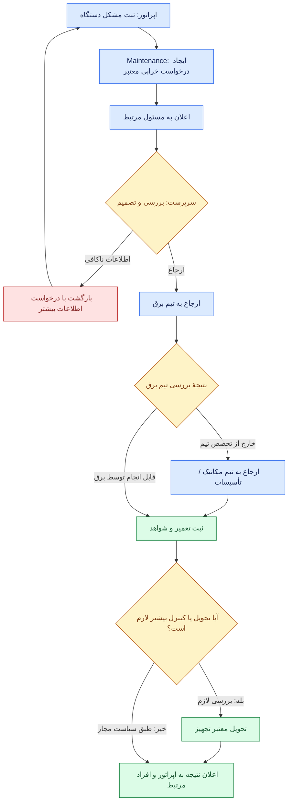

# از اطلاعات پایهٔ شرکت تا ماژول، کارتابل، میز و تجربهٔ اپراتور — ادامهٔ گفت‌وگوی معماری

> **تاریخ گفتگو:** ۲۰۲۶-۱۱-۰۵  
> **منشأ:** گفت‌وگوی جاریِ صاحب محصول و دستیار پس از ساخت شاخهٔ بازیابی‌شدهٔ `docs/recovered-session-core-workspace-2026-11-05`.  
> **نوع متن:** ثبت تفصیلی و انسانیِ پیشنهاد و توضیحات دستیار بر اساس گفت‌وگوی در دسترس؛ **نه transcript لفظ‌به‌لفظ، نه قرارداد مصوب و نه تصمیم نهایی کاربر**. مثال‌های تصویری و نمودارها به Markdown و Mermaid قابل خواندن در GitHub تبدیل شده‌اند.  
> **هدف:** روشن‌شدن نحوهٔ اتصال هسته با اطلاعات حداقلی شرکت، گسترش موجودیت‌ها توسط ماژول‌ها، تعامل ماژول‌ها، وظایف و تأییدها، پیام‌رسانی، اعلان‌ها، Form/Desk/Dashboard/Profile/3D و گذار کنترل‌شده به مأموریت‌های Codex.  
> **وضعیت:** `Discussion / Proposed`؛ بدون تغییر کد و بدون تصویب خودکار Schema، API، Permission یا Contract.  
> **شاخهٔ اسناد:** `docs/recovered-session-core-workspace-2026-11-05`؛ از شاخهٔ قبلی `docs/2026-11-05-thinking-aloud-platform-model` جدا شده است.  
> **مبنای بررسی کد:** مخزن `hossein-aghaie/pouyeshgar-workshop`، شاخهٔ `codex/04-core-workspaces-dashboard`، کامیت `5c7ac617f95ee8b84cbd32d7fa8e7474a073ec97`. این مشاهدهٔ فایل و سند است، **نه اجرای دوبارهٔ محصول یا تست زنده**.  
> **اسناد مرتبط:** [گفت‌وگوی پیشین دربارهٔ هسته و UX](CORE-OPERATIONS-UX-DESIGN-AND-REVIEW.fa.md)، [بررسی مستقل سشن دیگر](INDEPENDENT-ARCHITECTURE-REVIEW-SESSION.fa.md)، [پیش‌نویس تعامل رکورد و عملیات](../../contracts/DOMAIN-INTERACTION-CONTRACT-DRAFT.md)، [قرارداد ماژول](../../contracts/MODULE-CONTRACT-DRAFT.md)، [قرارداد UI](../../contracts/UI-CONTRIBUTIONS-DRAFT.md)، [هویت](../../core/IDENTITY-AND-ACCESS.fa.md)، [گسترش اطلاعات](../../core/EXTENSIONS.fa.md)، [فضای کار](../../core/WORKSPACES.fa.md)، [منبع، تگ و پارامتر](../../core/DATA-AND-PARAMETERS.fa.md)، [وضعیت واقعی](../../STATUS.fa.md).

## راهنمای وضعیت مطالب

- **Observed / موجود بر اساس سند و کد بررسی‌شده:** رفتاری که برای آن مسیر کد یا گزارش مستند داریم؛ این برچسب به معنی تست مجدد امروز نیست.
- **Proposed / پیشنهاد:** راه‌حل فنی قابل نقد و بازنگری.
- **Open / تصمیم باز:** جایی که باید گزینه‌ها با سناریو و اثرشان روشن شود و سپس مالک محصول تصمیم بگیرد.
- **Approved / مصوب:** فقط چیزی که در سند مالک یا تصمیم دارای تأیید ثبت‌شده باشد. در این گفت‌وگو، هیچ قرارداد تازه‌ای خودبه‌خود Approved نشده است.

---

## ۱. مسئله‌ای که صاحب محصول مطرح کرد و جهت جواب

صاحب محصول توضیح داد که پیش از ایجاد مخزن اختصاصی معماری، توسعهٔ نرم‌افزار به صورت آزمون و خطا روی هسته، فرم و Workspace جلو رفته بود. وقتی دامنهٔ ده‌ها ماژول و تعامل‌های پیچیده آشکار شد، نیمه‌تمام‌ماندن طراحی میز کار، پروفایل و محیط کاربری تصمیمی آگاهانه برای توقف توسعهٔ زودهنگام بود.

درخواست کنونی او **شروع دوباره از صفر نیست**؛ می‌خواهد قراردادهایی ببندیم که بعد از تعریف یک شرکت با حداقل اطلاعات، ماژول‌های مختلف بتوانند بدون هویت تکراری، بدون تغییر مکرر فرم‌های اصلی و بدون دوباره‌نویسی هسته به محصول اضافه شوند. از یک کارگاه کوچک با تلفن و ثبت دستی روزانه تا کارخانه‌ای با شیفت، چارت وظایف، Maintenance، OEE، Training، Quality، HSE و تأییدهای چندمرحله‌ای باید قابل پشتیبانی باشد.

**جواب کلی دستیار:** جهت هدف درست است، با سه اصلاح مهم:

1. هسته نباید تمام اطلاعات لازم برای ماژول‌ها را در جدول‌ها و فرم‌های خودش مالک شود. هسته هویت، اطلاعات پایه و مرز دسترسی را می‌دهد؛ ماژول‌ها اطلاعات تخصصی را به همان هویت‌ها متصل می‌کنند.
2. Message، Notification، Task و Approval مفاهیم جداگانه‌اند. ترکیب آن‌ها در یک «پیام» یا «میز» علت بسیاری از پیچیدگی‌ها می‌شود.
3. نباید همهٔ تغییرات هسته را قبل از اولین آزمون واقعی «کامل و نهایی» اعلام کرد. ابتدا مرز و قرارداد طراحی می‌شود، سپس زیرساخت محدود با ماژول واقعی آزموده و اصلاح می‌شود. آزمون این مرحله نباید جای پژوهش ۴۴ حوزه و سناریوهای سختِ قبلی را بگیرد.

## ۲. آنچه در کد و اسناد فعلی وجود دارد

بررسی مستندات SFP24 و مسیرهای مشخص در شاخهٔ کدِ بالا این تصویر را نشان می‌دهد:

| قابلیت | وضعیت مشاهده‌شده یا مستند | تصمیم پیشنهادی |
|---|---|---|
| شرکت، Person، Account، Permission و Scope | پایهٔ اجرایی دارد؛ مدل مشترک کامل همهٔ ماژول‌های آینده نیست | حفظ و تکمیلِ قرارداد استفاده |
| سایت، سالن/بخش، منبع/تجهیز، قطعه، OP، شیفت و واحد | کاتالوگ تعریف و سرویس Master دارد | حفظ؛ **وجودشان به معنی الزام ورود همه در زمان شروع شرکت نیست** |
| Source، Tag و Parameter | دریافت و تعریف اولیه و بعضی مصرف‌های محدود دارد | حفظ و تکمیل ارتباط داده با مصرف‌کنندهٔ معتبر |
| گسترش تعریف فیلدها | `masterDefinitionExtensions` و حل تعریف براساس ماژول فعال وجود دارد | تکمیل کنترل‌شده، نه حذف سازوکار قبلی |
| ساخت، نسخه‌بندی و تخصیص میز | `company_work_desks`، `deskIds` و `primaryDeskId` وجود دارند | ادامه از همین پایه |
| ابزارهای عملیاتی داخل AssignedDesk | `DeskExperiencePreview` هنوز تجربهٔ نمایشی دارد | اتصال به Query/Action واقعی و کنترل‌شده |
| Task/Approval/Notification یکپارچهٔ عمومی | از خوانده‌های فعلی، قرارداد نهایی و Runtime مشترک اثبات نشده است | طراحی و آزمون، نه اعلام «هیچ چیزی وجود ندارد» |
| فرم‌ساز عمومی و داشبوردساز فراگیر | ساخته‌شدن کامل اثبات نشده است | طراحی روی قراردادهای فعلی |
| یادداشت و پیام مرتبط با تجهیز | `server/operations/equipment-notes.ts` و `EquipmentNotes.vue` دارند | حفظ و جداسازی از درخواست رسمی خرابی |
| ثبت و گزارش تولید | `WorkService` و مسیرهای Production دارای کنترل دامنه‌ای هستند | حفظ و به‌کارگیری در آزمون واقعی میز و تعامل |

**شواهد مستقیم کد:** در `src/company/definition-catalog.ts`، فیلدهای مالک ماژول، `requiredFor` و تابع `resolveMasterDefinition` تعریف شده‌اند؛ در `server/operations/master/definitions.ts` همین کاتالوگ برای اعتبارسنجی Backend استفاده می‌شود. در `server/operations/desk-assignments.ts` ذخیره و اختصاص میزها و کنترل نسخه وجود دارد. در `src/company/AssignedDesk.vue` صریحاً نوشته شده که داده‌ها شبیه‌سازی‌اند و گزارش واقعی یا فرمان دستگاه ثبت نمی‌شود. در `server/operations/equipment-notes.ts` «یادداشت» و «اعلام مشکل دستگاه» با مخاطب اختیاری ذخیره می‌شوند و سرویس تصریح می‌کند **موتور دستورکار تعمیر یا پیام‌رسان عمومی نیست**.

اسناد موضوعی [گسترش تعریف](../../core/EXTENSIONS.fa.md) و [Workspace](../../core/WORKSPACES.fa.md) قبلاً همین تفکیک بین **فیلد افزوده به موجودیت موجود** و **فهرست/موجودیت مستقل** و نیز preview بودن محتوای AssignedDesk را ثبت کرده‌اند؛ نباید آن‌ها را به بهانهٔ طراحی تازه نادیده گرفت.

## ۳. حداقل اطلاعات هسته و اطلاعات اختصاصی ماژول‌ها

پیشنهاد، سه نوع اطلاعات است:

| نوع داده | نمونه | مالک و توضیح |
|---|---|---|
| **اطلاعات پایه** | شرکت، شخص، سایت، تجهیز، ساختار پایه | هسته یا سرویس Master فعلی؛ اطلاعات به‌اندازهٔ نیاز واقعی |
| **اطلاعات تکمیلی همان موجودیت** | مشخصات فنی تجهیزات، بخشی از نمای مهارت شخص، دادهٔ اختیاری مرتبط با هزینه | ماژول صاحب معناست؛ همان `people.id` یا `resources.id` حفظ می‌شود |
| **رکورد عملیاتی مستقل** | درخواست خرابی، Work Order، گزارش توقف، نتیجهٔ ارزیابی، برنامهٔ کاری | ماژول تخصصی صاحب رکورد و چرخهٔ عمر آن است |

### ۳.۱. نمونهٔ هزینهٔ نیروی کار

اگر ماژول بهای تمام‌شده برای هزینهٔ دستمزد اطلاعات می‌خواهد، **دستمزد و حقوق محرمانه را یک فیلد عمومیِ آزاد در فرم Person قرار ندهیم**. حقوق تاریخ‌دار، وابسته به دوره، قرارداد، قانون، حریم خصوصی و تأییدات مالی است. Payroll یا منبع مالی/HR معتبر مالک این اطلاعات می‌ماند؛ Costing فقط خروجیِ محاسباتی یا دادهٔ مجاز با محدوده و مبنای مشخص می‌خواند. UI می‌تواند بخشی از اطلاعات مجاز را به پروفایل همان شخص اضافه کند، ولی منبع داده نباید بی‌دلیل تکثیر شود.

### ۳.۲. نمونهٔ Skill Gap

Training از Person موجود استفاده می‌کند، نه Person دوم؛ اما Activity، Assessment، Evidence و Qualification رکوردهای تخصصی Training هستند. نمای پروفایل فرد می‌تواند بخش شایستگی و آموزش را از یک Query مجاز نشان بدهد. داشتن Permission نرم‌افزاریِ «ثبت تولید» به‌خودی‌خود صلاحیت انجام کاری را ثابت نمی‌کند.

### ۳.۳. اطلاعات اولیه برای همهٔ شرکت‌ها یکسان و انبوه نیست

هسته باید با کمترین اطلاعات لازم برای ایجاد شرکت و مدیر اولیه راه بیفتد. در زمان فعال‌سازی عملیاتی هر قابلیت، نیازمندی آن قابلیت بررسی شود:

| قابلیت | حداقل نیاز مرتبط با استفادهٔ معتبر | الزام نداشتن به بعضی موارد |
|---|---|---|
| راه‌اندازی شرکت | شناسهٔ شرکت، حساب مدیر اولیه و تنظیمات ضروری | سالن، دستگاه و نقشهٔ ۳بعدی الزام همگانی نیستند |
| ثبت تولید | Actor مجاز، منبع کار و مشخصات لازمِ ثبت معتبر | پلان سالانه، سنسور و OEE اجباری نیست |
| ثبت خرابی | تجهیز/موضوع، گزارش‌دهنده و شرح مسئله | PM، انبار قطعات و گردش تأیید پیشرفته اجباری نیستند |
| Skill Gap | Person، Activity و معیار معتبر شایستگی | خرید یا فعال‌سازی Production لازم نیست |
| OEE | زمان‌ها، شمارش و کیفیت معتبر و روش محاسبه | سه‌بعدی یا سیگنال از تمام ماشین‌ها لازم نیست |
| بهای تمام‌شده | منبع هزینه و روش تخصیص معتبر | دسترسی عمومی به فیش حقوقی افراد لازم نیست |

این مثال‌ها **شرایط دقیق عملیاتی نهایی نیستند**. مثلاً تولید واقعی برای هر نوع ثبت به فیلدهای مشخص و سازگاری تجهیز/قطعه/OP نیاز دارد و کنترل آن در سرویس Production است.

### ۳.۴. Module Requirements & Readiness — یک قرارداد نامزد

هر ماژول باید بتواند روشن کند برای هر **قابلیت داخل ماژول** چه چیزهایی می‌خواهد: مرجع Person، Resource، Activity، Unit، Parameter، دادهٔ بیرونی، Policy یا وابستگی به ماژول دیگر. نتیجهٔ بررسی آماده‌بودن باید مشخص کند کدام قابلیت `ready` است، چه چیزی ناقص است و **چه اقدامی به‌صورت دقیق** تا تکمیل مجاز/نامجاز است.

مثلاً خرید OEE نباید ذخیرهٔ Person یا گزارش تولید دستی شرکت را مسدود کند چون زمان سیکل معتبر هنوز وارد نشده. در کد فعلی، `required` برای ذخیرهٔ Master با `requiredFor` برای استفاده از یک قابلیت **عمداً متفاوت‌اند** و بررسی کامل Readiness باید در سرویس خود ماژول انجام شود.

**تصمیم باز:** کدام مورد از Requirement در Registry مشترک قابل توصیف است، کدام مورد فقط با Resolver کدِ مورد اعتماد به‌دست می‌آید و کدام قاعده باید در صاحب دامنه اجرا شود؟ هیچ JSON عمومی نباید بتواند قانون ایمنی یا اعتبار تخصصی را با حذف یک فیلد غیرفعال کند.

## ۴. ماژول چگونه خودش را به پلتفرم معرفی می‌کند؟

راه پیشنهادی، یک **تعریف نسخه‌دار قابل‌اعتبارسنجی** است که دست‌کم پنج دسته اطلاعات را دارد؛ پنج دسته لزوماً پنج فایل یا پنج سرویس جدا نیست:

| جزء تعریف | معنای دقیق |
|---|---|
| **Module Definition** | نام و شناسهٔ ماژول، release، Capabilityها، وابستگی‌ها، entitlement و سازگاری قرارداد |
| **Data Requirements** | برای هر Capability کدام دادهٔ هسته/سرویس دیگر و چه شرایط Readiness لازم است |
| **Data Extensions** | چه فیلد مجاز یا بخش نمایشی روی Person/Resource افزوده می‌شود؛ چه داده‌ای باید رکورد مستقل خود ماژول باشد |
| **Operations** | Domain Record، Query، Action، Event، Evidence و در صورت نیاز Task/Approvalهای معرفی‌شده |
| **UI Contributions** | صفحه، Form، Profile Section، کارت Desk، Dashboard، Inbox، ابزار تمام‌صفحه یا 3D Layer |

`Module Definition` از طریق رجیستری مورد اعتماد نرم‌افزار شناخته می‌شود. JSON یا ساختار مشابه می‌تواند تعریف declarative و نسخه‌دار را نگه دارد؛ **JSON به‌تنهایی منطق ماژول را اجرا نمی‌کند و نباید اسکریپت غیرقابل‌اعتماد مشتری را به Backend تزریق کند**.

### ۴.۱. مثال Maintenance

Maintenance اعلام می‌کند:

- موجودیت `Resource` را به‌صورت مرجع معتبر مصرف می‌کند، نه اینکه یک جدول ماشینِ جدا برای کل سیستم بسازد.
- فرم `Report Fault` و Action متناظر دارد؛ این Action از Backendِ Maintenance می‌گذرد.
- `MaintenanceRequest` و بعداً `MaintenanceWorkOrder` رکوردهای مستقلِ صاحب‌دار هستند.
- روی صفحهٔ تجهیز می‌تواند بخش «تاریخچهٔ خرابی‌ها» و روی میز مسئول، کارت «درخواست‌های باز من» اضافه کند.
- اگر شرکت مسیر تأیید یا ارجاع تیمی دارد، آن را از طریق Contract مشترک Task/Decision درخواست می‌کند، اما نتیجهٔ تعمیر و تحویل تجهیز متعلق به Maintenance است.

به‌صرف معرفی یک نام در Registry، جدول، API، Migration، فرمول تخصصی یا سرویس آماده ساخته نمی‌شود. افزودن یک Entity مستقل در کد فعلی هم به ذخیره‌سازی، مجوز، API، اعتبارسنجی و آزمون نیاز دارد.

### ۴.۲. ارتباط با قراردادهای فعلی

این طرح **جایگزین ناگهانی** [Module Contract](../../contracts/MODULE-CONTRACT-DRAFT.md)، [Data Contract](../../contracts/DATA-CONTRACT-DRAFT.md)، [UI Contribution](../../contracts/UI-CONTRIBUTIONS-DRAFT.md) یا [Domain Interaction Contract](../../contracts/DOMAIN-INTERACTION-CONTRACT-DRAFT.md) نمی‌شود. باید Requirements/Readiness/Extension را در سند مالک درست تعریف کرد و برای Action، RecordRef، Outcome، Retry و Evidence به همان قرارداد تعامل فعلی ارجاع داد؛ نه اینکه API دومِ ناسازگار بسازیم.

## ۵. پیام، اعلان، کارتابل و Approval؛ چهار مفهوم مستقل

پایهٔ `EquipmentNotes` موجود ارزشمند است. ولی آن را باید از چهار نوع مفهوم مرتبط **تفکیک** کنیم:

| مفهوم | کاربرد | نکتهٔ مرزی |
|---|---|---|
| **Message / Comment / Note** | نوشته یا گفت‌وگو دربارهٔ تجهیز، فرد مجاز یا پرونده | محتوا می‌تواند صرفاً برای تحویل شیفت باشد؛ Work Order تولید نمی‌کند |
| **Notification / زنگوله** | اطلاع از رخداد، تغییر وضعیت یا کار جدید | «خوانده شد» مساوی «تأیید شد» یا «کار انجام شد» نیست |
| **Task / Inbox** | عمل مشخصی که باید شخص یا گروه مجاز انجام دهد | Task ممکن است به چند RecordRef اشاره کند و خودِ رکورد دامنه‌ای نیست |
| **Approval / Decision** | تصمیم رسمی روی نسخهٔ رکورد تحت سیاست معتبر | نتیجه و اعتبار تصمیم از قانون دامنه جدا نیست؛ ممکن است بدون Approval مجاز باشد |

اگر اپراتور «دستگاه خراب است» بنویسد، این می‌تواند **یادداشت ساده** باشد یا با Action معتبر به **درخواست خرابی رسمی** تبدیل شود. سیستم نباید صرف وجود واژهٔ «خراب» در متن، دستورکار قطعی با وضعیتِ «تعمیر لازم است» بسازد.

### ۵.۱. مثال ارجاع خرابی از اپراتور به تعمیرات

**نکته:** پاسخ «این کار مربوط به برق نیست» رد نهایی خرابی نیست؛ نتیجهٔ بررسی تیم است و ممکن است سبب ارجاع مجاز به مکانیک شود. همچنین پایان Task تعمیرکار به‌تنهایی به معنی «تجهیز از نظر ایمنی و تولید آزاد شده» نیست؛ اگر تحویل فنی یا اجازهٔ اجرا لازم است باید صریح ثبت شود.

### ۵.۲. زنگوله چه می‌کند؟

مثلاً به اپراتور نشان می‌دهد «درخواست خرابی CNC-01 بررسی شد»؛ با لمس اعلان، رکورد مربوط در صفحهٔ مجاز باز می‌شود. اعلان باید مخاطب، Tenant، Scope، موضوع و مقصد معتبر داشته باشد. خواندن آن **هیچ Decision یا Domain Outcome** تولید نمی‌کند.

Notification Service سبک، نامزد مناسبی برای ارسال اعلان از تغییر معتبر Event/Task/Message است. اما نوع تحویل (`in-app`، push، ایمیل)، تضمین دریافت، تنظیمات مزاحمت، مجوز مخاطب و سیاست حفظ پیام‌ها هنوز باید در قرارداد مشخص شود. «چت عمومی سازمانی» را از نیاز اولیهٔ یادداشت دستگاه نتیجه نگیریم.

### ۵.۳. تحویل شیفت

یادداشت دستگاه برای شیفت بعد با Scope مجاز دیده می‌شود. اگر موضوع یک خرابیِ باز یا کار ناتمام است، پیام باید **مرجع همان پرونده** را داشته باشد و صرفِ خواندن یا بستن پیام، وضعیت پرونده را تغییر ندهد. در کارگاه ساده ممکن است همان یادداشت و یک گزارش ثبت‌شده کافی باشد؛ برای کار حساس شرکت بزرگ، ارجاع و کنترل تحویل جداگانه لازم می‌شود.
