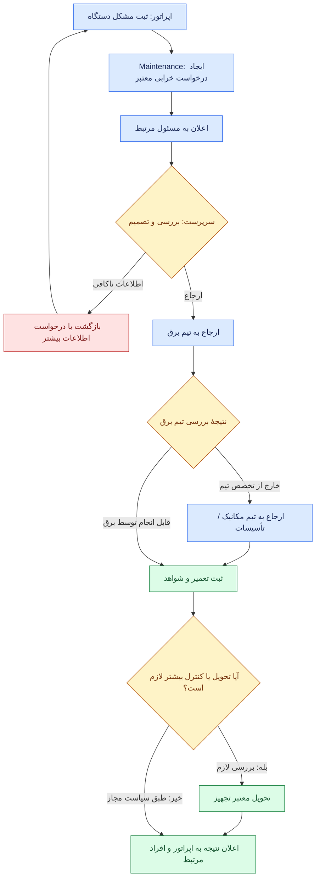
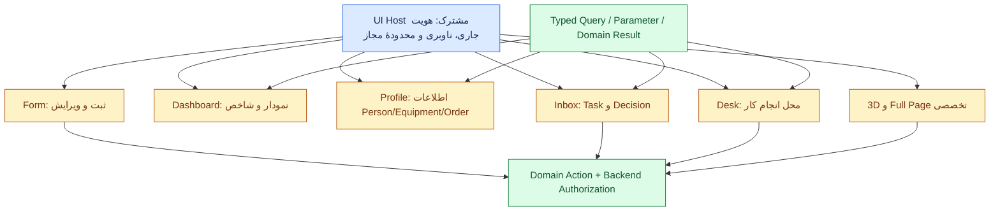

# از اطلاعات پایهٔ شرکت تا ماژول، کارتابل، میز و تجربهٔ اپراتور — ادامهٔ گفت‌وگوی معماری

> **تاریخ گفتگو:** ۲۰۲۶-۱۱-۰۵  
> **منشأ:** گفت‌وگوی جاریِ صاحب محصول و دستیار پس از ساخت شاخهٔ بازیابی‌شدهٔ `docs/recovered-session-core-workspace-2026-11-05`.  
> **نوع متن:** ثبت تفصیلی و انسانیِ پیشنهاد و توضیحات دستیار بر اساس گفت‌وگوی در دسترس؛ **نه transcript لفظ‌به‌لفظ، نه قرارداد مصوب و نه تصمیم نهایی کاربر**. مثال‌های تصویری و نمودارها به Markdown و Mermaid قابل خواندن در GitHub تبدیل شده‌اند.  
> **هدف:** روشن‌شدن نحوهٔ اتصال هسته با اطلاعات حداقلی شرکت، گسترش موجودیت‌ها توسط ماژول‌ها، تعامل ماژول‌ها، وظایف و تأییدها، پیام‌رسانی، اعلان‌ها، Form/Desk/Dashboard/Profile/3D و گذار کنترل‌شده به مأموریت‌های Codex.  
> **وضعیت:** `Discussion / Proposed`؛ بدون تغییر کد و بدون تصویب خودکار Schema، API، Permission یا Contract.  
> **شاخهٔ اسناد:** `docs/recovered-session-core-workspace-2026-11-05`؛ از شاخهٔ قبلی `docs/2026-11-05-thinking-aloud-platform-model` جدا شده است.  
> **مبنای بررسی کد:** مخزن `hossein-aghaie/pouyeshgar-workshop`، شاخهٔ `codex/04-core-workspaces-dashboard`، کامیت `5c7ac617f95ee8b84cbd32d7fa8e7474a073ec97`. این مشاهدهٔ فایل و سند است، **نه اجرای دوبارهٔ محصول یا تست زنده**.  
> **اسناد مرتبط:** [گفت‌وگوی پیشین دربارهٔ هسته و UX](CORE-OPERATIONS-UX-DESIGN-AND-REVIEW.fa.md)، [بررسی مستقل سشن دیگر](INDEPENDENT-ARCHITECTURE-REVIEW-SESSION.fa.md)، [پیش‌نویس تعامل رکورد و عملیات](../../contracts/DOMAIN-INTERACTION-CONTRACT-DRAFT.md)، [قرارداد ماژول](../../contracts/MODULE-CONTRACT-DRAFT.md)، [قرارداد UI](../../contracts/UI-CONTRIBUTIONS-DRAFT.md)، [هویت](../../core/IDENTITY-AND-ACCESS.fa.md)، [گسترش اطلاعات](../../core/EXTENSIONS.fa.md)، [فضای کار](../../core/WORKSPACES.fa.md)، [منبع، تگ و پارامتر](../../core/DATA-AND-PARAMETERS.fa.md)، [وضعیت واقعی](../../STATUS.fa.md).

## راهنمای وضعیت مطالب

- **Observed / موجود بر اساس سند و کد بررسی‌شده:** رفتاری که برای آن مسیر کد یا گزارش مستند داریم؛ این برچسب به معنی تست مجدد امروز نیست.
- **Proposed / پیشنهاد:** راه‌حل فنی قابل نقد و بازنگری.
- **Open / تصمیم باز:** جایی که باید گزینه‌ها با سناریو و اثرشان روشن شود و سپس مالک محصول تصمیم بگیرد.
- **Approved / مصوب:** فقط چیزی که در سند مالک یا تصمیم دارای تأیید ثبت‌شده باشد. در این گفت‌وگو، هیچ قرارداد تازه‌ای خودبه‌خود Approved نشده است.

---

## ۱. مسئله‌ای که صاحب محصول مطرح کرد و جهت جواب

صاحب محصول توضیح داد که پیش از ایجاد مخزن اختصاصی معماری، توسعهٔ نرم‌افزار به صورت آزمون و خطا روی هسته، فرم و Workspace جلو رفته بود. وقتی دامنهٔ ده‌ها ماژول و تعامل‌های پیچیده آشکار شد، نیمه‌تمام‌ماندن طراحی میز کار، پروفایل و محیط کاربری تصمیمی آگاهانه برای توقف توسعهٔ زودهنگام بود.

درخواست کنونی او **شروع دوباره از صفر نیست**؛ می‌خواهد قراردادهایی ببندیم که بعد از تعریف یک شرکت با حداقل اطلاعات، ماژول‌های مختلف بتوانند بدون هویت تکراری، بدون تغییر مکرر فرم‌های اصلی و بدون دوباره‌نویسی هسته به محصول اضافه شوند. از یک کارگاه کوچک با تلفن و ثبت دستی روزانه تا کارخانه‌ای با شیفت، چارت وظایف، Maintenance، OEE، Training، Quality، HSE و تأییدهای چندمرحله‌ای باید قابل پشتیبانی باشد.

**جواب کلی دستیار:** جهت هدف درست است، با سه اصلاح مهم:

1. هسته نباید تمام اطلاعات لازم برای ماژول‌ها را در جدول‌ها و فرم‌های خودش مالک شود. هسته هویت، اطلاعات پایه و مرز دسترسی را می‌دهد؛ ماژول‌ها اطلاعات تخصصی را به همان هویت‌ها متصل می‌کنند.
2. Message، Notification، Task و Approval مفاهیم جداگانه‌اند. ترکیب آن‌ها در یک «پیام» یا «میز» علت بسیاری از پیچیدگی‌ها می‌شود.
3. نباید همهٔ تغییرات هسته را قبل از اولین آزمون واقعی «کامل و نهایی» اعلام کرد. ابتدا مرز و قرارداد طراحی می‌شود، سپس زیرساخت محدود با ماژول واقعی آزموده و اصلاح می‌شود. آزمون این مرحله نباید جای پژوهش ۴۴ حوزه و سناریوهای سختِ قبلی را بگیرد.

## ۲. آنچه در کد و اسناد فعلی وجود دارد

بررسی مستندات SFP24 و مسیرهای مشخص در شاخهٔ کدِ بالا این تصویر را نشان می‌دهد:

| قابلیت | وضعیت مشاهده‌شده یا مستند | تصمیم پیشنهادی |
|---|---|---|
| شرکت، Person، Account، Permission و Scope | پایهٔ اجرایی دارد؛ مدل مشترک کامل همهٔ ماژول‌های آینده نیست | حفظ و تکمیلِ قرارداد استفاده |
| سایت، سالن/بخش، منبع/تجهیز، قطعه، OP، شیفت و واحد | کاتالوگ تعریف و سرویس Master دارد | حفظ؛ **وجودشان به معنی الزام ورود همه در زمان شروع شرکت نیست** |
| Source، Tag و Parameter | دریافت و تعریف اولیه و بعضی مصرف‌های محدود دارد | حفظ و تکمیل ارتباط داده با مصرف‌کنندهٔ معتبر |
| گسترش تعریف فیلدها | `masterDefinitionExtensions` و حل تعریف براساس ماژول فعال وجود دارد | تکمیل کنترل‌شده، نه حذف سازوکار قبلی |
| ساخت، نسخه‌بندی و تخصیص میز | `company_work_desks`، `deskIds` و `primaryDeskId` وجود دارند | ادامه از همین پایه |
| ابزارهای عملیاتی داخل AssignedDesk | `DeskExperiencePreview` هنوز تجربهٔ نمایشی دارد | اتصال به Query/Action واقعی و کنترل‌شده |
| Task/Approval/Notification یکپارچهٔ عمومی | از خوانده‌های فعلی، قرارداد نهایی و Runtime مشترک اثبات نشده است | طراحی و آزمون، نه اعلام «هیچ چیزی وجود ندارد» |
| فرم‌ساز عمومی و داشبوردساز فراگیر | ساخته‌شدن کامل اثبات نشده است | طراحی روی قراردادهای فعلی |
| یادداشت و پیام مرتبط با تجهیز | `server/operations/equipment-notes.ts` و `EquipmentNotes.vue` دارند | حفظ و جداسازی از درخواست رسمی خرابی |
| ثبت و گزارش تولید | `WorkService` و مسیرهای Production دارای کنترل دامنه‌ای هستند | حفظ و به‌کارگیری در آزمون واقعی میز و تعامل |

**شواهد مستقیم کد:** در `src/company/definition-catalog.ts`، فیلدهای مالک ماژول، `requiredFor` و تابع `resolveMasterDefinition` تعریف شده‌اند؛ در `server/operations/master/definitions.ts` همین کاتالوگ برای اعتبارسنجی Backend استفاده می‌شود. در `server/operations/desk-assignments.ts` ذخیره و اختصاص میزها و کنترل نسخه وجود دارد. در `src/company/AssignedDesk.vue` صریحاً نوشته شده که داده‌ها شبیه‌سازی‌اند و گزارش واقعی یا فرمان دستگاه ثبت نمی‌شود. در `server/operations/equipment-notes.ts` «یادداشت» و «اعلام مشکل دستگاه» با مخاطب اختیاری ذخیره می‌شوند و سرویس تصریح می‌کند **موتور دستورکار تعمیر یا پیام‌رسان عمومی نیست**.

اسناد موضوعی [گسترش تعریف](../../core/EXTENSIONS.fa.md) و [Workspace](../../core/WORKSPACES.fa.md) قبلاً همین تفکیک بین **فیلد افزوده به موجودیت موجود** و **فهرست/موجودیت مستقل** و نیز preview بودن محتوای AssignedDesk را ثبت کرده‌اند؛ نباید آن‌ها را به بهانهٔ طراحی تازه نادیده گرفت.

## ۳. حداقل اطلاعات هسته و اطلاعات اختصاصی ماژول‌ها

پیشنهاد، سه نوع اطلاعات است:

| نوع داده | نمونه | مالک و توضیح |
|---|---|---|
| **اطلاعات پایه** | شرکت، شخص، سایت، تجهیز، ساختار پایه | هسته یا سرویس Master فعلی؛ اطلاعات به‌اندازهٔ نیاز واقعی |
| **اطلاعات تکمیلی همان موجودیت** | مشخصات فنی تجهیزات، بخشی از نمای مهارت شخص، دادهٔ اختیاری مرتبط با هزینه | ماژول صاحب معناست؛ همان `people.id` یا `resources.id` حفظ می‌شود |
| **رکورد عملیاتی مستقل** | درخواست خرابی، Work Order، گزارش توقف، نتیجهٔ ارزیابی، برنامهٔ کاری | ماژول تخصصی صاحب رکورد و چرخهٔ عمر آن است |

### ۳.۱. نمونهٔ هزینهٔ نیروی کار

اگر ماژول بهای تمام‌شده برای هزینهٔ دستمزد اطلاعات می‌خواهد، **دستمزد و حقوق محرمانه را یک فیلد عمومیِ آزاد در فرم Person قرار ندهیم**. حقوق تاریخ‌دار، وابسته به دوره، قرارداد، قانون، حریم خصوصی و تأییدات مالی است. Payroll یا منبع مالی/HR معتبر مالک این اطلاعات می‌ماند؛ Costing فقط خروجیِ محاسباتی یا دادهٔ مجاز با محدوده و مبنای مشخص می‌خواند. UI می‌تواند بخشی از اطلاعات مجاز را به پروفایل همان شخص اضافه کند، ولی منبع داده نباید بی‌دلیل تکثیر شود.

### ۳.۲. نمونهٔ Skill Gap

Training از Person موجود استفاده می‌کند، نه Person دوم؛ اما Activity، Assessment، Evidence و Qualification رکوردهای تخصصی Training هستند. نمای پروفایل فرد می‌تواند بخش شایستگی و آموزش را از یک Query مجاز نشان بدهد. داشتن Permission نرم‌افزاریِ «ثبت تولید» به‌خودی‌خود صلاحیت انجام کاری را ثابت نمی‌کند.

### ۳.۳. اطلاعات اولیه برای همهٔ شرکت‌ها یکسان و انبوه نیست

هسته باید با کمترین اطلاعات لازم برای ایجاد شرکت و مدیر اولیه راه بیفتد. در زمان فعال‌سازی عملیاتی هر قابلیت، نیازمندی آن قابلیت بررسی شود:

| قابلیت | حداقل نیاز مرتبط با استفادهٔ معتبر | الزام نداشتن به بعضی موارد |
|---|---|---|
| راه‌اندازی شرکت | شناسهٔ شرکت، حساب مدیر اولیه و تنظیمات ضروری | سالن، دستگاه و نقشهٔ ۳بعدی الزام همگانی نیستند |
| ثبت تولید | Actor مجاز، منبع کار و مشخصات لازمِ ثبت معتبر | پلان سالانه، سنسور و OEE اجباری نیست |
| ثبت خرابی | تجهیز/موضوع، گزارش‌دهنده و شرح مسئله | PM، انبار قطعات و گردش تأیید پیشرفته اجباری نیستند |
| Skill Gap | Person، Activity و معیار معتبر شایستگی | خرید یا فعال‌سازی Production لازم نیست |
| OEE | زمان‌ها، شمارش و کیفیت معتبر و روش محاسبه | سه‌بعدی یا سیگنال از تمام ماشین‌ها لازم نیست |
| بهای تمام‌شده | منبع هزینه و روش تخصیص معتبر | دسترسی عمومی به فیش حقوقی افراد لازم نیست |

این مثال‌ها **شرایط دقیق عملیاتی نهایی نیستند**. مثلاً تولید واقعی برای هر نوع ثبت به فیلدهای مشخص و سازگاری تجهیز/قطعه/OP نیاز دارد و کنترل آن در سرویس Production است.

### ۳.۴. Module Requirements & Readiness — یک قرارداد نامزد

هر ماژول باید بتواند روشن کند برای هر **قابلیت داخل ماژول** چه چیزهایی می‌خواهد: مرجع Person، Resource، Activity، Unit، Parameter، دادهٔ بیرونی، Policy یا وابستگی به ماژول دیگر. نتیجهٔ بررسی آماده‌بودن باید مشخص کند کدام قابلیت `ready` است، چه چیزی ناقص است و **چه اقدامی به‌صورت دقیق** تا تکمیل مجاز/نامجاز است.

مثلاً خرید OEE نباید ذخیرهٔ Person یا گزارش تولید دستی شرکت را مسدود کند چون زمان سیکل معتبر هنوز وارد نشده. در کد فعلی، `required` برای ذخیرهٔ Master با `requiredFor` برای استفاده از یک قابلیت **عمداً متفاوت‌اند** و بررسی کامل Readiness باید در سرویس خود ماژول انجام شود.

**تصمیم باز:** کدام مورد از Requirement در Registry مشترک قابل توصیف است، کدام مورد فقط با Resolver کدِ مورد اعتماد به‌دست می‌آید و کدام قاعده باید در صاحب دامنه اجرا شود؟ هیچ JSON عمومی نباید بتواند قانون ایمنی یا اعتبار تخصصی را با حذف یک فیلد غیرفعال کند.

## ۴. ماژول چگونه خودش را به پلتفرم معرفی می‌کند؟

راه پیشنهادی، یک **تعریف نسخه‌دار قابل‌اعتبارسنجی** است که دست‌کم پنج دسته اطلاعات را دارد؛ پنج دسته لزوماً پنج فایل یا پنج سرویس جدا نیست:

| جزء تعریف | معنای دقیق |
|---|---|
| **Module Definition** | نام و شناسهٔ ماژول، release، Capabilityها، وابستگی‌ها، entitlement و سازگاری قرارداد |
| **Data Requirements** | برای هر Capability کدام دادهٔ هسته/سرویس دیگر و چه شرایط Readiness لازم است |
| **Data Extensions** | چه فیلد مجاز یا بخش نمایشی روی Person/Resource افزوده می‌شود؛ چه داده‌ای باید رکورد مستقل خود ماژول باشد |
| **Operations** | Domain Record، Query، Action، Event، Evidence و در صورت نیاز Task/Approvalهای معرفی‌شده |
| **UI Contributions** | صفحه، Form، Profile Section، کارت Desk، Dashboard، Inbox، ابزار تمام‌صفحه یا 3D Layer |

`Module Definition` از طریق رجیستری مورد اعتماد نرم‌افزار شناخته می‌شود. JSON یا ساختار مشابه می‌تواند تعریف declarative و نسخه‌دار را نگه دارد؛ **JSON به‌تنهایی منطق ماژول را اجرا نمی‌کند و نباید اسکریپت غیرقابل‌اعتماد مشتری را به Backend تزریق کند**.

### ۴.۱. مثال Maintenance

Maintenance اعلام می‌کند:

- موجودیت `Resource` را به‌صورت مرجع معتبر مصرف می‌کند، نه اینکه یک جدول ماشینِ جدا برای کل سیستم بسازد.
- فرم `Report Fault` و Action متناظر دارد؛ این Action از Backendِ Maintenance می‌گذرد.
- `MaintenanceRequest` و بعداً `MaintenanceWorkOrder` رکوردهای مستقلِ صاحب‌دار هستند.
- روی صفحهٔ تجهیز می‌تواند بخش «تاریخچهٔ خرابی‌ها» و روی میز مسئول، کارت «درخواست‌های باز من» اضافه کند.
- اگر شرکت مسیر تأیید یا ارجاع تیمی دارد، آن را از طریق Contract مشترک Task/Decision درخواست می‌کند، اما نتیجهٔ تعمیر و تحویل تجهیز متعلق به Maintenance است.

به‌صرف معرفی یک نام در Registry، جدول، API، Migration، فرمول تخصصی یا سرویس آماده ساخته نمی‌شود. افزودن یک Entity مستقل در کد فعلی هم به ذخیره‌سازی، مجوز، API، اعتبارسنجی و آزمون نیاز دارد.

### ۴.۲. ارتباط با قراردادهای فعلی

این طرح **جایگزین ناگهانی** [Module Contract](../../contracts/MODULE-CONTRACT-DRAFT.md)، [Data Contract](../../contracts/DATA-CONTRACT-DRAFT.md)، [UI Contribution](../../contracts/UI-CONTRIBUTIONS-DRAFT.md) یا [Domain Interaction Contract](../../contracts/DOMAIN-INTERACTION-CONTRACT-DRAFT.md) نمی‌شود. باید Requirements/Readiness/Extension را در سند مالک درست تعریف کرد و برای Action، RecordRef، Outcome، Retry و Evidence به همان قرارداد تعامل فعلی ارجاع داد؛ نه اینکه API دومِ ناسازگار بسازیم.

## ۵. پیام، اعلان، کارتابل و Approval؛ چهار مفهوم مستقل

پایهٔ `EquipmentNotes` موجود ارزشمند است. ولی آن را باید از چهار نوع مفهوم مرتبط **تفکیک** کنیم:

| مفهوم | کاربرد | نکتهٔ مرزی |
|---|---|---|
| **Message / Comment / Note** | نوشته یا گفت‌وگو دربارهٔ تجهیز، فرد مجاز یا پرونده | محتوا می‌تواند صرفاً برای تحویل شیفت باشد؛ Work Order تولید نمی‌کند |
| **Notification / زنگوله** | اطلاع از رخداد، تغییر وضعیت یا کار جدید | «خوانده شد» مساوی «تأیید شد» یا «کار انجام شد» نیست |
| **Task / Inbox** | عمل مشخصی که باید شخص یا گروه مجاز انجام دهد | Task ممکن است به چند RecordRef اشاره کند و خودِ رکورد دامنه‌ای نیست |
| **Approval / Decision** | تصمیم رسمی روی نسخهٔ رکورد تحت سیاست معتبر | نتیجه و اعتبار تصمیم از قانون دامنه جدا نیست؛ ممکن است بدون Approval مجاز باشد |

اگر اپراتور «دستگاه خراب است» بنویسد، این می‌تواند **یادداشت ساده** باشد یا با Action معتبر به **درخواست خرابی رسمی** تبدیل شود. سیستم نباید صرف وجود واژهٔ «خراب» در متن، دستورکار قطعی با وضعیتِ «تعمیر لازم است» بسازد.

### ۵.۱. مثال ارجاع خرابی از اپراتور به تعمیرات



**نکته:** پاسخ «این کار مربوط به برق نیست» رد نهایی خرابی نیست؛ نتیجهٔ بررسی تیم است و ممکن است سبب ارجاع مجاز به مکانیک شود. همچنین پایان Task تعمیرکار به‌تنهایی به معنی «تجهیز از نظر ایمنی و تولید آزاد شده» نیست؛ اگر تحویل فنی یا اجازهٔ اجرا لازم است باید صریح ثبت شود.

### ۵.۲. زنگوله چه می‌کند؟

مثلاً به اپراتور نشان می‌دهد «درخواست خرابی CNC-01 بررسی شد»؛ با لمس اعلان، رکورد مربوط در صفحهٔ مجاز باز می‌شود. اعلان باید مخاطب، Tenant، Scope، موضوع و مقصد معتبر داشته باشد. خواندن آن **هیچ Decision یا Domain Outcome** تولید نمی‌کند.

Notification Service سبک، نامزد مناسبی برای ارسال اعلان از تغییر معتبر Event/Task/Message است. اما نوع تحویل (`in-app`، push، ایمیل)، تضمین دریافت، تنظیمات مزاحمت، مجوز مخاطب و سیاست حفظ پیام‌ها هنوز باید در قرارداد مشخص شود. «چت عمومی سازمانی» را از نیاز اولیهٔ یادداشت دستگاه نتیجه نگیریم.

### ۵.۳. تحویل شیفت

یادداشت دستگاه برای شیفت بعد با Scope مجاز دیده می‌شود. اگر موضوع یک خرابیِ باز یا کار ناتمام است، پیام باید **مرجع همان پرونده** را داشته باشد و صرفِ خواندن یا بستن پیام، وضعیت پرونده را تغییر ندهد. در کارگاه ساده ممکن است همان یادداشت و یک گزارش ثبت‌شده کافی باشد؛ برای کار حساس شرکت بزرگ، ارجاع و کنترل تحویل جداگانه لازم می‌شود.


---

## ۶. فرم‌ساز، میزساز، داشبوردساز و پروفایل چگونه باید کنار هم باشند؟

پیشنهاد اصلی ساخت «یک سازندهٔ غول‌آسای همه‌چیزدان» نیست. **سه قرارداد برای فرم** و **یک Host مشترک چیدمان و نمایش** تعریف شوند.

| لایه/قرارداد | مسئولیت |
|---|---|
| **Data Schema** | نوع داده، ارجاعات معتبر، نسخه، قواعد حداقلی و اعتبارسنجی |
| **UI Schema** | ترتیب، گروه‌بندی، فیلدهای قابل نمایش، راهنما، ظاهر و شرط‌های مجاز |
| **Action Binding** | فرم/دکمه کدام Action ثبت‌شدهٔ ماژول را با چه Context و مجوزی اجرا می‌کند |

این سه با هم متفاوت‌اند. تغییر UI Schema ممکن است فقط ظاهر فرم را تغییر دهد، ولی هرگز نباید شرط ایمنی، مجوز، عدد مرجع یا Validation تخصصیِ سمت سرور را حذف کند. فرم تخصصی PTW، Recipe یا LIMS می‌تواند Renderer/Component مخصوص داشته باشد و به همان Host متصل شود؛ قرار نیست فرم‌ساز عمومی موتور تخصصی آن را اختراع کند.

الگوی جداکردن `Data Schema`، `UI Schema` و `Custom Renderer` در [JSON Forms](https://jsonforms.io/docs/architecture/) مطرح است؛ اما اینکه کتابخانهٔ خاصی برای Frontend فعلی SFP24 مناسب است باید بعداً در کد و آزمون سازگاری Vue ثابت شود. **این اشاره انتخاب قطعی فناوری نیست.**

### ۶.۱. یک فرم خرابی در دو شرکت

**کارگاه کوچک:** اپراتور دستگاه، شرح مشکل و زمان را ثبت می‌کند؛ عکس یا جزئیات بیشتر اگر لازم باشد افزوده می‌شوند. اگر شخص مجاز باشد ممکن است همان‌جا کار انجام‌شده را هم ثبت کند، بدون Approval مصنوعی.

**کارخانهٔ بزرگ:** همان capability ممکن است بخش‌های اولویت، نوع خرابی، اثر روی تولید، تصویر، محل، ایمنی و مسئول اولیه داشته باشد؛ بعضی فیلدها ضروری و بعضی مشروط‌اند. اگر PTW لازم شد، صرف اضافه‌کردن یک گزینهٔ «ایمنی تأیید شد» به فرم کافی نیست؛ باید عملیات و کنترل‌های واقعیِ صاحب دامنه اجرا شوند.

**اصل تنظیم‌پذیری:** در مرحلهٔ اول می‌توان انتخاب فیلدها و پیکربندی‌های **مجاز و قابل اعتبارسنجی** را ارائه کرد. ایجاد فیلدهای کاملاً دلخواه قابل ذخیره‌سازی، مهاجرت Schema، دادهٔ محرمانه یا منطق اختصاصی شرکت مرحلهٔ دیگری می‌خواهد. در کد فعلی هم گسترش Master به ورودی کدِ مورد اعتماد و Migration/Validation وابسته است.

### ۶.۲. میز با فرم یکی نیست

یک فرم «ثبت خرابی» باید بتواند از میز اپراتور، پروفایل تجهیز یا نمای سه‌بعدی باز شود؛ اما هر بار به **همان Action معتبر Maintenance** وصل باشد. میز چیدمانِ Contributionهاست، نه مالک داده، Domain State، Permission یا خرید ماژول.

### ۶.۳. مدل رابطهٔ رابط‌های کاربری



**توضیح برای خوانندهٔ گوشی:** Host یک پوستهٔ مشترک دارد؛ داخل آن می‌توان میز، داشبورد، پروفایل، فرم، کارتابل و صفحهٔ سه‌بعدی را نمایش داد. دریافت داده از Query/Provider مجاز و ثبت نتیجه از Action تخصصی انجام می‌شود. چیدن ویجت یا دیدن دکمه به هیچ‌کس Permission جدید نمی‌دهد.

### ۶.۴. تفاوت نام‌ها و نقش آن‌ها

| نام | معنا | تصمیم پیشنهادی |
|---|---|---|
| **Workspace / اتاق کاری** | زمینهٔ ناوبری یا مجموعهٔ میزهای در دسترس | فعلاً فرضیهٔ تجربهٔ کاربری؛ Entity و موتور مستقل جدید نسازیم تا نیاز اثبات شود |
| **Desk / میز** | چیدمان ابزارهای فرد یا گروه در کار روزمره | از مدل نسخه‌دارِ موجود `company_work_desks` ادامه دهیم |
| **Dashboard** | نما و تحلیل داده/شاخص در بازه و Scope مشخص | بتواند مستقل یا درون Desk استفاده شود |
| **Profile** | پرونده و نمای جزئیات Person/Equipment/Order | صاحب هویت اصلی یکی باشد؛ ماژول‌ها فقط Section مجاز اضافه کنند |
| **Inbox** | مجموعهٔ اقدام‌های باز و انتظار تصمیم | بتواند در میز و صفحهٔ مستقل نمایش داده شود |
| **Notification Bell** | اطلاع‌رسانی مرتبط با رکورد یا کار | نه Task، نه Approval، نه پیام‌رسان عمومی |
| **3D View** | نمایش مکانی تجهیز و لایه‌های مجاز | حالت مستقل و قابل‌جای‌گذاری؛ Action با همان کنترل سرور |

این تقسیم‌بندی با [وضعیت فعلی Workspace](../../core/WORKSPACES.fa.md) تعارضِ ازپیش‌پذیرفته‌شده ندارد؛ آن سند نیز «اتاق» و استقلال Dashboard را سؤال‌های باز می‌داند.

## ۷. تفاوت تجربهٔ اپراتور در کارگاه کوچک و کارخانهٔ بزرگ

**فرض کلیدی:** دو نرم‌افزار جدا نمی‌سازیم. همان هسته، همان هویت و قراردادهای ماژولی؛ تفاوت در ماژول فعال، سیاست شرکت، مسئولیت و Assignment، دادهٔ آماده، Scope و چیدمان میز است.

### ۷.۱. نمونهٔ میز اپراتور کارگاه کوچک

```text
┌──────────────────────────────────────────────────────┐
│ میز اپراتور پویشگر  —  کار امروز                      │
├──────────────────────────────────────────────────────┤
│ کار: تراشکاری قطعه A                                  │
│ دستگاه: CNC-01                                         │
│                                                      │
│ تعداد تولیدشده:   [۴۸]                               │
│ تعداد ضایعات:     [۲]                                │
│ توضیح اختیاری:    [......................]           │
│                                                      │
│ [ثبت گزارش]                                           │
│                                                      │
│ کارهای قبلی من     پیام‌های مرتبط با دستگاه            │
└──────────────────────────────────────────────────────┘
```

این تصویر **Wireframe مفهومی** است، نه Screenshot یا فرم واقعی کد. فرد با سواد دیجیتال محدود لازم نیست از میان ده‌ها کارت و صفحه عبور کند. ممکن است کار صبح تلفنی تعیین شده باشد، یا سرپرست یک Assignment ساده ثبت کرده باشد؛ در هر دو حالت ثبت تولید واقعی با قواعد Production انجام می‌شود.

بعد از شیفت، شخص با Permission `view_own` فقط سوابق مجاز خود را می‌بیند. اینکه کارگاه از مدیر بخواهد او نتیجهٔ خودش را جداگانه تأیید کند، یک قانون پیشنهادی/شرکتی است، نه نیاز خودکار همهٔ ماژول‌ها.

### ۷.۲. نمونهٔ میز اپراتور کارخانهٔ پیشرفته

```text
┌──────────────────────────────────────────────────────┐
│ میز اپراتور خط   —   شیفت صبح                         │
├──────────────────────────────────────────────────────┤
│ سفارش: Order-52 / عملیات: OP-10 / تجهیز: CNC-07       │
│ وضعیت کار جاری و برنامهٔ معتبر                       │
│                                                      │
│ بررسی محدودیت‌ها و شرایط قبل از اجرا                 │
│ دستورالعمل نسخهٔ معتبر                               │
│ توقف‌ها و درخواست‌های باز                             │
│                                                      │
│ [ثبت عملیات مجاز]  [اعلام توقف]  [گزارش خرابی]       │
│                                                      │
│ آموزش و صلاحیت / کارتابل / پیام‌های مرتبط             │
└──────────────────────────────────────────────────────┘
```

این هم Wireframe پیشنهادی است. برخی دکمه‌ها ممکن است به علت Permission، Scope، Qualification، Entitlement یا شرایط معتبر تجهیز فعال نباشند. پیام توقف، خروجی OEE و درخواست رسمی تعمیر یک رکورد نیستند.

### ۷.۳. شخص، مأموریت، Permission و Qualification را یکی نکنیم

برای مثال اگر اپراتور امروز مأمور CNC-07 شده است:
- **Assignment:** اکنون از او انتظار داریم روی این کار یا تجهیز فعالیت کند؛ می‌تواند موقت و وابسته به شیفت باشد.
- **Permission/Scope:** آیا از نظر نرم‌افزار اجازهٔ اجرای Action روی این تجهیز و شرکت را دارد؟
- **Qualification:** آیا برای نوع عملیات و شرایط آن صلاحیت معتبر دارد، اگر آن نوع کار چنین شرطی می‌خواهد؟
- **Actual Work:** آیا واقعاً پشت دستگاه کار کرده و چه نتیجه‌ای ثبت شده است؟

دیدن دستگاه در میز یا انتخاب دستگاه از سه‌بعدی هیچ‌کدام به‌تنهایی این چهار پاسخ را تأمین نمی‌کند. داشتن Position یا چند مسئولیت هم برای دورزدن منع خودتأییدی کافی نیست.

## ۸. OEE، توقف و پروفایل اپراتور

یک خطای معماری مهم این است که «علت توقف دستگاه» را در قالب **یک فیلد ثابت روی Person** ذخیره کنیم. توقف باید **رکورد مستقل** با زمان و بازه، تجهیز/عملیات مرتبط، منبع مشاهده، شخصِ گزارش‌دهنده، علت اظهارشده، کیفیت داده و وضعیت بررسی باشد.

**مثال:** اپراتور با مسئولیت گزارش توقف می‌گوید «دستگاه به دلیل صدای غیرعادی ایستاد». این یک **گزارش اولیهٔ انسانی** است، نه اثبات قطعی علت فنی. سرپرست مجاز می‌تواند طبق سیاست شرکت آن را بررسی، اصلاح یا دسته‌بندی کند؛ Maintenance ممکن است هم‌زمان یک درخواست خرابی مستقل داشته باشد.

OEE اگر فعال است، از داده‌های رسمی و معتبر زمان/توقف/تولید/کیفیت با تعریف روشن بازه و فرمول استفاده می‌کند. نبود داده یا قطع اینترنت معادل توقف واقعی دستگاه نیست.

پروفایل اپراتور می‌تواند «توقف‌هایی که من گزارش کرده‌ام» را با Scope مناسب نمایش دهد، اما **نشان‌دادن گزارش‌های او به معنی مقصر دانستن او نیست**. OEE نیز به‌صورت پیش‌فرض نباید علت یا عملکرد نیروی انسانی را از مقدار Tag یا نام گزارش‌دهنده استنباط کند.

این بحث در [گسترش تعریف‌های شرکت](../../core/EXTENSIONS.fa.md) هم سابقه دارد: علت‌های قابل تنظیم، بازهٔ توقف برنامه‌ریزی‌شده و رخداد واقعی توقف از هم جدا دانسته شده‌اند. این گفت‌وگو آن مرز را در طراحی پروفایل و UI عملیاتی روشن‌تر می‌کند.

## ۹. آزمایش با کدام ماژول‌ها آغاز شود؟

صاحب محصول می‌خواهد ابتدا هسته را آماده و سپس یک ماژول ساده انتخاب کند تا یک شرکت کوچک و یک شرکت پیشرفته هر دو آن را استفاده کنند. **اصلاح پیشنهادی دستیار:** اگر فقط یک ماژول مستقل داشته باشیم، مهم‌ترین ریسکِ تعامل **بین ماژول‌ها** آزموده نمی‌شود. بنابراین از قابلیتِ موجود Production استفاده کنیم و **یک مسیر سبک از Maintenance** را به‌عنوان دومین دامنه بسازیم؛ نه کل CMMS/EAM.

| بخش در پایلوت | کاری که باید آزموده شود | چه چیزی لازم نیست هم‌زمان ساخته شود |
|---|---|---|
| **Production موجود** | کار و گزارش تولید، ثبت نتیجه، Scope، بخش‌های واقعی میز، مرجع دستگاه/قطعه/OP | موتور کامل APS، MRP، OEE یا برنامهٔ چندسطحی |
| **Maintenance سبک** | درخواست خرابی، ارجاع به مسئول، تصمیم/برگشت، ثبت اقدام و شاهد، وضعیت تحویل، نتیجه برای درخواست‌دهنده | کل EAM، انبار تعمیرات، APM، برنامهٔ PM فراگیر |
| **زیرساخت مشترک لازم** | Domain Reference، Action/Result، Task محدود، Notification، Evidence Link، Query و UI Contribution | BPMN Engine تمام‌عیار، Message Broker بزرگ، Form Builder کاملاً آزاد |
| **مدل شبیه‌سازی‌شدهٔ صلاحیت** | آزمون اینکه مسیر حساس بدون مجوز/شاهد معتبر ادامه نرود | ادعای ساخته‌شدن یا تست واقعی LMS/Training |

برای سناریوهای شرکت بزرگ، می‌توان از Provider آزمایشیِ صلاحیت و چند نقش/تیم استفاده کرد، **مشروط بر اینکه تست با Mock را با اجرای واقعی ماژول Training اشتباه نگیریم**. در همین مرحله دو نوع شرکت را امتحان می‌کنیم:

- کارگاه کوچک: بدون برنامهٔ رسمی، بدون Approval صوری، ثبت گزارش/درخواست و سوابق قابل پیگیری.
- کارخانهٔ بزرگ: چند مسئول تعمیرات، ارجاع تیم برق/مکانیک، برگشت برای توضیح، در صورت لزوم دو تأیید، Scope و شاهد معتبر.

**نقطهٔ توقف:** تصمیم نهایی اینکه Maintenance سبک واقعاً اولین ماژول تازه باشد باید همراه با بررسی هزینه و وضعیت کد و قراردادهای پایه تأیید شود؛ این انتخاب هنوز دستور نوشتن CMMS نیست.

## ۱۰. مسیر تبدیل این بحث به قراردادهای اجرایی و مأموریت Codex

| مرحله | موضوع دقیق | خروجی قابل بررسی |
|---|---|---|
| **۱. تثبیت مرز و قرارداد هسته/ماژول** | `Module Requirements`، `Readiness`، Extension، Domain Reference، Action، Evidence، Task و Decision | قرارداد نسخه‌دار، مالکیت، حالت خطا و سناریوهای تست |
| **۲. قرارداد UI/تجربهٔ کاربری** | Form، Profile، Desk، Dashboard، Inbox، Notification، 3D و Full Page | Schemaهای مجاز، Contributionها، Context و اتصال امن به عملیات |
| **۳. شناسایی تغییر نسبت به کد** | تفکیک `implemented / preview-only / proposed / confirmed gap / unknown` | مسیر فایل، Migration، Risk، حفظ قابلیت موجود، تست‌های Regression |
| **۴. اجرای محدود زیرساخت، با مجوز مشخص** | پیاده‌سازی بخش‌هایی از قرارداد که برای پایلوت نیاز دارند | PRهای کوچک و تست‌های مستقل |
| **۵. آزمایش دو دامنه** | Production و Maintenance سبک با دو نوع شرکت | آزمون سرتاسری از ثبت تا پیام، رسیدگی، شاهد و سابقه |

**نکتهٔ عملی:** دادن مأموریت «کل هسته را کامل کن، بعد خودت تکه‌تکه کن» به Codex معقول نیست. Codex می‌تواند بعد از تصویب معماری، یک مأموریت محدود را به زیرتسک تقسیم کند؛ **نمی‌تواند بدون اجازهٔ مالک، معنای Person، Approval، Entitlement، قیمت‌گذاری، Schema یا قراردادهای دیگر را خودش تصویب کند**.

### ۱۰.۱. در کد فعلی کجا متوقف شده‌ایم؟

شاخهٔ `codex/04-core-workspaces-dashboard` طبق [پروندهٔ Stage 04](https://github.com/hossein-aghaie/pouyeshgar-workshop/blob/5c7ac617f95ee8b84cbd32d7fa8e7474a073ec97/docs/development/stage-04-core-workspaces-dashboard/README.md) وضعیت `Discovery / Read-only preparation` دارد. `ASSESSMENT.md` در همان snapshot قالب گزارش است و تکمیل بررسی را گزارش نمی‌کند. این شاخه **اجازهٔ خودکار برای ویرایش یا اجرای کد** ایجاد نمی‌کند. مرحلهٔ سوم بالا باید کد را از نزدیک ارزیابی کند و بعد از مجوز مستقل، تسک‌های اجرایی تدوین شوند.

### ۱۰.۲. تفاوت ایده، قرارداد و اجازهٔ اجرا

- این سند روایت و پیشنهاد است.
- [Domain Interaction Contract Draft v0.1](../../contracts/DOMAIN-INTERACTION-CONTRACT-DRAFT.md) دارای مدل‌های نامزد و آزمون‌های پیشنهادی است، ولی هنوز `Approved Contract` نیست.
- تصمیم‌های مورد موافقت صاحب محصول باید طبق [گردش تغییر](../../governance/CHANGE-WORKFLOW.md) و [سیاست مستندسازی](../../governance/DOCUMENTATION-POLICY.md) در ADR ثبت و سپس در سند مالک و قرارداد نسخه‌دار اعمال شوند.
- تأیید یک تصمیم، مجوز کدنویسی، تغییر شاخهٔ دیگر، Merge یا Deploy نیست.

---

## ۱۱. تصمیم‌های باز و قدم عملی بعد از ثبت این یادداشت

### ۱۱.۱. مواردی که قبلاً دربارهٔ آن‌ها فکر شده، اما نباید بی‌دلیل دوباره اختراع شوند

| موضوع | نقطهٔ شروع واقعی |
|---|---|
| DomainRef / Action / Result / Recovery | [Draft v0.1](../../contracts/DOMAIN-INTERACTION-CONTRACT-DRAFT.md)، تصمیم‌های D-01 تا D-08 |
| اضافه‌شدن فیلد ماژول به فرم Master | [تعاریف توسعه‌پذیر](../../core/EXTENSIONS.fa.md) و `masterDefinitionExtensions` |
| Module Registry / Capability / Dependencies | [Module Contract Draft](../../contracts/MODULE-CONTRACT-DRAFT.md) |
| UI Contributions / Desk / Profile | [UI Contributions Draft](../../contracts/UI-CONTRIBUTIONS-DRAFT.md) و [Workspace](../../core/WORKSPACES.fa.md) |
| Data Port / Tag / Parameter | [Data Contract Draft](../../contracts/DATA-CONTRACT-DRAFT.md) و [داده و پارامتر](../../core/DATA-AND-PARAMETERS.fa.md) |
| هویت، حق و صلاحیت فرد | [Identity](../../core/IDENTITY-AND-ACCESS.fa.md) و [Training/Skill Gap](../../modules/training/SKILL-GAP-LMS.fa.md) |
| ارجاع خرابی و اطلاع‌رسانی | کد فعلی EquipmentNotes و پیشنهاد Action/Task/Notification همین سشن |
| فهرست کاربردهای آینده | [کاتالوگ ۴۴ حوزه](../../modules/CATALOG.fa.md) و [طرح نقدشدهٔ قبلی](CORE-OPERATIONS-UX-DESIGN-AND-REVIEW.fa.md) |

### ۱۱.۲. سؤال‌های مشخصی که در جلسهٔ بعد باید به پاسخ اجرایی برسند

**سؤال A — Registry و Requirements:** ماژول برای Capability خودش چه داده‌ای می‌خواهد و چگونه readiness را روی شرکت، سایت، تجهیز و فرد کنترل می‌کند؟ تفاوت فیلد لازم برای ذخیره و فیلد لازم برای اجرای قابلیت دقیقاً چگونه در قرارداد نمایان می‌شود؟

**سؤال B — Extension و Ownership:** چه چیزی می‌تواند به Master Field اضافه شود، چه چیزی باید جدول/Entity مستقل ماژول باشد و چه چیزی فقط به صورت Profile Section/Query نمایش داده شود؟ سرنوشت داده با خاموش‌شدن یا ارتقای ماژول چیست؟

**سؤال C — Action/Task/Decision و ارتباط:** وقتی اپراتور از میز می‌زند «خرابی ثبت کن»، کدام سرویس مالک درخواست و تغییر وضعیت است، Task برای چه کسی ایجاد می‌شود، در رد و ارجاع چه رخ می‌دهد، Notification از کدام تغییر معتبر ساخته می‌شود، و Retry/خطا چگونه بازیابی می‌شود؟

**سؤال D — تجربهٔ کاربری:** Contract لازم برای Form/Page/Desk/Profile/Inbox/Dashboard/3D دقیقاً چه Context، Data Query، Action و Permission نیاز دارد؟ یک شخص با یک میز ساده چگونه بدون مسیر اضافی وارد کار می‌شود؟

**سؤال E — آزمون سناریویی و Codex:** کدام قسمت از کد موجود برای این قراردادها قابل استفاده است، کدام قسمت فقط پیش‌نمایش است، و کمترین مجموعهٔ تغییرات قابل آزمایش در دو شرکت چیست؟

### ۱۱.۳. تحویل دقیقِ پیشنهادی جلسهٔ بعد

**یک بستهٔ طراحی مشترک، نه یک موتور برنامه‌نویسی‌شده:**

1. در اسناد مالک موجود، نمونهٔ نسخه‌دارِ `Module Requirements / Readiness / Extension` را کنار قراردادهای Module و Data تعریف کنیم؛ دقیقاً مشخص کنیم مالک هر فیلد کجاست.
2. یک جریان کاملِ «گزارش خرابی → درخواست → ارجاع → رسیدگی → ثبت شاهد → اعلام نتیجه» و یک جریانِ «ثبت مستقیم کارگاه بدون Task صوری» را به Action/Task/Decision Draft گره بزنیم؛ حالت رد، برگشت، تکرار درخواست و ماژول خاموش نیز روشن باشد.
3. قرارداد UI Contribution این دو مسیر را روی میز اپراتور، پروفایل تجهیز، Inbox مدیر و زنگولهٔ شخص با نمونهٔ قابل نمایش تعریف کند. مستند UI و عملیات هر یک مالک بخش خودش بماند.
4. تصمیم‌های باز، اثر بر کد و آزمون‌های پذیرش را فهرست کنیم؛ موارد قابل پاسخ از کد را از صاحب محصول نپرسیم. سپس تصمیم‌های محصول را برای تأیید ارائه کنیم.
5. **بعد از تأیید مستقل**، برای Codex فقط مأموریت‌های محدود با SHA مبنا، فایل‌های مرتبط، Migration، آزمون، مرز مجاز تغییر و شرط توقف ایجاد کنیم.

**چرا این نقطهٔ شروع انتخاب شده؟** چون هم اطلاعات حداقلی و گسترش هسته را حل می‌کند، هم ماژولِ دوم واقعاً با Production تعامل دارد، و هم میز و اعلان را به‌جای ادامهٔ شبیه‌سازی به عملیات معتبر متصل می‌کند؛ در عین حال از ساخت موتورهای عظیم و فراتررفتن از محدودهٔ مصوب جلوگیری می‌کند.

### ۱۱.۴. محدودهٔ اجازه و وضعیت پایان همین ثبت

این نوشته تنها ادامهٔ **Journal** همین شاخه است. به‌روزرسانی آن نه به معنی نهایی‌شدن تمام قراردادهاست، نه اجازهٔ کدنویسی و نه مجوز Merge. تغییر در سند مالکِ قرارداد، هسته، کد یا شاخهٔ دیگر به تصمیم و اجازهٔ مخصوص همان تغییر نیاز دارد.

**نتیجهٔ موقت:** از فضای ایدهٔ اولیه عبور کرده‌ایم، اما هنوز پیش از برچسب `Approved` برای قراردادهای هسته/ماژول و UI باید سناریوهای بالا را به ورودی/خروجی و آزمون دقیق تبدیل کنیم. گام بعد **تکمیل قرارداد Module Requirements + Extensions + Actions + UI Contributions بر پایهٔ Draftهای موجود** است، سپس مأموریت‌های کوچک Codex با آزمون.
