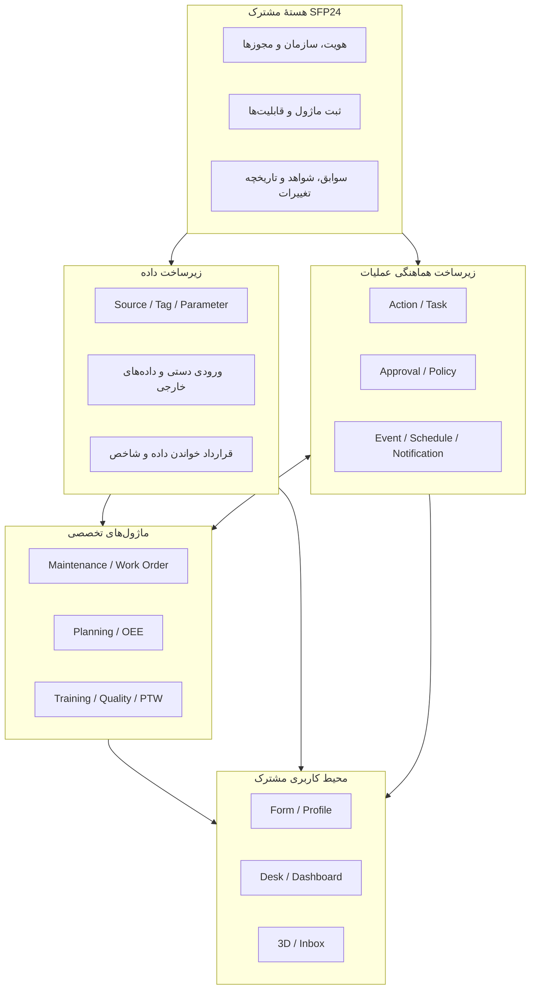
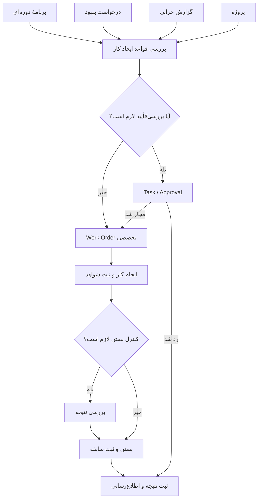
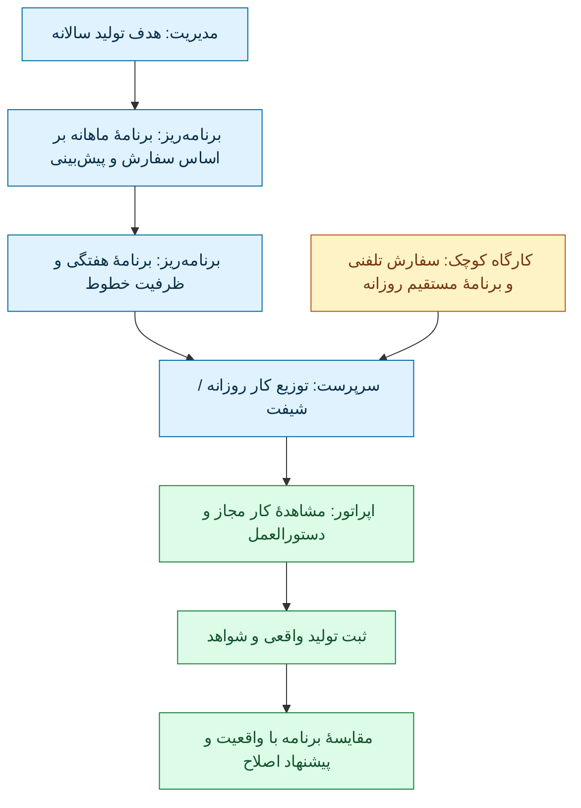
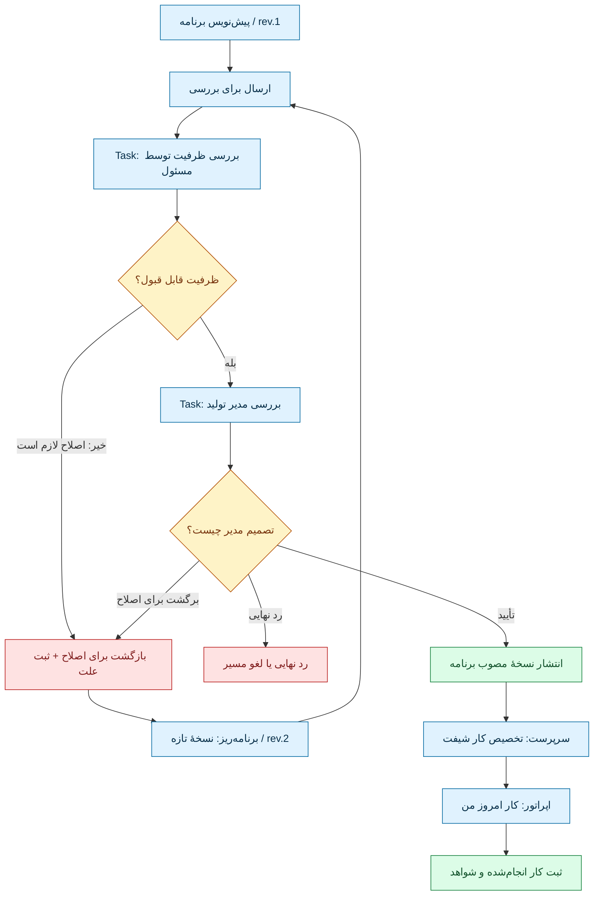
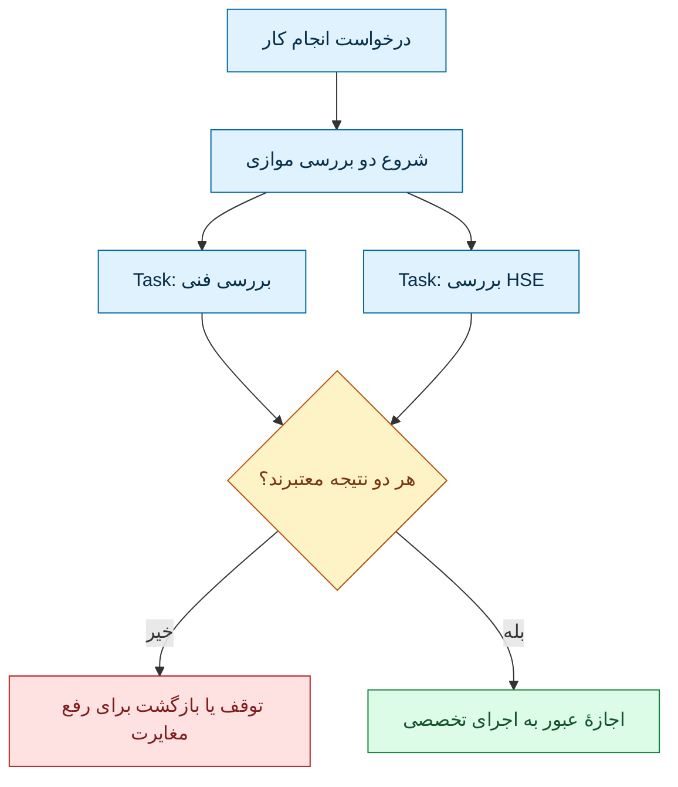
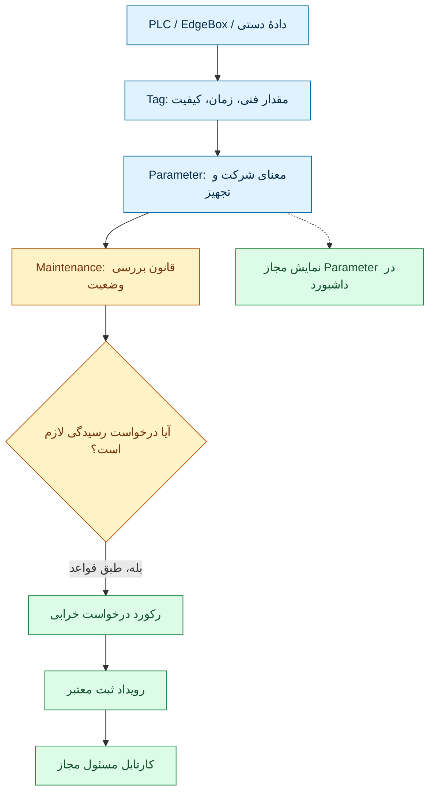
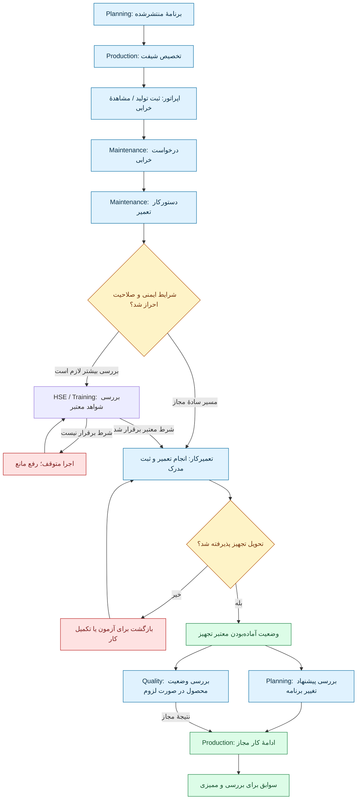
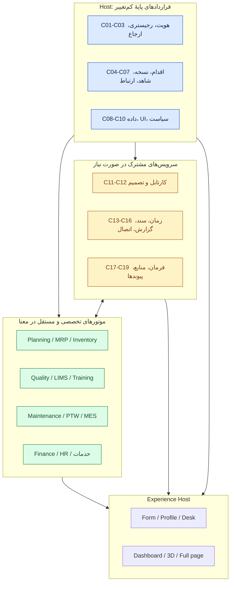

# از Source/Tag/Parameter تا Work Order و میز کار — طرح پایه و بررسی نقادانهٔ معماری SFP24

> **تاریخ:** ۲۰۲۶-۱۱-۰۵  
> **نوع سند:** بازنشر کامل محتوای پاسخ تحلیلی دستیار در این گفت‌وگو، همراه با توضیح تکمیلی و نقد طراحی. **بخش اول نقل محتوایی پاسخ دستیار است، نه نقل‌قول صاحب محصول**؛ فقط نمایش ویژهٔ گفت‌وگو به Markdown و Mermaid قابل نمایش در GitHub تبدیل شده است.  
> **وضعیت:** Discussion / Proposed / Critical Review؛ **نه ADR، نه قرارداد تصویب‌شده و نه پیاده‌سازی**.  
> **دامنهٔ مجوز:** صاحب محصول درخواست کرد تمام پاسخ پیشین، به‌جز جملهٔ آخر دربارهٔ تغییرندادن GitHub، بدون کاستن محتوا وارد مخزن شود و با مثال‌ها، نمودارها و بررسی نقادانه گسترش پیدا کند. این درخواست مجوز تغییر کد، قراردادهای مرجع، ادغام PR یا تصویب معماری نیست.  
> **مراجع داخلی:** [سوابق بلندبلند فکر کردن همین روز](THINKING-ALOUD-PLATFORM-DATA-WORKSPACES.fa.md) · [وضعیت اجرای محصول](../../STATUS.fa.md) · [هویت](../../core/IDENTITY-AND-ACCESS.fa.md) · [منبع/تگ/پارامتر](../../core/DATA-AND-PARAMETERS.fa.md) · [فضای کار](../../core/WORKSPACES.fa.md) · [مرزهای پیشنهادی](../../core/CANONICAL-BOUNDARIES.fa.md).  
> **نکتهٔ شواهد:** بررسی اسناد مبتنی بر گزارش کد در revision تاریخی `b3f203b` است؛ بررسی دوبارهٔ سند، جای اجرای تازهٔ کد یا آزمون رابط کاربری را نمی‌گیرد.

## راهنمای مطالعه

**بخش اول** همان پاسخ قبلی است، بدون کاهش مطالب؛ جدول‌ها و نمودارهای آن به Markdown/Mermaid تبدیل شده‌اند. **بخش دوم** برای فهم بهتر مسیر کار از مدیر تا اپراتور، ارجاع و رد و ارسال مجدد، و تفاوت نمایش در پنل کاربران اضافه شده است. **بخش سوم** نقد فرضیات و سناریوی ترکیبی یک کارخانهٔ فرضی با نظام کیفیت است. توضیحات افزوده نباید با متن پیشین یا تصمیم تصویب‌شده اشتباه گرفته شوند.

---

# بخش اول — متن کامل پاسخ پیشین، منتقل‌شده از گفت‌وگو

الان دقیقاً می‌دانم از کجا باید شروع کنیم. **Source، Tag و Parameter ایده‌های درستی بودند، اما فقط بخش «داده» را حل می‌کنند؛ نه کل معماری SFP24 را.**

بعد از بررسی دوبارهٔ قراردادهای موجود و روش‌های نرم‌افزارهایی مثل Camunda، Grafana و JSON Forms، من این معماری را پیشنهاد می‌کنم:

## ۱. معماری پیشنهادی SFP24



**این معماری پیشنهادی است، نه وضعیت فعلی کد.** قرار هم نیست هر کادر یک برنامه یا سرویس مستقل باشد؛ در ابتدا می‌توانند بخش‌هایی از همان Modular Monolith فعلی باشند.

## ۲. دقیقاً چه اجزایی لازم داریم؟

| جزء | کار آن | تصمیم پیشنهادی |
|---|---|---|
| **Identity / Responsibility** | شخص، چند مسئولیت، مأموریت موقت و محدودهٔ اختیار | تکمیل مدل موجود |
| **Module / Capability Registry** | معرفی ماژول، نسخه، قابلیت، وابستگی و اتصال آن | تکمیل قرارداد موجود |
| **Data Ports** | تحویل دادهٔ معتبر Parameter به ماژول‌ها | قرارداد عمومی جدید روی زیرساخت موجود |
| **Action** | درخواست انجام یک عملیات معتبر؛ مثل «ثبت تعمیر» | قرارداد مشترک |
| **Task** | سپردن یک اقدام به فرد یا گروه | سرویس مشترک محدود |
| **Approval / Policy** | تعیین اینکه چه عملی نیازمند تأیید است و توسط چه کسی | سازوکار مشترک با قواعد تخصصی ماژول |
| **Event / Notification** | اطلاع از وقوع اتفاق، بدون اتصال مستقیم ماژول‌ها به جدول یکدیگر | قرارداد رویداد و پیام‌رسانی |
| **Evidence / Audit** | مدرک، امضا یا تصمیم، ثبت تغییرات و تاریخچهٔ قابل پیگیری | قابلیت مشترک |
| **Schedule** | اجرای کار در زمان مشخص یا براساس برنامه | زمان‌بندی مشترک؛ معنای برنامه متعلق به ماژول |
| **UI Contributions** | اتصال فرم، صفحه، دکمه، کارت و نمودار ماژول به محیط کار | تکمیل قرارداد موجود |

یک جزء را عمداً در این جدول به‌عنوان سرویس عمومی قرار ندادم: **Work Order**.

چرا؟ چون Work Order دستورکار تخصصی است. تعمیر یک دستگاه، تولید یک قطعه و انجام یک پروژه ممکن است همگی «کار» نامیده شوند، ولی الزاماً مدل داده و قوانین یکسانی ندارند.

هسته باید امکانات مشترک برای کارها را بدهد؛ هر ماژول مالک دستورکار تخصصی خودش باشد.

---

## ۳. مثال اجرایی: فایل صوتی اول مدیر شرکت

او چهار منبع ایجاد دستورکار مطرح کرد: برنامهٔ نگهداری، درخواست بهبود، خرابی و پروژه.

من آن را این‌طور طراحی می‌کنم:



اینجا نکتهٔ مهمی داریم: **قرار نیست برای چهار منشأ، چهار موتور Work Order بسازیم.**

می‌توانیم یک ماژول Maintenance داشته باشیم که چند نوع دستورکار و چند مسیر ایجاد و رسیدگی را پشتیبانی کند. اگر بعدها یک نوع عملیات واقعاً مدل تخصصی متفاوتی خواست، قابلیت یا پیاده‌سازی جدا اضافه می‌کنیم.

همچنین Task با Work Order فرق دارد: یک دستورکار ممکن است چند وظیفه برای افراد مختلف داشته باشد، یا در کارگاه کوچک اصلاً Task جداگانه‌ای نخواهد.

این تفکیک در موتورهای واقعی Workflow هم دیده می‌شود. مثلاً Camunda وضعیت وظیفهٔ انسانی و انتساب آن به شخص را از هم جدا می‌کند. [منبع: Camunda User Task Lifecycle](https://docs.camunda.io/docs/8.9/apis-tools/frontend-development/task-applications/user-task-lifecycle/).

---

## ۴. فرم‌ساز، میزساز، پروفایل و داشبورد را چطور بسازیم؟

**پیشنهاد من ساخت سه سازنده و یک سیستم اتصال مشترک است؛ نه یک سازندهٔ غول‌آسا برای همه‌چیز.**

| ابزار | باید چه چیزی بسازد؟ | روش |
|---|---|---|
| **Form Builder** | فرم ثبت خرابی، بازرسی، درخواست، ثبت نتیجه و... | فیلدهای تعریف‌شده، اعتبارسنجی، شرط نمایش و نسخهٔ فرم |
| **Desk Builder** | محیط کاری شخص با چند فرم، کارتابل، نمودار و ابزار | چیدمان اجزای ثبت‌شدهٔ ماژول‌ها |
| **Dashboard Builder** | گزارش و نمودار با فیلتر زمان، تجهیز، سایت و... | اتصال به منابع داده و شاخص‌های معتبر |
| **Profile Extensions** | نمایش تعمیرات یک دستگاه یا مهارت‌های یک شخص | بخش‌های تخصصی افزوده‌شده به پروفایل اصلی |

### فرم‌ساز: دو نوع فرم لازم داریم

**نوع اول: فرم‌های معمولی قابل تنظیم.** مدیر مجاز شرکت بتواند فیلدهای اختیاری، ترتیب، عنوان، لیست انتخابی و بعضی شروط را تغییر دهد.

**نوع دوم: فرم‌های تخصصی ماژول.** مثلاً فرم صدور PTW یا تأیید صلاحیت که منطق و کنترل‌های تخصصی دارد. این فرم‌ها می‌توانند از اجزای مشترک استفاده کنند، ولی اعتبارسنجی‌شان در کد ماژول باقی بماند.

نباید اجازه دهیم فرم‌ساز با تغییر ظاهر یا فیلدها، قانون ایمنی یا مجوز را دور بزند.

برای پیاده‌سازی، الگوی **Data Schema + UI Schema + Custom Components** مناسب است. همین تفکیک در JSON Forms وجود دارد و از Vue هم پشتیبانی می‌کند؛ البته قبل از انتخاب کتابخانه باید سازگاری فنی آن آزمایش شود. [منبع: JSON Forms در Vue](https://jsonforms.io/docs/integrations/vue/) و [معماری JSON Forms](https://jsonforms.io/docs/architecture/).

### داشبوردساز: پیشنهاد من شش نوع اتصال داده است

نه اینکه شش موتور داشبورد جدا بسازیم؛ یک داشبوردساز داشته باشیم که این منابع را می‌شناسد:

1. **Parameter زنده:** دما، جریان، وضعیت تجهیز.
2. **تاریخچهٔ Parameter:** نمودار زمانی و مقایسهٔ بازه‌ها.
3. **Metric معتبر:** OEE، میزان تحقق برنامه یا شاخص آموزشی.
4. **رکوردهای عملیاتی:** فهرست خرابی‌ها، دستورکارها، سفارش‌ها.
5. **Task و Approval:** کارهای معوق، موارد منتظر تأیید.
6. **Event و Alert:** اتفاقات، هشدارها و تغییر وضعیت‌ها.

Grafana نیز داده‌گیری و پرس‌وجو را از پنل نمایشی جدا می‌کند؛ این الگو برای SFP24 مفید است. [منبع: Grafana — Query and transform data](https://grafana.com/docs/grafana/latest/visualizations/panels-visualizations/query-transform-data/).

هر کارت به‌جای دسترسی آزاد به جدول دیتابیس، باید از یک **منبع دادهٔ تعریف‌شده و مجاز** استفاده کند.

### دربارهٔ میز و اتاق

پیشنهاد مشخص من:

- **میز** محیط کار قابل تنظیم باشد.
- **داشبورد** هم مستقل قابل بازشدن باشد، هم داخل میز قرار بگیرد.
- **پروفایل** متعلق به شخص یا تجهیز باشد، نه میز کاربر.
- **سه‌بعدی** بتواند مستقل یا داخل محیط کار استفاده شود.
- **اتاق** فعلاً فقط مفهوم دسته‌بندی یا ناوبری باشد؛ هنوز برای آن موتور و ساختار دادهٔ مستقل نسازیم.

چون ساخت میز نسخه‌دار و اختصاص آن در کد فعلی تا حدی وجود دارد، بهتر است آن را تکمیل کنیم، نه اینکه یک میزساز دوم ایجاد کنیم.

---

## ۵. حالا ترتیب واقعی کار چیست؟

من برای سه مرحلهٔ بعدی این خروجی‌های مشخص را پیشنهاد می‌کنم:

| مرحله | هدف | خروجی |
|---|---|---|
| **مرحلهٔ ۱ — طراحی مدل مشترک عملیات** | تعریف دقیق Request، Work Order، Action، Task، Approval، Event، Evidence و ارتباطشان؛ تعیین مالک هر مفهوم و مثال مسیر ساده و پیچیده | مدل موجودیت‌ها + قرارداد عملیات + نمودار وضعیت‌ها |
| **مرحلهٔ ۲ — قرارداد اتصال ماژول و داده** | مشخص‌کردن اینکه ماژول چگونه Parameter دریافت می‌کند، رکورد و شاخص منتشر می‌کند، Action معرفی می‌کند، درخواست تأیید می‌دهد و قابلیت‌هایش فعال یا نسخه‌بندی می‌شوند | قراردادهای ورودی/خروجی، امنیت، نسخه و رفتار خطا |
| **مرحلهٔ ۳ — قرارداد رابط کاربری و مأموریت Codex** | تعریف Form، Desk، Dashboard، Profile و 3D؛ سپس مقایسه با کد موجود، تشخیص تغییرات لازم، ترتیب Migration و آزمون‌های پذیرش | مشخصات اجرایی قابل بررسی و تسک‌های مستقل برای Codex |

## انتخاب نهایی من

**از مرحلهٔ ۱، یعنی مدل مشترک عملیات شروع کنیم.**

نه چون Source/Tag/Parameter بی‌اهمیت‌اند؛ اتفاقاً بخش دادهٔ آن‌ها قبلاً تا حدی ساخته شده است. ولی تا رابطهٔ «درخواست، عملیات، وظیفه، تأیید، مدرک و نتیجه» روشن نشود، نمی‌توانیم فرم‌ساز و میز کار عملیاتی درستی طراحی کنیم.

قبل از تحویل به Codex هم این مدل را با سناریوهای Maintenance، Training، Planning و PTW محک می‌زنیم تا یک راه‌حل مخصوص تعمیرات را به کل نرم‌افزار تحمیل نکنیم.

**قدم بعدی مشخص:** تعریف تک‌تک موجودیت‌های مرحلهٔ ۱، روابط، مالکیت داده، وضعیت‌ها و قواعد آن‌ها. سپس می‌توانیم دربارهٔ هر قرارداد تصمیم بگیریم و آن را برای کدنویسی آماده کنیم.

> **مرز انتقال:** جملهٔ پایانی پاسخ مبنی بر «تغییری در GitHub داده نشده» به خواستهٔ صاحب محصول بازنشر نشده است؛ سایر ادعاهای وضعیتی و محتوایی پاسخ در بالا باقی مانده‌اند. این سند همچنان «پیشنهاد» است و تصویب خودکار محسوب نمی‌شود.

---

# بخش دوم — توضیح ساده‌تر و دقیق‌تر: کار از مدیر تا اپراتور چگونه حرکت می‌کند؟

> **توضیح تازهٔ دستیار** برای رفع ابهام‌های گفته‌شده؛ نام وضعیت‌ها، شمارهٔ نمونه‌ها و پنل‌ها صرفاً پیشنهادی هستند، نه API یا UI موجود و نه الزام جهانی استاندارد.

## ۶. هشت مفهوم مستقل؛ اشتباه نگیریم

فرض کنیم مدیر کارخانه می‌خواهد این هفته ۲۵۰ قطعه تولید شود.

| اصطلاح | معنی بسیار ساده | مثال | مالک یا مسئول اصلی |
|---|---|---|---|
| **Plan / برنامه** | چه چیزی و چه زمانی انجام شود | ۲۵۰ قطعه در هفته | ماژول Planning |
| **Request / درخواست** | کسی کاری می‌خواهد یا مشکلی را گزارش می‌کند | گزارش خرابی اپراتور | ماژول صاحب درخواست |
| **Work Order / دستورکار** | کار تخصصی با جزئیات و وضعیت | تعمیر CNC-07 | Maintenance، نه هستهٔ همه‌چیزدان |
| **Action / اقدام** | فرمان معنادار و مجاز به یک سرویس | «برنامه را منتشر کن» | سرویس تخصصی با کنترل مشترک هویت |
| **Task / وظیفه** | کاری که شخص یا گروه باید اکنون انجام دهد | «سرپرست، ظرفیت را بررسی کن» | قرارداد کارتابل مشترکِ پیشنهادی |
| **Approval / تصمیم** | قبول، رد یا بازگرداندن موضوع مشخص | تأیید برنامهٔ rev.2 | قواعد ماژول + کنترل تصمیم معتبر |
| **Event / رخداد** | خبر وقوع یک تغییر ثبت‌شده | `PlanPublished` | ماژول منتشرکننده و قرارداد تبادل |
| **Evidence / شاهد** | مدرک دربارهٔ اقدام یا تصمیم | اندازه‌گیری، تصویر، علت رد | مالک رکورد با زیرساخت مشترک قابل بررسی |

**رابطهٔ یک‌به‌یک وجود ندارد:** یک برنامه می‌تواند به چند تخصیص روزانه برسد؛ یک Work Order ممکن است چند Task داشته باشد؛ یک Task ممکن است اصلاً Approval نداشته باشد. در کارگاه کوچک نیز ثبت مستقیم کار با شواهد لازم ممکن است، بدون آنکه Task مصنوعی برای ارجاع به خود ایجاد شود.

## ۷. سلسله‌مراتب برنامه: هدف سالانه تا اجرای شیفت



**اصل:** این چهار سطح برنامه‌ریزی یک مسیر اجباری نیستند. برنامهٔ سالانه ممکن است فقط هدف کلی ظرفیت باشد؛ برنامهٔ ماهانه ترکیبی از سفارش و Forecast باشد؛ برنامهٔ شیفت از سفارش مستقیم ساخته شود. مدیر نیز الزاماً برنامهٔ همهٔ شیفت‌ها را امضا نمی‌کند. **نقطهٔ تأیید براساس سیاست معتبرِ همان نوع برنامه مشخص می‌شود**.

## ۸. تأیید، رد، اصلاح و عبور به نفر بعد ـ نمودار رنگی

مثال: برنامه‌ریز نسخهٔ اول برنامهٔ هفته را می‌نویسد. مسئول ظرفیت می‌گوید یک دستگاه در سرویس دوره‌ای است، بنابراین برنامه را **برای اصلاح بازمی‌گرداند**. برنامه‌ریز نسخهٔ دوم را آماده می‌کند. این بار مسئول ظرفیت قبول می‌کند؛ سپس کار در پنل مدیر تولید برای **تصمیم نهایی** ظاهر می‌شود. تنها پس از انتشار، سرپرست می‌تواند کار شیفت را از برنامهٔ معتبر تخصیص دهد.



**راهنمای رنگ:** آبی = پیش‌نویس یا کار انسانی؛ زرد = تصمیم؛ قرمز = رد یا بازگشت؛ سبز = انتشار یا ثبت نتیجه. این رنگ‌ها برای فهم Mermaid هستند، نه طراحی نهایی UI.

چهار نتیجه را جدا ثبت کنیم: **تأیید** یک نسخهٔ مشخص، **بازگشت برای اصلاح** همراه با دلیل و حق ساخت نسخهٔ بعدی، **رد نهایی** با پایان پروندهٔ فعلی و **لغو/انقضا** که علت متفاوتی دارد. رد نهایی نباید با ویرایش پنهانی به تأیید تبدیل شود.

### Task چگونه به نفر بعد می‌رسد؟

یک نمونهٔ زندهٔ فرایند یا **Workflow Instance** به نسخهٔ مشخصی از تعریف مراحل متصل است. به مرحلهٔ بررسی ظرفیت که رسید، یک **Task Instance** برای شخص یا گروه مجاز می‌سازد. نتیجهٔ Task و علت تصمیم ثبت می‌شود؛ فقط بعد از بررسی قواعد سمت سرور، Task بعدی برای مدیر ایجاد می‌شود. اگر برنامه برای اصلاح برگشت، Task مدیر هنوز نباید از روی پیش‌نویس قبلی فعال بماند. تاریخچهٔ درخواست، نسخه‌ها، مأموریت‌ها و تصمیم‌ها محفوظ می‌ماند.

**انجام Task با معتبرشدن نتیجهٔ تخصصی فرق دارد.** اپراتور ممکن است فرم ثبت کار را تکمیل کند، اما صحیح‌بودن شمارش، وضعیت کیفیت، نوع عملیات و مقدار قابل گزارش باید در Production بررسی شود.

### اگر تأیید هم‌زمان لازم باشد؟



این طرح «هر دو باید تأیید کنند» را مثال می‌زند. برای بعضی فرایندها شاید «یکی از اعضای گروه» کافی باشد؛ برای عملیات حساس شاید استقلال اشخاص، صلاحیت فنی و اعتبار زمانی کنترل‌ها هم لازم باشد. همهٔ این‌ها باید در تعریف سیاست مشخص باشند. در PTW، تأیید نرم‌افزاری جای اجرای واقعی کنترل ایمنی را نمی‌گیرد.

## ۹. هر فرد در پنل خودش چه می‌بیند؟

**اصل طراحی:** میز و داشبورد مالک اطلاعات نیستند؛ فقط نمای مجاز رکوردهای صاحب ماژول‌اند.

| پنل/میز | چیزهایی که نشان می‌دهد | Action مجاز | چیزی که نباید رخ دهد |
|---|---|---|---|
| **مدیر تولید** | برنامه‌های منتظر تصمیم، تأخیر مهم، اثر توقف، خلاصهٔ شاخص‌ها | تأیید/بازگرداندن نسخهٔ مشخص | تأیید همهٔ کارهای هر اپراتور به‌صورت پیش‌فرض |
| **برنامه‌ریز** | سفارش، ظرفیت، Forecast، برنامه‌های برگشتی، سابقهٔ تغییر | اصلاح و ارسال نسخه | تغییر بی‌ردپای برنامهٔ منتشرشده |
| **سرپرست شیفت** | برنامهٔ منتشرشده، افراد و تجهیزات، موانع | تخصیص کار و اعلام استثنا | اجرای قطعیِ برنامهٔ Draft |
| **اپراتور** | دستورالعمل معتبر، کار امروز، تجهیز، فرم ثبت کار | ثبت تولید یا اعلام مشکل | تأیید ایمنی بدون اختیار |
| **تعمیرکار** | دستورکارها، قطعات، تاریخچهٔ تجهیز، کنترل‌های لازم | ثبت کار واقعی و مدرک | معادل‌گرفتن «تعمیر انجام شد» با «تجهیز آزاد شد» |
| **کیفیت / HSE** | شواهد بازرسی، توقف کیفیت، مجوزهای موردی | بررسی و تصمیم تخصصی | تغییر وضعیت فقط با کلیک بر کارت |
| **Company Admin** | انتساب میز، ماژول‌های فعال، سیاست قابل تنظیم | تنظیم مجاز و انتشار نسخه | حذف قانون تخصصی یا دورزدن امنیت از فرم‌ساز |

### نمونهٔ پنل مدیر — نمای مفهومی

```text
┌──────────────────────────────────────────────────────┐
│ میز مدیر تولید — کارخانهٔ نمونه                      │
├──────────────────────────────────────────────────────┤
│ منتظر تصمیم من: ۳       تأخیر مهم خطوط: ۱            │
│                                                      │
│ برنامهٔ هفتهٔ ۴۲ / نسخهٔ ۲                            │
│ وضعیت: منتظر تأیید من                                │
│ [تغییرها] [شواهد] [تأیید] [بازگرداندن]                │
│                                                      │
│ CNC-07: توقف / هنوز آمادهٔ تحویل نیست               │
│ برنامهٔ جایگزین: فقط پیشنهاد؛ منتشرنشده             │
└──────────────────────────────────────────────────────┘
```

### نمونهٔ پنل اپراتور — نمای مفهومی

```text
┌──────────────────────────────────────────────────────┐
│ کار امروز من — شیفت صبح                              │
├──────────────────────────────────────────────────────┤
│ قطعه P-100 / عملیات OP-10 / هدف ۵۰ عدد              │
│ تجهیز CNC-07 — وضعیت: متوقف / مانع اجرا             │
│                                                      │
│ [اعلام مشکل] [دستورالعمل نسخهٔ معتبر]               │
│ [ثبت تولید] ← طبق شرایط و مجوز معتبر                │
│                                                      │
│ کار قبلی من: ۱۲ عدد ثبت‌شده، کیفیت هنوز نهایی نیست   │
└──────────────────────────────────────────────────────┘
```

**جمع‌بندی UX:** کارتابل = چه چیزی منتظر اقدام من است؛ میز = محیط انجام کار من؛ داشبورد = نمایش داده و شاخص؛ پروفایل = اطلاعات همان فرد/تجهیز/سفارش. هر چهار ممکن است در یک صفحه کنار هم باشند، اما یک رکورد یا مجوز واحد نیستند.

## ۱۰. اتصال Tag/Parameter به همین گردش



**قید:** Parameter ورودیِ بررسی است، نه «ماشینِ خودکارِ ثبت خرابی قطعی». وضعیت ارتباط، تکرار سیگنال، کیفیت، تناقض با ثبت انسانی و زمینهٔ تجهیز باید بررسی شوند. مسیر فرمان فیزیکی `TAG.OUT` نیازمند قرارداد مستقلِ فرمان، پاسخ، وضعیت واقعی و ایمنی است.

---

# بخش سوم — نقد فنیِ طرح و یک سناریوی چندماژولی در کارخانهٔ دارای نظام کیفیت

> **منشأ:** تحلیل تکمیلی دستیار، نه تجربهٔ گزارش‌شده از شرکت واقعی. مثال کارخانه، شماره‌ها، رویه‌ها و تصمیم‌ها **فرضی** هستند. وجود ISO 9001 یا IATF 16949 به‌خودی‌خود هیچ Workflow جزئیِ نمونه را اجباری نمی‌کند. هدف اینجا آزمون معماری است.

## ۱۱. نقد مستقل: طرح قبلی کجاها هنوز برای کدنویسی مبهم است؟

نمودار «هسته / داده / هماهنگی / ماژول / نمایش» جهت مناسبی دارد، ولی **به‌تنهایی مشخصات اجرایی نیست**. در آن مشخص نبود رکورد چه کسی مالک است، تصمیم چگونه روی نسخهٔ داده اعمال می‌شود و پیام بعد از قطع ارتباط چه سرنوشتی دارد. این موارد باید قبل از تبدیل طرح به دستور Codex روشن شوند.

| ابهام یا خطر | چرا مهم است؟ | نتیجهٔ فنی پیشنهادی برای بررسی |
|---|---|---|
| **Work Order در برابر Task** | یک دستورکار تعمیر ممکن است چند وظیفه، توقف و مدرک داشته باشد؛ «تولید» هم دستورکار تخصصی دیگری دارد | Work Order نزد ماژول؛ Task به رکورد تخصصی با مرجع typed وصل شود |
| **Approval در برابر نتیجهٔ واقعی** | کلیک «تأیید» نباید خودش ماشین را تعمیرشده یا قطعه را سالم کند | تصمیم به نسخهٔ موضوع اشاره کند؛ انتقال وضعیت با سرویس مالک دامنه |
| **تغییر برنامه پس از انتشار** | ممکن است اپراتور از برنامهٔ قبلی کار را شروع کرده باشد | نسخهٔ منتشرشدهٔ تغییرناپذیر، تاریخ اثر، روش اطلاع و تکلیف کار در جریان |
| **چند تأیید موازی** | گاهی قبول همهٔ مسئولان لازم است؛ گاهی یک نفر از گروه؛ گاهی منع خودتأییدی داریم | قانون Join/Quorum، تفکیک وظایف، Delegate، Scope و Qualification |
| **تکرار/تأخیر رویداد** | اعلان ممکن است دو بار به یک ماژول برسد؛ قطعی شبکه هم عادی است | شناسهٔ پیام، پردازش idempotent، Retry و بازیابی، انتشار پایدار بعد از commit؛ Outbox یک گزینه است |
| **دادهٔ ناقص و مشکوک** | خاموشی دستگاه از قطع اینترنت اثبات نمی‌شود؛ OEE غلط می‌شود | زمان، نوع، واحد، کیفیت، provenance، نسخهٔ transform و gap |
| **نبود ماژول خریداری‌شده** | PTW ممکن است بدون Training هم لازم باشد | مسیر دریافت مدرک معتبر جایگزین، نه حذف شرط صلاحیت |
| **شواهد و ممیزی** | فایل قابل‌ویرایش و زمان ثبتِ صرف همیشه قابل اتکا نیست | انتساب مدرک، نسخه، کنترل دسترسی، سابقهٔ اصلاح، retention و در صورت نیاز امضای معتبر |
| **فرم‌ساز آزاد** | حذف یک فیلد از UI نباید کنترل قانونی یا تخصصی را حذف کند | Data Schema و UI Schema جدا، نسخهٔ Published، Validator تخصصی سمت سرور |
| **داشبوردساز و حریم داده** | فیلتر سمت مرورگر نباید اطلاعات سایت دیگر را افشا کند | Data Source/Query Contract امن، Tenant و Scope سمت سرور، زمان و cache policy |
| **زمان‌بندی در مقابل Planning** | ساخت خودکار کار دوره‌ای با برنامه‌ریزی ظرفیت تولید یکی نیست | Scheduler مشترک در صورت نیاز؛ موتور برنامه‌ریزی متعلق به Planning |
| **Workflow Engine بزرگ و زودهنگام** | ساخت موتور همه‌کاره ممکن است همهٔ قوانین تخصصی را به هسته بکشاند | ابتدا State/Task/Decision/Events با مرز مشخص؛ انتخاب موتور بعداً |
| **میز به‌عنوان منبع Permission** | نمایش دکمه نباید مجوز اجرای آن بسازد | UI فقط Contribution؛ Authorization واقعی در API |
| **ویرایش موضوع پس از تأیید** | قبول نسخهٔ اول نمی‌تواند قبول محتوای تغییرکرده محسوب شود | Subject ID + Subject Revision + Policy Revision + تصمیم تاریخ‌دار |
| **فرمان فیزیکی و نتیجه** | «فرمان ارسال شد» با «PLC اجرا کرد» و «وضعیت واقعی امن است» یکسان نیست | Requested / Accepted / Executed / Observed، timeout و fail-safe تخصصی |
| **گونه‌های ماژول و ارتقا** | سیاست شرکت را نباید با نسخهٔ کد قاطی کرد | Release، Capability، Strategy، Company Policy و Workflow Revision جداگانه |

### سه اصلاح جدی در طرح قبلی

**اول:** عبارت `Action / Task / Approval` در یک کادر، نباید به یک جدول یا موتور واحد تعبیر شود. Action درخواست عملیات معتبر است؛ Task منتظر کار انسانی است؛ Approval تصمیم دربارهٔ نسخه‌ای از یک موضوع است. ممکن است هر سه ارتباط داشته باشند ولی هرکدام معنای جدا دارد.

**دوم:** Event «خبر» است، نه «فرمان حتمی». اگر بعد از `WorkOrderClosed`، Planning باید برنامه را بازنگری کند، باید روشن شود آیا فقط یک اعلان ثبت می‌کند، یک پیشنهاد می‌سازد یا درخواست اقدام مشخصی را دنبال می‌کند. پاسخ، شکست و مالک تصمیم باید معلوم باشد.

**سوم:** نمی‌توان بدون بررسی نسخهٔ جدید کد بگوییم همهٔ این اجزا «وجود ندارند». اسناد [وضعیت واقعی](../../STATUS.fa.md)، [گسترش موجودیت‌ها](../../core/EXTENSIONS.fa.md) و [مرز هسته](../../core/CANONICAL-BOUNDARIES.fa.md) برخی امکانات موجود و پیش‌نویس‌ها را نشان می‌دهند. قبل از هر مأموریت Codex باید هر موضوع برچسب `Observed`، `Proposed`، `Confirmed gap` یا `Approved` بگیرد؛ کمبود فقط با شواهد اعلام شود.

## ۱۲. سناریوی سرتاسری: کارخانهٔ قطعه‌سازی با نظام کیفیت مستند

### شرکت و اعداد مثال

فرض کنیم یک کارخانهٔ قطعه‌سازی دوشیفتی، با Planning، Production، Maintenance، Quality، Training و HSE کار می‌کند. برای این مثال شرکت می‌خواهد سوابقی قابل بررسی برای نظام کیفیت خودش نگه دارد؛ **ادعا نمی‌کنیم مراحل این مثال عین بندهای یک استاندارد هستند**.

ویرایش جاری استاندارد عمومی کیفیت در این تاریخ [ISO 9001:2026](https://www.iso.org/standard/9001) است. در زنجیرهٔ خودرویی، الزامات اختصاصی مشتری نیز می‌تواند اثرگذار باشد؛ [فهرست رسمی IATF دربارهٔ Customer-Specific Requirements](https://www.iatfglobaloversight.org/oem-requirements/customer-specific-requirements/). متن کامل الزام مشتری و شرایط خود کارخانه باید برای تصمیم اجرایی جدا بررسی شود.

تجهیز نمونه `CNC-07`، قطعه `P-100` و عملیات `OP-10` است. برای فهم آسان، هدف سالانه ۱۲٬۰۰۰ قطعه، ماهانه ۱٬۰۰۰، هفتگی ۲۵۰ و روزانه ۵۰ قطعه در پنج روز فرض شده است. این صرفاً مثال حسابی است؛ Forecast، سفارش قطعی، تقویم، ظرفیت و مواد واقعی باید از منابع معتبر بیایند. سفارش و Forecast اگر به یک تقاضا اشاره می‌کنند نباید دوبار جمع زده شوند.

### گام ۱ — برنامه‌ریز یک نسخه می‌فرستد و رد می‌شود

برنامه‌ریز از سفارش‌ها و ظرفیت، برنامهٔ `PLAN-W42 rev.1` را می‌سازد. مسئول بررسی می‌بیند تجهیز CNC-07 در همان هفته سرویس ازپیش‌تعیین‌شده دارد و برنامه با ظرفیت سازگار نیست. او **«برگشت برای اصلاح»** را انتخاب می‌کند، نه «کار انجام شد». دلیل و شخص و زمان ثبت می‌شوند.

برنامه‌ریز `rev.2` را با توزیع زمانی جدید آماده می‌کند. این بار مسئول ظرفیت قبول می‌کند و مرحلهٔ بعد برای مدیر تولید باز می‌شود. مدیر مجاز، نسخهٔ دوم را تأیید می‌کند؛ نسخهٔ منتشرشده دیگر بدون سابقهٔ اصلاح تغییر نمی‌کند.

سرپرست بر پایهٔ برنامهٔ منتشرشده، سهم مجاز کار روزانه را به اپراتور تخصیص می‌دهد. **برنامهٔ هفتگی، کار تخصیص‌یافته و تولید واقعی سه نوع رکورد مستقل‌اند.**

### گام ۲ — اپراتور یک مشکل ثبت می‌کند

اپراتور پس از ثبت ۱۲ قطعه متوجه عملکرد نامناسب دستگاه می‌شود. شاید Parameter مربوط به وضعیت ماشین نیز تغییر غیرعادی را نشان دهد. اپراتور درخواست خرابی `MR-217` را با توضیح، زمان و تجهیز ثبت می‌کند.

Maintenance بررسی می‌کند آیا خرابیِ تکراری قبلاً ثبت شده، دادهٔ سنسور معتبر است و آیا واقعاً درخواست جدید لازم است. سپس در این مثال دستورکار `WO-84` را می‌سازد. **تغییر مقدار یک Tag به‌تنهایی سند تشخیص قطعی خرابی نیست.**

### گام ۳ — تعمیرات، صلاحیت و کنترل ایمنی

سرپرست تعمیرات مسئول را تعیین می‌کند. در این مثال، برای بخشی از تعمیر احتمال خطر الکتریکی وجود دارد. پیش از اجازهٔ اجرای آن بخش، قواعد HSE دربارهٔ ارزیابی خطر و کنترل واقعی شرایط بررسی می‌شوند. اگر PTW لازم باشد، ماژول مربوط به مجوز کار باید بر اساس شرایط معتبر تصمیم بگیرد.

وجود دسترسی نرم‌افزاری برای تعمیرکار **صلاحیت فنی و حق انجام کار پرخطر را ثابت نمی‌کند**. اگر Training در شرکت فعال باشد، می‌توان شواهد صلاحیت متناسب با آن فعالیت را با قرارداد مجاز دریافت کرد. اگر Training فعال نباشد، بررسی صلاحیت و الزام ایمنی از بین نمی‌رود؛ راه جایگزین معتبر و مستند لازم است.

### گام ۴ — پایان تعمیر، اما هنوز نه پایان کل پرونده

تعمیرکار قطعهٔ تعویض‌شده، شرح کار، زمان، نتیجهٔ اندازه‌گیری و شاهد لازم را ثبت می‌کند. Task او بسته می‌شود؛ اما Work Order می‌تواند وضعیت «کار فنی انجام‌شده، منتظر تحویل» داشته باشد.

اگر تحویل تجهیز نیاز به آزمون یا بازبینی داشته باشد، مسئول مربوط نتیجه را ثبت می‌کند. صرف کلیک «تعمیر تکمیل شد» ماشین را خودکار «مجاز برای تولید» نمی‌کند.

### گام ۵ — اثر خرابی بر Planning و Quality

Maintenance تغییر وضعیت معتبر تجهیز را در اختیار مصرف‌کنندگان مجاز قرار می‌دهد. Planning مدت توقف و ظرفیت ازدست‌رفته را بررسی می‌کند و در صورت نیاز پیشنهاد نسخهٔ اصلاحی برنامه می‌دهد. اگر سیاست شرکت تصویب تغییر برنامه را لازم می‌داند، نسخهٔ جدید باید مسیر همان تأیید را طی کند. برنامهٔ قبلی و گزارش تولیدی که پیش‌تر تحت آن ایجاد شده‌اند پاک نمی‌شوند.

ممکن است Quality تصمیم بگیرد بعد از تعمیر یک نمونهٔ قطعه بررسی شود. تا قبل از وجود نتیجهٔ معتبر، وضعیت محصول نباید خودسرانه «سالم و آزادشده» معرفی شود. OEE نیز تنها با زمان مبنا، شمارش معتبر، زمان سیکل، کیفیت و دامنهٔ روشن، نتیجه‌ای قابل توضیح می‌دهد؛ قطع ارتباط یا دادهٔ ناقص نباید صفر فرض شود.

### گام ۶ — زنجیرهٔ مدارک قابل بررسی

کاربر مجاز یا ممیز می‌تواند **با حفظ محدودیت‌های دسترسی** مسیر سوابق را دنبال کند: برنامهٔ برگشتی `rev.1` و علت آن؛ برنامهٔ منتشرشده `rev.2`؛ کار شیفت اپراتور؛ ثبت ۱۲ قطعه؛ `MR-217`؛ `WO-84`؛ مدرک صلاحیت و مجوزهای لازم؛ مدارک تعمیر؛ تحویل تجهیز؛ اثر بر برنامه و وضعیت کیفیت محصول.

این «ردیابی» کمک‌ابزار ممیزی است، نه تضمین انطباق استاندارد. واقعی‌بودن اقدام‌ها، کیفیت شواهد، رویهٔ مصوب و الزامات قابل اعمال باید مستقلاً بررسی شوند.

### نمودار بین‌ماژولی: کجا قبول، رد یا توقف رخ می‌دهد؟



**دقت در خواندن نمودار:** فلش‌های `Planning` و `Quality` به معنای اجرای اجباری پشت سر هم نیستند؛ آن دو ممکن است موازی یا مستقل باشند. Quality مالک آزادسازی محصول است، ولی مسئولیت آماده‌بودن فنی تجهیز می‌تواند در Maintenance یا نقش مرتبط دیگری باشد. همچنین شرط «نیاز نداشتن به PTW» فقط نتیجهٔ بررسی معتبر است؛ مسیر ساده اجازهٔ دورزدن قانون ایمنی نیست.

### وضعیت پنل‌ها در چند لحظهٔ حساس

| اتفاق | مدیر تولید | برنامه‌ریز | اپراتور/سرپرست | تعمیرات/HSE/کیفیت |
|---|---|---|---|---|
| برنامهٔ rev.1 برگشت | هنوز تأیید نهایی در انتظارش نیست | علت رد و امکان اصلاح را می‌بیند | پیش‌نویس را کار قطعی نمی‌بیند | Maintenance سرویس برنامه‌ریزی‌شدهٔ تجهیز را طبق قرارداد عرضه می‌کند |
| rev.2 منتشر شد | نتیجه و نسخهٔ پذیرفته‌شده | تاریخچهٔ نسخه‌ها | سرپرست سهم شیفت و اپراتور کار خودش را می‌بیند | فقط اطلاعات مجازِ مربوط را می‌بیند |
| خرابی اعلام شد | اثر مهم توقف در گزارش | پیام اثر بر برنامه | اپراتور وضعیت «گزارش‌شده» را می‌بیند | مسئول فنی درخواست را بررسی و دستورکار ایجاد می‌کند |
| تعمیر منتظر مجوز است | وضعیت تأخیر مهم | امکان پیشنهاد تغییر برنامه | فعالیت محدودشده را نباید به‌عنوان کار آزاد نمایش داد | مسئول HSE/مجاز بررسی واقعی را انجام می‌دهد |
| تعمیر ثبت شده ولی تحویل نشده | وضع «تحویل باز» | تجهیز را آمادهٔ قطعی فرض نمی‌کند | کار بعدی تا رفع مانع معتبر فعال نمی‌شود | نتیجهٔ فنی و تحویل توسط صاحب اختیار بررسی می‌شود |
| تجهیز آماده شد | مدت توقف و اثر معتبر | تأثیر بر نسخهٔ برنامه | ادامهٔ کار مجاز | کیفیت وضعیت محصول را جدا بررسی می‌کند |

### همان مسئله در کارگاه کوچک

مشتری تلفن می‌زند؛ فرد مجاز برنامهٔ روز را ثبت می‌کند؛ خودش کار تولید یا تعمیر را انجام می‌دهد؛ سپس رکورد نتیجه و شواهد لازم را ثبت می‌کند. اگر برای آن فعالیت **Approval مستقل الزامی نیست**، هیچ تسک صوری برای ارسال و تأیید کارِ همان شخص ساخته نشود. اما این کوتاهی مسیر، به معنی حذف کنترل‌های خطر، تاریخچه یا شواهد لازم نیست.

---

## ۱۳. نتیجهٔ نقد: در قدم بعد دقیقاً چه چیزی باید تبدیل به قرارداد شود؟

| اولویت | خروجی دقیق مرحلهٔ بعد | پرسشِ آزمون‌پذیر |
|---|---|---|
| ۱ | مدل مالکیت `Plan/Request/WO/Task/Decision/Evidence` | آیا هر رکورد یک مالک روشن و شناسهٔ پایدار دارد؟ |
| ۲ | جدول حالات و مجوزهای انتقال وضعیت + نسخهٔ سیاست | در رد، اصلاح، تأیید موازی، لغو، انقضا و تغییر محتوا چه اتفاقی می‌افتد؟ |
| ۳ | قرارداد امن Action و Task/Inbox | چه کسی روی کدام موضوع و در چه Scope و زمانی می‌تواند عمل کند؟ |
| ۴ | Data Port و Domain Event | در نبود داده، تکرار پیام، قطع شبکه، تغییر ماژول و دادهٔ دیررس چه می‌شود؟ |
| ۵ | شواهد، Audit و سیاست نگهداری | مدرک به کدام نسخهٔ رکورد وصل است و تغییرات آن چگونه قابل ردیابی‌اند؟ |
| ۶ | Form/Desk/Dashboard/Profile Contribution | کدام بخش صرفاً نمایش و کدام‌یک اجرای یک Action معتبر است؟ |
| ۷ | Module/Capability/Policy/Strategy Versioning | با غیرفعال‌سازی یا ارتقا، سوابق و فرایندهای باز چه وضعی دارند؟ |
| ۸ | تطبیق با کد واقعی و تسک‌های Codex | کدام نیاز واقعاً جدید است، کدام موجود است و هر تغییر چه آزمونی دارد؟ |

**پیشنهاد اولین قرارداد مشخص:** به‌جای یک «موتور همهٔ کارها»، مدل ارتباط نسخه‌دارِ **Domain Record → Action → Task/Decision → Evidence/Audit** را طراحی کنیم. در قراردادهای نامزد، Tenant، Subject ID و Revision، Actor، Scope، Policy Revision، Timestamp، Outcome و Evidence References بررسی شوند؛ اما همهٔ این فیلدها را بدون شناسایی نوع رکورد روی هر جدول تحمیل نکنیم.

تا وقتی مشخص نشده است **کدام نفر، با چه اجازه‌ای، روی کدام نسخهٔ کدام رکورد چه تصمیمی می‌گیرد و رد/لغو/خرابی/قطعی چگونه بازیابی می‌شود**، مأموریت «یک موتور عمومی Workflow بساز» برای Codex زودهنگام است.

## ۱۴. منابع و حد استناد

### الگوهای بیرونی

- [Camunda — User Tasks](https://docs.camunda.io/docs/8.9/components/modeler/bpmn/user-tasks/) و [User Task Lifecycle](https://docs.camunda.io/docs/8.9/apis-tools/frontend-development/task-applications/user-task-lifecycle/) — مثال استقلال انتساب Task، وضعیت کار و نتیجهٔ تصمیم. این مطالعه مجوز یا الزام نصب Camunda نیست.
- [JSON Forms — Vue Integration](https://jsonforms.io/docs/integrations/vue/) و [Architecture](https://jsonforms.io/docs/architecture/) — نمونهٔ جدایی Data Schema، UI Schema و Renderer. **ادغام Vue در مستند رسمی JSON Forms در وضعیت Preview ذکر شده**؛ انتخاب قطعی کتابخانه نیاز به آزمون سازگاری دارد.
- [Grafana — Query and Transform Data](https://grafana.com/docs/grafana/latest/visualizations/panels-visualizations/query-transform-data/) — نمونهٔ جداکردن Data Source، Query و نمایش؛ قرارداد امنیتی SFP24 باید مستقل طراحی شود.
- [ISO — ISO 9001:2026](https://www.iso.org/standard/9001) — معرفی رسمی ویرایش جاری استاندارد مدیریت کیفیت. سناریوی این سند، تحلیل بندبه‌بندِ متن کامل استاندارد نیست.
- [IATF Global Oversight — Customer-Specific Requirements](https://www.iatfglobaloversight.org/oem-requirements/customer-specific-requirements/) — شواهد تفاوت الزامات مشتریان خودروسازی.

### اسناد مالک در SFP24

[معماری موجود](../../core/ARCHITECTURE.fa.md) · [Source/Tag/Parameter](../../core/DATA-AND-PARAMETERS.fa.md) · [هویت و دسترسی](../../core/IDENTITY-AND-ACCESS.fa.md) · [Workspace](../../core/WORKSPACES.fa.md) · [گسترش تعاریف](../../core/EXTENSIONS.fa.md) · [قرارداد ماژول Draft](../../contracts/MODULE-CONTRACT-DRAFT.md) · [قرارداد داده Draft](../../contracts/DATA-CONTRACT-DRAFT.md) · [UI Contributions Draft](../../contracts/UI-CONTRIBUTIONS-DRAFT.md) · [مسائل باز](../../core/OPEN-QUESTIONS.md) · [Planning](../../modules/planning/README.md) · [Maintenance](../../modules/maintenance/README.md) · [Training](../../modules/training/README.md) · [PTW](../../modules/ptw/README.md) · [سیاست مستندسازی](../../governance/DOCUMENTATION-POLICY.md).

**حکم موقت تحلیل:** Source/Tag/Parameter اجزای ارزشمند و تا حدی موجودند، اما کافی نیستند. رکورد تخصصی، اقدام مجاز، Task و Decision، شواهد، تاریخچه، قرارداد داده و لایهٔ نمایش باید از نظر **معنا، مالکیت و نسخه** از هم شناخته شوند. دیدن سخت‌ترین سناریوها پیش از پیاده‌سازی به معنی ساختن یک هستهٔ غول‌آسا یا تثبیت بی‌بررسی تک‌تک اجزای آن نیست.


---

# بخش چهارم — بازسنجی مستقلِ وسعت معماری در برابر تمام حوزه‌های کاتالوگ SFP24

> **تاریخ:** ۲۰۲۶-۱۱-۰۵؛ ادامهٔ تحلیل درخواستی صاحب محصول.  
> **دامنه:** این فصل **روی همان سند پیشین افزوده شده** و فصل‌های قبل را حذف یا به‌عنوان تصمیم مصوب بازنویسی نمی‌کند. هدف، به چالش کشیدن فرض‌های خود طرح است.  
> **مبنای فهرست:** [کاتالوگ جاریِ حوزه‌ها و ماژول‌ها](../../modules/CATALOG.fa.md)، بازبینی‌شده در شاخهٔ این سند. کاتالوگ شامل **۴۴ حوزهٔ نام‌گذاری‌شده** در چهار خانوادهٔ ۱۲ + ۱۲ + ۱۲ + ۸ است؛ نه لزوماً ۴۴ افزونهٔ آمادهٔ فروش یا ۴۴ موتور مستقل.  
> **مرز شواهد:** این بررسی اثبات وجود ۴۴ ماژول، بررسی runtime همهٔ آن‌ها یا تضمین اجرای آیندهٔ بدون تغییر نیست. مبنای وضعیت پیاده‌سازی همچنان [وضعیت واقعی محصول](../../STATUS.fa.md) و کدِ بازبینی‌شدهٔ همان revision است.  
> **تصمیم:** تحلیل و پیشنهاد؛ هنوز هیچ قرارداد API، مدل دیتابیس، SDK، موتور Workflow یا بستهٔ فروش با این فصل تصویب نشده است.

## ۱۵. حکم اصلی: طرح قبلی در شکل فعلی برای تمام دامنه کافی نیست

پیشنهاد پیشین شامل Source، Tag، Parameter، Action، Task، Approval، Event، Evidence، Schedule، Module Registry و چند سازندهٔ رابط کاربری بود. این‌ها **لازم یا مفیدند، ولی یک فهرست کامل از نیازهای پلتفرم نیستند**.

این موضوع از مثال‌های واقعیِ کاتالوگ معلوم می‌شود: موجودیِ انبار به ثبت حرکت و جلوگیری از دوبارمصرف نیاز دارد؛ ردیابی قطعه به ارتباط ماده، بچ، سریال و مسیر تبدیل نیاز دارد؛ طراحی مهندسی به نسخهٔ ساختار محصول و تاریخ اثر تغییر نیاز دارد؛ حقوق و بهای تمام‌شده به قواعد محاسبه و اسناد مالی معتبر نیاز دارند؛ و تولید بچی با Recipe/Equipment و پروندهٔ اجرای بچ سر و کار دارد. نمی‌توان با افزودن Approval و چند ویجت به Parameter، این مسئله‌ها را حل‌شده دانست.

**بنابراین سه گزاره را باید از هم جدا کرد:**
1. **قابل میزبانی بودن:** آیا می‌توان یک ماژول یا رابط تخصصی را با هویت مشترک، دسترسی معتبر، نسخه، ارتباط typed و UI مشترک به SFP24 متصل کرد؟ این هدف معماری عمومی است.
2. **وجود منطق تخصصی:** آیا خود SFP24 امروز محاسبهٔ MRP، موتور انبار، دستور ساخت Batch، حقوق، مدیریت مالی یا LIMS دارد؟ **خیر؛ از طراحی Host چنین نتیجه‌ای نمی‌شود.**
3. **قابل پشتیبانی‌بودن تنوع شرکت‌ها:** حتی وقتی ماژول تخصصی ساخته شد، تنظیم سیاست، روش محاسبه، قانون، اتصال بیرونی و سطح قابلیت باید برای همان ماژول طراحی و آزمون شوند.

**حکم پیشنهادی:** به‌جای یک «هستهٔ عمومی با ۵ یا ۶ جدول»، باید **مرز هستهٔ کوچک و باثبات + قراردادهای مشترک + سرویس‌های اختیاری پلتفرم + موتورهای تخصصی ماژول‌ها** را طراحی کنیم. تعداد بخش‌ها در این مدل الزاماً به معنی تعداد Microservice یا پایگاه داده نیست.

## ۱۶. شش فرض قبلی که باید صریح کنار گذاشته یا محدود شوند

### ۱۶.۱. «همهٔ کارها، Task هستند» — نادرست

تولید ۵۰ قطعه، رزرو موجودی، تغییر وضعیت یک نمونهٔ آزمایشگاهی، صدور نتیجهٔ صلاحیت یا ثبت هزینهٔ مالی، **رکوردها و تراکنش‌های تخصصی** هستند؛ ممکن است هیچ Task انسانی نداشته باشند. Task فقط نمای «اقدامی که باید شخص انجام دهد» را پشتیبانی می‌کند. حتی اگر چند Task بسته شوند، این به‌خودی‌خود هیچ‌یک از تغییرات تخصصی را معتبر نمی‌کند.

### ۱۶.۲. «همهٔ تصمیم‌ها، Approval هستند» — نادرست

برخی نتیجه‌ها محصول **محاسبهٔ معتبر**، **آزمون آزمایشگاهی**، **تخصیص موجودی**، **قاعدهٔ محدودکنندهٔ ایمنی**، **تطبیق شماره سریال** یا **تأیید دریافت واقعی کالا** هستند، نه فقط امضای یک مدیر. Approval ممکن است یکی از پیش‌شرط‌ها باشد. مفهومِ «آمادهٔ استفاده»، «مجاز برای اجرا»، «پذیرفته‌شدهٔ کیفی» و «بسته‌شده» نیز بسته به دامنه تفاوت دارند.

### ۱۶.۳. «همهٔ ارتباطات از Event Bus عبور کنند» — نادرست

رویداد خبر وقوع یک تغییر است. برای درخواست قطعیِ رزرو موجودی، تأیید وجود ظرفیت یا دریافت سند معتبرِ کنونی، گاهی به **درخواست/پاسخ با نتیجهٔ مشخص** نیاز داریم. اگر عملیات چند ماژول باید هماهنگ شود، شکست، لغو، تکرار و جبران نیز باید معلوم باشد. از اتصال مستقیم جدول‌های خصوصیِ ماژول‌ها جلوگیری کنیم؛ ولی Event را جای هر نوع ارتباط نگذاریم.

### ۱۶.۴. «همهٔ اطلاعات به Tag/Parameter تبدیل شوند» — نادرست

Tag/Parameter برای دادهٔ اندازه‌گیری، وضعیت، شمارش و معنای پارامتر عالی است. اما **سفارش، Batch، فرد، قرارداد، نمونه، حوالهٔ انبار، فاکتور، نسخهٔ نقشه و رکورد تعمیر** هویت و چرخهٔ عمر دامنه‌ای دارند. ورودی دستی نیز همیشه یک Parameter نیست. باید هویت و روابط موجودیت‌های تخصصی را بدون ساختن Tag مصنوعی حفظ کنیم.

### ۱۶.۵. «فرم‌ساز عمومی منطق نرم‌افزار را می‌سازد» — نادرست

Form Builder می‌تواند نمای فیلدها، فهرست‌ها، ترتیب، پیام اعتبارسنجی و بخشی از شرط‌های نمایش را فراهم کند. نمی‌تواند صرفاً با Schema، ثبت مالی، تخلیهٔ ایمن فشار، محاسبهٔ تخصصی حقوق، اجرای Recipe یا پذیرش قانونی محصول را خلق کند. **Action، Validation، Domain State و Policy** باید از حوزهٔ تخصصی و Backend معتبر بیایند.

### ۱۶.۶. «پروفایل، میز، داشبورد و سه‌بعدی، معادل ماژول‌اند» — نادرست

این‌ها شکل تجربهٔ کاربری و نمایش‌اند، نه مالک ثبت‌ها و تصمیم‌ها. بعضی ماژول‌ها فرم ساده می‌خواهند؛ بعضی صفحهٔ تخصصی کامل، نقشه، Gantt، جدول نمونهٔ آزمایشگاه، صفحهٔ شجرهٔ مواد، و بعضی هم اصلاً UI داخلی SFP24 نمی‌خواهند و فقط API/Integration می‌دهند. UI Contribution باید **چند شکل رابط** را پشتیبانی کند، ولی منطق تخصصی را در قالب «یک ویجت» حبس نکند.

## ۱۷. نقشهٔ دقیق‌تر قابلیت‌های معماری: چه چیز را کجا قرار دهیم؟

این کدهای C01 تا C19 **برچسب تحلیل در همین سند هستند، نه شناسهٔ مصوب API و نه سرویس‌های ساخته‌شده**. آن‌ها کمک می‌کنند هنگام مرور ۴۴ حوزه بفهمیم هر نیاز به کدام نوع زیرساخت یا منطق تعلق دارد.

### ۱۷.۱. لایهٔ A — قراردادهای بنیادی Host که باید از ابتدا مرز روشن داشته باشند

| شناسه | قرارداد/قابلیت پایه | انتظار قابل آزمون |
|---|---|---|
| **C01** | Tenant / Person / Account / Organization / Assignment / Scope | یک فرد چندمسئولیتی، چند سایت، تفویض موقت، شخصِ بدون حساب ورود، کنترل سمت سرور و جدایی شرکت‌ها |
| **C02** | Module / Capability / Version / Dependency | مشخص‌بودن مالک کد و داده، وابستگی اختیاری/اجباری، فعال‌سازی، ارتقا، غیرفعال‌سازی، نگهداری سابقه و سازگاری |
| **C03** | Typed Reference / Master Data Boundary | ارجاع پایدار به شخص، تجهیز، محصول، مکان و رکورد صاحب ماژول؛ بدون ایجاد کپیِ موازیِ هویت و بدون فرض Schema جهانی همهٔ دامنه‌ها |
| **C04** | Domain Action / Authorization / Result | درخواست اقدام مشخص، مجوز و محدودهٔ معتبر، بررسی وضعیت و نسخهٔ موضوع، نتیجه و خطا، جلوگیری از اجرای تکراری نامجاز |
| **C05** | Domain State / Revision / Effective Time | جداکردن پیش‌نویس، نسخهٔ منتشرشده، تاریخ اثر، وضعیت واقعی، انتقال مجاز و تغییرِ بدون پاک‌کردن گذشته |
| **C06** | Evidence / Record Link / History | ارجاعِ مجاز از رکورد به سند/شاهد، منشأ، تغییرات قابل ردیابی، سطح محرمانگی و الزامات نگهداری قابل تعیین؛ امضای الکترونیکی در صورت لزوم |
| **C07** | Typed Ports / Integration / Reliable Events | قرارداد درخواست/پاسخ و رویداد، نسخهٔ پیام، Actor و Tenant، کنترل تکرار/شکست، دسترسی محدود، عدم خواندن مستقیم جدول داخلی ماژول دیگر |
| **C08** | Data Observation / Parameter / Computed Result | نوع، واحد، زمان، کیفیت، منشأ، بازه و معنای جمع/تجمیع؛ خروجی محاسبه دارای روش، نسخه، محدوده و دادهٔ مبنا |
| **C09** | UI Contributions / Authorized Views | ثبت فرم، صفحه، بخش پروفایل، کارتابل، نمودار و نمای مکانی؛ چیدمان UI به معنی صدور Permission نیست |
| **C10** | Policy / Configuration / Strategy Revision | جدایی نسخهٔ کد از تنظیم شرکت، فرمول و الگوریتم معتبر، نسخهٔ سیاست، سطوح Override مجاز، امکان مشاهدهٔ اثر تغییر و حفظ رفتار گذشته |

**نکتهٔ اجرایی:** «باید مرز قرارداد از ابتدا معلوم باشد» به معنی «همهٔ این‌ها را از روز اول به‌صورت موتور عمومی کامل بسازیم» نیست. بخش‌هایی از C01، C02، C03، C08 و C09 در SFP24 طبق مستندات واقعاً ریشهٔ اجرایی دارند؛ دامنه و کامل‌بودنشان باید با بازبینی کد فعلی مشخص شود. C04 تا C07 و C10 نیز در اسناد فعلی به‌صورت پیش‌نویس یا پرسش باز مطرح شده‌اند؛ به‌صرف نام‌گذاری دوباره، کمبود تازه کشف نشده است.

### ۱۷.۲. لایهٔ B — سرویس‌های مشترکِ *احتمالی*، نه الزام به ساخت در هسته

| شناسه | سرویس یا زیرساخت نامزد | چه وقت ارزش مشترک‌سازی دارد؟ و کجا نباید منطق دامنه را ببلعد؟ |
|---|---|---|
| **C11** | Task Inbox / Assignment / Escalation | کارهای انسانیِ چند ماژول، انتساب گروهی، موعد، تفویض، تأخیر و جایگزینی مسئول؛ **Work Order یا وضعیت تخصصی خود ماژول نیست** |
| **C12** | Decision / Approval Orchestration | مراحل ترتیبی/موازی، quorum، امضا و بازگشت برای اصلاح؛ «پذیرشِ فنی/کیفی/ایمنی» همچنان با صاحب دامنه است |
| **C13** | Time / Calendar / Scheduler / Availability | زمان‌بندی رویداد، موعد و برنامهٔ دوره‌ای، Time Zone و تعطیلات؛ الگوریتم APS، حقوق و حضور را خودش حساب نمی‌کند |
| **C14** | Search / Document / Records / Signature Services | جست‌وجو، سند نسخه‌دار، مدرک، سیاست نگهداری و در صورت لزوم امضای قابل انتساب؛ قوانین خاص صنعت یا مقررات باید در دامنه اعمال شوند |
| **C15** | Safe Query / Metrics / Report Delivery | منابع دادهٔ دارای مجوز و Scope، بازه و منشأ محاسبه، قالب گزارش و Snapshot؛ موتور تخصصی محاسبهٔ OEE، SPC، مالی یا OPEX نیست |
| **C16** | External Integration / Import / Export | ارتباط امن با ERP، HR، دستگاه، آزمایشگاه و پیمانکار؛ نگاشت شناسه، تأخیر، تکرار، شکست و مالک اصلی داده |
| **C17** | Physical Command / OT Safety Boundary | درخواست فرمان، اجازه و محدودیت، تحویل به Gateway، ACK، مشاهدهٔ حالت واقعی، Timeout، شرایط fail-safe؛ **جای PLC، interlock و مهندسی ایمنی نیست** |
| **C18** | Shared Location / Reservation / Resource Reference | ارجاع به سایت/مکان و رزرو محدودِ منابع مشترک در صورت نیاز؛ **موتور انبار، تخصیص ظرفیت تولید، رزرو صندلی یا اتاق را یکسان فرض نمی‌کند** |
| **C19** | Relationship / Lineage Exchange | ارتباط typed میان رکوردها و زنجیرهٔ منشأ/نتیجه به شکل قابل جست‌وجو؛ **شجرهٔ Batch، حسابداری یا موجودی را به یک «گراف عمومی بدون قواعد» تبدیل نمی‌کند** |

گفتن «سرویس مشترک احتمالی» عمدی است: مثلاً اگر فقط Maintenance و Training در مرحلهٔ اول Task داشته باشند، ممکن است یک قرارداد و پیاده‌سازی محدود بس باشد؛ تا زمانی که سناریوها هزینهٔ یک Workflow Engine عمومی را توجیه کنند، آن موتور را پیش‌فرض نمی‌گیریم. برعکس، اگر چند حوزه به نسخه، شاهد و پیوند رکورد نیاز دارند، **قرارداد مشترک C06 و C19** باید زودتر در طراحی دیده شود، حتی اگر ذخیرهٔ واقعی شجرهٔ مواد متعلق به Traceability باشد.

### ۱۷.۳. لایهٔ C — موتورهایی که عمداً نباید در هستهٔ عمومی ساخته شوند

| موتور تخصصی | صاحب طبیعی یا محل مناسب | چرا هستهٔ مشترک نیست؟ |
|---|---|---|
| BOM / Routing / Recipe / Batch execution | MPM، PLM و Batch/MES | معنی مسیر ساخت، ماده و فرمان‌های فرایندی صنعتی خاص است |
| Stock / Reservation / Movement Ledger | Inventory/WMS | موجودی و تعهد فیزیکی، تراکنش و ماندهٔ تخصصی دارند |
| MRP / APS / Forecast / Demand Netting | Planning، MRP، SCM | روش‌های محاسبه و محدودیت‌های تخصصی و گاه الگوریتم‌های جدا دارند |
| LIMS / Calibration / SPC / Quality Release | کیفیت، آزمایشگاه و کالیبراسیون | روش آزمون، اعتبار ابزار، پذیرش نتایج و وضعیت محصول یک قاعدهٔ عمومی Task نیست |
| Maintenance WO / APM / PTW | Maintenance، APM، HSE | چرخهٔ تعمیر، تحلیل وضعیت، مجوز کار و کنترل خطر معانی متفاوت دارند |
| HR / Payroll / Accounting / Costing | ماژول مستقل یا ERP بیرونی | قانون محلی، روش محاسبه، محرمانگی، تسویه و سند مالی خاص دارند |
| Logistics / Canteen / Visitor / Field Service | ماژول مربوط یا اتصال تخصصی | تحویل، رزرو، مجوز فیزیکی و مأموریت بیرونی معنای کسب‌وکاری متفاوت دارند |
| Optimizer / Digital Twin / DNC / Control | ماژول مهندسی و سامانهٔ کنترل معتبر | الگوریتم، شبیه‌سازی، نسخهٔ NC و ایمنی تجهیز تخصصی‌اند |

این فهرست به معنی جداکردن همهٔ موتورها به Microservice یا انتخاب خرید نرم‌افزار خارجی نیست؛ فقط **مرز مالکیت معنی و قانون** را روشن می‌کند.

### ۱۷.۴. شکل واقعیِ رابطهٔ لایه‌ها



**توضیح بدون شکل برای گوشی:** سه دسته داریم: (الف) قواعد پایهٔ ارتباط و هویت که باید پایدار باشند؛ (ب) امکانات مشترکی مثل کارتابل و گزارش که ممکن است بعداً سرویس یکپارچه شوند؛ (پ) موتور تخصصی هر حوزه که مدل محاسبه و دادهٔ خودش را دارد. فرم و میز و داشبورد فقط **میزبان نمایش و اقدام مجاز** هستند. هیچ‌کدام نباید به Data/Action بدون کنترل سرور دسترسی آزاد داشته باشند.


## ۱۸. سنجش همهٔ ۴۴ حوزهٔ کاتالوگ؛ هیچ ردیفی حذف نشده است

### روش خواندن جدول‌ها

در ستون «نیاز فراتر از کادرهای اولیه»، مهم‌ترین فشار معماری ذکر شده است؛ نه مشخصات کامل هر محصول. در ستون «مسیر پیشنهادی»، **Cxx** به قرارداد نامزد بالا ارجاع می‌دهد و قسمت آخر می‌گوید منطق خاص کدام دامنه است. هیچ ردیفی به معنای **«امروز قابل نصب و اجرا است»** نیست. در بسیاری از موارد نتیجه فقط این است که *با تعریف قراردادها، ماژول مستقل یا اتصال به محصول موجود قابل تصور است*؛ نه اینکه تمام رفتارهای آن قبلاً طراحی شده باشند.

### ۱۸.۱. دوازده حوزهٔ عملیات صنعتی — IND

| ردیف کاتالوگ | مسئلهٔ دشوار فراتر از Tag/Task/Approval | مسیر معماری؛ مالک منطق |
|---|---|---|
| **IND-01 — MES / اجرای تولید** | کار در جریان ساخت، قطعه/OP، گزارش واقعیت، ضایعات، اصلاح گزارش، تعارض دادهٔ ماشین و انسان | C03/04/05/06/08/19؛ **Production/MES** مالک اجرای عملیات و محاسبات دامنه‌ای |
| **IND-02 — QMS / کیفیت** | مشخصات و نسخهٔ معیار، نمونه‌گیری، NCR/CAPA، قرنطینه، اقدام اصلاحی، آزادسازی محصول مستقل از پایان Task | C05/06/11/12/14/19؛ **QMS** مالک وضعیت پذیرش، عدم انطباق و قواعد کیفیت |
| **IND-03 — CMMS/EAM** | تفاوت خرابی/درخواست/دستورکار، PM، قطعات، دارایی، هزینه، عمر تجهیز، بازگشت تجهیز به بهره‌برداری | C03/04/05/11/12/13/18؛ **Maintenance/EAM** مالک Work Order و چرخهٔ دارایی |
| **IND-04 — Inventory/WMS** | ورود/خروج، انتقال بین مکان‌ها، رزرو، تعارض دو برداشت، واحدهای بسته‌بندی و ماندهٔ دقیق | C03/04/05/07/18/19؛ **Inventory** باید دفتر تراکنشی حرکت و رزرو خودش را داشته باشد؛ Task جای ماندهٔ انبار نیست |
| **IND-05 — Planning/APS** | سفارش قطعی و Forecast، افق چندسطحی، محدودیت ظرفیت، ترتیب عملیات، بازبرنامه‌ریزی بدون نابودی نسخهٔ گذشته | C03/05/07/10/13/18؛ **Planning** مالک Demand/Plan و موتورهای زمان‌بندی |
| **IND-06 — MRP** | BOM نسخه‌دار، موجودی، زمان تأمین، سفارش‌های باز و جلوگیری از دوبارشماری نیاز | C03/05/07/16/19؛ **MRP** مالک Explosion/Netting و پیشنهاد تأمین؛ نه وظیفهٔ عمومی Core |
| **IND-07 — OEE** | تعریف معتبر زمان تولید، سیکل، سالم/نامنطبق، توقف کوتاه، دادهٔ ناقص، روش تجمیع | C05/08/10/15؛ **OEE** مالک فرمول نسخه‌دار و اعتبار نتیجه |
| **IND-08 — Traceability/Genealogy** | بچ و سریال، منشأ ماده، مصرف در عملیات، تقسیم/ترکیب و فراخوان؛ پیوند چندسایتی | C03/05/06/07/19؛ **Traceability** مالک مدل شجرهٔ فیزیکی و قواعد تبدیل |
| **IND-09 — DMS/Document Control** | نسخهٔ دستورالعمل، تأیید و انتشار، تاریخ اثر، توزیع، اطلاع از تغییر و سابقهٔ مطالعه | C05/06/11/12/14؛ **DMS** مالک چرخهٔ سند؛ فضای ذخیره‌سازی فایل به‌تنهایی کافی نیست |
| **IND-10 — EHS/HSE/PTW** | ریسک، کنترل کار هم‌زمان، ایزولاسیون، صلاحیت، تعلیق، تحویل شیفت، مجوز محدود به زمان/محل | C01/05/06/12/14/17/19؛ **HSE/PTW** مالک قواعد خطر و اعتبار مجوز |
| **IND-11 — EnMS/انرژی** | خط مبنا، تفاوت kW و kWh، نرمال‌سازی نسبت به تولید و شرایط محیطی، اعتبار دوره | C08/10/15/16؛ **EnMS** مالک مدل مصرف، مرز اندازه‌گیری و محاسبهٔ صرفه‌جویی |
| **IND-12 — BI/تحلیل صنعتی** | جمع‌کردن خروجی چند ماژول بدون تحریف، معنای شاخص، تاریخچه و حق دیدن | C07/08/09/15/16؛ **BI/Reporting** مصرف‌کنندهٔ منابع معتبر، نه مالک فرمول همهٔ دامنه‌ها |

**نتیجهٔ این خانواده:** Work Order و Approval بخش کوچکی از مسئله‌اند. **تراکنش انبار، شجرهٔ محصول، مدل برنامه‌ریزی و اعتبار محاسبه** از طرح اولیهٔ صرفاً عملیات/میز بیرون می‌زدند. بنابراین C03/C05/C07/C19 و مالکیت Domain Transaction باید پیش از قرارداد نهایی بررسی شوند؛ نه اینکه برای همهٔ آن‌ها «موتور جدید در Core» بسازیم.

### ۱۸.۲. دوازده حوزهٔ تخصصی مهندسی و تجهیزات — SPC

| ردیف کاتالوگ | مسئلهٔ دشوار | مسیر معماری؛ مالک منطق |
|---|---|---|
| **SPC-01 — PLM/PDM** | هویت و نسخهٔ محصول، نقشه و BOM، تغییر مهندسی، زمان مؤثر و اینکه کار در جریان با کدام نسخه ادامه پیدا کند | C03/05/06/07/14/19؛ **PLM/PDM** مالک مهندسی تغییر |
| **SPC-02 — MPM** | Routing، OP، ابزار، زمان مرجع، تجهیز مجاز و تفاوت «چگونه بسازیم» با «کی بسازیم» | C03/05/07/19؛ **MPM** مالک دستور و مدل فرایند ساخت |
| **SPC-03 — Batch/Recipe** | Recipe نسخه‌دار، ترتیب مراحل، وضعیت بچ، تجهیز قابل استفاده، محدودیت و کنترل فیزیکی فرایند | C05/06/08/17/19؛ **Batch Execution/Recipe** موتور دامنه‌ای خاص می‌خواهد؛ نه یک زنجیرهٔ سادهٔ Task |
| **SPC-04 — EBR/eDHR** | پروندهٔ ساخت یک بچ/قطعه، تکمیل شواهد، تغییرناپذیری سابقه و در حوزه‌های مشمول امضا یا بررسی معتبر | C05/06/12/14/19؛ **EBR** مالک پروندهٔ تولید و قواعد انتشار/بازبینی آن |
| **SPC-05 — LIMS** | زنجیرهٔ نگهداری نمونه، روش آزمون، دستگاه آزمایش، کالیبراسیون، نتیجه، بازبینی و آزادسازی | C03/05/06/07/14/19؛ **LIMS** موتور آزمون و نمونهٔ خودش را دارد |
| **SPC-06 — SPC آماری** | دنبالهٔ داده و زیرگروه آماری، حدود کنترل، قواعد هشدار و تفاوت کنترل آماری با تلرانس پذیرش | C08/10/15؛ **SPC** مالک الگوریتم آماری، نه Dashboard Builder |
| **SPC-07 — کالیبراسیون/اندازه‌شناسی** | ردیابی به مرجع، گواهی، انقضای اعتبار، نتیجهٔ خارج از تلرانس و اثر آن بر نتایج قبلی | C03/05/06/13/14/19؛ **Calibration** مالک اعتبار ابزار و اثر بر محصول |
| **SPC-08 — Tool Management** | عمر ابزار، محل، وضعیت استفاده، آفست، شماره ابزار و ارتباط با تجهیزات و برنامهٔ CNC | C03/05/08/18/19؛ **Tooling** صاحب دادهٔ تخصصی ابزار |
| **SPC-09 — APM/Condition Monitoring** | لرزش/دما، تشخیص ناهنجاری، اعتماد مدل، باقی‌ماندهٔ عمر و هشدارِ بدون خرابی قطعی | C08/10/15/16؛ **APM** الگوریتم و تصمیم تخصصی؛ Tag فقط منبع داده است |
| **SPC-10 — Intralogistics** | مأموریت حمل، موقعیت، تحویل، رزرو مسیر، موجودی مقصد و اتصال محتاطانه به AGV | C07/13/16/17/18؛ **Intralogistics** مالک مأموریت و هماهنگی فیزیکی |
| **SPC-11 — Digital Twin/Simulation** | مدل قابل‌اعتبارسنجی، نسخهٔ هندسه و رفتار، همگام‌سازی با واقعیت، فرضیات و دقت شبیه‌سازی | C05/08/09/15/19؛ **Simulation** موتور جدا؛ صحنهٔ Three.js به‌تنهایی دوقلو نیست |
| **SPC-12 — DNC/CNC Program** | نسخهٔ برنامهٔ NC، تأیید مجاز، انتقال امن، نتیجهٔ دریافت کنترلر، خطر اجرای فایل اشتباه | C05/06/07/14/16/17؛ **DNC** با قرارداد مستقل اتصال و کنترل صنعتی |

**نتیجهٔ این خانواده:** با Form Builder و Task Engine نمی‌توان Recipe، نمونهٔ LIMS، شبیه‌سازی یا انتقال امن برنامهٔ CNC را «تولید» کرد. **مرز فرمان صنعتی C17، مدل نسخهٔ مهندسی C05 و ارتباط منشأ C19** در طراحی Host باید از ابتدا دیده شوند، ولی موتورهای علمی/صنعتی در ماژول می‌مانند.

### ۱۸.۳. دوازده حوزهٔ کارکنان، زمان و خدمات — EMP

| ردیف کاتالوگ | مسئلهٔ دشوار | مسیر معماری؛ مالک منطق |
|---|---|---|
| **EMP-01 — Training/Competency** | تفاوت یادگیری، آزمون، ارزیابی عملی، شواهد و صلاحیت معتبر؛ اختلاف مسئولیت و اختیار | C01/05/06/11/12/13/14؛ **Training** مالک Qualification و Gap |
| **EMP-02 — Attendance** | ثبت تردد واقعی، شیفت، استثنای اصلاح، زمان محلی، محرمانگی و منبع ساعت | C01/05/06/08/13/16؛ **Attendance** مالک تبدیل رکورد تردد به حضور معتبر |
| **EMP-03 — Timesheet** | ساعت فعالیت با حضور در سایت و ساعت قابل پرداخت یکی نیست؛ ارتباط با پروژه/هزینه | C01/04/05/06/13/16؛ **Time Tracking** مالک کارکرد ثبت‌شده و قواعد خودش |
| **EMP-04 — WFM** | شیفت و ظرفیت افراد، حضور، جایگزینی، صلاحیت و مأموریت هم‌زمان | C01/05/13/18؛ **WFM** موتور تخصیص و پوشش نیرو |
| **EMP-05 — مرخصی/اضافه‌کار** | مانده، سیاست قانونی/قراردادی، تداخل شیفت، تصویب و انتقال به حقوق | C01/05/06/11/12/13/16؛ **Leave/HR** مالک قواعد محاسبه و مانده |
| **EMP-06 — Canteen** | رزرو وعده، ظرفیت، لغو، تحویل واقعی، سهمیه/یارانه و صورتحساب | C01/03/04/13/16/18؛ **Canteen** مالک سفارش و دریافت غذا |
| **EMP-07 — سرویس رفت‌وآمد** | مسیر، صندلی، زمان‌بندی، مسافر و حضور واقعی در سفر، پیمانکار بیرونی | C01/03/13/16/18؛ **Transport** مالک رزرو و اجرای سفر |
| **EMP-08 — Employee Services** | درخواست لباس یا PPE، تأمین، تحویل، رسیدگی و استثنای هر نوع خدمت | C01/04/05/06/11/12/16؛ **Services** مالک فرایند هر خدمت |
| **EMP-09 — CAFM/IWMS** | اتاق و محل، تجهیز ساختمانی، درخواست خدمت، رزرو فضا و قرارداد پیمانکار | C03/05/11/13/16/18؛ **Facilities** مالک نگهداری/رزرو فضا |
| **EMP-10 — Visitor/Access** | هویت مهمان، اجازهٔ ورود محدود، ثبت تردد واقعی، پیمانکار و اتصال قفل/گیت | C01/05/06/13/16/17؛ **Physical Access** مالک حق ورود فیزیکی؛ Permission نرم‌افزار کافی نیست |
| **EMP-11 — Travel & Expense** | مدرک هزینه، ارز، نرخ تبدیل، مالیات، سیاست سفر، تسویهٔ معتبر | C01/05/06/12/14/16؛ **Expense/Finance** موتور محاسبه و تسویه |
| **EMP-12 — Goals/Performance** | هدف و بازخورد، محرمانگی ارزیابی، تفکیک عملکرد فرد از شرایط تجهیزات و شاخص‌ها | C01/05/06/10/15؛ **Performance** صاحب معیار و تفسیر منصفانه |

**نتیجهٔ این خانواده:** استفاده از Person مشترک مهم است، اما **Person ≠ Account ≠ حضور ≠ ساعت کار ≠ صلاحیت ≠ سفر ≠ سفارش غذا**. اگر Host فقط Task/Approval ببیند، برای حقوق، مرخصی، زمان، رزرو و حریم خصوصی دچار اشتباه می‌شود. C01، C03، C13، C16 و C18 باید این تفاوت‌ها را پشتیبانی کنند، بدون اینکه موتور حقوق و رستوران را یکی کنند.

### ۱۸.۴. هشت حوزهٔ سازمانی و زنجیرهٔ تأمین — BUS

| ردیف کاتالوگ | مسئلهٔ دشوار | مسیر معماری؛ مالک منطق |
|---|---|---|
| **BUS-01 — CRM/Sales** | تعهد مشتری، قیمت/نسخهٔ سفارش، موعد، تغییرات و تبدیل تقاضا به برنامه | C03/05/06/07/16/19؛ **Sales/CRM** مالک قرارداد تجاری و سفارش |
| **BUS-02 — Procurement/SRM** | درخواست خرید، تأیید بودجه، سفارش، دریافت، اختلاف فاکتور و کیفیت تأمین‌کننده | C03/04/05/06/07/12/16؛ **Procurement** مالک چرخهٔ خرید و ارتباط با انبار/کیفیت |
| **BUS-03 — SCM/S&OP/IBP** | یکپارچه‌سازی تقاضا، عرضه، ظرفیت و سناریوهای چندسایتی/چندافقی | C03/05/07/10/13/16/18؛ **SCM** موتور برنامه‌ریزی و مصالحهٔ تخصصی |
| **BUS-04 — Finance/Costing** | دفتر مالی، تعادل ثبت‌ها، ارز، دورهٔ حسابداری، بهای تمام‌شده، مالیات و بازبینی حساب | C01/05/06/07/14/16؛ **Finance/ERP** موتور دفترداری و محاسبه؛ **Event عمومی دفتر مالی نیست** |
| **BUS-05 — HRIS/HCM/Payroll** | استخدام و تغییر وضعیت تاریخ‌دار، دادهٔ محرمانه، قانون محل، حقوق و کسورات | C01/05/06/13/14/16؛ **HR/Payroll** یا سامانهٔ HR بیرونی؛ Person هسته به معنی حقوق آماده نیست |
| **BUS-06 — TMS** | محموله، مسیر، ظرفیت ناوگان، تحویل به مشتری، اسناد و رهگیری پیمانکار | C03/05/13/16/18/19؛ **TMS** مالک حمل بیرونی |
| **BUS-07 — Projects/Services** | قرارداد، پروژه، فاز، کار، منابع، تأیید تحویل، هزینه و زمان‌بندی | C03/04/05/06/11/13/15/16؛ **Project/Service** مالک پروژه و Milestone |
| **BUS-08 — FSM** | تجهیز در سایت مشتری، مأموریت تکنسین، موقعیت، آفلاین‌بودن، قطعات، امضای مشتری | C01/03/04/05/06/13/16/18؛ **Field Service** موتور عملیات میدانی و همگام‌سازی |

**نتیجهٔ این خانواده:** ورود به حوزه‌های ERP نیازمند **تراکنش، قرارداد بیرونی، تغییرات دارای اثر مالی و حریم داده** است. SFP24 لازم نیست از ابتدا ERP کامل شود؛ ولی باید بتواند بدون Patch کردن هسته با نرم‌افزار معتبر بیرونی تبادل کند یا در آینده ماژول تخصصی مستقل داشته باشد.

### ۱۸.۵. نتیجهٔ شمارش و معنای «پوشش»

این فصل **۴۴ ردیف از ۴۴ ردیفِ دارای شناسهٔ IND، SPC، EMP و BUS** را نام‌به‌نام بررسی کرده است. این بررسی به معنی ۴۴ موفقیت در تست یا آماده‌بودن محصول نیست.

**صورت‌بندی دقیق نتیجه:** الگوی Host + Typed Contracts + Optional Shared Services + Domain Engines در سطح نظری می‌تواند **مسیر میزبانی و اتصال برای هر ۴۴ حوزه** را تعریف کند. اما **از طرح اولیه و حتی از C01 تا C19 نمی‌توان نتیجه گرفت همهٔ ۴۴ حوزه بدون بازطراحی هرگونه قرارداد، به‌طور کامل و با هر سناریوی قانونی قابل پیاده‌سازی‌اند**. در حوزه‌هایی مانند WMS، Batch، PLM، LIMS، Payroll، Finance، PTW و DNC هم منطق عمیق تخصصی و هم آزمون سازگاری مرزها ضروری است. برای برخی حوزه‌ها، یک Integration Adapter به محصول دیگر از ساخت داخل SFP24 منطقی‌تر است.

**نکتهٔ کلیدی:** هیچ استانداردی این ۴۴ ردیف را به‌عنوان «۴۴ ماژول اجباری» تعیین نکرده است؛ عنوان‌های فهرست، حوزه‌های شناخت محصول‌اند و بسته‌بندی فروش/ساخت بعداً تصمیم می‌شود.
