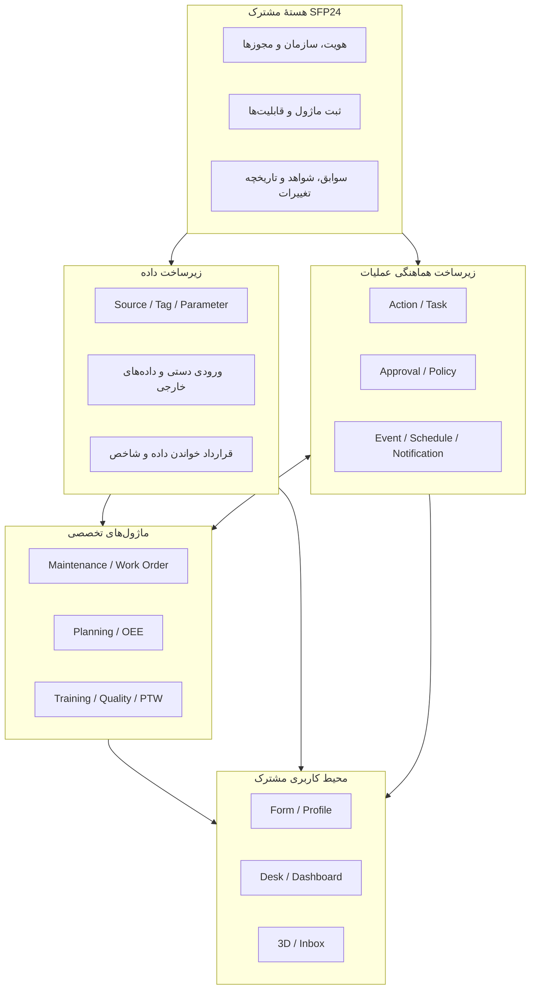
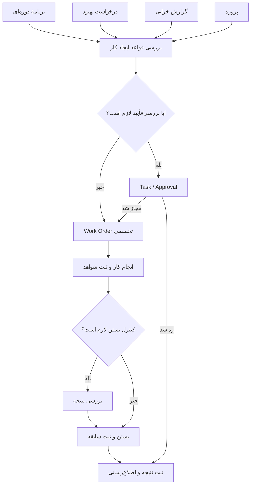
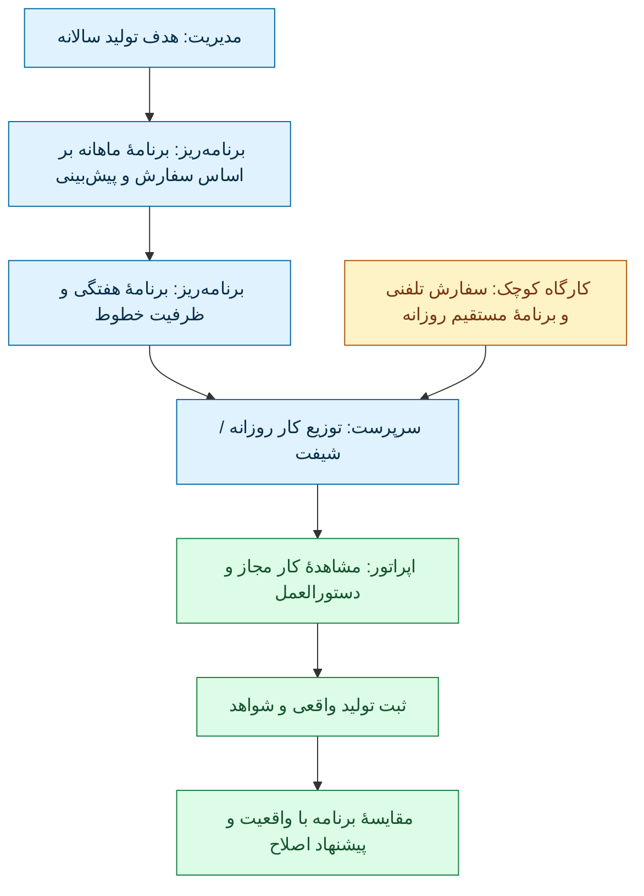
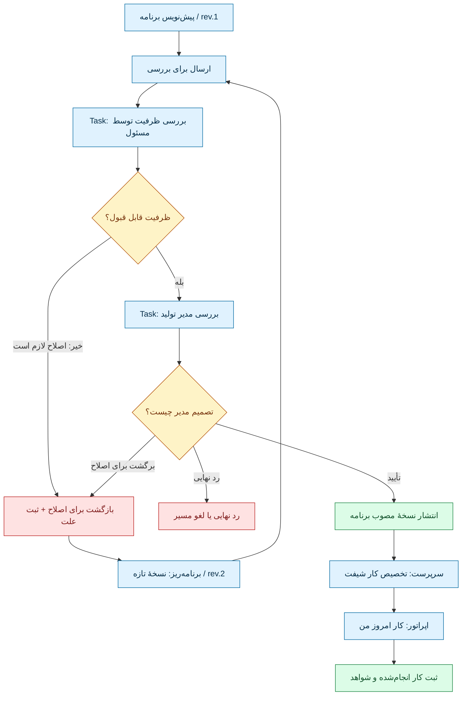
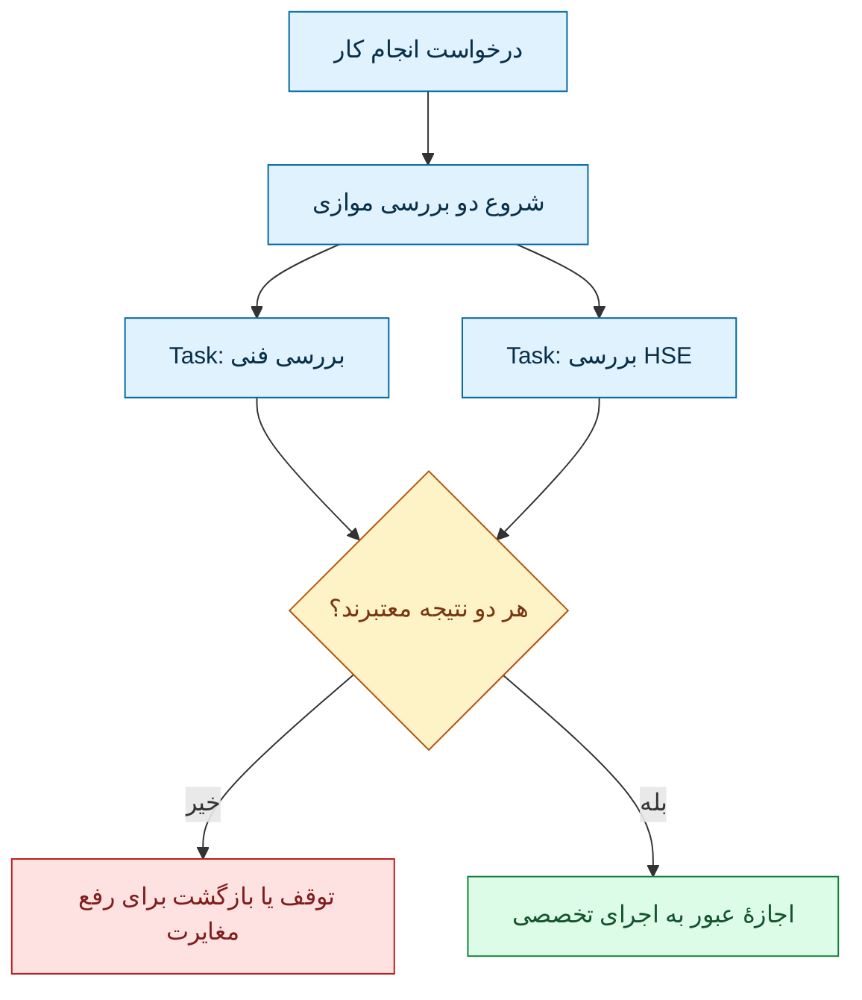
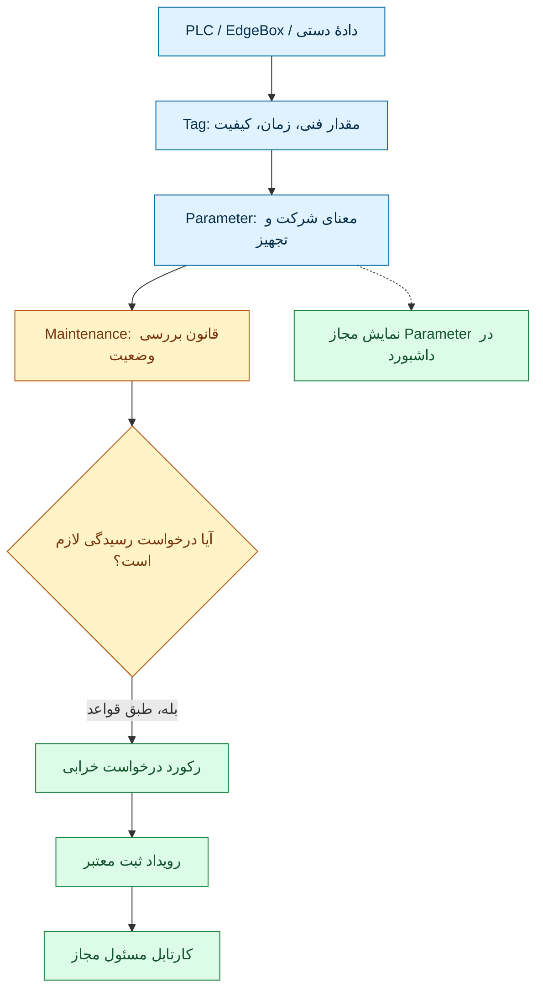

# از Source/Tag/Parameter تا Work Order و میز کار — طرح پایه و بررسی نقادانهٔ معماری SFP24

> **تاریخ:** ۲۰۲۶-۱۱-۰۵  
> **نوع سند:** بازنشر کامل محتوای پاسخ تحلیلی دستیار در این گفت‌وگو، همراه با توضیح تکمیلی و نقد طراحی. **بخش اول نقل محتوایی پاسخ دستیار است، نه نقل‌قول صاحب محصول**؛ فقط نمایش ویژهٔ گفت‌وگو به Markdown و Mermaid قابل نمایش در GitHub تبدیل شده است.  
> **وضعیت:** Discussion / Proposed / Critical Review؛ **نه ADR، نه قرارداد تصویب‌شده و نه پیاده‌سازی**.  
> **دامنهٔ مجوز:** صاحب محصول درخواست کرد تمام پاسخ پیشین، به‌جز جملهٔ آخر دربارهٔ تغییرندادن GitHub، بدون کاستن محتوا وارد مخزن شود و با مثال‌ها، نمودارها و بررسی نقادانه گسترش پیدا کند. این درخواست مجوز تغییر کد، قراردادهای مرجع، ادغام PR یا تصویب معماری نیست.  
> **مراجع داخلی:** [سوابق بلندبلند فکر کردن همین روز](THINKING-ALOUD-PLATFORM-DATA-WORKSPACES.fa.md) · [وضعیت اجرای محصول](../../STATUS.fa.md) · [هویت](../../core/IDENTITY-AND-ACCESS.fa.md) · [منبع/تگ/پارامتر](../../core/DATA-AND-PARAMETERS.fa.md) · [فضای کار](../../core/WORKSPACES.fa.md) · [مرزهای پیشنهادی](../../core/CANONICAL-BOUNDARIES.fa.md).  
> **نکتهٔ شواهد:** بررسی اسناد مبتنی بر گزارش کد در revision تاریخی `b3f203b` است؛ بررسی دوبارهٔ سند، جای اجرای تازهٔ کد یا آزمون رابط کاربری را نمی‌گیرد.

## راهنمای مطالعه

**بخش اول** همان پاسخ قبلی است، بدون کاهش مطالب؛ جدول‌ها و نمودارهای آن به Markdown/Mermaid تبدیل شده‌اند. **بخش دوم** برای فهم بهتر مسیر کار از مدیر تا اپراتور، ارجاع و رد و ارسال مجدد، و تفاوت نمایش در پنل کاربران اضافه شده است. **بخش سوم** نقد فرضیات و سناریوی ترکیبی یک کارخانهٔ فرضی با نظام کیفیت است. توضیحات افزوده نباید با متن پیشین یا تصمیم تصویب‌شده اشتباه گرفته شوند.

---

# بخش اول — متن کامل پاسخ پیشین، منتقل‌شده از گفت‌وگو

الان دقیقاً می‌دانم از کجا باید شروع کنیم. **Source، Tag و Parameter ایده‌های درستی بودند، اما فقط بخش «داده» را حل می‌کنند؛ نه کل معماری SFP24 را.**

بعد از بررسی دوبارهٔ قراردادهای موجود و روش‌های نرم‌افزارهایی مثل Camunda، Grafana و JSON Forms، من این معماری را پیشنهاد می‌کنم:

## ۱. معماری پیشنهادی SFP24



**این معماری پیشنهادی است، نه وضعیت فعلی کد.** قرار هم نیست هر کادر یک برنامه یا سرویس مستقل باشد؛ در ابتدا می‌توانند بخش‌هایی از همان Modular Monolith فعلی باشند.

## ۲. دقیقاً چه اجزایی لازم داریم؟

| جزء | کار آن | تصمیم پیشنهادی |
|---|---|---|
| **Identity / Responsibility** | شخص، چند مسئولیت، مأموریت موقت و محدودهٔ اختیار | تکمیل مدل موجود |
| **Module / Capability Registry** | معرفی ماژول، نسخه، قابلیت، وابستگی و اتصال آن | تکمیل قرارداد موجود |
| **Data Ports** | تحویل دادهٔ معتبر Parameter به ماژول‌ها | قرارداد عمومی جدید روی زیرساخت موجود |
| **Action** | درخواست انجام یک عملیات معتبر؛ مثل «ثبت تعمیر» | قرارداد مشترک |
| **Task** | سپردن یک اقدام به فرد یا گروه | سرویس مشترک محدود |
| **Approval / Policy** | تعیین اینکه چه عملی نیازمند تأیید است و توسط چه کسی | سازوکار مشترک با قواعد تخصصی ماژول |
| **Event / Notification** | اطلاع از وقوع اتفاق، بدون اتصال مستقیم ماژول‌ها به جدول یکدیگر | قرارداد رویداد و پیام‌رسانی |
| **Evidence / Audit** | مدرک، امضا یا تصمیم، ثبت تغییرات و تاریخچهٔ قابل پیگیری | قابلیت مشترک |
| **Schedule** | اجرای کار در زمان مشخص یا براساس برنامه | زمان‌بندی مشترک؛ معنای برنامه متعلق به ماژول |
| **UI Contributions** | اتصال فرم، صفحه، دکمه، کارت و نمودار ماژول به محیط کار | تکمیل قرارداد موجود |

یک جزء را عمداً در این جدول به‌عنوان سرویس عمومی قرار ندادم: **Work Order**.

چرا؟ چون Work Order دستورکار تخصصی است. تعمیر یک دستگاه، تولید یک قطعه و انجام یک پروژه ممکن است همگی «کار» نامیده شوند، ولی الزاماً مدل داده و قوانین یکسانی ندارند.

هسته باید امکانات مشترک برای کارها را بدهد؛ هر ماژول مالک دستورکار تخصصی خودش باشد.

---

## ۳. مثال اجرایی: فایل صوتی اول مدیر شرکت

او چهار منبع ایجاد دستورکار مطرح کرد: برنامهٔ نگهداری، درخواست بهبود، خرابی و پروژه.

من آن را این‌طور طراحی می‌کنم:



اینجا نکتهٔ مهمی داریم: **قرار نیست برای چهار منشأ، چهار موتور Work Order بسازیم.**

می‌توانیم یک ماژول Maintenance داشته باشیم که چند نوع دستورکار و چند مسیر ایجاد و رسیدگی را پشتیبانی کند. اگر بعدها یک نوع عملیات واقعاً مدل تخصصی متفاوتی خواست، قابلیت یا پیاده‌سازی جدا اضافه می‌کنیم.

همچنین Task با Work Order فرق دارد: یک دستورکار ممکن است چند وظیفه برای افراد مختلف داشته باشد، یا در کارگاه کوچک اصلاً Task جداگانه‌ای نخواهد.

این تفکیک در موتورهای واقعی Workflow هم دیده می‌شود. مثلاً Camunda وضعیت وظیفهٔ انسانی و انتساب آن به شخص را از هم جدا می‌کند. [منبع: Camunda User Task Lifecycle](https://docs.camunda.io/docs/8.9/apis-tools/frontend-development/task-applications/user-task-lifecycle/).

---

## ۴. فرم‌ساز، میزساز، پروفایل و داشبورد را چطور بسازیم؟

**پیشنهاد من ساخت سه سازنده و یک سیستم اتصال مشترک است؛ نه یک سازندهٔ غول‌آسا برای همه‌چیز.**

| ابزار | باید چه چیزی بسازد؟ | روش |
|---|---|---|
| **Form Builder** | فرم ثبت خرابی، بازرسی، درخواست، ثبت نتیجه و... | فیلدهای تعریف‌شده، اعتبارسنجی، شرط نمایش و نسخهٔ فرم |
| **Desk Builder** | محیط کاری شخص با چند فرم، کارتابل، نمودار و ابزار | چیدمان اجزای ثبت‌شدهٔ ماژول‌ها |
| **Dashboard Builder** | گزارش و نمودار با فیلتر زمان، تجهیز، سایت و... | اتصال به منابع داده و شاخص‌های معتبر |
| **Profile Extensions** | نمایش تعمیرات یک دستگاه یا مهارت‌های یک شخص | بخش‌های تخصصی افزوده‌شده به پروفایل اصلی |

### فرم‌ساز: دو نوع فرم لازم داریم

**نوع اول: فرم‌های معمولی قابل تنظیم.** مدیر مجاز شرکت بتواند فیلدهای اختیاری، ترتیب، عنوان، لیست انتخابی و بعضی شروط را تغییر دهد.

**نوع دوم: فرم‌های تخصصی ماژول.** مثلاً فرم صدور PTW یا تأیید صلاحیت که منطق و کنترل‌های تخصصی دارد. این فرم‌ها می‌توانند از اجزای مشترک استفاده کنند، ولی اعتبارسنجی‌شان در کد ماژول باقی بماند.

نباید اجازه دهیم فرم‌ساز با تغییر ظاهر یا فیلدها، قانون ایمنی یا مجوز را دور بزند.

برای پیاده‌سازی، الگوی **Data Schema + UI Schema + Custom Components** مناسب است. همین تفکیک در JSON Forms وجود دارد و از Vue هم پشتیبانی می‌کند؛ البته قبل از انتخاب کتابخانه باید سازگاری فنی آن آزمایش شود. [منبع: JSON Forms در Vue](https://jsonforms.io/docs/integrations/vue/) و [معماری JSON Forms](https://jsonforms.io/docs/architecture/).

### داشبوردساز: پیشنهاد من شش نوع اتصال داده است

نه اینکه شش موتور داشبورد جدا بسازیم؛ یک داشبوردساز داشته باشیم که این منابع را می‌شناسد:

1. **Parameter زنده:** دما، جریان، وضعیت تجهیز.
2. **تاریخچهٔ Parameter:** نمودار زمانی و مقایسهٔ بازه‌ها.
3. **Metric معتبر:** OEE، میزان تحقق برنامه یا شاخص آموزشی.
4. **رکوردهای عملیاتی:** فهرست خرابی‌ها، دستورکارها، سفارش‌ها.
5. **Task و Approval:** کارهای معوق، موارد منتظر تأیید.
6. **Event و Alert:** اتفاقات، هشدارها و تغییر وضعیت‌ها.

Grafana نیز داده‌گیری و پرس‌وجو را از پنل نمایشی جدا می‌کند؛ این الگو برای SFP24 مفید است. [منبع: Grafana — Query and transform data](https://grafana.com/docs/grafana/latest/visualizations/panels-visualizations/query-transform-data/).

هر کارت به‌جای دسترسی آزاد به جدول دیتابیس، باید از یک **منبع دادهٔ تعریف‌شده و مجاز** استفاده کند.

### دربارهٔ میز و اتاق

پیشنهاد مشخص من:

- **میز** محیط کار قابل تنظیم باشد.
- **داشبورد** هم مستقل قابل بازشدن باشد، هم داخل میز قرار بگیرد.
- **پروفایل** متعلق به شخص یا تجهیز باشد، نه میز کاربر.
- **سه‌بعدی** بتواند مستقل یا داخل محیط کار استفاده شود.
- **اتاق** فعلاً فقط مفهوم دسته‌بندی یا ناوبری باشد؛ هنوز برای آن موتور و ساختار دادهٔ مستقل نسازیم.

چون ساخت میز نسخه‌دار و اختصاص آن در کد فعلی تا حدی وجود دارد، بهتر است آن را تکمیل کنیم، نه اینکه یک میزساز دوم ایجاد کنیم.

---

## ۵. حالا ترتیب واقعی کار چیست؟

من برای سه مرحلهٔ بعدی این خروجی‌های مشخص را پیشنهاد می‌کنم:

| مرحله | هدف | خروجی |
|---|---|---|
| **مرحلهٔ ۱ — طراحی مدل مشترک عملیات** | تعریف دقیق Request، Work Order، Action، Task، Approval، Event، Evidence و ارتباطشان؛ تعیین مالک هر مفهوم و مثال مسیر ساده و پیچیده | مدل موجودیت‌ها + قرارداد عملیات + نمودار وضعیت‌ها |
| **مرحلهٔ ۲ — قرارداد اتصال ماژول و داده** | مشخص‌کردن اینکه ماژول چگونه Parameter دریافت می‌کند، رکورد و شاخص منتشر می‌کند، Action معرفی می‌کند، درخواست تأیید می‌دهد و قابلیت‌هایش فعال یا نسخه‌بندی می‌شوند | قراردادهای ورودی/خروجی، امنیت، نسخه و رفتار خطا |
| **مرحلهٔ ۳ — قرارداد رابط کاربری و مأموریت Codex** | تعریف Form، Desk، Dashboard، Profile و 3D؛ سپس مقایسه با کد موجود، تشخیص تغییرات لازم، ترتیب Migration و آزمون‌های پذیرش | مشخصات اجرایی قابل بررسی و تسک‌های مستقل برای Codex |

## انتخاب نهایی من

**از مرحلهٔ ۱، یعنی مدل مشترک عملیات شروع کنیم.**

نه چون Source/Tag/Parameter بی‌اهمیت‌اند؛ اتفاقاً بخش دادهٔ آن‌ها قبلاً تا حدی ساخته شده است. ولی تا رابطهٔ «درخواست، عملیات، وظیفه، تأیید، مدرک و نتیجه» روشن نشود، نمی‌توانیم فرم‌ساز و میز کار عملیاتی درستی طراحی کنیم.

قبل از تحویل به Codex هم این مدل را با سناریوهای Maintenance، Training، Planning و PTW محک می‌زنیم تا یک راه‌حل مخصوص تعمیرات را به کل نرم‌افزار تحمیل نکنیم.

**قدم بعدی مشخص:** تعریف تک‌تک موجودیت‌های مرحلهٔ ۱، روابط، مالکیت داده، وضعیت‌ها و قواعد آن‌ها. سپس می‌توانیم دربارهٔ هر قرارداد تصمیم بگیریم و آن را برای کدنویسی آماده کنیم.

> **مرز انتقال:** جملهٔ پایانی پاسخ مبنی بر «تغییری در GitHub داده نشده» به خواستهٔ صاحب محصول بازنشر نشده است؛ سایر ادعاهای وضعیتی و محتوایی پاسخ در بالا باقی مانده‌اند. این سند همچنان «پیشنهاد» است و تصویب خودکار محسوب نمی‌شود.

---

# بخش دوم — توضیح ساده‌تر و دقیق‌تر: کار از مدیر تا اپراتور چگونه حرکت می‌کند؟

> **توضیح تازهٔ دستیار** برای رفع ابهام‌های گفته‌شده؛ نام وضعیت‌ها، شمارهٔ نمونه‌ها و پنل‌ها صرفاً پیشنهادی هستند، نه API یا UI موجود و نه الزام جهانی استاندارد.

## ۶. هشت مفهوم مستقل؛ اشتباه نگیریم

فرض کنیم مدیر کارخانه می‌خواهد این هفته ۲۵۰ قطعه تولید شود.

| اصطلاح | معنی بسیار ساده | مثال | مالک یا مسئول اصلی |
|---|---|---|---|
| **Plan / برنامه** | چه چیزی و چه زمانی انجام شود | ۲۵۰ قطعه در هفته | ماژول Planning |
| **Request / درخواست** | کسی کاری می‌خواهد یا مشکلی را گزارش می‌کند | گزارش خرابی اپراتور | ماژول صاحب درخواست |
| **Work Order / دستورکار** | کار تخصصی با جزئیات و وضعیت | تعمیر CNC-07 | Maintenance، نه هستهٔ همه‌چیزدان |
| **Action / اقدام** | فرمان معنادار و مجاز به یک سرویس | «برنامه را منتشر کن» | سرویس تخصصی با کنترل مشترک هویت |
| **Task / وظیفه** | کاری که شخص یا گروه باید اکنون انجام دهد | «سرپرست، ظرفیت را بررسی کن» | قرارداد کارتابل مشترکِ پیشنهادی |
| **Approval / تصمیم** | قبول، رد یا بازگرداندن موضوع مشخص | تأیید برنامهٔ rev.2 | قواعد ماژول + کنترل تصمیم معتبر |
| **Event / رخداد** | خبر وقوع یک تغییر ثبت‌شده | `PlanPublished` | ماژول منتشرکننده و قرارداد تبادل |
| **Evidence / شاهد** | مدرک دربارهٔ اقدام یا تصمیم | اندازه‌گیری، تصویر، علت رد | مالک رکورد با زیرساخت مشترک قابل بررسی |

**رابطهٔ یک‌به‌یک وجود ندارد:** یک برنامه می‌تواند به چند تخصیص روزانه برسد؛ یک Work Order ممکن است چند Task داشته باشد؛ یک Task ممکن است اصلاً Approval نداشته باشد. در کارگاه کوچک نیز ثبت مستقیم کار با شواهد لازم ممکن است، بدون آنکه Task مصنوعی برای ارجاع به خود ایجاد شود.

## ۷. سلسله‌مراتب برنامه: هدف سالانه تا اجرای شیفت



**اصل:** این چهار سطح برنامه‌ریزی یک مسیر اجباری نیستند. برنامهٔ سالانه ممکن است فقط هدف کلی ظرفیت باشد؛ برنامهٔ ماهانه ترکیبی از سفارش و Forecast باشد؛ برنامهٔ شیفت از سفارش مستقیم ساخته شود. مدیر نیز الزاماً برنامهٔ همهٔ شیفت‌ها را امضا نمی‌کند. **نقطهٔ تأیید براساس سیاست معتبرِ همان نوع برنامه مشخص می‌شود**.

## ۸. تأیید، رد، اصلاح و عبور به نفر بعد ـ نمودار رنگی

مثال: برنامه‌ریز نسخهٔ اول برنامهٔ هفته را می‌نویسد. مسئول ظرفیت می‌گوید یک دستگاه در سرویس دوره‌ای است، بنابراین برنامه را **برای اصلاح بازمی‌گرداند**. برنامه‌ریز نسخهٔ دوم را آماده می‌کند. این بار مسئول ظرفیت قبول می‌کند؛ سپس کار در پنل مدیر تولید برای **تصمیم نهایی** ظاهر می‌شود. تنها پس از انتشار، سرپرست می‌تواند کار شیفت را از برنامهٔ معتبر تخصیص دهد.



**راهنمای رنگ:** آبی = پیش‌نویس یا کار انسانی؛ زرد = تصمیم؛ قرمز = رد یا بازگشت؛ سبز = انتشار یا ثبت نتیجه. این رنگ‌ها برای فهم Mermaid هستند، نه طراحی نهایی UI.

چهار نتیجه را جدا ثبت کنیم: **تأیید** یک نسخهٔ مشخص، **بازگشت برای اصلاح** همراه با دلیل و حق ساخت نسخهٔ بعدی، **رد نهایی** با پایان پروندهٔ فعلی و **لغو/انقضا** که علت متفاوتی دارد. رد نهایی نباید با ویرایش پنهانی به تأیید تبدیل شود.

### Task چگونه به نفر بعد می‌رسد؟

یک نمونهٔ زندهٔ فرایند یا **Workflow Instance** به نسخهٔ مشخصی از تعریف مراحل متصل است. به مرحلهٔ بررسی ظرفیت که رسید، یک **Task Instance** برای شخص یا گروه مجاز می‌سازد. نتیجهٔ Task و علت تصمیم ثبت می‌شود؛ فقط بعد از بررسی قواعد سمت سرور، Task بعدی برای مدیر ایجاد می‌شود. اگر برنامه برای اصلاح برگشت، Task مدیر هنوز نباید از روی پیش‌نویس قبلی فعال بماند. تاریخچهٔ درخواست، نسخه‌ها، مأموریت‌ها و تصمیم‌ها محفوظ می‌ماند.

**انجام Task با معتبرشدن نتیجهٔ تخصصی فرق دارد.** اپراتور ممکن است فرم ثبت کار را تکمیل کند، اما صحیح‌بودن شمارش، وضعیت کیفیت، نوع عملیات و مقدار قابل گزارش باید در Production بررسی شود.

### اگر تأیید هم‌زمان لازم باشد؟



این طرح «هر دو باید تأیید کنند» را مثال می‌زند. برای بعضی فرایندها شاید «یکی از اعضای گروه» کافی باشد؛ برای عملیات حساس شاید استقلال اشخاص، صلاحیت فنی و اعتبار زمانی کنترل‌ها هم لازم باشد. همهٔ این‌ها باید در تعریف سیاست مشخص باشند. در PTW، تأیید نرم‌افزاری جای اجرای واقعی کنترل ایمنی را نمی‌گیرد.

## ۹. هر فرد در پنل خودش چه می‌بیند؟

**اصل طراحی:** میز و داشبورد مالک اطلاعات نیستند؛ فقط نمای مجاز رکوردهای صاحب ماژول‌اند.

| پنل/میز | چیزهایی که نشان می‌دهد | Action مجاز | چیزی که نباید رخ دهد |
|---|---|---|---|
| **مدیر تولید** | برنامه‌های منتظر تصمیم، تأخیر مهم، اثر توقف، خلاصهٔ شاخص‌ها | تأیید/بازگرداندن نسخهٔ مشخص | تأیید همهٔ کارهای هر اپراتور به‌صورت پیش‌فرض |
| **برنامه‌ریز** | سفارش، ظرفیت، Forecast، برنامه‌های برگشتی، سابقهٔ تغییر | اصلاح و ارسال نسخه | تغییر بی‌ردپای برنامهٔ منتشرشده |
| **سرپرست شیفت** | برنامهٔ منتشرشده، افراد و تجهیزات، موانع | تخصیص کار و اعلام استثنا | اجرای قطعیِ برنامهٔ Draft |
| **اپراتور** | دستورالعمل معتبر، کار امروز، تجهیز، فرم ثبت کار | ثبت تولید یا اعلام مشکل | تأیید ایمنی بدون اختیار |
| **تعمیرکار** | دستورکارها، قطعات، تاریخچهٔ تجهیز، کنترل‌های لازم | ثبت کار واقعی و مدرک | معادل‌گرفتن «تعمیر انجام شد» با «تجهیز آزاد شد» |
| **کیفیت / HSE** | شواهد بازرسی، توقف کیفیت، مجوزهای موردی | بررسی و تصمیم تخصصی | تغییر وضعیت فقط با کلیک بر کارت |
| **Company Admin** | انتساب میز، ماژول‌های فعال، سیاست قابل تنظیم | تنظیم مجاز و انتشار نسخه | حذف قانون تخصصی یا دورزدن امنیت از فرم‌ساز |

### نمونهٔ پنل مدیر — نمای مفهومی

```text
┌──────────────────────────────────────────────────────┐
│ میز مدیر تولید — کارخانهٔ نمونه                      │
├──────────────────────────────────────────────────────┤
│ منتظر تصمیم من: ۳       تأخیر مهم خطوط: ۱            │
│                                                      │
│ برنامهٔ هفتهٔ ۴۲ / نسخهٔ ۲                            │
│ وضعیت: منتظر تأیید من                                │
│ [تغییرها] [شواهد] [تأیید] [بازگرداندن]                │
│                                                      │
│ CNC-07: توقف / هنوز آمادهٔ تحویل نیست               │
│ برنامهٔ جایگزین: فقط پیشنهاد؛ منتشرنشده             │
└──────────────────────────────────────────────────────┘
```

### نمونهٔ پنل اپراتور — نمای مفهومی

```text
┌──────────────────────────────────────────────────────┐
│ کار امروز من — شیفت صبح                              │
├──────────────────────────────────────────────────────┤
│ قطعه P-100 / عملیات OP-10 / هدف ۵۰ عدد              │
│ تجهیز CNC-07 — وضعیت: متوقف / مانع اجرا             │
│                                                      │
│ [اعلام مشکل] [دستورالعمل نسخهٔ معتبر]               │
│ [ثبت تولید] ← طبق شرایط و مجوز معتبر                │
│                                                      │
│ کار قبلی من: ۱۲ عدد ثبت‌شده، کیفیت هنوز نهایی نیست   │
└──────────────────────────────────────────────────────┘
```

**جمع‌بندی UX:** کارتابل = چه چیزی منتظر اقدام من است؛ میز = محیط انجام کار من؛ داشبورد = نمایش داده و شاخص؛ پروفایل = اطلاعات همان فرد/تجهیز/سفارش. هر چهار ممکن است در یک صفحه کنار هم باشند، اما یک رکورد یا مجوز واحد نیستند.

## ۱۰. اتصال Tag/Parameter به همین گردش



**قید:** Parameter ورودیِ بررسی است، نه «ماشینِ خودکارِ ثبت خرابی قطعی». وضعیت ارتباط، تکرار سیگنال، کیفیت، تناقض با ثبت انسانی و زمینهٔ تجهیز باید بررسی شوند. مسیر فرمان فیزیکی `TAG.OUT` نیازمند قرارداد مستقلِ فرمان، پاسخ، وضعیت واقعی و ایمنی است.
