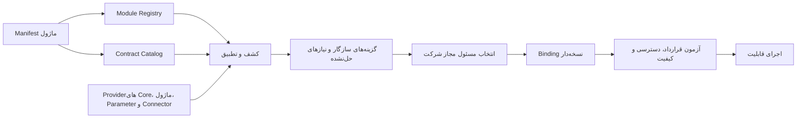
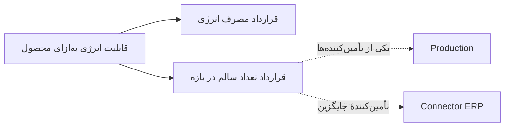
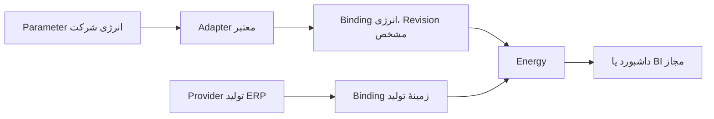
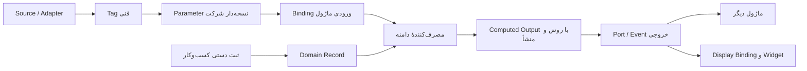

# بازنگری قرارداد، شناسایی و ارتباط ماژول‌ها — متن کامل گفتگو

- تاریخ ثبت: ۲۰۲۶-۱۱-۱۰
- نوع رکورد: متن کامل درخواست صاحب محصول و پاسخ Codex؛ بدون خلاصه‌سازی یا بازسازی متن.
- وضعیت سند: سابقهٔ گفتگو (Journal). وضعیت پیشنهادهای طراحی: **Proposed؛ تأییدنشده و بدون مجوز اجرا**. تأیید ثبت این گفتگو به معنی تأیید محتوای معماری آن نیست.
- مبنای اسناد در پاسخ: `sfp24-architecture@01e834b2127a03e79ac05c0cd45fb2992015f5df`؛ نقطهٔ کنترل جهت‌های قبلی: `9f64a669`.
- مبنای کد گزارش‌شده در پاسخ: `pouyeshgar-workshop@627feed3f93411554be0ed0be623ec43ec1e106b` و مقایسه با `55ad14d`، همراه تغییرات محلی Commitنشده. این SHA به‌تنهایی بازتولیدکنندهٔ تمام مشاهدات محلی نیست.
- نوع شواهد پاسخ: بررسی ایستای کد و اسناد؛ پیشنهادهای طراحی و نمونهٔ مفهومی رابط. ثبت این رکورد اجرای تازهٔ تست، Build یا تأیید Runtime نیست.

## این سابقه به چه کاری کمک می‌کند؟

برای ادامهٔ بحث دربارهٔ اعلام ساختاریافتهٔ نیازها و خروجی‌های ماژول، کشف تأمین‌کنندهٔ معتبر، اتصال در سطح شرکت، مجوزها، مشارکت در رابط و چرخهٔ عمر، اینجا خواستهٔ کامل و پاسخ کامل کنار هم حفظ شده‌اند. سشن بعدی می‌تواند استدلال، محدودیت‌ها و تصمیم‌های باز را بخواند؛ سپس وضعیت جاری سند مالک و کد را دوباره بررسی کند. مطالب این گفتگو جایگزین قراردادهای جاری نیستند.

- [فهرست گفتگوهای مشترک](../README.md)
- [سوابق هسته](../../core/RECORDS.md)
- [مرجع قراردادهای موجود و پیشنهادی](../../contracts/README.md)
- [قواعد ثبت و وضعیت اسناد](../../governance/DOCUMENTATION-POLICY.md)

## راهنمای خواندن متن اصلی و پیوندها

دو بخش بعدی متن اصلی هستند و هنگام بایگانی بازنویسی نشده‌اند. لینک‌های محلی ویندوز و دستور نمایش داخلی Codex در پاسخ، جزئی از متن تاریخی‌اند و در GitHub قابل استفاده نیستند. برای فایل‌های Commitشده از [درخت کد در مبنای گزارش](https://github.com/hossein-aghaie/pouyeshgar-workshop/tree/627feed3f93411554be0ed0be623ec43ec1e106b) استفاده کنید؛ مخزن کد خصوصی است. فایل‌های محلی جدیدی مانند `maintenance/module.ts`، `module-info.json`، `ModuleIntroduction.vue` و `ModuleRegistrations.vue` را نباید موجود در آن Commit فرض کرد.

[نسخهٔ همراه طرح تعاملی](assets/module-contract-review.html) نیز حفظ شده است. GitHub این HTML را مانند برنامه اجرا نمی‌کند؛ فایل را دانلود و در مرورگر باز کنید. این طرح مفهومی است، نه تصویر Runtime، شاهد آزمون یا قابلیت نصب‌شده.

## کنترل تمامیت متن

هش‌های SHA-256 زیر مربوط به متن UTF-8 با پایان خط LF هستند. متن دو بخش اصلی با منبع درخواست و پاسخ استخراج‌شده از همین گفتگو تطبیق داده شده است.

- درخواست: `483183ba155a20fd59eada1b9b3e1066f64fd2cd00652a62c09236b805ea4b2d`
- پاسخ: `b03a310455e80728d92419abdd8c68dc8abe10a7d4909f69add0137792f089da`

---

## متن کامل درخواست صاحب محصول

# مأموریت جامع بازنگری معماری Module Management، Module Interoperability و Developer Admin در SFP24

## هدف اصلی

طرح فعلی مدیریت ماژول‌ها را از نظر معماری، توسعه‌پذیری، ارتباط بین ماژول‌ها، قراردادهای داده، مدیریت وابستگی، کشف قابلیت‌ها، امنیت، چرخهٔ عمر، رابط کاربری و توسعه توسط برنامه‌نویسان داخلی و ثالث، به‌صورت اساسی بازبینی کن.

هدف صرفاً ساخت یک صفحه زیبا برای ثبت، فعال‌سازی و غیرفعال‌کردن ماژول‌ها نیست.

ما در حال ساخت یک پلتفرم Modular Operations هستیم که باید در آینده بتواند تعداد زیادی ماژول تخصصی و حتی ماژول‌های سفارشی نوشته‌شده توسط توسعه‌دهندگان مختلف را در خود جای دهد.

این ماژول‌ها باید بتوانند:

- از قابلیت‌ها و خدمات مشترک هسته استفاده کنند.
- نیازهای خود را به‌صورت استاندارد معرفی کنند.
- ورودی‌های خود را از منابع مختلف دریافت کنند.
- خروجی‌های خود را به ماژول‌های دیگر، هسته، داشبوردها و سامانه‌های بیرونی ارائه دهند.
- بدون وابستگی غیرضروری به یکدیگر توسعه پیدا کنند.
- در زمان نصب یا ثبت، ارتباط‌های قابل‌استفاده و وابستگی‌های احتمالی خود را شناسایی کنند.
- در صورت وجود چند ارائه‌دهنده برای یک قابلیت، امکان انتخاب و تنظیم اتصال مناسب داشته باشند.
- بدون دسترسی مستقیم به دیتابیس یکدیگر، با قراردادهای مشخص با هم ارتباط برقرار کنند.
- در محیط‌های چندشرکتی و چندسایتی، تنظیمات و اتصال‌های مستقل داشته باشند.

**مهم‌ترین مسئله‌ای که باید حل کنی این است: چگونه یک ماژول جدید می‌تواند بفهمد چه قابلیت‌هایی در SFP24 و ماژول‌های دیگر وجود دارند، چه چیزی را می‌تواند از آن‌ها دریافت کند، چه چیزی را می‌تواند به آن‌ها ارائه دهد و چگونه این ارتباط‌ها به‌صورت قابل اعتماد تعریف و برقرار می‌شوند؟**

این مسئله باید محور اصلی بازنگری باشد؛ نه صرفاً اضافه‌کردن چند فیلد به Manifest فعلی.

---

# بخش اول ــ قواعد بررسی و محدودیت‌ها

۱. فعلاً هیچ کدی تغییر نده.

۲. هیچ Migration، تغییر Schema، تغییر شاخه، Commit، PR یا تغییر مخزن انجام نده.

۳. هیچ قابلیت موجود را بدون بررسی شاهد کد، پیاده‌سازی‌شده فرض نکن.

۴. واقعیت پیاده‌سازی، تصمیم تأییدشده، پیشنهاد معماری و ایدهٔ آینده را از یکدیگر تفکیک کن.

۵. اگر یک قابلیت فقط در Research یا Draft مطرح شده، آن را قابلیت اجرایی معرفی نکن.

۶. پیش از پیشنهاد تغییر، اسناد و کد موجود را بررسی کن. از ایجاد قرارداد موازی با قراردادهای قبلی خودداری کن.

۷. برای هر ادعای مربوط به وضعیت فعلی، مسیر فایل و در صورت امکان شمارهٔ خط و Commit مبنا ارائه بده.

۸. اگر یک موضوع در اسناد تعیین تکلیف نشده، آن را با استدلال و گزینه‌های ممکن به‌عنوان مسئلهٔ باز ثبت کن؛ خودسرانه تصمیم نهایی نگیر.

۹. طرح باید آینده‌نگر باشد، اما به معنی ساخت Microservice، Plugin Engine، Marketplace یا سیستم نصب آزاد برای تمام ماژول‌ها از روز اول نیست.

۱۰. راهکار باید با معماری فعلی SFP24 قابل شروع باشد و مسیر رشد آن در آینده را مسدود نکند.

## منابعی که باید بررسی شوند

### اسناد معماری و تحقیق

- `docs/research/MODULE-EXTENSIBILITY-AND-WORKSPACES.fa.md`
- `docs/research/OPERATIONS-PLATFORMS.fa.md`
- `docs/contracts/MODULE-CONTRACT-DRAFT.md`
- `docs/contracts/DATA-CONTRACT-DRAFT.md`
- `docs/contracts/UI-CONTRIBUTIONS-DRAFT.md`
- `docs/contracts/README.md`
- `docs/core/ARCHITECTURE.fa.md`
- `docs/core/DATA-AND-PARAMETERS.fa.md`
- `docs/core/EXTENSIONS.fa.md`
- `docs/core/IDENTITY-AND-ACCESS.fa.md`
- `docs/core/WORKSPACES.fa.md`
- `docs/core/OPEN-QUESTIONS.md`
- `docs/modules/CATALOG.fa.md`
- `docs/modules/README.md`
- `docs/STATUS.fa.md`
- `docs/TECHNOLOGY.fa.md`

### کدهای مهم برای تطبیق

در Snapshot بررسی‌شده `55ad14d`:

- `server/platform/module-registry.ts`
- `server/operations/module-capabilities.ts`
- `server/platform/identity/permission-catalog.ts`
- `src/company/ui-contribution-contract.ts`
- `src/company/pilot-contributions.ts`
- `src/company/pilot-components.ts`
- `src/company/desk-sections.ts`
- `src/company/desk-studio-model.ts`
- `src/company/workspaces.ts`
- `src/company/module-catalog.ts`
- `src/company/resource-inputs.ts`

همچنین سرویس‌های واقعی Data Hub، Parameter، Telemetry، Master Data و عملیات Production و Maintenance را بررسی کن.

**نکتهٔ نسخه‌ای:** اسناد STATUS و TECHNOLOGY مبنای `b3f203b` را معرفی می‌کنند، در حالی که مطالعهٔ دقیق Registry و UI در Research روی `55ad14d` انجام شده است. ابتدا HEAD و وضعیت واقعی شاخهٔ در اختیار خودت را مشخص کن. این Snapshotها را با هم یکی فرض نکن.

تصاویر سه‌گانهٔ Developer Admin که برایت فرستاده‌ام صرفاً مرجع اولیهٔ چیدمان و ظاهر هستند. نوشته‌های داخل تصاویر خوانایی کامل ندارند؛ مشخصات و متن صحیح باید از این دستور و اسناد استخراج شوند. تصویر را جایگزین تحلیل معماری نکن.

---

# بخش دوم ــ ابتدا مسئلهٔ اصلی را درست تعریف کن

ما با چند مفهوم متفاوت روبه‌رو هستیم که نباید آن‌ها را یکی کنیم.

این تفاوت‌ها را در طرح نهایی روشن کن:

| مفهوم | سؤال اصلی |
|---|---|
| Module | این بخش نرم‌افزار چه مسئولیت دامنه‌ای دارد؟ |
| Module Manifest | ماژول خودش را چگونه به پلتفرم معرفی می‌کند؟ |
| Module Registry | هسته چه ماژول‌هایی را می‌شناسد؟ |
| Capability | ماژول چه توانایی‌هایی ارائه می‌کند؟ |
| Port / API | دیگر بخش‌ها از چه مسیری با آن ارتباط می‌گیرند؟ |
| Contract | اطلاعات و عملیات بین دو بخش دقیقاً چه معنا و ساختاری دارند؟ |
| Dependency | نبود چه چیزی باعث می‌شود یک قابلیت یا ماژول قابل اجرا نباشد؟ |
| Binding / Integration | ورودی یک بخش عملاً به کدام خروجی یا منبع متصل شده است؟ |
| Adapter | چگونه دو ساختار متفاوت را با حفظ معنا به یکدیگر تبدیل می‌کنیم؟ |
| Data Source | داده از کجا وارد سیستم می‌شود؟ |
| UI Contribution | ماژول چه بخش‌هایی به رابط کاربری عرضه می‌کند؟ |
| Entitlement | کدام شرکت حق استفاده از ماژول را دارد؟ |
| Permission | کدام شخص اجازهٔ انجام عملیات را دارد؟ |

به‌خصوص پنج مفهوم Dependency، Contract، Port، Binding و Integration را از یکدیگر جدا کن.

مثلاً اگر ماژول انرژی از یک دادهٔ تولید استفاده می‌کند، لزوماً نباید وابستگی اجباری به کل ماژول Production داشته باشد. شاید یک قرارداد استاندارد برای «بازهٔ اجرای تجهیز» کافی باشد که بتواند توسط Production یا یک Provider دیگر تأمین شود.

این تفاوت بسیار مهم است.

## اصل مالکیت

- Core مالک هویت، شرکت، Tenant، Scope، مجوزها و سرویس‌های مشترک است.
- هر ماژول مالک داده، منطق و قواعد دامنهٔ خودش است.
- یک ماژول نباید برای استفاده از اطلاعات ماژول دیگر مستقیماً جدول‌های آن را بخواند یا تغییر دهد.
- ماژول‌ها باید از Port، API، Event و قراردادهای معتبر استفاده کنند.
- یک ماژول نباید Person، Account یا Resource موازی بسازد، مگر یک موجودیت تخصصی مستقل با ارجاع به هویت مشترک واقعاً لازم باشد.

---

# بخش سوم ــ معماری ارتباط و کشف قابلیت‌ها

این مهم‌ترین بخش مأموریت است.

یک سازوکار کامل طراحی کن که در آن ماژول‌ها صرفاً نام و نسخهٔ خود را اعلام نکنند؛ بلکه بتوانند قراردادهای ورودی و خروجی خود را نیز معرفی کنند.

پیشنهادهای زیر را بررسی و در صورت نیاز اصلاح کن.

## ۳.۱. کاتالوگ قراردادهای هسته (Core Contract Catalog)

هسته باید یک مرجع قابل جست‌وجو از قابلیت‌ها و قراردادهایی داشته باشد که ماژول‌ها می‌توانند مصرف کنند.

برای نمونه، قراردادهای مربوط به:

- Person
- Account
- Company / Tenant
- Site
- Resource / Equipment
- Organization
- Position و Assignment
- Scope
- Permission
- Parameter
- Tag
- Data Source
- Task و Notification در صورت تصویب و پیاده‌سازی
- Workspace و Context
- فایل و مستندات
- رویدادهای مشترک
- داده‌های زمانی و اندازه‌گیری

برای هر قرارداد مشخص کن:

- شناسهٔ پایدار و یکتا
- مالک قرارداد
- نسخه
- تعریف معنایی
- ساختار داده و Schema
- نوع داده و واحد
- زمان یا بازهٔ زمانی
- کیفیت و منشأ داده
- محدودهٔ اعتبار و Scope
- Permission لازم
- روش دسترسی
- رفتار در نبود داده
- سیاست سازگاری نسخه‌ها
- نمونهٔ واقعی ورودی و خروجی
- محدودیت‌های مصرف

این کاتالوگ باید برای توسعه‌دهنده قابل مشاهده باشد.

یعنی وقتی کسی می‌خواهد یک ماژول جدید بنویسد، بتواند در Developer Documentation یا SDK ببیند:

- هسته چه خدماتی دارد؟
- چه اطلاعاتی از هسته قابل دریافت است؟
- چه عملیاتی را می‌تواند درخواست کند؟
- چه Eventهایی قابل اشتراک هستند؟
- چه قراردادهای داده‌ای از قبل وجود دارند؟
- کدام قراردادها پایدار، آزمایشی یا منسوخ هستند؟

توسعه‌دهنده نباید مجبور باشد برای کشف این اطلاعات، سورس تمام ماژول‌ها را بخواند.

## ۳.۲. کاتالوگ قابلیت‌ها و خروجی‌های ماژول‌ها

هر ماژول علاوه بر نیازهای خودش باید قابلیت‌های ارائه‌شده را هم معرفی کند.

مثلاً:

**Production**

ممکن است قراردادهایی برای این موارد ارائه کند:

- ثبت گزارش تولید
- بازهٔ اجرای کار
- تعداد تولیدشده
- تعداد سالم و ضایعات
- تاریخچهٔ گزارش
- خلاصهٔ تولید
- رخداد ثبت گزارش

**Maintenance**

ممکن است ارائه کند:

- درخواست خرابی
- دستورکار تعمیر
- وضعیت دستورکار
- سابقهٔ تعمیر تجهیز
- نتیجهٔ تعمیر
- رخداد تکمیل تعمیر
- وضعیت رسیدگی به تجهیز

**Training**

ممکن است ارائه کند:

- وضعیت شایستگی فرد
- نتیجهٔ ارزیابی
- سوابق آموزش
- صلاحیت معتبر برای فعالیت مشخص
- رخداد تکمیل آموزش

این موارد مثال‌های طراحی‌اند؛ وجود هر قرارداد را در کد فعلی اثبات کن و موارد پیشنهادی را جدا علامت بزن.

ماژول باید بتواند خروجی‌هایش را با قراردادهای نسخه‌دار در اختیار سایر مصرف‌کنندگان قرار دهد.

## ۳.۳. قراردادهای ورودی و خروجی هر ماژول

برای هر ماژول یک ساختار روشن طراحی کن که حداقل این اطلاعات را داشته باشد:

**ورودی‌ها:**

- شناسهٔ قرارداد موردنیاز
- مالک قرارداد موردنیاز
- نوع ارتباط: Query، Command، Event Subscription یا Data Binding
- نسخه‌های قابل قبول
- اجباری یا اختیاری بودن
- محدودهٔ دادهٔ موردنیاز
- نوع و واحد
- نیازهای زمانی
- Permission لازم
- رفتار هنگام نبود Provider
- رفتار هنگام قطع ارتباط
- امکان جایگزین‌شدن Provider
- روش تبدیل داده در صورت نیاز

**خروجی‌ها:**

- شناسهٔ قرارداد ارائه‌شده
- نوع خروجی
- Schema
- نسخه
- مالک داده
- معنا و واحد
- Scope
- روش دریافت
- محدودیت دسترسی
- کیفیت و منشأ
- سیاست نگهداری و تاریخچه
- مصرف‌کنندگان مجاز
- وضعیت پشتیبانی و سازگاری

ماژول باید بتواند چند ورودی و چند خروجی داشته باشد.

یک ورودی می‌تواند از Core، یک ماژول دیگر، Data Hub، ورودی دستی یا Connector خارجی تأمین شود.

یک خروجی هم می‌تواند چند مصرف‌کننده داشته باشد؛ بدون اینکه لازم باشد دادهٔ خام چند بار تکثیر شود.

## ۳.۴. سازوکار شناسایی وابستگی در زمان ثبت یا نصب

سناریوی زیر را دقیق طراحی کن:

یک توسعه‌دهنده ماژول جدیدی را به پلتفرم معرفی می‌کند.

سیستم باید بتواند:

۱. Manifest و قراردادهای اعلام‌شدهٔ آن را بخواند.

۲. نسخهٔ Host و Contract را بررسی کند.

۳. ورودی‌های موردنیاز ماژول را استخراج کند.

۴. در Registry بگردد و ببیند چه ماژول‌ها و Providerهایی این قراردادها را ارائه می‌کنند.

۵. قراردادهای Core را با ورودی‌های ماژول تطبیق دهد.

۶. در صورت وجود چند Provider مناسب، همه را معرفی کند.

۷. در صورت وجود ناسازگاری نوع، واحد، معنا یا نسخه، آن را مشخص کند.

۸. در صورت امکان تبدیل معتبر، Adapter مناسب پیشنهاد کند.

۹. وابستگی‌های اجباری و اختیاری را تفکیک کند.

۱۰. وابستگی حلقوی را تشخیص دهد.

۱۱. موارد بدون Provider را به‌عنوان نیاز برآورده‌نشده گزارش کند.

۱۲. گزارش قابل فهمی برای Developer Admin تولید کند.

اما یک اصل مهم:

**کشف خودکار نباید به معنی اتصال خودکار و بدون تأیید باشد.**

سه وضعیت پیشنهاد کن:

- تطبیق دقیق و معتبر
- تطبیق احتمالی با نیاز به Mapping یا Adapter
- عدم تطبیق یا نبود Provider

اگر دو ماژول خروجی و ورودی مشابهی دارند، سیستم می‌تواند ارتباط احتمالی را پیشنهاد کند؛ اما نباید صرفاً بر اساس شباهت نام فیلد، ارتباط را معتبر فرض کند.

اگر چند Provider وجود دارد، انتخاب باید براساس Scope، کیفیت، اولویت، منبع معتبر و سیاست شرکت انجام شود.

همچنین توضیح بده که از روی کد دلخواه یک ماژول ناشناخته نمی‌توان تمام وابستگی‌های آن را با اطمینان استنتاج کرد. قرارداد اعلام‌شده، تحلیل ایستا و آزمون سازگاری مبنای معتبر هستند؛ تحلیل کد یا AI حداکثر می‌تواند پیشنهاد کمکی بدهد.

---

# بخش چهارم ــ اتصال معماری ماژول‌ها به Data Hub، Tag و Parameter

این قسمت را با دقت ویژه بررسی کن؛ چون SFP24 از قبل برای Tag و Parameter طراحی و پیاده‌سازی‌هایی دارد.

مرجع:

`docs/core/DATA-AND-PARAMETERS.fa.md`

و:

`docs/contracts/DATA-CONTRACT-DRAFT.md`

در مدل فعلی این تفکیک وجود دارد:

Source / Adapter → Tag → Parameter → Domain Consumer → Computed Output → Display Binding

این مدل نباید با یک Event Bus عمومی یا جدول مشترک همهٔ ماژول‌ها اشتباه گرفته شود.

بررسی کن چگونه می‌توان این معماری را به قرارداد ورودی و خروجی ماژول‌ها متصل کرد.

### مواردی که باید دقیقاً رعایت شوند

۱. Tag شناسهٔ فنی سیگنال است، نه لزوماً معنای کسب‌وکاری آن.

۲. Parameter معنای قابل استفادهٔ شرکت، نوع، واحد، منبع و تبدیل نسخه‌دار را نگهداری می‌کند.

۳. یک Parameter می‌تواند چند مصرف‌کننده داشته باشد.

۴. گزارش دستی کسب‌وکار الزاماً نباید به یک Tag مصنوعی تبدیل شود.

۵. دادهٔ محاسبه‌شده باید روش، نسخه، بازه و دامنهٔ محاسبهٔ مشخص داشته باشد.

۶. دادهٔ لحظه‌ای، شمارندهٔ تجمعی، اختلاف بازه، Event و State نباید به‌اشتباه یکی فرض شوند.

۷. نبود داده مساوی صفر نیست.

۸. قطع ارتباط دستگاه مساوی توقف واقعی تجهیز نیست.

۹. انتخاب Widget نباید منبع رسمی گزارش تولید را تغییر دهد.

۱۰. اتصال یک ماژول به Parameter نباید به معنی دسترسی آزاد آن به Raw Data یا Credential منبع باشد.

### مسئلهٔ مهم

در کد فعلی `resource-inputs.ts` تعدادی ورودی مانند موارد زیر دیده می‌شود:

- operating_state
- operation_mode
- alarm_active
- stop_reason
- cycle_time
- power
- energy
- electric_current
- voltage

اما توضیح کد برای بسیاری از آن‌ها می‌گوید نگاشت سیگنال ذخیره می‌شود و مصرف خودکار آن در ماژول‌ها هنوز پیاده نشده است.

این محدودیت را حفظ کن و آن را با قابلیت عمومی مصرف داده اشتباه نگیر.

### خروجی مورد انتظار

یک مدل روشن ارائه کن که نشان دهد:

- یک ماژول چگونه یک Parameter را درخواست می‌کند؟
- چگونه می‌فهمد مقدار آن معتبر است؟
- چگونه واحد و معنای داده بررسی می‌شود؟
- اگر چند Tag یا منبع برای یک Parameter وجود داشته باشد چه اتفاقی می‌افتد؟
- چگونه یک ماژول خروجی محاسبه‌شدهٔ خود را به‌عنوان دادهٔ معتبر منتشر می‌کند؟
- چگونه یک ماژول دیگر می‌تواند آن خروجی را مصرف کند؟
- چه زمانی باید از Query استفاده شود؟
- چه زمانی Event مناسب‌تر است؟
- چه زمانی باید از Command استفاده کرد؟
- چه زمانی Integration Module لازم است؟

برای این موارد دیاگرام و مثال عملی ارائه کن.

---

# بخش پنجم ــ نمونهٔ واقعی طراحی ارتباط چند ماژولی

صرفاً توضیح مفهومی کافی نیست. حداقل سه سناریوی کامل طراحی کن.

## سناریو A: Energy Management

یک ماژول جدید به نام Energy Management به SFP24 اضافه می‌شود.

این ماژول می‌تواند:

**از Core بگیرد:**
- شناسهٔ تجهیز
- سایت و محدوده
- اطلاعات شرکت
- زمان و بازهٔ کاری
- مجوز خواندن داده

**از Data Hub بگیرد:**
- توان لحظه‌ای
- انرژی تجمعی
- جریان
- ولتاژ
- داده‌های دارای واحد، زمان و کیفیت معتبر

**از Production به‌صورت اختیاری بگیرد:**
- بازهٔ واقعی اجرای تولید
- تعداد تولید سالم
- اطلاعات عملیات
- زمینهٔ فعالیت تجهیز

**خروجی تولید کند:**
- مصرف انرژی
- مصرف انرژی در بازه
- مصرف انرژی به‌ازای تولید
- روند مصرف
- هشدار مصرف غیرعادی

**به سایر بخش‌ها ارائه دهد:**
- Widget داشبورد
- گزارش انرژی
- خروجی قابل استفاده برای BI
- Event هشدار برای Maintenance، در صورت وجود قرارداد مناسب

این ماژول نباید برای محاسبهٔ مصرف انرژی الزاماً به Production وابسته باشد. ممکن است یک مشتری فقط پایش انرژی بخواهد.

اما برای محاسبهٔ انرژی به‌ازای واحد محصول، اطلاعات معتبر تولید لازم می‌شود.

این تفاوت را در Dependency و Capability مشخص کن.

## سناریو B: ارتباط Production و Maintenance

فرض کن Maintenance یک دستورکار را تکمیل می‌کند.

آیا Production باید مستقیماً از جدول تعمیرات بخواند؟

خیر.

بررسی کن:

- Maintenance چه Event یا Outputی ارائه می‌کند؟
- Production چه Contractی می‌تواند مصرف کند؟
- وضعیت آماده‌به‌کاری تجهیز چگونه معتبر می‌شود؟
- آیا Integration Module برای هماهنگی این دو لازم است؟
- اگر Maintenance نصب نباشد Production چه رفتاری دارد؟
- اگر Maintenance غیرفعال شود تکلیف سوابق و Eventهای قبلی چیست؟

همچنین بررسی کن که چه زمانی یک ارتباط مستقیم مبتنی بر Contract کافی است و چه زمانی یک ماژول واسط با منطق مستقل بهتر است.

## سناریو C: Training، Person و PTW

فرض کن ماژول آموزش، وضعیت صلاحیت فرد را ارائه می‌کند و ماژول مجوز کار پرخطر (PTW) باید بررسی کند که فرد صلاحیت لازم را دارد یا خیر.

بررسی کن:

- Person و Account چگونه از Core گرفته می‌شوند؟
- Training چگونه Qualification را ارائه می‌کند؟
- PTW چگونه آن را مصرف می‌کند؟
- آیا PTW باید به کل Training وابسته باشد یا به یک Contract مشخص؟
- اگر Training نصب یا فعال نباشد، سیاست صدور مجوز چه خواهد بود؟
- آیا صلاحیت منقضی‌شده یا فاقد شواهد باید مانند صلاحیت معتبر رفتار کند؟

از این مثال برای طراحی قراردادهای قابل استفادهٔ مجدد در سایر ماژول‌ها استفاده کن.

---

# بخش ششم ــ بررسی ارتباطات در کل کاتالوگ ماژول‌ها

فقط روی Production و Maintenance تمرکز نکن.

مرجع کامل حوزه‌های محصول:

`docs/modules/CATALOG.fa.md`

این فهرست خانواده‌های زیر را دارد:

### عملیات صنعتی

- MES / Production
- QMS
- CMMS / EAM
- WMS / Inventory
- Planning / APS
- MRP
- OEE
- Traceability / Genealogy
- DMS
- EHS / HSE / PTW
- Energy Management
- Manufacturing Intelligence / BI

### مهندسی و تجهیزات

- PLM / PDM
- MPM
- Batch / Recipe Management
- EBR / eDHR
- LIMS
- SPC
- Metrology / Calibration
- Tool Management
- APM / Condition Monitoring
- Intralogistics
- Digital Twin
- DNC / NC Program Management

### کارکنان و خدمات شرکت

- LMS / Competency
- Time & Attendance
- Timesheet
- WFM
- Leave / Overtime
- Canteen Management
- Employee Transport
- Employee Services
- CAFM / IWMS
- Visitor Management
- Travel & Expense
- Performance Management

### سامانه‌های سازمانی

- CRM / Sales
- Procurement / SRM
- SCM / S&OP / IBP
- Finance / Costing
- HRIS / Payroll
- TMS
- Project / Service Management
- Field Service Management

برای این حوزه‌ها یک **Module Interoperability Matrix** طراحی کن.

برای هر حوزه مشخص کن:

| مورد | توضیح |
|---|---|
| Core Inputs | اطلاعاتی که از هسته نیاز دارد |
| Data Hub Inputs | داده‌هایی که از Tag و Parameter می‌گیرد |
| Module Inputs | قراردادهای احتمالی مصرف‌شده از سایر ماژول‌ها |
| Outputs | داده‌ها، سرویس‌ها و Eventهای قابل ارائه |
| UI Contributions | صفحاتی که به رابط اضافه می‌کند |
| Profile Contributions | پروفایل‌هایی که می‌تواند گسترش دهد |
| Dependencies | وابستگی اجباری و اختیاری |
| Integration Modules | اتصال‌های میان‌دامنه‌ای احتمالی |
| Permissions | مجوزهای عملیاتی لازم |
| Absence Behavior | رفتار در نبود ماژول یا Provider دیگر |

تمام روابط را به سه دسته تقسیم کن:

- وابستگی واقعی و اجباری
- ارتباط اختیاری از طریق Contract
- اتصال تجاری یا فرایندی که ممکن است نیازمند Integration Module باشد

**هر ارتباطی را به وابستگی اجباری تبدیل نکن.**

مثلاً Quality می‌تواند از دادهٔ Production استفاده کند، اما الزاماً در همهٔ شرکت‌ها باید Production از همین SFP24 را داشته باشد؛ ممکن است داده از ERP یا منبع دیگری بیاید.

همچنین همهٔ این حوزه‌ها در حال حاضر پیاده نشده‌اند. وضعیت هرکدام را از Product Catalog و STATUS جداگانه استخراج کن.

---

# بخش هفتم ــ طراحی Manifest و قرارداد فنی ماژول

Manifest فعلی را بررسی کن و مشخص کن چه چیزهایی کم دارد.

در Snapshot بررسی‌شده، ModuleDescriptor شامل این موارد است:

- contractVersion
- moduleKey
- release
- compatibleHostMajor
- requiredModules
- optionalModules
- capabilities

و Portهای فعلی عمدتاً Query و Action هستند.

بررسی کن این مدل برای آینده کافی است یا باید توسعه پیدا کند.

حداقل مفاهیم زیر را در طرح پیشنهادی بررسی کن:

### Module Identity
- moduleKey
- publisher
- module family
- release
- description
- ownership
- support policy
- trust level

### Compatibility
- host API compatibility
- contract compatibility
- schema compatibility
- supported runtime
- deprecation policy

### Requirements
- required module dependencies
- optional module dependencies
- required contracts
- optional contracts
- required core capabilities
- required parameters
- external services

### Provided Capabilities
- capability ID
- owner
- description
- permissions
- readiness
- associated ports

### Input / Output Ports
- Query
- Command
- Event
- Event Subscription
- Data Stream
- Parameter Binding
- Computed Output

### UI Contributions
- Page
- Form
- Action
- Desk Widget
- Dashboard Widget
- Profile Section
- Inbox
- Notification
- 3D Overlay

### Data Ownership
- domain entities
- schema
- migrations
- retention
- export
- disable behavior

### Security
- requested permissions
- scopes
- actor requirements
- service identity
- sensitive data access
- external network access

### Lifecycle
- registration
- installation
- provisioning
- enable
- disable
- upgrade
- rollback
- unregister
- retire

یک نمونهٔ Manifest مفهومی و کامل برای Energy Management ارائه کن.

این نمونه باید نشان دهد یک ماژول چگونه ورودی‌ها و خروجی‌های خود را معرفی می‌کند.

اما JSON یا YAML پیشنهادی را قرارداد مصوب تلقی نکن؛ ابتدا ساختار و ضرورت هر فیلد را توضیح بده.

---

# بخش هشتم ــ طراحی Adapter و Data Mapping

صرف داشتن ورودی و خروجی کافی نیست.

ممکن است دو ماژول داده‌هایی با نام متفاوت اما معنای یکسان داشته باشند.

یا نام و نوع ظاهراً یکسان داشته باشند ولی معنای متفاوتی ارائه کنند.

بنابراین یک لایهٔ Mapping و Adapter بررسی کن.

مثلاً:

- یک Provider مقدار انرژی را به Wh ارائه می‌دهد.
- مصرف‌کننده kWh می‌خواهد.
- یک ماژول زمان را به‌صورت Timestamp ارائه می‌کند.
- دیگری بازهٔ شروع و پایان می‌خواهد.
- یک ماژول وضعیت تجهیز را به شکل State ارائه می‌کند.
- دیگری Event تغییر وضعیت مصرف می‌کند.
- یک ماژول تعداد تجمعی می‌دهد.
- مصرف‌کننده اختلاف یک بازه را لازم دارد.

بررسی کن:

۱. چه تبدیل‌هایی را Core می‌تواند به‌صورت استاندارد فراهم کند؟

۲. کدام تبدیل‌ها باید متعلق به Adapter اختصاصی باشند؟

۳. کدام تبدیل‌ها تغییر معنای داده ایجاد می‌کنند و نباید خودکار انجام شوند؟

۴. تبدیل واحد و تبدیل معنایی چگونه از هم تفکیک می‌شوند؟

۵. Mapping چگونه نسخه‌بندی و Audit می‌شود؟

۶. اگر Mapping تغییر کند، سوابق محاسبات قبلی چه وضعیتی دارند؟

۷. چه کسی Mapping را تعریف و تأیید می‌کند؟

۸. چگونه یک ماژول سفارشی می‌تواند Adapter خودش را معرفی کند؟

از اجرای فرمول یا کد دلخواه و بدون محدودیت در محیط مشتری پرهیز کن.

---

# بخش نهم ــ رابط Developer Admin

حالا که معماری روشن شد، رابط کاربری را بر اساس آن طراحی کن.

صرفاً صفحهٔ فعلی را با چند Tab بیشتر نکن.

بررسی کن آیا Developer Admin باید بخش‌های مستقل زیر را داشته باشد:

### ۱. Module Catalog
- فهرست ماژول‌ها
- وضعیت واقعی پیاده‌سازی
- نسخه
- ناشر
- نوع انتشار
- وضعیت اعتماد
- وضعیت ثبت و استقرار

### ۲. Module Descriptor
- اطلاعات هویتی
- قابلیت‌ها
- وابستگی‌ها
- ورودی‌ها
- خروجی‌ها
- مجوزها
- نسخه و سازگاری

### ۳. Contract Catalog
- قراردادهای Core
- قراردادهای ماژول‌ها
- ورودی و خروجی هر قرارداد
- نسخه‌ها
- نمونه داده
- وضعیت پشتیبانی
- مالک قرارداد

### ۴. Integration Explorer
یک نمای گرافیکی که ارتباط میان ماژول‌ها را نشان دهد.

در این گراف مشخص باشد:

- کدام ماژول تولیدکننده است؟
- کدام ماژول مصرف‌کننده است؟
- ارتباط از نوع Query است یا Event یا Data Binding؟
- کدام قرارداد استفاده می‌شود؟
- وابستگی اجباری است یا اختیاری؟
- ارتباط فعال است یا فقط پیشنهاد شده؟
- نسخهٔ قرارداد چیست؟
- وضعیت اتصال چیست؟

### ۵. Dependency Analyzer
- وابستگی‌های مستقیم
- وابستگی‌های غیرمستقیم
- وابستگی‌های اختیاری
- قراردادهای برآورده‌نشده
- چرخه‌های وابستگی
- اثر غیرفعال‌کردن Provider
- اثر ارتقای نسخه

### ۶. Input / Output Mapping
- ورودی‌های هر ماژول
- خروجی‌های قابل استفاده
- Providerهای پیشنهادی
- Data Hub Binding
- انتخاب Parameter
- Adapter
- تست Mapping
- وضعیت اعتبارسنجی

### ۷. UI Contribution Manager
- صفحات
- فرم‌ها
- Widgetها
- میزها
- داشبوردها
- پروفایل‌ها
- کارتابل
- اعلان
- 3D Overlay

### ۸. Permission & Security
- Permissionهای اعلام‌شده
- Permissionهای تأییدشده
- Scope
- دسترسی به اطلاعات حساس
- دسترسی بین ماژول‌ها
- دسترسی به سرویس‌های Core

### ۹. Version & Compatibility
- نسخهٔ ماژول
- نسخهٔ Host
- نسخهٔ Contract
- نسخهٔ Schema
- ماتریس سازگاری
- Migration
- Rollback
- Deprecation

### ۱۰. Lifecycle & Impact Analysis
- ثبت
- انتشار
- استقرار
- فعال‌سازی
- غیرفعال‌سازی
- بازنشستگی
- وابستگی شرکت‌ها
- اتصال‌های فعال
- کارهای معوق
- داده‌های متعلق به ماژول

### ۱۱. Health & Monitoring
- سلامت ماژول
- سلامت Portها
- سلامت اتصال‌ها
- تأخیر Eventها
- دادهٔ قدیمی
- خطاهای Mapping
- وضعیت Worker
- آخرین موفقیت دریافت داده

بررسی کن کدام بخش‌ها برای نسخهٔ نخست ضروری‌اند و کدام باید برای مرحله‌های بعد باقی بمانند.

---

# بخش دهم ــ تفاوت Developer Admin و Company Admin

این دو سطح نباید در هم ادغام شوند.

**Developer Admin** مسئول مدیریت تعریف، انتشار، نسخه، قرارداد و سازگاری ماژول‌هاست.

**Company Admin** مسئول انتخاب و فعال‌سازی قابلیت‌های مجاز، تنظیم ارتباط‌های شرکت و تعیین دسترسی‌ها در محدودهٔ اختیارات خودش است.

مثلاً:

- Developer Admin تعریف می‌کند Energy Management چه ورودی‌هایی می‌خواهد.
- Company Admin تعیین می‌کند ورودی انرژی این شرکت از کدام Parameter و منبع تأمین شود.
- Developer Admin مشخص می‌کند خروجی انرژی چه Contractی دارد.
- Company Admin می‌تواند مشخص کند کدام داشبوردهای مجاز از آن استفاده کنند.
- Access Admin مجوزهای اشخاص را مدیریت می‌کند.

شرکت نباید بتواند با فعال‌سازی یک ماژول، Permission جدیدی خارج از سیاست‌های پلتفرم ایجاد کند یا کد ناشناس روی سرور اجرا کند.

یک ماتریس مسئولیت نقش‌ها طراحی کن.

---

# بخش یازدهم ــ پروفایل‌ها، Workspaceها و Dashboardها

ماژول‌ها فقط منطق Backend نیستند.

هر ماژول ممکن است به یک یا چند موجودیت موجود در پلتفرم، بخش تخصصی اضافه کند.

برای مثال:

- Maintenance به پروفایل Resource / Equipment سابقهٔ تعمیر اضافه می‌کند.
- Training به پروفایل Person بخش شایستگی و سوابق آموزش اضافه می‌کند.
- Quality به پروفایل محصول یا تجهیز، در صورت وجود مدل و قرارداد معتبر، اطلاعات کیفیت اضافه می‌کند.
- Energy به پروفایل تجهیز، روند مصرف انرژی اضافه می‌کند.

بررسی کن چگونه این Contributionها بدون ساخت Profile موازی ثبت شوند.

همچنین این تفاوت‌ها حفظ شوند:

- Profile Field
- Profile Section
- Full Page
- Workbench / Desk
- Dashboard
- Widget
- Inbox
- Notification
- 3D Overlay

Context باید قابل انتقال باشد؛ برای مثال:

- Person انتخاب‌شده
- Resource انتخاب‌شده
- Site
- Work Order
- Production Order
- Time Range

Widget نباید به یک تجهیز یا شرکت ثابت قفل شود.

بررسی کن چه الگویی برای Context Binding و Alias مناسب است.

همچنین UI Contribution نباید مجوز عملیات ایجاد کند. کنترل سمت سرور الزامی است.

---

# بخش دوازدهم ــ امنیت، اعتماد و جداسازی ماژول‌های سفارشی

این بخش برای آیندهٔ SFP24 حیاتی است.

فرض کن در آینده یک شرکت یا توسعه‌دهندهٔ ثالث می‌خواهد ماژول سفارشی خودش را بنویسد.

بررسی کن:

- آیا می‌تواند کد دلخواه بارگذاری کند؟
- آیا فقط Manifest ثبت می‌کند؟
- آیا Build مورد اعتماد لازم است؟
- آیا Package باید امضا شود؟
- چه کسی Publisher را تأیید می‌کند؟
- چگونه از اجرای کد مخرب جلوگیری می‌شود؟
- چگونه دسترسی به Tenantهای دیگر مسدود می‌شود؟
- چگونه Secret و Credential نگهداری می‌شود؟
- چگونه دسترسی شبکه‌ای ماژول کنترل می‌شود؟
- چگونه SQL مستقیم محدود می‌شود؟
- چگونه Permissionهای درخواستی بازبینی می‌شوند؟
- چگونه از جعل Contract یا معرفی خروجی غیرواقعی جلوگیری می‌شود؟

تفاوت این دو مدل را روشن کن:

۱. ماژول مورد اعتماد که در Build مشترک SFP24 حضور دارد.

۲. Package مستقل نوشته‌شده توسط توسعه‌دهندهٔ ثالث.

برای هرکدام Trust Model و Runtime مناسب پیشنهاد بده.

هیچ فرضی مبنی بر اینکه Manifest به‌تنهایی کد را امن می‌کند پذیرفته نیست.

---

# بخش سیزدهم ــ نسخه‌بندی و سازگاری

نسخهٔ ماژول، نسخهٔ قرارداد و نسخهٔ داده الزاماً یکی نیستند.

این موضوع را دقیق طراحی کن.

مثلاً اگر Production یک خروجی جدید اضافه کند، آیا همهٔ مصرف‌کنندگان باید تغییر کنند؟

اگر نوع یک فیلد تغییر کند، چه اتفاقی می‌افتد؟

اگر نسخهٔ جدید Maintenance یک Event قدیمی را حذف کند، مصرف‌کنندگان قبلی چگونه مطلع می‌شوند؟

بررسی کن:

- Semantic Versioning
- Backward Compatibility
- Forward Compatibility
- Schema Evolution
- Contract Deprecation
- Compatibility Matrix
- Consumer-Driven Contract Tests
- Provider Conformance Tests
- Migration
- Rollback
- چند نسخهٔ فعال در چند Tenant

در کد فعلی Capability Status مقدار `compatible` به‌صورت ثابت `true` قرار گرفته است. این را با ماتریس سازگاری واقعی اشتباه نگیر.

یک مدل واقعی برای محاسبه و اثبات Compatibility پیشنهاد کن.

---

# بخش چهاردهم ــ رفتار در خطا و نبود وابستگی

سناریوهای شکست را فراموش نکن.

برای هرکدام رفتار مورد انتظار را مشخص کن:

۱. ماژول موردنیاز نصب نشده است.

۲. ماژول نصب شده ولی برای شرکت Enable نشده است.

۳. ماژول فعال است ولی Readiness ندارد.

۴. Provider قرارداد موردنیاز را ارائه نمی‌کند.

۵. دو Provider برای یک ورودی وجود دارند.

۶. Provider در زمان اجرا از دسترس خارج می‌شود.

۷. Event تکراری دریافت می‌شود.

۸. داده قدیمی یا نامعتبر است.

۹. واحد داده با نیاز مصرف‌کننده سازگار نیست.

۱۰. Contract نسخهٔ ناسازگار دارد.

۱۱. یک ماژول وابسته غیرفعال می‌شود.

۱۲. ماژول مصرف‌کننده در زمان انتشار نسخهٔ جدید وجود ندارد.

۱۳. اتصال میان دو ماژول حذف می‌شود.

۱۴. عملیات نیمه‌تمام باقی می‌ماند.

۱۵. یک شرکت تنظیمات متفاوتی نسبت به شرکت دیگر دارد.

در این بخش موارد زیر را هم بررسی کن:

- Timeout
- Retry
- Idempotency
- Dead Letter
- Event Ordering
- Health Check
- Circuit Breaker
- Fallback
- Data Freshness
- Data Provenance

اما این امکانات را به‌عنوان زیرساخت موجود معرفی نکن؛ وضعیت فعلی و نیاز آینده را جدا کن.

---

# بخش پانزدهم ــ چرخهٔ عمر و تأثیر تغییرات

چرخهٔ عمر انتشار و چرخهٔ عمر استفاده در شرکت دو موضوع جدا هستند.

تفکیک کن:

- Build
- Publish
- Deploy
- Register
- Provision
- Entitlement
- Enable
- Disable
- Detach Binding
- Unregister
- Retire
- Uninstall
- Emergency Stop

اگر ماژولی غیرفعال شود، باید مشخص باشد:

- عملیات جدید متوقف می‌شود یا نه؟
- عملیات نیمه‌تمام چه می‌شود؟
- Eventهای معوق چه می‌شوند؟
- مصرف‌کنندگان وابسته چه وضعیتی پیدا می‌کنند؟
- داده‌های قبلی حفظ می‌شوند یا نه؟
- داشبوردهای وابسته چگونه رفتار می‌کنند؟
- امکان فعال‌سازی مجدد وجود دارد یا نه؟

در صورت حذف Provider، سیستم باید قبل از انجام عملیات، همهٔ مصرف‌کنندگان و اتصال‌های وابسته را شناسایی کند.

حذف ماژول نباید به‌صورت پیش‌فرض به معنی حذف سوابق عملیاتی باشد.

این بخش باید با تصمیم‌های قبلی محصول دربارهٔ Disable و Lifecycle سازگار بماند.

---

# بخش شانزدهم ــ مرحله‌بندی اجرایی

نمی‌خواهم به بهانهٔ آینده‌نگری از همان ابتدا یک سیستم پیچیده و غیرقابل مدیریت بسازیم.

بر اساس Research موجود، مرحله‌بندی را بازبینی کن.

حداقل این مسیر را ارزیابی کن:

### مرحله صفر: تکمیل شناخت و قراردادها
- بررسی کد موجود
- شناسایی محدودیت‌ها
- تعیین مالکیت داده
- تعیین قراردادهای اصلی Core
- تعریف تفاوت Module Dependency و Contract Dependency
- طراحی Manifest و Port

### مرحله یک: معماری Modular Monolith
- Registry کد-محور
- Manifest نسخه‌دار
- Core Contract Catalog
- Provider / Consumer Ports
- Dependency Resolver
- اتصال‌های صریح
- Mapping اولیه به Parameter
- UI Contributions کنترل‌شده
- تست سازگاری

در این مرحله Package ناشناس و بارگذاری آزاد کد مشتری لازم نیست.

### مرحله دو: Integration Management
- Binding Registry
- Integration Explorer
- Adapter Catalog
- Contract Validation
- Tenant-specific Bindings
- گزارش ارتباطات
- تست سلامت اتصال‌ها

### مرحله سه: SDK و Developer Experience
- SDK
- مستندات قرارداد
- ابزار تولید اسکلت ماژول
- Manifest Validation
- Contract Test Kit
- انتشار کنترل‌شده

### مرحله چهار: سرویس‌های مستقل و اکوسیستم توسعه‌دهندگان
فقط در صورت وجود نیاز واقعی:
- Package Registry
- Signature Verification
- Trust Policy
- Sandbox
- Independent Deployment
- Service-to-Service Security
- Version Isolation

مشخص کن کدام قسمت‌ها باید از ابتدا در طراحی لحاظ شوند تا در آینده مهاجرت پرهزینه نشود، و کدام قسمت‌ها واقعاً نباید زودتر از نیاز ساخته شوند.

---

# بخش هفدهم ــ معیارهای پذیرش طراحی

برای اینکه طرح صرفاً یک متن زیبا نباشد، حداقل سناریوهای پذیرش زیر را طراحی کن.

| سناریو | نتیجهٔ مورد انتظار |
|---|---|
| نصب ماژولی با ورودی Core | شناسایی قرارداد و دسترسی معتبر |
| نصب ماژول با Provider موجود | پیشنهاد اتصال معتبر |
| وجود چند Provider | نمایش گزینه‌ها و انتخاب کنترل‌شده |
| نبود Provider اجباری | اعلام نیاز برآورده‌نشده و جلوگیری از Enable |
| نبود Provider اختیاری | امکان استفاده از قابلیت‌های مستقل و هشدار مناسب |
| ناسازگاری نوع و واحد | رد اتصال یا پیشنهاد Adapter معتبر |
| اتصال Parameter به ماژول | کنترل معنا، نوع، واحد، زمان و کیفیت |
| اتصال دو ماژول | ارتباط از Port/API/Event، نه SQL مستقیم |
| وجود وابستگی حلقوی | تشخیص و گزارش |
| غیرفعال‌سازی Provider | نمایش اثر بر مصرف‌کنندگان |
| ارتقای Contract | بررسی Compatibility و مهاجرت |
| نصب ماژول سفارشی ناشناس | عدم اجرای کد پیش از Trust و Validation |
| دو Tenant متفاوت | Binding و دسترسی مستقل |
| نبود داده | عدم تبدیل خودکار به صفر |
| وجود Widget بدون Permission | عدم اجرای عملیات |
| وجود Contract بدون Implementation | عدم معرفی قابلیت به‌عنوان آماده |

برای هر سناریو توضیح بده چگونه قابل آزمون خواهد بود.

---

# بخش هجدهم ــ خروجی نهایی مورد انتظار از تو

پاسخت باید یک طرح معماری واقعی و قابل بررسی باشد؛ نه خلاصه‌ای از ایده‌ها و نه صرفاً طرح UI.

خروجی را به ترتیب زیر ارائه کن:

۱. **جمع‌بندی معماری:** مسئلهٔ اصلی چیست و چرا طرح فعلی کافی نیست؟

۲. **وضعیت موجود:** چه چیزهایی در کد و اسناد وجود دارند و چه چیزهایی وجود ندارند؟

۳. **مدل مفهومی پیشنهادی:** ارتباط Core، Module Registry، Contract Catalog، Provider، Consumer، Binding و Adapter.

۴. **مدل قرارداد:** ساختار پیشنهادی Manifest، Port و Data Contract با مثال.

۵. **الگوریتم کشف ارتباط:** سیستم هنگام ثبت یا نصب چگونه ورودی‌ها را با قابلیت‌های موجود تطبیق می‌دهد؟

۶. **Dependency Graph و Integration Graph:** تفاوت و کاربرد هر دو.

۷. **Module Interoperability Matrix:** بررسی ارتباطات در کل کاتالوگ حوزه‌های محصول.

۸. **سه سناریوی کامل:** Energy Management، Production-Maintenance و Training-PTW.

۹. **Data Hub Integration:** ارتباط دقیق Tag، Parameter، Domain Record و Computed Output با قرارداد ماژول.

۱۰. **UI Architecture:** مشخصات صفحه‌ها و بخش‌های Developer Admin و Company Admin.

۱۱. **Profile و Workspace Contributions:** روش افزودن قابلیت به پروفایل شخص، تجهیز و سایر موجودیت‌ها.

۱۲. **Security و Trust Model:** برای ماژول داخلی و ثالث.

۱۳. **Versioning و Compatibility:** قراردادها و روش آزمون سازگاری.

۱۴. **Lifecycle و Failure Handling:** رفتار در نصب، فعال‌سازی، توقف، ارتقا و حذف.

۱۵. **نقشهٔ مرحله‌بندی اجرا:** از مدل فعلی تا SDK و توسعهٔ ثالث.

۱۶. **ریسک‌ها و تصمیم‌های باز:** مواردی که نیاز به تصمیم صاحب محصول دارند.

۱۷. **معیارهای پذیرش:** سناریوهایی که باید پیش از اعلام آمادگی معماری آزموده شوند.

---

# بخش نوزدهم ــ الزامات طراحی بصری

پس از تکمیل تحلیل معماری، یک طرح تصویری دقیق‌تر از Developer Admin تهیه کن.

طرح باید حداقل این نماها را نشان دهد:

- Module Catalog
- Module Detail
- Input / Output Contracts
- Dependency Graph
- Integration Graph
- Contract Catalog
- Mapping Editor
- Permission Manager
- UI Contribution Manager
- Compatibility
- Lifecycle & Impact

متن فارسی و انگلیسی باید خوانا، درست و متناسب با فضای واقعی رابط باشد.

از نمایش اطلاعات ساختگی، نسخه‌های فرضی، تعدادهای غیرواقعی و وضعیت‌های تأییدنشده خودداری کن.

اگر یک قابلیت فقط پیشنهادی است، آن را به‌وضوح Proposed نشان بده.

---

# اصل نهایی و مهم‌ترین مطالبه

من نمی‌خواهم فقط بتوانیم یک ماژول را به فهرست برنامه اضافه یا از آن حذف کنیم.

می‌خواهم به نقطه‌ای برسیم که:

یک توسعه‌دهنده بتواند ماژول جدیدی بنویسد؛ پلتفرم از طریق قراردادها بفهمد این ماژول چه چیزی می‌خواهد و چه چیزی ارائه می‌دهد؛ ارتباط‌های ممکن با هسته و سایر ماژول‌ها را شناسایی کند؛ ناسازگاری‌ها و وابستگی‌های حل‌نشده را نشان دهد؛ و امکان اتصال کنترل‌شده و قابل آزمون را فراهم کند.

به بیان دیگر:

**ما به یک Module Registry ساده نیاز نداریم؛ به یک معماری استاندارد برای معرفی قابلیت‌ها، کشف قراردادها، تطبیق ورودی و خروجی، مدیریت اتصال‌ها و ترکیب ماژول‌ها نیاز داریم.**

در عین حال، نمی‌خواهم ماژول‌ها به یکدیگر قفل شوند. هر ماژول باید تا حد امکان مستقل بماند و تنها از قراردادهایی استفاده کند که واقعاً نیاز دارد.

طرح باید هم برای ماژول‌های فعلی SFP24 جواب بدهد، هم برای فهرست گستردهٔ ماژول‌های آینده و هم برای ماژول‌های سفارشی توسعه‌دهندگان دیگر.

**تا زمان ارائه و بازبینی این طرح، هیچ تغییری در کد یا مخزن انجام نده. این مأموریت صرفاً تحلیل، طراحی و ارائهٔ پیشنهاد معماری است.**

---

## متن کامل پاسخ Codex

**مسئلهٔ اصلی، «معرفی پوشهٔ ماژول» نیست؛ تعریف یک زبان مشترک برای نیازها، خروجی‌ها و اتصال‌های ماژول‌هاست.** رجیستری فعلی بخشی از این پایه را دارد، اما هنوز نمی‌تواند به‌صورت عمومی تشخیص دهد یک ورودی از کدام تأمین‌کننده، با چه معنا و شرایطی، قابل دریافت است.

هیچ فایل مخزن، کد، دیتابیس، شاخه یا PR را تغییر ندادم. ۱۶ مسیر تغییرکرده یا جدیدِ قبلی محیط کار دست‌نخورده‌اند. آزمون یا Build اجرا نکردم. فقط یک طرح تعاملی مستقل، خارج از مخزن، برای بررسی پیشنهاد پنل تهیه شده است.

## ۱. جمع‌بندی معماری

پیشنهاد من ادامهٔ **Trusted Modular Monolith** است؛ همراه با تکمیل قراردادها و اتصال‌ها، بدون ساخت Marketplace یا بارگذاری آزاد کد.

چهار مرحله باید از یکدیگر جدا شوند:

1. **اعلام:** ماژول نیازها و امکاناتش را معرفی می‌کند.
2. **کشف و تطبیق:** پلتفرم تأمین‌کننده‌های سازگار را پیدا می‌کند.
3. **انتخاب و اتصال:** شرکت اتصال موردنظرش را تأیید می‌کند.
4. **آزمون و اجرا:** سازگاری، دسترسی و رفتار واقعی اتصال بررسی می‌شود.

مثلاً ماژول انرژی اعلام می‌کند:

> برای محاسبهٔ مصرف بازه‌ای، دادهٔ معتبر انرژی می‌خواهم. برای محاسبهٔ انرژی به‌ازای محصول، علاوه بر آن تعداد محصول سالم و بازهٔ تولید لازم است.

پلتفرم بررسی می‌کند این نیاز از Parameter، Production یا یک Connector معتبر تأمین می‌شود یا خیر. وجود کلمهٔ «تولید» در Manifest، به‌تنهایی نباید نصب کل Production را اجباری کند.

**وضعیت تصمیم‌ها:**

| موضوع | وضعیت |
|---|---|
| جهت Trusted Modular Monolith و Build مورد اعتماد | تأییدشده در نقطهٔ کنترل مالک |
| حفظ تمایز Family، Implementation و Release | جهت تأییدشده |
| رجیستری، Portها و مشارکت‌های فعلی پایلوت | موجود در کد، با محدودیت |
| مدل تفصیلی Contract Catalog، Binding و الگوریتم این گزارش | **Proposed** |
| SDK عمومی، Package مستقل، Sandbox و اجرای چند نسخه | آینده؛ پیاده‌سازی‌نشده |

مرجع جهت‌های تأییدشده همان زیربخش تأیید مالک در بخش ۷ و جدول Approved در بخش ۹ [نقطهٔ کنترل معماری](https://github.com/hossein-aghaie/sfp24-architecture/blob/9f64a669ada50be608d92c100c48cb65c18dd8ce/docs/journal/2026-11-07/OPERATOR-UX-AND-MODULE-LIFECYCLE-CHECKPOINT.fa.md) است؛ همهٔ مطالب آن سند مجوز اجرا نیستند.

## ۲. وضعیت موجود و فاصله با نیاز

### مبنای بررسی

- شاخهٔ محلی: `codex/core-module-pilot-v1`
- HEAD: `627feed3f93411554be0ed0be623ec43ec1e106b`
- تفاوت Commit‌شده با `55ad14d`: فقط `AGENTS.md`؛ تغییرات اجرایی جدید محیط کار هنوز Commit نشده‌اند.
- نسخهٔ بررسی‌شدهٔ شاخهٔ تجمیعی اسناد: `01e834b2127a03e79ac05c0cd45fb2992015f5df`
- اسناد `STATUS` و `TECHNOLOGY` مبنای تاریخی `b3f203b` دارند؛ آن‌ها را گزارش وضعیت اجرایی `55ad14d` فرض نکردم.

### یافته‌های کد

| موضوع | شاهد | نتیجه |
|---|---|---|
| شناسنامهٔ ماژول | [module-registry.ts:31](D:/git/pouyeshgar-workshop/server/platform/module-registry.ts:31) | شناسه، Release، Host Major، وابستگی و Capability وجود دارند. |
| قرارداد Port | [module-registry.ts:12](D:/git/pouyeshgar-workshop/server/platform/module-registry.ts:12) | مالک، Permission و تابع اجرا دارد؛ قرارداد معنایی عمومیِ ورودی و خروجی ندارد. |
| اعتبارسنجی رجیستری | [module-registry.ts:65](D:/git/pouyeshgar-workshop/server/platform/module-registry.ts:65) | تکرار کلید، نسخهٔ Host، مالکیت Port، Permission و حلقهٔ وابستگی بررسی می‌شوند. |
| Product Catalog و Registry | [module-registry.ts:41](D:/git/pouyeshgar-workshop/server/platform/module-registry.ts:41) | مجموعهٔ نام‌های شناخته‌شده از Product Catalog می‌آید؛ این با ثبت واقعی همهٔ آن‌ها در Runtime برابر نیست. |
| `availability` | [module-registry.ts:23](D:/git/pouyeshgar-workshop/server/platform/module-registry.ts:23) | `registered/planned` است؛ وضعیت «در حال اجرا»، سلامت یا آمادگی Tenant نیست. |
| سازگاری | [module-capabilities.ts:249](D:/git/pouyeshgar-workshop/server/operations/module-capabilities.ts:249) | `compatible` در نسخهٔ کاری مقدار ثابت دارد؛ موتور اثبات سازگاری نیست. |
| معرفی پوشه | [module.ts:15](D:/git/pouyeshgar-workshop/server/operations/maintenance/module.ts:15) | فایل جدیدِ Commit‌نشده، Maintenance شناخته‌شده را با Manifest و Hash تطبیق می‌دهد؛ کشف و نصب عمومی ماژول ناشناس نیست. |
| انتخاب فایل در مرورگر | [ModuleIntroduction.vue:113](D:/git/pouyeshgar-workshop/src/accounts/ModuleIntroduction.vue:113) | متن Manifest و Hash فایل خوانده می‌شود؛ این مسیر، نصب اجرایی تمام فایل‌های انتخاب‌شده نیست. |
| UI Contribution | [ui-contribution-contract.ts:28](D:/git/pouyeshgar-workshop/src/company/ui-contribution-contract.ts:28) | نوع مشارکت، Context، Capability، Permission و Component مشخص می‌شوند. |
| Renderer رابط | [pilot-components.ts:38](D:/git/pouyeshgar-workshop/src/company/pilot-components.ts:38) | Componentها از فهرست Importهای مورد اعتماد Host می‌آیند؛ Renderer عمومیِ کد خارجی نداریم. |
| Permission | [permission-catalog.ts:19](D:/git/pouyeshgar-workshop/server/platform/identity/permission-catalog.ts:19) | فهرست مرکزی وجود دارد؛ Manifest ناشناس نمی‌تواند خودکار Permission معتبر ایجاد کند. |
| توسعهٔ اطلاعات پایه | [definition-catalog.ts:237](D:/git/pouyeshgar-workshop/src/company/definition-catalog.ts:237) | Extension باید همراه Storage و API واقعی ثبت شود؛ فرم JSON به‌تنهایی Backend و Schema نمی‌سازد. |
| ورودی‌های عمومی تجهیز | [resource-inputs.ts:39](D:/git/pouyeshgar-workshop/src/company/resource-inputs.ts:39) | برای بسیاری از ورودی‌ها، فقط نگاشت ذخیره می‌شود؛ مصرف خودکار عمومی هنوز ساخته نشده است. |
| اتصال واقعی Parameter به شمارش | [parameter-inputs.ts:62](D:/git/pouyeshgar-workshop/server/operations/production/parameter-inputs.ts:62) | اتصال نسخه‌دار، کنترل منبع و تاریخچهٔ مؤثر وجود دارد؛ نمونهٔ مفید برای گسترش محدود است. |
| مصرف Telemetry | [read.ts:83](D:/git/pouyeshgar-workshop/server/telemetry/read.ts:83) | مسیر تخصصی شمارش Production است؛ خوانندهٔ عمومیِ انرژی و تمام Time Seriesها نیست. |
| پردازش ورودی HTTP | [projection.ts:12](D:/git/pouyeshgar-workshop/services/ingest/http-channels/projection.ts:12) | نوع، واحد، بازه، تکرار و نمونهٔ دریافت‌شده پردازش می‌شوند؛ این با Event Bus عمومی تفاوت دارد. |
| ارتباط Maintenance با Production | [service.ts:239](D:/git/pouyeshgar-workshop/server/operations/maintenance/service.ts:239) | ارجاع اختیاری به گزارش تولید وجود دارد؛ موتور عمومی اتصال ماژول‌ها نیست. |
| وابستگی Host | [http.ts:50](D:/git/pouyeshgar-workshop/server/operations/http.ts:50) | ساخت سرویس‌ها و اتصال مسیرها هنوز در Host انجام می‌شود. استقلال قراردادی با استقلال کامل Wiring یکسان نیست. |
| Worker رویداد | [delivery.ts:20](D:/git/pouyeshgar-workshop/server/operations/events/delivery.ts:20) | دریافت Tenantها به Entitlement فعال Maintenance وابسته است؛ قطع Entitlement می‌تواند تحویل معوق را نیز متوقف کند. |
| تحویل محلی Event | [delivery.ts:55](D:/git/pouyeshgar-workshop/server/operations/events/delivery.ts:55) | قفل ردیف، مصرف و ثبت `delivered` در تراکنش وجود دارد؛ اثبات Exactly-once برای اثر بیرونی نیست. |
| Receipt | [receipt.ts:38](D:/git/pouyeshgar-workshop/server/operations/maintenance/receipt.ts:38) | Authorization پیش از خواندن Receipt اجرا می‌شود؛ برای قرارداد Gate و Recovery عمومی نیازمند بازبینی است. |
| Migration | [migrations.ts:298](D:/git/pouyeshgar-workshop/server/platform/migrations.ts:298) | Schema 19 بخشی از Migration مشترک Tenant است؛ Migrator مستقل هر ماژول نداریم. |
| SQL Runtime | [tenant-storage.ts:94](D:/git/pouyeshgar-workshop/server/platform/storage/tenant-storage.ts:94) | مجوزهای Runtime محدود شده‌اند، ولی SQL Sandbox مستقل برای هر ماژول وجود ندارد. |

شمارهٔ خطوط فایل‌های دارای تغییر محلی، متعلق به همین نسخهٔ کاری بررسی‌شده است؛ نه الزاماً لینک ثابت Commit.

### نتیجهٔ اسناد

اسناد فعلی پایه‌های مناسبی دارند:

- [قراردادهای پیشنهادی ماژول و UI](https://github.com/hossein-aghaie/sfp24-architecture/tree/01e834b2127a03e79ac05c0cd45fb2992015f5df/docs/contracts)
- [داده و پارامتر](https://github.com/hossein-aghaie/sfp24-architecture/blob/01e834b2127a03e79ac05c0cd45fb2992015f5df/docs/core/DATA-AND-PARAMETERS.fa.md)
- [Extensionها](https://github.com/hossein-aghaie/sfp24-architecture/blob/01e834b2127a03e79ac05c0cd45fb2992015f5df/docs/core/EXTENSIONS.fa.md)
- [هویت و دسترسی](https://github.com/hossein-aghaie/sfp24-architecture/blob/01e834b2127a03e79ac05c0cd45fb2992015f5df/docs/core/IDENTITY-AND-ACCESS.fa.md)

بنابراین نباید قرارداد موازی بسازیم. پیشنهاد این گزارش، **تکمیل همان Draftها پس از تصویب** است.

تحقیق [توسعه‌پذیری ماژول‌ها](https://github.com/hossein-aghaie/sfp24-architecture/blob/f3f2df76297abed6906f96cd3ce4d4f92fdc9ec9/docs/research/MODULE-EXTENSIBILITY-AND-WORKSPACES.fa.md) نیز برای انتخاب الگو مفید است؛ اما مقایسهٔ SDK، Add-on و App مستقل، به معنی تصویب هم‌زمان همهٔ این مدل‌ها نیست.

## ۳. مدل مفهومی پیشنهادی

| مفهوم | مسئولیت دقیق |
|---|---|
| **Core** | هویت، Tenant، Scope، دسترسی، ارجاع موجودیت‌ها و خدمات مشترک مصوب |
| **Module** | منطق و دادهٔ یک دامنه؛ مانند تعمیرات |
| **Manifest** | اعلام ساختاریافتهٔ هویت، نیازها، خروجی‌ها، Permission و UI ماژول |
| **Module Registry** | پیاده‌سازی‌ها و Releaseهای مورد اعتماد و شناخته‌شدهٔ Deployment |
| **Contract Catalog** | تعریف نسخه‌دارِ معنا، ساختار و قواعد تعامل |
| **Capability** | یک توانایی مشخص؛ مانند محاسبهٔ مصرف بازه‌ای |
| **Provider** | پیاده‌سازی واقعیِ ارائه‌دهندهٔ یک قرارداد |
| **Consumer** | مصرف‌کننده‌ای با نیاز و محدودیت مشخص |
| **Port** | نقطهٔ ورود قابل فراخوانی یا اشتراک؛ با قرارداد مشخص |
| **Dependency** | پیش‌شرط لازم برای ساخت یا اجرای یک قابلیت |
| **Binding** | انتخاب نسخه‌دارِ تأمین‌کننده برای یک ورودی در یک Tenant |
| **Integration** | همکاری واقعی چند بخش؛ ممکن است شامل چند Binding و منطق مستقل باشد |
| **Adapter** | تبدیل معتبر و نسخه‌دار میان دو نمایش سازگار از اطلاعات |



**مثال جداسازی پنج مفهوم اصلی:**

- Contract: «تعداد محصول سالم در بازهٔ مشخص».
- Port: مسیر خواندن این تعداد.
- Dependency: محاسبهٔ انرژی به‌ازای محصول بدون این داده آماده نیست.
- Binding: شرکت میهان این ورودی را از Provider مشخص دریافت می‌کند.
- Integration: کنار هم قراردادن انرژی و تولید برای گزارش بهره‌وری انرژی.

Core قرارداد را نگهداری و اتصال را کنترل می‌کند؛ مالک منطق «سالم‌بودن محصول» یا «محاسبهٔ انرژی» نمی‌شود.

## ۴. مدل Manifest، Port و Data Contract

### تفکیک هویت‌ها

| سطح | شناسهٔ پیشنهادی | مثال مفهومی |
|---|---|---|
| Family | `familyId` | نگهداری و تعمیرات |
| Implementation | `implementationId` | پیاده‌سازی ساده یا کارخانه‌ای |
| Release | `releaseId` و نسخه | انتشار مشخص همان پیاده‌سازی |
| Deployment | `deploymentId` و Build | نسخهٔ مستقر SFP24 |
| Tenant Assignment | `assignmentId` | انتخاب پیاده‌سازی و Release برای شرکت |
| Provider | `providerId` | خروجی قابل مصرف همان پیاده‌سازی |
| Binding | `bindingId` و Revision | اتصال ورودی مشخص شرکت به Provider |

نسخهٔ اول می‌تواند برای هر Family در یک Deployment فقط یک پیاده‌سازی اجرایی مؤثر داشته باشد. وجود شناسه‌های جدا، راه انتخاب پیاده‌سازی متفاوت برای شرکت‌ها در آینده را باز می‌گذارد؛ **اجرای هم‌زمان آن‌ها را امروز فراهم نمی‌کند.**

### قرارداد داده باید چه داشته باشد؟

برای هر قرارداد:

| بخش | محتوای لازم |
|---|---|
| هویت | شناسه، مالک، وضعیت و نسخه |
| معنا | دقیقاً چه واقعیتی را بیان می‌کند؟ |
| Schema | فیلدها، نوع، اجباری‌بودن، Null و محدودیت‌ها |
| اندازه‌گیری | کمیت، واحد و حالت اندازه‌گیری |
| زمان | لحظه، بازه، منطقهٔ زمانی و زمان ثبت |
| کیفیت | معتبر، ناقص، قدیمی، ناموجود یا نامعتبر؛ با دلیل |
| منشأ | Provider، رکورد یا نمونهٔ مبنا و نسخهٔ تبدیل |
| محدوده | Tenant، Site، Resource و قواعد دسترسی |
| تعامل | Query، Command، Event یا Data Binding |
| نبود داده | خروجی صریح؛ بدون تبدیل ضمنی به صفر |
| مصرف | محدودیت حجم، بازه، نرخ و سطح دسترسی |
| تکامل | سازگاری، منسوخ‌شدن و آزمون‌های انطباق |

Schema اعتبار ساختاری را بررسی می‌کند؛ معنای کسب‌وکاری و صحت واحد را به‌تنهایی اثبات نمی‌کند. قواعد `required` و محدودیت فیلدهای اضافی باید صریح باشند. [مرجع JSON Schema](https://json-schema.org/understanding-json-schema/reference/object)

### نمونهٔ کامل مفهومی Manifest انرژی — Proposed

این نمونه فایل اجرایی یا قرارداد تصویب‌شده نیست. شناسه‌ها پیشنهادی‌اند و عمداً Release و نسخهٔ قرارداد مصوب برای ماژول ساخته‌نشده اختراع نشده است.

```yaml
status: proposed
executable: false
manifestSchema: pending-approval

identity:
  familyId: energy
  implementationId: energy.standard
  release: unassigned
  publisherId: requires-verification
  title:
    fa: مدیریت انرژی
    en: Energy Management
  purpose: پایش و محاسبه مصرف انرژی با منشأ و کیفیت مشخص

runtime:
  model: trusted-shared-build
  entrypoint: supplied-by-reviewed-build
  hostCompatibility: requires-approved-range
  dynamicCodeLoading: false

contracts:
  location: reviewed-contract-definitions
  versionPolicy: explicit-approved-versions
  undocumentedContractAllowed: false

requirements:
  - id: resource-context
    contract: core.resource.reference
    contractOwner: core
    acceptedVersions: pending-approval
    interaction: query
    requiredFor: [energy.interval, energy.trend, energy.intensity]
    scope: tenant-site-resource
    permission: core.resource.read
    onMissing: block-affected-capabilities
    onUnavailable: report-unavailable
    replacement: explicit-rebinding

  - id: energy-measurement
    contract: measurement.energy.series
    contractOwner: measurement-contract-owner
    acceptedVersions: pending-approval
    interaction: data-binding
    requiredFor: [energy.interval, energy.trend]
    type: decimal
    quantity: energy
    acceptedUnits: [kWh, Wh]
    acceptedModes: [interval-delta, cumulative-counter]
    time: explicit-interval-and-source-time
    quality: valid-with-coverage-and-provenance
    permission: measurement.read
    onMissing: block-affected-capabilities
    onUnavailable: no-fabricated-result
    replacement: explicit-rebinding
    adapters:
      - reviewed-unit-conversion
      - reviewed-counter-difference-with-reset-policy

  - id: electrical-context
    contracts:
      - measurement.power.series
      - measurement.current.series
      - measurement.voltage.series
    acceptedVersions: pending-approval
    interaction: data-binding
    required: false
    requiredFor: [enhanced-electrical-monitoring]
    type: decimal
    quantities: [power, electric-current, voltage]
    units: [kW, A, V]
    quality: valid-and-fresh
    permission: measurement.read
    onMissing: hide-only-dependent-details
    onUnavailable: show-quality-state
    replacement: explicit-rebinding

  - id: production-context
    contract: operations.production.interval-summary
    contractOwner: operations-contract-owner
    acceptedVersions: pending-approval
    interaction: query
    requiredFor: [energy.intensity]
    requiredForWholeModule: false
    scope: same-resource-compatible-time-and-product
    fields:
      - executionInterval
      - goodQuantity
      - quantityUnit
      - operationReference
      - revision
      - quality
    permission: production-context.read
    onMissing: intensity-unavailable
    onUnavailable: intensity-unavailable
    replacement: explicit-rebinding
    providerConstraint: any-approved-conforming-provider

capabilities:
  - id: energy.interval
    requires: [resource-context, energy-measurement]
  - id: energy.trend
    requires: [resource-context, energy-measurement]
  - id: energy.intensity
    requires: [resource-context, energy-measurement, production-context]
  - id: energy.anomaly
    requires:
      - resource-context
      - energy-measurement
      - approved-tenant-anomaly-policy

provides:
  - id: energy.interval-result
    contract: energy.consumption.interval
    interaction: query
    schema: contracts/energy-consumption
    version: pending-approval
    dataOwner: energy
    quantity: energy
    unit: kWh
    scope: tenant-site-resource-time
    permission: energy.read
    quality: includes-coverage-source-and-method
    history: versioned-results-with-input-references
    allowedConsumers: authorized-contract-consumers

  - id: energy.intensity-result
    contract: energy.consumption.per-good-unit
    interaction: query
    schema: contracts/energy-intensity
    version: pending-approval
    dataOwner: energy
    unit: kWh-per-declared-product-unit
    permission: energy.read
    quality: unavailable-if-denominator-invalid-or-zero
    history: preserves-production-and-binding-revisions

  - id: energy.anomaly-event
    contract: energy.anomaly.detected
    interaction: event
    schema: contracts/energy-anomaly
    version: pending-approval
    dataOwner: energy
    permission: energy.events.consume
    delivery: requires-approved-delivery-contract
    history: durable-event-and-consumer-receipts
    allowedConsumers: approved-subscriptions

permissions:
  requested:
    - energy.read
    - energy.configure
    - energy.export
    - energy.events.consume
  approval: platform-review-before-registration
  userAssignment: company-access-administration

ui:
  trustedComponentsOnly: true
  contributions:
    - kind: full-page
      capability: energy.interval
      permission: energy.read
      context: [site, resource, timeRange]
    - kind: resource-profile-section
      capability: energy.trend
      permission: energy.read
      context: [resource, timeRange]
    - kind: dashboard-widget
      capability: energy.interval
      permission: energy.read
      context: [resourceAlias, timeRange]
    - kind: dashboard-widget
      capability: energy.intensity
      permission: energy.read
      context: [resourceAlias, productContext, timeRange]

configuration:
  owner: energy
  fields:
    - measurementBinding
    - counterResetPolicy
    - freshnessPolicy
    - anomalyPolicy
  requiredFieldsApplyTo: affected-capability-only
  arbitrarySqlOrCode: forbidden

storage:
  owner: energy
  sharedIdentityReferences: [tenantId, siteId, resourceId]
  crossModuleSql: forbidden
  migration: reviewed-shared-tenant-migration-in-first-phase
  disableDeletesData: false

lifecycle:
  registration: reviewed-trusted-build
  readiness: per-tenant-per-capability
  detach: impact-check-and-new-binding-revision
  disable: requires-approved-execution-gate-policy
  uninstall: never-implies-business-data-deletion

conformance:
  required:
    - schema-validation
    - semantic-unit-time-validation
    - provider-contract-tests
    - tenant-permission-isolation
    - missing-and-stale-data
    - duplicate-event-and-recovery
    - binding-change-history
```

نکتهٔ مهم: بخش `provides` یک ادعاست. فقط پس از وجود پیاده‌سازی و آزمون انطباق، Provider اجرایی شناخته می‌شود.

## ۵. الگوریتم کشف و تطبیق

### هنگام معرفی ماژول در سطح پلتفرم

1. اعتبار منبع، ناشر و Build بررسی شود.
2. Manifest بدون اجرای کد ناشناخته خوانده شود.
3. شناسه‌ها، نسخه‌ها، قراردادها و Permissionهای اعلام‌شده اعتبارسنجی شوند.
4. پیاده‌سازی واقعی هر Port با قرارداد اعلام‌شده تطبیق داده شود.
5. نیازهای هر Capability استخراج شوند.
6. Providerهای Core و ماژول‌های مورد اعتماد جست‌وجو شوند.
7. وابستگی‌های اجباری و حلقه‌های راه‌اندازی گزارش شوند.
8. نتیجه به‌عنوان **ظرفیت اتصال در Deployment** نمایش داده شود.

### هنگام تنظیم برای شرکت

9. فقط Providerهای مجاز همان Tenant و Scope باقی بمانند.
10. نوع، معنا، واحد، زمان، کیفیت و نسخه مقایسه شوند.
11. Adapterهای مورد اعتماد بررسی شوند.
12. مسئول مجاز شرکت Provider را انتخاب کند.
13. Binding با Revision، محدودهٔ اعتبار و منشأ انتخاب ثبت شود.
14. آزمون اتصال اجرا و Readiness قابلیت محاسبه شود.

### خروجی تطبیق

| نتیجه | معنا |
|---|---|
| **تطبیق قراردادی مستقیم** | قرارداد و محدودیت‌ها سازگارند؛ هنوز انتخاب شرکت و آزمون اجرا لازم است. |
| **نامزد تبدیل** | Adapter یا Mapping معتبر و تأییدشده لازم است. |
| **نیاز حل‌نشده** | Provider مناسب موجود نیست. |
| **غیرمجاز** | ممکن است از نظر فنی سازگار باشد، اما دسترسی یا Scope اجازه نمی‌دهد. |
| **فعلاً در دسترس نیست** | قرارداد درست است، ولی Provider فعال یا آماده نیست. |

تطبیق بر اساس شباهت نام، ترجمه یا توضیح فارسی معتبر نمی‌شود. AI می‌تواند پیشنهاد بدهد؛ نتیجهٔ آن جای قرارداد و آزمون نیست.

همچنین **«قابل تطبیق» با «متصل»، «آزموده» و «سالم در زمان اجرا» چهار وضعیت جدا هستند.**

## ۶. Dependency Graph در برابر Integration Graph

| ویژگی | Dependency Graph | Integration Graph |
|---|---|---|
| سؤال | برای اجرای این قابلیت چه چیزی لازم است؟ | داده عملاً از کجا به کجا می‌رود؟ |
| گره | ماژول، Capability، Contract یا سرویس لازم | Provider، Consumer، Binding و Adapter |
| محدوده | Deployment و پیش‌نیاز قابلیت | Tenant، Site، Resource و بازهٔ اعتبار |
| مثال | انرژی‌به‌ازای‌محصول نیازمند تعداد معتبر است | این تعداد از Connector ERP شرکت تأمین می‌شود |
| اثر تغییر | آماده‌نبودن قابلیت وابسته | قطع یا تغییر اتصال مشخص |
| حلقه | حلقهٔ اجباری راه‌اندازی باید رد یا حل شود | حلقهٔ Event لزوماً ممنوع نیست؛ باید کنترل بازخورد داشته باشد |





در حلقه‌های Event، `eventId`، `causationId`، قواعد عدم بازتولید و سیاست تکرار لازم‌اند؛ تشخیص حلقهٔ گراف به‌تنهایی کافی نیست.

## ۷. ماتریس تعامل در کل کاتالوگ محصول

مرجع دامنه‌ها [CATALOG.fa.md](https://github.com/hossein-aghaie/sfp24-architecture/blob/01e834b2127a03e79ac05c0cd45fb2992015f5df/docs/modules/CATALOG.fa.md) است.

**تمام ارتباط‌های این ماتریس Proposed هستند.** این جدول وجود ۴۴ ماژول اجرایی را ادعا نمی‌کند. Production و Maintenance شواهد کد پایلوت دارند؛ Training عمدتاً طراحی و پیش‌نمایش تألیف است؛ سایر حوزه‌ها بسته به سند در سطح نامزد، تحقیق یا طراحی‌اند.

برای خوانایی، ده بُعد خواسته‌شده در پنج ستون جفت شده‌اند:

- Core و Hub
- ورودی ماژولی و خروجی
- مشارکت UI و پروفایل
- وابستگی و Integration
- Permission و رفتار نبود ورودی

علامت «اختیاری» یعنی نبود آن نباید قابلیت مستقل را از کار بیندازد. ورودی ماژولی می‌تواند از Provider خارجیِ منطبق نیز تأمین شود.

### عملیات صنعتی

| حوزه | CoreInputs / HubInputs | ModuleInputs / Outputs | UI / Profile | Dependencies / IntegrationModules | Permissions / AbsenceBehavior |
|---|---|---|---|---|---|
| MES / Production | تجهیز، شخص، سایت، زمان / شمارش معتبر اختیاری | برنامه و محصول اختیاری / گزارش، سالم، ضایعات، اجرای کار | فرم و سابقه / تجهیز و شخص در Scope مجاز | ثبت دستی مستقل؛ شمارش خودکار نیازمند Provider / ERP و Planning | ثبت، ارسال، مشاهده / نبود شمارش خودکار، مسیر دستیِ صریح |
| QMS | شخص، تجهیز، سایت / اندازه‌گیری اختیاری | مشخصات و Lot اختیاری / بازرسی، عدم‌انطباق، آزادسازی | بازرسی و رسیدگی / محصول، Lot، تجهیز | قرارداد معیار بازرسی لازم؛ Production الزام عمومی نیست / MES، LIMS | بازرسی، تأیید / نبود معیار، جلوگیری از تأیید؛ ثبت مستقل ممکن |
| CMMS / EAM | تجهیز، شخص، Scope / وضعیت تجهیز اختیاری | زمینهٔ تولید و قطعه اختیاری / خرابی، دستورکار، نتیجه، سابقه | خرابی، کارتابل / تجهیز | تعمیر دستی مستقل / Production، انبار، ERP | اعلام، ارجاع، تعمیر، بازبینی / نبود اتصال، تعمیر مستقل |
| WMS / Inventory | سایت، محل، هویت / بارکد یا RFID اختیاری | کالا و سفارش / موجودی، رزرو، گردش، تحویل | دریافت و جابه‌جایی / کالا و محل | هویت کالا و واحد لازم / Procurement، MES، ERP | دریافت، انتقال، تعدیل / بدون موجودی معتبر، رزرو نهایی ممنوع |
| Planning / APS | تقویم، منابع، Scope / وضعیت اختیاری | تقاضا، ظرفیت، مسیر / برنامه و تخصیص | تقویم و گانت / منبع و سفارش | دادهٔ برنامه‌ریزی لازم؛ Provider داخلی یا خارجی / ERP، MES | برنامه‌ریزی، انتشار / کمبود داده با محدودیت مشخص؛ برنامه قطعی نشود |
| MRP | سایت، واحد، منابع / معمولاً ندارد | BOM، تقاضا، موجودی، Lead Time / نیاز و پیشنهاد تأمین | پیشنهادها / ماده و محصول | قراردادهای این داده‌ها لازم / WMS، Procurement، ERP | محاسبه، تأیید / داده ناقص، نتیجهٔ ناقص و غیرقابل سفارش |
| OEE | تجهیز، زمان، Scope / حالت، شمارش و سیکل معتبر | کیفیت و زمان برنامه / A، P، Q و OEE | تحلیل و Widget / تجهیز | دادهٔ معتبر لازم؛ مجوز SFP Production الزام ذاتی نیست / MES، Quality | خواندن، تحلیل، تنظیم / نبود مؤلفه، OEE معتبر تولید نشود |
| Traceability / Genealogy | هویت و سایت / اسکن اختیاری | Lot، مصرف، تولید و تبدیل / زنجیرهٔ ردیابی | جست‌وجوی مسیر / Lot، محصول، سفارش | قرارداد شناسه و رخداد لازم / MES، WMS، ERP | ثبت و ردیابی / حلقهٔ مفقود صریح؛ زنجیرهٔ کامل ادعا نشود |
| DMS | شخص، Scope، فایل / ندارد | ارجاع اسناد / نسخه، گردش تصویب، اعتبار | اسناد و تأیید / موجودیت مرتبط | سرویس فایل و نسخه لازم / تمام دامنه‌های مجاز | خواندن، ویرایش، تصویب / نسخه نامعتبر مانع استفادهٔ رسمی |
| EHS / HSE / PTW | شخص، تجهیز، محل، Scope / محیطی اختیاری | صلاحیت، خطر، ایزولاسیون / مجوز، محدودیت، شواهد | ارزیابی و صدور / شخص و محل | پیش‌نیازهای سیاست ایمنی لازم / Training، Maintenance | ارزیابی، صدور، تعلیق / نبود یا ابهام پیش‌نیاز، Fail-Closed |
| Energy Management | تجهیز، سایت، زمان / انرژی و برق | زمینهٔ تولید اختیاری / مصرف، شدت، هشدار | گزارش و Widget / تجهیز | انرژی معتبر؛ تولید فقط برای شدت / BI، MES، Maintenance | خواندن، تنظیم، Export / نبود تولید فقط شدت را می‌بندد |
| Manufacturing Intelligence / BI | Scope و هویت / دادهٔ مجاز اختیاری | خروجی‌های قراردادی / تحلیل و مدل گزارش | گزارش و داشبورد / Context مجاز | قرارداد هر تحلیل / Connectorهای موردنیاز | تحلیل، اشتراک، Export / شاخص ناقص مشخص؛ بدون عدد ساختگی |

### مهندسی و فرایند

| حوزه | CoreInputs / HubInputs | ModuleInputs / Outputs | UI / Profile | Dependencies / IntegrationModules | Permissions / AbsenceBehavior |
|---|---|---|---|---|---|
| PLM / PDM | شخص، سازمان، فایل / ندارد | محصول و الزامات / نسخهٔ طراحی، BOM مهندسی | تغییر مهندسی / محصول | سرویس فایل و Revision / ERP، MPM | طراحی، بازبینی، Release / بدون تأیید، طراحی منتشر نشود |
| MPM | منابع، تجهیز / اختیاری | طراحی، مسیر و ابزار / فرایند ساخت و دستورالعمل | طراحی فرایند / محصول و عملیات | مرجع معتبر طراحی / PLM، MES | تدوین، تأیید / نسخه ناقص قابل اجرا معرفی نشود |
| Batch / Recipe | تجهیز، سایت / فرایندی اختیاری | Recipe و مواد / اجرای Batch و انحراف | اجرای مرحله‌ای / Batch و تجهیز | Recipe و قواعد فرایند لازم / MES، WMS | اجرا، تغییر Recipe، تأیید / پیش‌نیاز ناقص، مرحله متوقف |
| EBR / eDHR | شخص، هویت و زمان / شواهد اختیاری | اجرای فرایند و کیفیت / پروندهٔ الکترونیکی | پرونده و تأیید / Batch یا محصول | قرارداد شواهد و Revision / MES، QMS، DMS | ثبت، امضا، Release / شواهد ناقص، پرونده کامل نشود |
| LIMS | شخص، سایت / ابزار آزمایش اختیاری | نمونه و روش آزمون / نتیجه و وضعیت نمونه | آزمایشگاه / نمونه و Lot | روش و هویت نمونه لازم / QMS، ERP | ثبت، بازبینی نتیجه / بدون روش معتبر، نتیجه رسمی نشود |
| SPC | تجهیز و زمان / اندازه‌گیری معتبر | حدود کنترل و مشخصه / نمودار و هشدار | تحلیل کنترل / تجهیز و مشخصه | داده و روش آماری / QMS، MES | تحلیل و تنظیم حدود / داده ناکافی با هشدار، بدون نتیجه قطعی |
| Metrology / Calibration | ابزار، شخص، زمان / دادهٔ ابزار اختیاری | استاندارد و برنامه / اعتبار کالیبراسیون | برنامه و گواهی / ابزار | مرجع و روش معتبر / QMS، Maintenance | کالیبره، تأیید / انقضا یا نبود شاهد، ابزار معتبر فرض نشود |
| Tool Management | تجهیز و محل / شناسایی اختیاری | برنامه و مصرف / موجودی و عمر ابزار | تحویل و عمر / ابزار | هویت ابزار لازم / WMS، MES، DNC | تحویل، تعویض، اصلاح / نبود شمارش معتبر، عمر باقی‌مانده تخمین قطعی نشود |
| APM / Condition Monitoring | تجهیز، Scope / ارتعاش، دما و وضعیت | سوابق تعمیر اختیاری / وضعیت، تشخیص و پیشنهاد | روند و هشدار / تجهیز | داده و مدل معتبر / Maintenance، Energy | پایش، مدل، تأیید هشدار / فقدان داده یعنی نامعلوم، نه سالم |
| Intralogistics | محل، منابع، شخص / اسکن و موقعیت اختیاری | درخواست جابه‌جایی / مأموریت و تحویل | مأموریت حمل / محل و واحد بار | قرارداد بار و مقصد / WMS، MES، ناوگان | تخصیص، حمل، تحویل / مقصد نامعتبر، اعزام ممنوع |
| Digital Twin | Resource و Context / دادهٔ معتبر اختیاری | مدل و خروجی دامنه‌ها / نمایش و شبیه‌سازی مشخص | 3D و Overlay / تجهیز | ارتباط معتبر مدل و موجودیت / ماژول‌های داده‌دهنده | مشاهده، ویرایش مدل / قطع داده با برچسب؛ مدل سه‌بعدی خودبه‌خود حقیقت عملیاتی نیست |
| DNC / NC | تجهیز، شخص، فایل / وضعیت CNC اختیاری | برنامه و Setup / انتقال و نسخهٔ اجرا | برنامه و انتقال / تجهیز و برنامه | Connector تأییدشده لازم برای انتقال / PLM، MPM، Tool | بارگذاری، تأیید، انتقال / بدون اتصال معتبر، انتقال واقعی انجام نشود |

### کارکنان و خدمات سازمانی

| حوزه | CoreInputs / HubInputs | ModuleInputs / Outputs | UI / Profile | Dependencies / IntegrationModules | Permissions / AbsenceBehavior |
|---|---|---|---|---|---|
| LMS / Competency | Person، Account، سازمان / ندارد | محتوا و الزامات / آموزش، ارزیابی، صلاحیت | آموزش و آزمون / شخص | Person مشترک و شواهد / PTW، WFM | یادگیری، ارزیابی، تأیید / نبود شاهد، صلاحیت تأیید نشود |
| Time & Attendance | Person و سایت / دستگاه تردد اختیاری | تقویم و قواعد / رخداد تردد و حضور محاسبه‌شده | تردد و اصلاح / شخص | منبع تردد یا ثبت دستی مجاز / Payroll، WFM | مشاهده، اصلاح، تأیید / نبود تردد مساوی غیبت قطعی نیست |
| Timesheet | شخص، زمان، Scope / ندارد | کار و پروژه اختیاری / زمان صرف‌شده | ثبت کارکرد / شخص و پروژه | مرجع فعالیت لازم / Project، Payroll | ثبت، تأیید / بدون فعالیت معتبر، ارسال نهایی محدود |
| WFM | شخص، مسئولیت و تقویم / ندارد | تقاضای نیرو و صلاحیت / شیفت و تخصیص | برنامهٔ نیرو / شخص و تیم | قرارداد ظرفیت و الزامات / Training، Planning | برنامه‌ریزی، تخصیص / صلاحیت لازم نامعلوم، تخصیص حساس ممنوع |
| Leave / Overtime | Person و تقویم / ندارد | حضور و سیاست / مرخصی و اضافه‌کار مصوب | درخواست و تأیید / شخص | سیاست شرکت لازم / Attendance، Payroll | درخواست، تصویب / نبود سیاست، محاسبهٔ قطعی انجام نشود |
| Canteen | Person و محل / ثبت تحویل اختیاری | برنامه غذا / رزرو، تحویل، هزینه | رزرو و تحویل / شخص | سیاست سرویس و تقویم / Attendance، Payroll | رزرو، توزیع، تسویه / نبود Attendance مانع ذاتی رزرو نیست |
| Employee Transport | شخص و محل / موقعیت اختیاری | مسیر و برنامه / رزرو و سفر | سرویس کارکنان / شخص و مسیر | Provider مسیر یا تعریف دستی / Attendance، ناوگان | رزرو، مدیریت مسیر / بدون ظرفیت معتبر، رزرو تأیید نشود |
| Employee Services | شخص، سازمان، Scope / ندارد | سیاست خدمت / درخواست و نتیجه | خدمات و کارتابل / شخص | تعریف خدمت لازم / HRIS، Facilities | درخواست، رسیدگی / نیاز حل‌نشده شفاف؛ بدون فرم بی‌اثر |
| CAFM / IWMS | محل، Resource، شخص / ساختمان اختیاری | قرارداد و درخواست / بهره‌برداری فضا و خدمات | فضا و رسیدگی / محل و دارایی | مدل مکان لازم / Maintenance، Energy | رزرو، خدمت، مدیریت دارایی / فقدان حسگر مانع ثبت دستی نیست |
| Visitor Management | میزبان و سایت / کنترل ورود اختیاری | دعوت و قواعد / مجوز و سابقهٔ مراجعه | پذیرش و خروج / بازدید و میزبان | سیاست دسترسی لازم / Access Control | دعوت، پذیرش، تأیید / بدون مجوز معتبر، دسترسی صادر نشود |
| Travel / Expense | Person، سازمان، Scope / ندارد | مأموریت و سیاست هزینه / درخواست و هزینه تأییدشده | سفر و رسید / شخص و مأموریت | سیاست مالی / Finance، HRIS | ثبت، تأیید، تسویه / بدون نرخ یا سیاست، تسویه قطعی نشود |
| Performance Management | شخص، مسئولیت، سازمان / ندارد | اهداف و شواهد / ارزیابی و اقدام رشد | اهداف و ارزیابی / شخص | سیاست ارزیابی / Training، HRIS | ثبت هدف، ارزیابی، مشاهده محدود / داده ناکافی با امتیاز ساختگی پر نشود |

### کسب‌وکار و زنجیرهٔ تأمین

| حوزه | CoreInputs / HubInputs | ModuleInputs / Outputs | UI / Profile | Dependencies / IntegrationModules | Permissions / AbsenceBehavior |
|---|---|---|---|---|---|
| CRM / Sales | سازمان، شخص، Scope / ندارد | مشتری، قیمت و تقاضا / پیشنهاد و سفارش | فروش و پیگیری / مشتری و سفارش | مدل مشتری و سیاست فروش / ERP، Planning | فروش، قیمت، تأیید / نبود موجودی مانع ثبت تقاضا نیست |
| Procurement / SRM | سازمان و Scope / ندارد | نیاز خرید و تأمین‌کننده / درخواست، سفارش، ارزیابی | خرید و تأیید / تأمین‌کننده و کالا | سیاست خرید / MRP، WMS، Finance | درخواست، خرید، تأیید / نبود قیمت معتبر، تعهد مالی ایجاد نشود |
| SCM / S&OP / IBP | سایت و منابع / اختیاری | عرضه، تقاضا، موجودی / سناریو و برنامه متوازن | سناریو و برنامه / محصول و سایت | دادهٔ برنامه‌ریزی لازم / Sales، Planning، ERP | سناریو، انتشار / عدم قطعیت و فقدان داده آشکار |
| Finance / Costing | شرکت، Scope، شخص / مصرف اختیاری | هزینه، نرخ، کارکرد، مواد / هزینه و اسناد محاسباتی | محاسبه و گزارش / محصول و سفارش | قرارداد نرخ و مبنای هزینه / Payroll، MES، ERP | محاسبه، تأیید، Export / نرخ ناموجود صفر فرض نشود |
| HRIS / Payroll | Person، سازمان، مسئولیت / ندارد | قرارداد، حضور، مزایا / پرداخت و سابقهٔ پرسنلی | پرسنلی و حقوق / شخص با دسترسی حساس | سیاست و اطلاعات قانونی معتبر / Attendance، Finance | پرسنلی، حقوق، تأیید / نبود داده، پرداخت نهایی نشود |
| TMS | محل، سازمان، شخص / موقعیت اختیاری | سفارش حمل و ناوگان / مأموریت، تحویل، هزینه | اعزام و پیگیری / سفر و خودرو | مرجع بار و مسیر / WMS، ERP | تخصیص، حمل، تأیید / موقعیت ناموجود به معنی توقف خودرو نیست |
| Project / Service Management | شخص، سازمان و منابع / ندارد | قرارداد و فعالیت / برنامه، کارکرد و پیشرفت | پروژه و کارتابل / پروژه و شخص | تعریف پروژه و قواعد / Timesheet، Finance | برنامه، اجرا، تأیید / پیشرفت بدون شاهد قطعی معرفی نشود |
| FSM | شخص، تجهیز، محل / دادهٔ تجهیز اختیاری | قرارداد خدمت و صلاحیت / اعزام، خدمت و نتیجه | مأموریت میدانی / تجهیز، مشتری، تکنسین | قرارداد خدمت / CMMS، CRM، Training | اعزام، اجرا، تحویل / نبود صلاحیت لازم، اعزام حساس ممنوع |

**نتیجهٔ ماتریس:** نام ماژول‌های دیگر بیشتر «تأمین‌کننده‌های ممکن» را نشان می‌دهد. وابستگی اجباری باید به قرارداد موردنیاز همان Capability محدود شود.

## ۸. سه سناریوی کامل

### الف) Energy Management

**معرفی:** ماژول قرارداد انرژی و زمینهٔ تولید اختیاری را اعلام می‌کند.

**کشف:** پلتفرم ممکن است این گزینه‌ها را پیدا کند:

- Parameter انرژی تجمعی از کنتور؛
- Provider انرژی بازه‌ای از Connector؛
- Production برای تعداد سالم؛
- ERP خارجی برای همان قرارداد تعداد.

**اتصال شرکت:** Company Admin کنتور و Scope تجهیز را انتخاب می‌کند. اگر دو کنتور وجود داشته باشند، ترکیب یا اولویت آن‌ها باید قاعدهٔ صریح داشته باشد؛ جمع خودکار مجاز نیست.

**اعتبارسنجی:**

- `Wh → kWh` تبدیل واحد معتبر است.
- انرژی تجمعی به مصرف بازه‌ای، نیازمند سیاست Reset، Roll-over و شکاف داده است.
- توان لحظه‌ای به انرژی، صرفاً تغییر واحد نیست؛ انتگرال‌گیری و قواعد پوشش زمانی لازم دارد.
- جریان و ولتاژ بدون اطلاعات لازم، جای انرژی معتبر قرار نمی‌گیرند.

**اجرا:** مصرف بازه‌ای بدون Production کار می‌کند. شدت انرژی فقط وقتی آماده است که تعداد، واحد محصول و بازهٔ متناظر معتبر باشند.

**خطا:** تعداد صفر، دادهٔ ناموجود یا بازهٔ ناسازگار، نتیجهٔ معتبرِ انرژی‌به‌ازای‌محصول تولید نمی‌کند.

**خروجی:** نتیجه همراه نسخهٔ روش، پوشش داده، Revision اتصال و ارجاع ورودی‌ها منتشر می‌شود. هشدار انرژی فقط با قرارداد و سیاست معتبر می‌تواند به درخواست تعمیر تبدیل شود؛ این اتصال امروز موجود فرض نمی‌شود.

### ب) Production و Maintenance

**واقعیت موجود:** درخواست تعمیر می‌تواند به گزارش تولید ارجاع داشته باشد. Eventهای مشخص Maintenance و تحویل محلی آن‌ها نیز وجود دارند.

**پیشنهاد:**

1. Maintenance نتیجهٔ تعمیر را با WorkOrder Revision و شواهد منتشر کند.
2. وضعیت «کار تعمیر تمام شد» از «تجهیز مجاز به استفاده است» جدا بماند.
3. اگر سیاست شرکت تأیید فنی و تحویل می‌خواهد، پیش از هر دو تأیید، تجهیز آزادشده معرفی نشود.
4. Production از Query یا Event قراردادی استفاده کند؛ از جدول تعمیرات نخواند.
5. رکورد تولید، مرجع و Revision نتیجهٔ استفاده‌شده را حفظ کند.

**Maintenance نصب نیست:** Production مستقل باقی می‌ماند، مگر شرکت صریحاً سیاستی تصویب کرده باشد که شروع عملیات خاص به تأیید تعمیر وابسته باشد.

**Maintenance غیرفعال می‌شود:** سوابق حذف نمی‌شوند. اتصال وابسته وضعیت ناموجود یا متوقف می‌گیرد. تخلیهٔ Eventها و ادامهٔ کار باز باید طبق سیاست Lifecycle انجام شود؛ رفتار فعلی Entitlement برای این تضمین کافی نیست.

**چه زمانی Integration Module لازم است؟**

- صرف نمایش نتیجهٔ تعمیر: Port مستقیم قراردادی کافی است.
- هماهنگی چندمرحله‌ای میان تعمیر، برنامهٔ تولید، انبار و ERP: منطق مستقل Integration مناسب‌تر است؛ نباید داخل Core پنهان شود.

### ج) Training، Person و PTW

این سناریو **طراحی آینده** است؛ Runtime کامل Training و PTW را موجود فرض نمی‌کنم.

1. Core هویت `Person` و ارتباط مجاز `Account` با او را ارائه می‌کند.
2. Training شواهد آموزش و ارزیابی را نگه می‌دارد.
3. Provider صلاحیت، نتیجه‌ای شامل فرد، فعالیت، Scope، تاریخ اعتبار، صادرکننده، شواهد و Revision ارائه می‌دهد.
4. PTW قرارداد «صلاحیت معتبر برای فعالیت» را مصرف می‌کند؛ نه الزاماً کل LMS را.
5. Provider می‌تواند Training داخلی یا یک سامانهٔ صلاحیت معتبر خارجی باشد.
6. PTW هنگام صدور، نتیجه و نسخهٔ شواهد را ثبت می‌کند؛ صرفاً وجود یک تیک در پروفایل کافی نیست.

**نبود Provider، انقضا، لغو صلاحیت یا فقدان شواهد:** وضعیت نامعلوم یا نامعتبر؛ صدور مجوز وابسته مسدود می‌ماند.

**تغییر پس از صدور:** رخداد لغو صلاحیت باید باعث ارزیابی دوبارهٔ مجوزهای مرتبط شود؛ قاعدهٔ تعلیق و مسئول تصمیم نیازمند تصویب است.

این قرارداد برای WFM، FSM و تخصیص تکنسین نیز قابل استفاده است، بدون ساخت Person موازی.

## ۹. اتصال Data Hub، Tag و Parameter به قراردادها



| مفهوم | معنای آن |
|---|---|
| Tag | آدرس فنی سیگنال؛ مثلاً فیلد دریافت‌شده از منبع |
| Parameter | معنای قابل مصرفِ شرکت، با نوع، واحد، منبع و تبدیل نسخه‌دار |
| Domain Record | واقعیت کسب‌وکاری؛ مانند گزارش تولید یا دستورکار |
| Computed Output | نتیجهٔ محاسبه با روش، نسخه، بازه و شواهد |
| Binding | انتخاب اینکه ورودی مشخص ماژول از کدام مورد بالا تأمین شود |
| Display Binding | انتخاب خروجی برای نمایش؛ بدون تغییر منبع رسمی عملیات |

### درخواست Parameter توسط ماژول

ماژول نمی‌گوید «هر پارامتری که اسمش انرژی بود». درخواست می‌کند:

> کمیت انرژی، نوع عددی، واحد قابل تبدیل به kWh، حالت اندازه‌گیری معلوم، محدودهٔ تجهیز مشخص، زمان و کیفیت قابل قبول.

Company Admin Parameter مناسب را انتخاب می‌کند. Backend هم همان شرایط را بررسی می‌کند.

### چند Tag یا منبع

باید مشخص شود:

- یکی منبع اصلی است یا چند منبع تجمیع می‌شوند؟
- محدودهٔ هر منبع چیست؟
- بازه‌های هم‌پوشان چطور کنترل می‌شوند؟
- تعویض منبع از چه زمانی مؤثر است؟
- Fallback مجاز است یا خیر؟

تعویض خاموشِ منبع، نتیجهٔ تاریخی را غیرقابل دفاع می‌کند.

### انتخاب روش تعامل

| روش | کاربرد |
|---|---|
| Query | خواندن وضعیت یا نتیجهٔ معتبر؛ مانند سابقهٔ تعمیر |
| Command | درخواست تغییر دامنه؛ مانند ثبت خرابی |
| Event | اعلام واقعیت ثبت‌شده؛ مانند تأیید تحویل تعمیر |
| Data Binding | دریافت دادهٔ اندازه‌گیری با معنا و کیفیت معلوم |
| Integration Module | هماهنگی دارای منطق، وضعیت و مسئولیت مستقل |

**محدودیت موجود:** خوانندهٔ فعلی Telemetry برای شمارش بازه‌ای Production محدودیت‌های مشخص دارد؛ نباید آن را با تغییر نام برای انرژی استفاده کرد.

دسترسی به Parameter نیز اجازهٔ خواندن Credential منبع یا تمام Raw Data را نمی‌دهد.

## ۱۰. معماری UI و تفکیک دو پنل

### Developer Admin

ورود به صفحهٔ ماژول‌ها نباید ابتدا انتخاب شرکت بخواهد. سؤال اول این است:

> پلتفرم چه ماژول‌ها و قراردادهایی را می‌شناسد؟

شرکت فقط در تخصیص، Binding و تحلیل اثر مربوط به Tenant وارد می‌شود.

| نما | محتوای لازم | اولویت |
|---|---|---|
| Module Catalog | موجود در Build، ثبت‌شده، پیشنهادی و آینده؛ با تفکیک واقعی | نسخهٔ نخست |
| Module Detail | هویت، ناشر، Release، منبع، وضعیت و شواهد | نسخهٔ نخست |
| Input / Output Contracts | نیازها، خروجی‌ها، اجباری/اختیاری و وضعیت پیاده‌سازی | نسخهٔ نخست |
| Dependency Graph | پیش‌نیاز و حلقه‌های راه‌اندازی | نسخهٔ نخست، محدود |
| Integration Graph | اتصال‌های واقعی Tenant | ابتدا ساده؛ گسترش مرحلهٔ دوم |
| Contract Catalog | جست‌وجوی قرارداد، نسخه و Provider | نسخهٔ نخست |
| Mapping Editor | انتخاب Provider و Adapter مجاز | نسخهٔ نخست، بدون کد دلخواه |
| Permission Manager | Permissionهای اعلام‌شده و تأیید آن‌ها | نسخهٔ نخست |
| UI Contributions | Component، Context، Port و شرط نمایش | نسخهٔ نخست |
| Compatibility | نتیجهٔ بررسی، دلیل و شاهد آزمون | نسخهٔ نخست |
| Lifecycle & Impact | شرکت‌ها، اتصال‌ها، کار باز و Event معوق | ابتدا خواندنی |
| Health & Monitoring | سلامت Port و Binding، تازگی و خطا | ابتدا حداقل وضعیت واقعی؛ تکمیل بعدی |

### Company Admin

کاربر این پنل باید ببیند:

1. کدام ماژول‌ها به شرکت واگذار شده‌اند؟
2. برای استفاده چه تنظیماتی ناقص است؟
3. هر ورودی از کجا تأمین می‌شود؟
4. چه کسی اجازهٔ استفاده دارد؟
5. کدام مشارکت در میز یا پروفایل مجاز نمایش داده شود؟

### ماتریس مسئولیت

| کار | Developer / Provider Admin | Company Admin | Access Admin |
|---|---|---|---|
| تأیید کد، ناشر و Release | مسئول | خیر | خیر |
| تعریف و بازبینی Contract | مسئول فنی و مالک قرارداد | اعلام نیاز | خیر |
| انتشار و واگذاری ماژول | در اختیار نقش انتشار | در محدودهٔ مجوز دریافتی | خیر |
| انتخاب Parameter و Provider شرکت | تعیین گزینه‌های مجاز | مسئول | در صورت نیاز تأیید دسترسی |
| تأیید Permission جدید پلتفرم | مسئول امنیت/پلتفرم | خیر | خیر |
| تخصیص Permission به حساب | خیر، مگر اختیار جدا | طبق تفویض | مسئول |
| تعیین میز و Context نمایش | تعریف مشارکت مجاز | تنظیم شرکت | کنترل دسترسی |
| حذف دادهٔ عملیاتی | مجوز ضمنی ندارد | مجوز ضمنی ندارد | مجوز ضمنی ندارد |

### طرح تعاملی پیشنهادی

طرح زیر ۱۱ نمای خواسته‌شده را دارد. به Runtime متصل نیست؛ وضعیت‌های پیشنهادی مشخص‌اند. بررسی نحوی انجام شده، اما رندر مرورگری در این محیط تأیید نشده است.

visualize{"path":"C:/Users/Admin/.codex/visualizations/2026/10/13/01a1360e-d5b1-75f2-ae99-226192d70b16/module-contract-review.html","mode":"wide"}

این طرح پیشنهاد چیدمان است؛ نه Screenshot محصول و نه شاهد تکمیل قابلیت‌ها.

## ۱۱. پروفایل، Workspace و مشارکت‌های UI

ماژول باید **بخش تخصصی به موجودیت مشترک اضافه کند**؛ پروفایل موازی نسازد.

| نوع | کاربرد |
|---|---|
| Profile Field | یک فیلد تخصصی با مالکیت، نوع و دسترسی مشخص |
| Profile Section | مجموعهٔ اطلاعات و اقدام‌های تخصصی؛ مانند سابقهٔ تعمیر |
| Full Page | جریان تخصصی کامل |
| Desk / Workbench | محل انجام مجموعه‌ای از کارهای مجاز |
| Dashboard | ترکیب نمایش‌های تحلیلی |
| Widget | یک نمایش محدود و قابل Context Binding |
| Inbox | کارهای قابل اقدام برای فرد |
| Notification | اطلاع‌رسانی و هدایت به موضوع |
| 3D Overlay | نمایش دادهٔ معتبر روی موجودیت مدل سه‌بعدی |

### Context پیشنهادی

Contribution اعلام کند چه چیزی لازم دارد:

- `person`
- `resource`
- `site`
- `workOrder`
- `productionOrder`
- `timeRange`

Alias مثل `selectedResource` باید در تنظیمات میز به Resource معتبر Resolve شود. Widget نباید شناسهٔ یک دستگاه یا شرکت را داخل کد ثابت کند.

Tenant از Session معتبر سرور تعیین می‌شود؛ از Context ارسالی مرورگر پذیرفته نمی‌شود. ارجاع‌ها نیز باید از نظر مالک، نوع، Scope و وجود واقعی رکورد اعتبارسنجی شوند.

### ورودی‌های تخصصی روی اطلاعات پایه

برای مثال حقوق کارگر:

- Core مالک Person است.
- Payroll یا Costing مالک دادهٔ تخصصی حقوق و نرخ است.
- ارتباط از طریق `personId` مشترک برقرار می‌شود.
- بخش ورودی می‌تواند در پروفایل Person نمایش داده شود، اما داده الزاماً ستون عمومی Person نمی‌شود.
- Permission حساس و نگهداری داده بر عهدهٔ مالک دامنه است.

**Schema-driven UI** برای فیلدهای ساده و کنترل‌شده مناسب است. گردش پیچیدهٔ تعمیر یا آزمون آموزشی، صرفاً با چند فیلد JSON حل نمی‌شود؛ Component مورد اعتماد لازم دارد.

حضور یک Widget یا تب نیز Permission اجرایی ایجاد نمی‌کند. API باید مستقل کنترل کند.

## ۱۲. امنیت و مدل اعتماد

### مدل اول: ماژول مورد اعتماد در Build مشترک

پیشنهاد مرحلهٔ اول:

- کد بازبینی‌شده و Import صریح؛
- Manifest و Contract نسخه‌دار؛
- Permissionهای تأییدشده؛
- API و Port محدود؛
- مالکیت مشخص داده؛
- بررسی Tenant و Scope در Backend؛
- عدم دسترسی به Credential خام منابع؛
- آزمون جداسازی دو Tenant.

**محدودیت:** کدهای داخل یک پردازه، صرف داشتن Manifest از یکدیگر ایزوله نمی‌شوند. مرز فعلی بیشتر قراردادی و مهندسی است؛ Sandbox امنیتی مستقل نیست.

### مدل دوم: Package ثالث مستقل

برای آینده، پذیرش Package باید مستقل از ثبت Manifest باشد:

1. تأیید ناشر و منشأ Package؛
2. بررسی وابستگی‌ها و دسترسی‌های درخواستی؛
3. آزمون و بازبینی کد؛
4. امضای Artifact و بررسی تمامیت؛
5. در صورت نیاز، اجرای جدا با هویت و شبکهٔ محدود؛
6. مدیریت Secret و Credential اختصاصی؛
7. قرارداد سرویس‌به‌سرویس و جداسازی نسخه.

امضا منشأ و تمامیت را کمک می‌کند؛ سالم‌بودن منطق را اثبات نمی‌کند.

### جلوگیری از جعل قابلیت

Provider فقط با اعلام نام قرارداد معتبر نمی‌شود. باید:

- مالکیت و مجوز ارائهٔ قرارداد تأیید شود؛
- Implementation واقعی وجود داشته باشد؛
- آزمون انطباق بگذرد؛
- خروجی زمان اجرا اعتبارسنجی شود؛
- منشأ و نسخهٔ نتیجه قابل پیگیری باشد.

### زبان و فناوری

در Build مشترک فعلی، ماژول درون‌پردازه‌ای باید با Runtime و Toolchain آن سازگار باشد. یک سرویس Go یا رابط React می‌تواند در آینده از API قراردادی متصل شود؛ اما فایل آن مستقیماً جای Component یا سرویس فعلی Import نمی‌شود.

برای این مرحله، تغییر فناوری هسته یا مهاجرت دیتابیس توجیه لازم ندارد.

## ۱۳. نسخه‌بندی و سازگاری

این نسخه‌ها جدا هستند:

- نسخهٔ Host؛
- نسخهٔ Implementation؛
- Release ماژول؛
- نسخهٔ Contract؛
- نسخهٔ Schema داده؛
- Revision تنظیمات و Binding؛
- نسخهٔ Adapter و روش محاسبه.

افزودن فیلد اختیاری ممکن است سازگار باشد؛ تغییر نوع، معنا، واحد یا رفتار خطا می‌تواند Breaking باشد، حتی اگر نام فیلد تغییر نکند.

Semantic Versioning زمانی مفید است که API عمومی و قواعد سازگاری معلوم باشند؛ `0.x` یا برچسب `pilot` به‌تنهایی تعهد پایداری ایجاد نمی‌کند. [مرجع SemVer](https://semver.org/)

### محاسبهٔ پیشنهادی Compatibility

به‌جای یک Boolean ثابت:

| بُعد | بررسی |
|---|---|
| Host | نسخه و امکانات موردنیاز |
| Contract | نسخهٔ پذیرفته‌شدهٔ Consumer |
| Schema | نوع، فیلد لازم و رفتار فیلد اضافه |
| Semantics | معنا، واحد، زمان و کیفیت |
| Security | Permission، Scope و مجوز Provider |
| Storage | Schema و Migration لازم |
| UI | Component و Context پشتیبانی‌شده |
| Evidence | Provider Conformance و Consumer Contract Tests |

نتیجه: `compatible`، `incompatible`، `untested` یا `conditional`؛ همراه دلیل و شاهد.

**Contract بدون Provider آزموده‌شده، Ready نیست.**

### ارتقا و بازگشت

- قبل از ارتقا، همهٔ Bindingها و Consumerها بررسی شوند.
- Event قدیمی پیش از حذف، دورهٔ Deprecation داشته باشد.
- Event ذخیره‌شده با نسخهٔ خودش قابل تفسیر بماند.
- Rollback کد با Rollback داده یکسان نیست.
- Migration برگشت‌ناپذیر، با «برگرداندن فایل اجرایی» حل نمی‌شود.

توصیف Event با قالب‌هایی مانند AsyncAPI می‌تواند مستندسازی را کمک کند؛ خود آن، Bus، تحویل پایدار یا Exactly-once ایجاد نمی‌کند. [مرجع AsyncAPI](https://www.asyncapi.com/docs/reference/specification/v3.0.0)

برای آینده، Assignment باید Implementation و Release را صریح نگه دارد. اجرای هم‌زمان نسخه‌های متفاوت به Resolver، Isolation و سازگاری Storage واقعی نیاز خواهد داشت؛ صرف افزودن ستون نسخه کافی نیست.

## ۱۴. چرخهٔ عمر و رفتار خطا

### وضعیت‌ها و عملیات جدا

| عملیات/وضعیت | سطح و اثر | آنچه نباید ضمنی رخ دهد |
|---|---|---|
| Build | حضور کد در Artifact مورد اعتماد | فعال‌شدن برای شرکت |
| Publish | اجازهٔ عرضهٔ Release | Deploy یا اعطای Permission |
| Deploy | استقرار Build | ثبت و آماده‌شدن تمام Tenantها |
| Register | پذیرش Descriptor و Implementation در Registry | اجرای کد ناشناس |
| Provision / Preparation | آماده‌سازی Storage و تنظیمات لازم Tenant | فعال‌سازی خودکار |
| Entitlement | حق استفادهٔ شرکت | مجوز فرد |
| Enable | اجازهٔ اجرای قابلیتِ آماده برای Tenant | عبور از Permission یا Scope |
| Disable | محدودکردن اجرا طبق سیاست توقف | حذف داده و Schema |
| Detach Binding | پایان اتصال و ثبت Revision | حذف منبع یا تغییر تاریخچه |
| Unregister | خارج‌کردن Implementation از اجرای رجیستری | باقی‌ماندن API و Worker مستقیمِ فعال |
| Retire | پایان پشتیبانی یا عرضه، با برنامهٔ خروج | پاک‌کردن شواهد گذشته |
| Uninstall | خارج‌کردن Artifact اجرایی از Deployment | حذف اطلاعات شرکت |
| Emergency Stop | توقف اضطراری طبق دستهٔ عملیات | ایمن‌سازی فیزیکی تجهیز |

### سیاست توقف پیشنهادی

Disable باید دست‌کم این کانال‌ها را جدا کند:

| دسته | رفتار پیشنهادی |
|---|---|
| شروع کار جدید | پس از مرز قطعی توقف پذیرفته نشود |
| ثبت شواهد کار موجود | طبق سیاست و وضعیت امنیتی؛ مستقل از شروع جدید |
| تکمیل یا لغو امن | مسیر مشخص و مجاز؛ نه ادامهٔ خودکار تمام عملیات |
| Event خروجی قبلاً ثبت‌شده | نگهداری و تعیین تکلیف؛ حذف نشود |
| Event ورودی | نگهداری یا رد قراردادی؛ اجرای خاموش ممنوع |
| خواندن سوابق | با مجوز مستقل و سیاست حفظ دسترسی |
| Export | مجوز مستقل |
| Replay | عملیات مدیریتی کنترل‌شده، با اثر و Audit مشخص |

در رخداد امنیتی ممکن است حتی خواندن سوابق مسدود شود. این با Disable عادی تفاوت دارد.

**مثال تعمیرکار:** اگر تکنسین در حال تعمیر است، توقف نرم‌افزاری نباید به کاربر القا کند تجهیز از نظر فیزیکی ایمن شده است. امکان ثبت وضعیت، شواهد و تحویل به مسئول باید طبق سیاست مشخص باشد؛ شروع دستورکار جدید بسته می‌ماند.

### Gate و مرز آمادگی اجرا

این گزارش، مسائل قبلی Gate را حل‌شده اعلام نمی‌کند:

- Gate باید پیش از قفل دامنه‌ای اخذ شود.
- همهٔ API، Port، Worker، Timer و مسیر Recovery باید رعایتش کنند.
- Control Intent و Tenant Commit تراکنش مشترک ندارند.
- `operationId`، Generation، Tenant Receipt و Reconciliation لازم‌اند.
- نسخهٔ قدیمیِ نویسنده می‌تواند قرارداد جدید را دور بزند؛ Cutover باید اثبات شود.
- قطع ارتباط نباید وضعیت «موفق» ساختگی ایجاد کند.

تا تعیین این موارد، فرمان عمومی Stop، Unregister یا Uninstall امن آمادهٔ پیاده‌سازی نیست. تحلیل اثر خواندنی می‌تواند زودتر ساخته شود.

### رفتار ۱۵ شکست اصلی

| شکست | رفتار پیشنهادی |
|---|---|
| ماژول یا Provider لازم وجود ندارد | نیاز حل‌نشده؛ قابلیت وابسته آماده نشود |
| برای شرکت فعال نیست | استفادهٔ اجرایی رد شود؛ با نبود کد اشتباه نشود |
| فعال ولی آماده نیست | دلیل Preparation/Binding نشان داده شود |
| قرارداد موردنیاز ارائه نمی‌شود | اتصال معتبر شناخته نشود |
| چند Provider وجود دارد | انتخاب کنترل‌شده؛ نه انتخاب تصادفی |
| Provider قطع می‌شود | Timeout و وضعیت unavailable؛ Fallback فقط با سیاست صریح |
| Event تکراری | رسید مصرف و کلید Idempotency؛ بدون اثر تکراری |
| داده قدیمی یا نامعتبر | کیفیت منتقل شود؛ نتیجه معتبر ساخته نشود |
| واحد ناسازگار | رد یا Adapter معتبر |
| نسخه ناسازگار | اتصال جدید مسدود و مسیر ارتقا مشخص |
| Provider غیرفعال می‌شود | تحلیل اثر و تعیین وضعیت Consumerها |
| Consumer هنگام انتشار حاضر نیست | سازگاری عمومی و شواهد نگهداری شود؛ آزمون آن Consumer ادعا نشود |
| Binding حذف می‌شود | اتصال قبلی تاریخی بماند؛ قابلیت وابسته آماده نباشد |
| عملیات نیمه‌تمام است | وضعیت قابل بازیابی؛ Retry کور ممنوع |
| تنظیم دو شرکت متفاوت است | Binding و نتیجهٔ مستقل؛ بدون نشت تنظیمات |

Retry باید محدود، دارای Backoff و وابسته به Idempotency باشد. خطاهای دائمی به وضعیت نیازمند رسیدگی بروند. ترتیب Event در حد Aggregate یا قرارداد مشخص تعریف شود؛ ترتیب سراسری ادعا نشود.

Circuit Breaker برای Connector بیرونی مفید است؛ برای هر فراخوانی داخلی نباید بی‌دلیل زیرساخت جدا ساخت.

## ۱۵. نقشهٔ مرحله‌بندی اجرا

### مرحلهٔ صفر — قراردادهای کم‌تعداد و روشن

- تثبیت اصطلاحات و مالکیت؛
- تکمیل Draft موجود؛
- تعریف قراردادهای محدود Core؛
- استخراج ورودی/خروجی واقعی Production و Maintenance؛
- مشخص‌کردن وضعیت اعلام‌شده، پیاده‌شده و آزموده‌شده؛
- تصویب شکل اولیهٔ Manifest و Binding.

**خروجی قابل بررسی:** خواننده بفهمد هر قابلیت چه می‌خواهد، چه می‌دهد و کدام ادعا هنوز اجرا ندارد.

### مرحلهٔ یک — Trusted Modular Monolith

- Manifest معتبر در Build مورد اعتماد؛
- Registry و Contract Catalog محدود؛
- Provider/Consumer Portهای صریح؛
- Binding اولیهٔ Tenant؛
- نگاشت محدود به Parameter؛
- UI Contribution مورد اعتماد؛
- آزمون انطباق و جداسازی.

حداقل Binding از همین مرحله لازم است؛ انتقال تمام آن به مرحلهٔ دوم باعث Hard-code اتصال‌ها می‌شود.

**برش اجرایی پیشنهادی بعد از تأیید:** Production و Maintenance، همراه نمایش نیازها و خروجی‌ها و آزمون استقلال دو شرکت. Energy فعلاً نمونهٔ طراحی بماند.

### مرحلهٔ دو — Integration Management

- Binding Registry کامل‌تر؛
- Adapter Catalog محدود و واقعی؛
- Integration Explorer؛
- Health اتصال و تحلیل اثر؛
- مدیریت خطا و نسخهٔ اتصال؛
- Lifecycle اجرایی فقط پس از رفع موانع Gate و Recovery.

### مرحلهٔ سه — SDK و تجربهٔ توسعه‌دهنده

- مستندات قرارداد قابل استفاده بدون خواندن سورس تمام برنامه؛
- اسکلت ماژول؛
- Validator؛
- Contract Test Kit؛
- نمونهٔ مرجع؛
- مسیر بازبینی و انتشار.

### مرحلهٔ چهار — اکوسیستم مستقل، در صورت نیاز واقعی

Package Registry، امضا، Sandbox، سرویس مستقل، امنیت سرویس‌به‌سرویس و جداسازی نسخه‌ها.

### از ابتدا حفظ شود، ولی فعلاً ساخته نشود

| از ابتدا در مدل حفظ شود | فعلاً نسازیم |
|---|---|
| هویت مستقل Family/Implementation/Release | اجرای چند Release در یک پردازه |
| قرارداد مستقل از Transport | Microservice عمومی |
| مالکیت داده و ارجاع پایدار | دیتابیس مستقل برای هر ماژول |
| Binding صریح Tenant | موتور Mapping با کد دلخواه |
| نسخه و منشأ خروجی | Event Bus گسترده برای همهٔ حوزه‌ها |
| مرز اعتماد | Marketplace و Upload آزاد Package |
| Context مستقل از تجهیز ثابت | Dashboard Builder پیشرفته |

## ۱۶. ریسک‌ها و تصمیم‌های نیازمند مالک

### ریسک‌های اصلی

1. **زیبایی پنل جای قرارداد را بگیرد:** صفحه امکاناتی را نشان دهد که فقط متن Manifest هستند.
2. **قفل‌شدن به نام ماژول:** نیاز به «دادهٔ تولید» تبدیل به وابستگی اجباری به SFP Production شود.
3. **تطبیق ساختاری بدون معنا:** عدد و واحد ظاهراً درست، اما بازه و مفهوم اشتباه باشد.
4. **اعتماد بیش‌ازحد به Monolith:** دسترسی منطقی با ایزولاسیون امنیتی اشتباه گرفته شود.
5. **تغییر خاموش Binding:** نتایج تاریخی با تنظیمات امروز دوباره معنا شوند.
6. **Lifecycle ناقص:** UI غیرفعال شود ولی API یا Worker مستقیم همچنان بنویسد.
7. **بزرگ‌شدن زودهنگام دامنه:** ۴۴ حوزه به ۴۴ پروژهٔ پیاده‌سازی هم‌زمان تبدیل شود.
8. **تکرار قراردادها:** هر ماژول نسخهٔ خودش از Person، صلاحیت یا اندازه‌گیری بسازد.

### تصمیم‌های واقعی موردنیاز

| تصمیم Proposed | پیشنهاد | پیامد |
|---|---|---|
| واحد آمادگی | در سطح Capability، با خلاصهٔ ماژول | نبود ورودی اختیاری کل ماژول را نمی‌بندد |
| انتخاب Provider | کشف خودکار، اتصال با تأیید | رفتار قابل پیش‌بینی و قابل Audit |
| قراردادهای اولیه | فقط چند قرارداد موردنیاز پایلوت | سرعت اجرا؛ جلوگیری از SDK زودرس |
| برش آزمایشی | Production و Maintenance موجود | بهره‌برداری از شواهد فعلی |
| نقش Energy | نمونهٔ طراحی تا زمان مأموریت جدا | از ساخت ناخواستهٔ ماژول جدید جلوگیری می‌کند |
| Storage مرحلهٔ اول | Schema مشترک Tenant، مالکیت منطقی روشن | با کد فعلی سازگار؛ استقلال Migration ادعا نمی‌شود |
| Provider جایگزین | Rebinding صریح؛ بدون Fallback مخفی | کاهش نتیجهٔ غیرقابل توضیح |
| قراردادهای جدید | درخواست به مالک قرارداد و بازبینی | جلوگیری از معنای موازی |
| Disable و Emergency Stop | سیاست جدا برای هر دستهٔ عملیات | نیازمند تأیید پیش از فرمان اجرایی |
| تقدم نسل‌ها | انتخاب صریح Control Intent یا Tenant Commit | روی پروتکل هم‌زمانی و زمان اعلام موفقیت اثر دارد |
| دسترسی پس از Revoke | جدا از حق شروع عملیات | حفظ سوابق با سیاست امنیتی قابل دفاع |
| کد ثالث | ورود به Build فقط پس از Trust Review | نصب آزاد فعلاً مجاز نیست |

انتخاب جزئیات قفل، Retry و پیاده‌سازی Validator وظیفهٔ فنی است؛ اما سیاست کار نیمه‌تمام، حق دسترسی به سوابق و معنای توقف باید با مالک تصویب شوند.

## ۱۷. ماتریس پذیرش طراحی

**این‌ها سناریوهای پذیرش پیشنهادی‌اند؛ در این مأموریت اجرا نشده‌اند.**

| شناسه | سناریو | روش اثبات | نتیجهٔ لازم |
|---|---|---|---|
| AC-01 | ورودی Core | فراخوانی با Tenant/Scope مجاز و غیرمجاز | قرارداد شناخته شود؛ دسترسی نامجاز رد شود |
| AC-02 | Provider موجود | معرفی Consumer و Provider منطبق | پیشنهاد اتصال با علت و نسخه؛ بدون اتصال خودکار |
| AC-03 | چند Provider | دو Provider هم‌قرارداد با Scope متفاوت | گزینه‌های مجاز نمایش داده شوند؛ انتخاب ثبت و قابل پیگیری باشد |
| AC-04 | نبود Provider اجباری | حذف تأمین‌کنندهٔ یک نیاز لازم | Enable قابلیت وابسته مسدود شود |
| AC-05 | نبود Provider اختیاری | انرژی بدون زمینهٔ تولید | مصرف مستقل کار کند؛ شدت انرژی آماده نباشد |
| AC-06 | ناسازگاری نوع و واحد | Wh/kWh، متن/عدد و توان/انرژی | تبدیل معتبر پذیرفته؛ تبدیل فاقد معنا رد شود |
| AC-07 | Parameter به ماژول | دادهٔ معتبر، قدیمی، ناقص و حالت اندازه‌گیری اشتباه | معنا، زمان، کیفیت و واحد همگی کنترل شوند |
| AC-08 | اتصال دو ماژول | Port قراردادی و بررسی مسیر دسترسی داده | بدون SQL مستقیم به جدول ماژول دیگر |
| AC-09 | وابستگی حلقوی | ساخت حلقهٔ اجباری راه‌اندازی | گزارش مسیر حلقه و جلوگیری از آمادگی |
| AC-10 | Disable Provider | Binding و کار باز و Event معوق | اثر همه مشخص شود؛ داده حذف نشود؛ مسیر مستقیم دور نزند |
| AC-11 | ارتقای Contract | فیلد اختیاری، تغییر نوع و حذف Event | سازگاری مستند؛ Breaking مسدود یا مهاجرت صریح |
| AC-12 | ماژول ناشناس | Manifest و فایل کد نامورداعتماد | هیچ کدی قبل از Trust اجرا نشود |
| AC-13 | دو Tenant | Provider و Binding متفاوت، حساب‌های مستقل | عدم نشت تنظیم، داده و Permission |
| AC-14 | نبود داده | بازهٔ بدون نمونه یا Provider قطع | نتیجهٔ ناموجود؛ نه صفر ساختگی |
| AC-15 | Widget بدون Permission | UI دست‌کاری‌شده و API مستقیم | سرور عملیات را رد کند |
| AC-16 | Contract بدون Implementation | ثبت تعریف بدون Port واقعی | در Catalog دیده شود، اما Ready/Executable معرفی نشود |

برای Lifecycle اجرایی، معیار توقف اضافه این است: **تا پوشش Gate، ترتیب قفل، Commit نامعلوم، رقابت نسل‌ها و Cutover نویسندگان قدیمی اثبات نشده‌اند، Stop و Unregister عمومی آماده اعلام نشوند.**

پیشنهاد مشخص من برای ادامه، پس از بازبینی این طرح، یک برش محدود است: **اعلام ساختاریافتهٔ نیازها و خروجی‌های واقعی Production و Maintenance، کشف Providerهای معتبر، و Binding مستقل دو شرکت؛ همراه پنلی که منشأ هر وضعیت و دلیل آماده‌نبودن را نشان دهد.** این کار اتصال ماژول را واقعاً قابل آزمون می‌کند و پایهٔ فرم‌ها و مراحل بعدی می‌شود.
