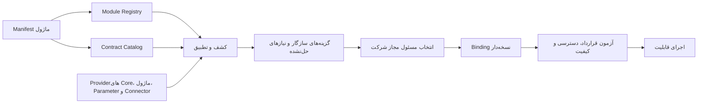
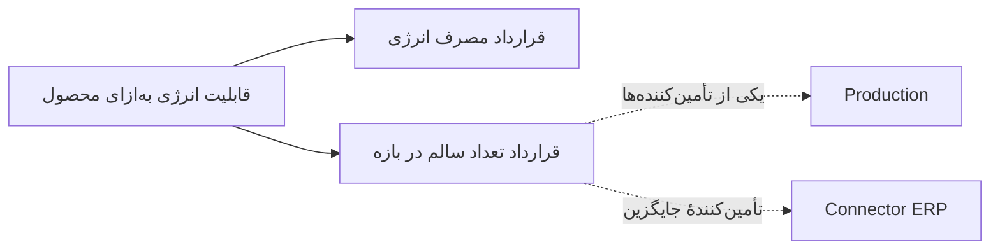
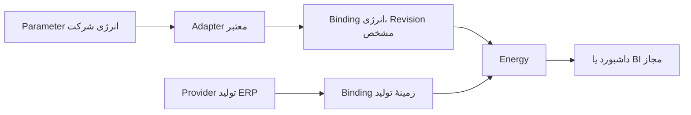
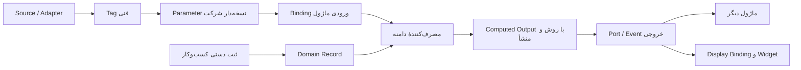
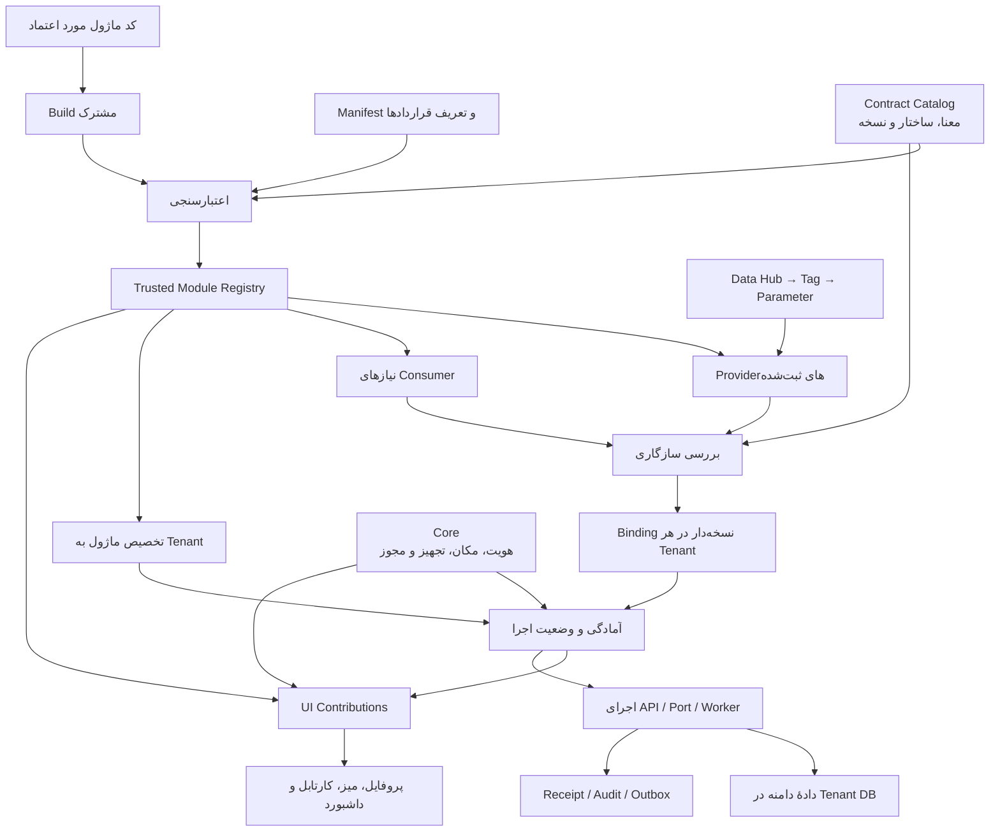
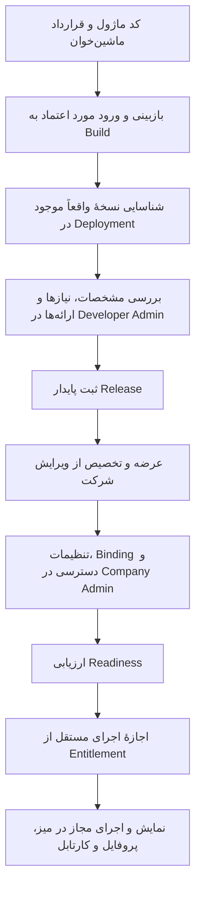

# بازنگری قرارداد، شناسایی و ارتباط ماژول‌ها — متن کامل گفتگو

- تاریخ ثبت: ۲۰۲۶-۱۱-۱۰
- نوع رکورد: متن کامل درخواست صاحب محصول و پاسخ Codex؛ بدون خلاصه‌سازی یا بازسازی متن.
- وضعیت سند: سابقهٔ گفتگو (Journal). وضعیت پیشنهادهای طراحی: **Proposed؛ تأییدنشده و بدون مجوز اجرا**. تأیید ثبت این گفتگو به معنی تأیید محتوای معماری آن نیست.
- مبنای اسناد در پاسخ: `sfp24-architecture@01e834b2127a03e79ac05c0cd45fb2992015f5df`؛ نقطهٔ کنترل جهت‌های قبلی: `9f64a669`.
- مبنای کد گزارش‌شده در پاسخ: `pouyeshgar-workshop@627feed3f93411554be0ed0be623ec43ec1e106b` و مقایسه با `55ad14d`، همراه تغییرات محلی Commitنشده. این SHA به‌تنهایی بازتولیدکنندهٔ تمام مشاهدات محلی نیست.
- نوع شواهد پاسخ: بررسی ایستای کد و اسناد؛ پیشنهادهای طراحی و نمونهٔ مفهومی رابط. ثبت این رکورد اجرای تازهٔ تست، Build یا تأیید Runtime نیست.

## این سابقه به چه کاری کمک می‌کند؟

برای ادامهٔ بحث دربارهٔ اعلام ساختاریافتهٔ نیازها و خروجی‌های ماژول، کشف تأمین‌کنندهٔ معتبر، اتصال در سطح شرکت، مجوزها، مشارکت در رابط و چرخهٔ عمر، اینجا خواستهٔ کامل و پاسخ کامل کنار هم حفظ شده‌اند. سشن بعدی می‌تواند استدلال، محدودیت‌ها و تصمیم‌های باز را بخواند؛ سپس وضعیت جاری سند مالک و کد را دوباره بررسی کند. مطالب این گفتگو جایگزین قراردادهای جاری نیستند.

- [فهرست گفتگوهای مشترک](../README.md)
- [سوابق هسته](../../core/RECORDS.md)
- [مرجع قراردادهای موجود و پیشنهادی](../../contracts/README.md)
- [قواعد ثبت و وضعیت اسناد](../../governance/DOCUMENTATION-POLICY.md)

## راهنمای خواندن متن اصلی و پیوندها

دو بخش بعدی متن اصلی هستند و هنگام بایگانی بازنویسی نشده‌اند. لینک‌های محلی ویندوز و دستور نمایش داخلی Codex در پاسخ، جزئی از متن تاریخی‌اند و در GitHub قابل استفاده نیستند. برای فایل‌های Commitشده از [درخت کد در مبنای گزارش](https://github.com/hossein-aghaie/pouyeshgar-workshop/tree/627feed3f93411554be0ed0be623ec43ec1e106b) استفاده کنید؛ مخزن کد خصوصی است. فایل‌های محلی جدیدی مانند `maintenance/module.ts`، `module-info.json`، `ModuleIntroduction.vue` و `ModuleRegistrations.vue` را نباید موجود در آن Commit فرض کرد.

[نسخهٔ همراه طرح تعاملی](assets/module-contract-review.html) نیز حفظ شده است. GitHub این HTML را مانند برنامه اجرا نمی‌کند؛ فایل را دانلود و در مرورگر باز کنید. این طرح مفهومی است، نه تصویر Runtime، شاهد آزمون یا قابلیت نصب‌شده.

## کنترل تمامیت متن

هش‌های SHA-256 زیر مربوط به متن UTF-8 با پایان خط LF هستند. متن دو بخش اصلی با منبع درخواست و پاسخ استخراج‌شده از همین گفتگو تطبیق داده شده است.

- درخواست: `483183ba155a20fd59eada1b9b3e1066f64fd2cd00652a62c09236b805ea4b2d`
- پاسخ: `b03a310455e80728d92419abdd8c68dc8abe10a7d4909f69add0137792f089da`

---

## متن کامل درخواست صاحب محصول

# مأموریت جامع بازنگری معماری Module Management، Module Interoperability و Developer Admin در SFP24

## هدف اصلی

طرح فعلی مدیریت ماژول‌ها را از نظر معماری، توسعه‌پذیری، ارتباط بین ماژول‌ها، قراردادهای داده، مدیریت وابستگی، کشف قابلیت‌ها، امنیت، چرخهٔ عمر، رابط کاربری و توسعه توسط برنامه‌نویسان داخلی و ثالث، به‌صورت اساسی بازبینی کن.

هدف صرفاً ساخت یک صفحه زیبا برای ثبت، فعال‌سازی و غیرفعال‌کردن ماژول‌ها نیست.

ما در حال ساخت یک پلتفرم Modular Operations هستیم که باید در آینده بتواند تعداد زیادی ماژول تخصصی و حتی ماژول‌های سفارشی نوشته‌شده توسط توسعه‌دهندگان مختلف را در خود جای دهد.

این ماژول‌ها باید بتوانند:

- از قابلیت‌ها و خدمات مشترک هسته استفاده کنند.
- نیازهای خود را به‌صورت استاندارد معرفی کنند.
- ورودی‌های خود را از منابع مختلف دریافت کنند.
- خروجی‌های خود را به ماژول‌های دیگر، هسته، داشبوردها و سامانه‌های بیرونی ارائه دهند.
- بدون وابستگی غیرضروری به یکدیگر توسعه پیدا کنند.
- در زمان نصب یا ثبت، ارتباط‌های قابل‌استفاده و وابستگی‌های احتمالی خود را شناسایی کنند.
- در صورت وجود چند ارائه‌دهنده برای یک قابلیت، امکان انتخاب و تنظیم اتصال مناسب داشته باشند.
- بدون دسترسی مستقیم به دیتابیس یکدیگر، با قراردادهای مشخص با هم ارتباط برقرار کنند.
- در محیط‌های چندشرکتی و چندسایتی، تنظیمات و اتصال‌های مستقل داشته باشند.

**مهم‌ترین مسئله‌ای که باید حل کنی این است: چگونه یک ماژول جدید می‌تواند بفهمد چه قابلیت‌هایی در SFP24 و ماژول‌های دیگر وجود دارند، چه چیزی را می‌تواند از آن‌ها دریافت کند، چه چیزی را می‌تواند به آن‌ها ارائه دهد و چگونه این ارتباط‌ها به‌صورت قابل اعتماد تعریف و برقرار می‌شوند؟**

این مسئله باید محور اصلی بازنگری باشد؛ نه صرفاً اضافه‌کردن چند فیلد به Manifest فعلی.

---

# بخش اول ــ قواعد بررسی و محدودیت‌ها

۱. فعلاً هیچ کدی تغییر نده.

۲. هیچ Migration، تغییر Schema، تغییر شاخه، Commit، PR یا تغییر مخزن انجام نده.

۳. هیچ قابلیت موجود را بدون بررسی شاهد کد، پیاده‌سازی‌شده فرض نکن.

۴. واقعیت پیاده‌سازی، تصمیم تأییدشده، پیشنهاد معماری و ایدهٔ آینده را از یکدیگر تفکیک کن.

۵. اگر یک قابلیت فقط در Research یا Draft مطرح شده، آن را قابلیت اجرایی معرفی نکن.

۶. پیش از پیشنهاد تغییر، اسناد و کد موجود را بررسی کن. از ایجاد قرارداد موازی با قراردادهای قبلی خودداری کن.

۷. برای هر ادعای مربوط به وضعیت فعلی، مسیر فایل و در صورت امکان شمارهٔ خط و Commit مبنا ارائه بده.

۸. اگر یک موضوع در اسناد تعیین تکلیف نشده، آن را با استدلال و گزینه‌های ممکن به‌عنوان مسئلهٔ باز ثبت کن؛ خودسرانه تصمیم نهایی نگیر.

۹. طرح باید آینده‌نگر باشد، اما به معنی ساخت Microservice، Plugin Engine، Marketplace یا سیستم نصب آزاد برای تمام ماژول‌ها از روز اول نیست.

۱۰. راهکار باید با معماری فعلی SFP24 قابل شروع باشد و مسیر رشد آن در آینده را مسدود نکند.

## منابعی که باید بررسی شوند

### اسناد معماری و تحقیق

- `docs/research/MODULE-EXTENSIBILITY-AND-WORKSPACES.fa.md`
- `docs/research/OPERATIONS-PLATFORMS.fa.md`
- `docs/contracts/MODULE-CONTRACT-DRAFT.md`
- `docs/contracts/DATA-CONTRACT-DRAFT.md`
- `docs/contracts/UI-CONTRIBUTIONS-DRAFT.md`
- `docs/contracts/README.md`
- `docs/core/ARCHITECTURE.fa.md`
- `docs/core/DATA-AND-PARAMETERS.fa.md`
- `docs/core/EXTENSIONS.fa.md`
- `docs/core/IDENTITY-AND-ACCESS.fa.md`
- `docs/core/WORKSPACES.fa.md`
- `docs/core/OPEN-QUESTIONS.md`
- `docs/modules/CATALOG.fa.md`
- `docs/modules/README.md`
- `docs/STATUS.fa.md`
- `docs/TECHNOLOGY.fa.md`

### کدهای مهم برای تطبیق

در Snapshot بررسی‌شده `55ad14d`:

- `server/platform/module-registry.ts`
- `server/operations/module-capabilities.ts`
- `server/platform/identity/permission-catalog.ts`
- `src/company/ui-contribution-contract.ts`
- `src/company/pilot-contributions.ts`
- `src/company/pilot-components.ts`
- `src/company/desk-sections.ts`
- `src/company/desk-studio-model.ts`
- `src/company/workspaces.ts`
- `src/company/module-catalog.ts`
- `src/company/resource-inputs.ts`

همچنین سرویس‌های واقعی Data Hub، Parameter، Telemetry، Master Data و عملیات Production و Maintenance را بررسی کن.

**نکتهٔ نسخه‌ای:** اسناد STATUS و TECHNOLOGY مبنای `b3f203b` را معرفی می‌کنند، در حالی که مطالعهٔ دقیق Registry و UI در Research روی `55ad14d` انجام شده است. ابتدا HEAD و وضعیت واقعی شاخهٔ در اختیار خودت را مشخص کن. این Snapshotها را با هم یکی فرض نکن.

تصاویر سه‌گانهٔ Developer Admin که برایت فرستاده‌ام صرفاً مرجع اولیهٔ چیدمان و ظاهر هستند. نوشته‌های داخل تصاویر خوانایی کامل ندارند؛ مشخصات و متن صحیح باید از این دستور و اسناد استخراج شوند. تصویر را جایگزین تحلیل معماری نکن.

---

# بخش دوم ــ ابتدا مسئلهٔ اصلی را درست تعریف کن

ما با چند مفهوم متفاوت روبه‌رو هستیم که نباید آن‌ها را یکی کنیم.

این تفاوت‌ها را در طرح نهایی روشن کن:

| مفهوم | سؤال اصلی |
|---|---|
| Module | این بخش نرم‌افزار چه مسئولیت دامنه‌ای دارد؟ |
| Module Manifest | ماژول خودش را چگونه به پلتفرم معرفی می‌کند؟ |
| Module Registry | هسته چه ماژول‌هایی را می‌شناسد؟ |
| Capability | ماژول چه توانایی‌هایی ارائه می‌کند؟ |
| Port / API | دیگر بخش‌ها از چه مسیری با آن ارتباط می‌گیرند؟ |
| Contract | اطلاعات و عملیات بین دو بخش دقیقاً چه معنا و ساختاری دارند؟ |
| Dependency | نبود چه چیزی باعث می‌شود یک قابلیت یا ماژول قابل اجرا نباشد؟ |
| Binding / Integration | ورودی یک بخش عملاً به کدام خروجی یا منبع متصل شده است؟ |
| Adapter | چگونه دو ساختار متفاوت را با حفظ معنا به یکدیگر تبدیل می‌کنیم؟ |
| Data Source | داده از کجا وارد سیستم می‌شود؟ |
| UI Contribution | ماژول چه بخش‌هایی به رابط کاربری عرضه می‌کند؟ |
| Entitlement | کدام شرکت حق استفاده از ماژول را دارد؟ |
| Permission | کدام شخص اجازهٔ انجام عملیات را دارد؟ |

به‌خصوص پنج مفهوم Dependency، Contract، Port، Binding و Integration را از یکدیگر جدا کن.

مثلاً اگر ماژول انرژی از یک دادهٔ تولید استفاده می‌کند، لزوماً نباید وابستگی اجباری به کل ماژول Production داشته باشد. شاید یک قرارداد استاندارد برای «بازهٔ اجرای تجهیز» کافی باشد که بتواند توسط Production یا یک Provider دیگر تأمین شود.

این تفاوت بسیار مهم است.

## اصل مالکیت

- Core مالک هویت، شرکت، Tenant، Scope، مجوزها و سرویس‌های مشترک است.
- هر ماژول مالک داده، منطق و قواعد دامنهٔ خودش است.
- یک ماژول نباید برای استفاده از اطلاعات ماژول دیگر مستقیماً جدول‌های آن را بخواند یا تغییر دهد.
- ماژول‌ها باید از Port، API، Event و قراردادهای معتبر استفاده کنند.
- یک ماژول نباید Person، Account یا Resource موازی بسازد، مگر یک موجودیت تخصصی مستقل با ارجاع به هویت مشترک واقعاً لازم باشد.

---

# بخش سوم ــ معماری ارتباط و کشف قابلیت‌ها

این مهم‌ترین بخش مأموریت است.

یک سازوکار کامل طراحی کن که در آن ماژول‌ها صرفاً نام و نسخهٔ خود را اعلام نکنند؛ بلکه بتوانند قراردادهای ورودی و خروجی خود را نیز معرفی کنند.

پیشنهادهای زیر را بررسی و در صورت نیاز اصلاح کن.

## ۳.۱. کاتالوگ قراردادهای هسته (Core Contract Catalog)

هسته باید یک مرجع قابل جست‌وجو از قابلیت‌ها و قراردادهایی داشته باشد که ماژول‌ها می‌توانند مصرف کنند.

برای نمونه، قراردادهای مربوط به:

- Person
- Account
- Company / Tenant
- Site
- Resource / Equipment
- Organization
- Position و Assignment
- Scope
- Permission
- Parameter
- Tag
- Data Source
- Task و Notification در صورت تصویب و پیاده‌سازی
- Workspace و Context
- فایل و مستندات
- رویدادهای مشترک
- داده‌های زمانی و اندازه‌گیری

برای هر قرارداد مشخص کن:

- شناسهٔ پایدار و یکتا
- مالک قرارداد
- نسخه
- تعریف معنایی
- ساختار داده و Schema
- نوع داده و واحد
- زمان یا بازهٔ زمانی
- کیفیت و منشأ داده
- محدودهٔ اعتبار و Scope
- Permission لازم
- روش دسترسی
- رفتار در نبود داده
- سیاست سازگاری نسخه‌ها
- نمونهٔ واقعی ورودی و خروجی
- محدودیت‌های مصرف

این کاتالوگ باید برای توسعه‌دهنده قابل مشاهده باشد.

یعنی وقتی کسی می‌خواهد یک ماژول جدید بنویسد، بتواند در Developer Documentation یا SDK ببیند:

- هسته چه خدماتی دارد؟
- چه اطلاعاتی از هسته قابل دریافت است؟
- چه عملیاتی را می‌تواند درخواست کند؟
- چه Eventهایی قابل اشتراک هستند؟
- چه قراردادهای داده‌ای از قبل وجود دارند؟
- کدام قراردادها پایدار، آزمایشی یا منسوخ هستند؟

توسعه‌دهنده نباید مجبور باشد برای کشف این اطلاعات، سورس تمام ماژول‌ها را بخواند.

## ۳.۲. کاتالوگ قابلیت‌ها و خروجی‌های ماژول‌ها

هر ماژول علاوه بر نیازهای خودش باید قابلیت‌های ارائه‌شده را هم معرفی کند.

مثلاً:

**Production**

ممکن است قراردادهایی برای این موارد ارائه کند:

- ثبت گزارش تولید
- بازهٔ اجرای کار
- تعداد تولیدشده
- تعداد سالم و ضایعات
- تاریخچهٔ گزارش
- خلاصهٔ تولید
- رخداد ثبت گزارش

**Maintenance**

ممکن است ارائه کند:

- درخواست خرابی
- دستورکار تعمیر
- وضعیت دستورکار
- سابقهٔ تعمیر تجهیز
- نتیجهٔ تعمیر
- رخداد تکمیل تعمیر
- وضعیت رسیدگی به تجهیز

**Training**

ممکن است ارائه کند:

- وضعیت شایستگی فرد
- نتیجهٔ ارزیابی
- سوابق آموزش
- صلاحیت معتبر برای فعالیت مشخص
- رخداد تکمیل آموزش

این موارد مثال‌های طراحی‌اند؛ وجود هر قرارداد را در کد فعلی اثبات کن و موارد پیشنهادی را جدا علامت بزن.

ماژول باید بتواند خروجی‌هایش را با قراردادهای نسخه‌دار در اختیار سایر مصرف‌کنندگان قرار دهد.

## ۳.۳. قراردادهای ورودی و خروجی هر ماژول

برای هر ماژول یک ساختار روشن طراحی کن که حداقل این اطلاعات را داشته باشد:

**ورودی‌ها:**

- شناسهٔ قرارداد موردنیاز
- مالک قرارداد موردنیاز
- نوع ارتباط: Query، Command، Event Subscription یا Data Binding
- نسخه‌های قابل قبول
- اجباری یا اختیاری بودن
- محدودهٔ دادهٔ موردنیاز
- نوع و واحد
- نیازهای زمانی
- Permission لازم
- رفتار هنگام نبود Provider
- رفتار هنگام قطع ارتباط
- امکان جایگزین‌شدن Provider
- روش تبدیل داده در صورت نیاز

**خروجی‌ها:**

- شناسهٔ قرارداد ارائه‌شده
- نوع خروجی
- Schema
- نسخه
- مالک داده
- معنا و واحد
- Scope
- روش دریافت
- محدودیت دسترسی
- کیفیت و منشأ
- سیاست نگهداری و تاریخچه
- مصرف‌کنندگان مجاز
- وضعیت پشتیبانی و سازگاری

ماژول باید بتواند چند ورودی و چند خروجی داشته باشد.

یک ورودی می‌تواند از Core، یک ماژول دیگر، Data Hub، ورودی دستی یا Connector خارجی تأمین شود.

یک خروجی هم می‌تواند چند مصرف‌کننده داشته باشد؛ بدون اینکه لازم باشد دادهٔ خام چند بار تکثیر شود.

## ۳.۴. سازوکار شناسایی وابستگی در زمان ثبت یا نصب

سناریوی زیر را دقیق طراحی کن:

یک توسعه‌دهنده ماژول جدیدی را به پلتفرم معرفی می‌کند.

سیستم باید بتواند:

۱. Manifest و قراردادهای اعلام‌شدهٔ آن را بخواند.

۲. نسخهٔ Host و Contract را بررسی کند.

۳. ورودی‌های موردنیاز ماژول را استخراج کند.

۴. در Registry بگردد و ببیند چه ماژول‌ها و Providerهایی این قراردادها را ارائه می‌کنند.

۵. قراردادهای Core را با ورودی‌های ماژول تطبیق دهد.

۶. در صورت وجود چند Provider مناسب، همه را معرفی کند.

۷. در صورت وجود ناسازگاری نوع، واحد، معنا یا نسخه، آن را مشخص کند.

۸. در صورت امکان تبدیل معتبر، Adapter مناسب پیشنهاد کند.

۹. وابستگی‌های اجباری و اختیاری را تفکیک کند.

۱۰. وابستگی حلقوی را تشخیص دهد.

۱۱. موارد بدون Provider را به‌عنوان نیاز برآورده‌نشده گزارش کند.

۱۲. گزارش قابل فهمی برای Developer Admin تولید کند.

اما یک اصل مهم:

**کشف خودکار نباید به معنی اتصال خودکار و بدون تأیید باشد.**

سه وضعیت پیشنهاد کن:

- تطبیق دقیق و معتبر
- تطبیق احتمالی با نیاز به Mapping یا Adapter
- عدم تطبیق یا نبود Provider

اگر دو ماژول خروجی و ورودی مشابهی دارند، سیستم می‌تواند ارتباط احتمالی را پیشنهاد کند؛ اما نباید صرفاً بر اساس شباهت نام فیلد، ارتباط را معتبر فرض کند.

اگر چند Provider وجود دارد، انتخاب باید براساس Scope، کیفیت، اولویت، منبع معتبر و سیاست شرکت انجام شود.

همچنین توضیح بده که از روی کد دلخواه یک ماژول ناشناخته نمی‌توان تمام وابستگی‌های آن را با اطمینان استنتاج کرد. قرارداد اعلام‌شده، تحلیل ایستا و آزمون سازگاری مبنای معتبر هستند؛ تحلیل کد یا AI حداکثر می‌تواند پیشنهاد کمکی بدهد.

---

# بخش چهارم ــ اتصال معماری ماژول‌ها به Data Hub، Tag و Parameter

این قسمت را با دقت ویژه بررسی کن؛ چون SFP24 از قبل برای Tag و Parameter طراحی و پیاده‌سازی‌هایی دارد.

مرجع:

`docs/core/DATA-AND-PARAMETERS.fa.md`

و:

`docs/contracts/DATA-CONTRACT-DRAFT.md`

در مدل فعلی این تفکیک وجود دارد:

Source / Adapter → Tag → Parameter → Domain Consumer → Computed Output → Display Binding

این مدل نباید با یک Event Bus عمومی یا جدول مشترک همهٔ ماژول‌ها اشتباه گرفته شود.

بررسی کن چگونه می‌توان این معماری را به قرارداد ورودی و خروجی ماژول‌ها متصل کرد.

### مواردی که باید دقیقاً رعایت شوند

۱. Tag شناسهٔ فنی سیگنال است، نه لزوماً معنای کسب‌وکاری آن.

۲. Parameter معنای قابل استفادهٔ شرکت، نوع، واحد، منبع و تبدیل نسخه‌دار را نگهداری می‌کند.

۳. یک Parameter می‌تواند چند مصرف‌کننده داشته باشد.

۴. گزارش دستی کسب‌وکار الزاماً نباید به یک Tag مصنوعی تبدیل شود.

۵. دادهٔ محاسبه‌شده باید روش، نسخه، بازه و دامنهٔ محاسبهٔ مشخص داشته باشد.

۶. دادهٔ لحظه‌ای، شمارندهٔ تجمعی، اختلاف بازه، Event و State نباید به‌اشتباه یکی فرض شوند.

۷. نبود داده مساوی صفر نیست.

۸. قطع ارتباط دستگاه مساوی توقف واقعی تجهیز نیست.

۹. انتخاب Widget نباید منبع رسمی گزارش تولید را تغییر دهد.

۱۰. اتصال یک ماژول به Parameter نباید به معنی دسترسی آزاد آن به Raw Data یا Credential منبع باشد.

### مسئلهٔ مهم

در کد فعلی `resource-inputs.ts` تعدادی ورودی مانند موارد زیر دیده می‌شود:

- operating_state
- operation_mode
- alarm_active
- stop_reason
- cycle_time
- power
- energy
- electric_current
- voltage

اما توضیح کد برای بسیاری از آن‌ها می‌گوید نگاشت سیگنال ذخیره می‌شود و مصرف خودکار آن در ماژول‌ها هنوز پیاده نشده است.

این محدودیت را حفظ کن و آن را با قابلیت عمومی مصرف داده اشتباه نگیر.

### خروجی مورد انتظار

یک مدل روشن ارائه کن که نشان دهد:

- یک ماژول چگونه یک Parameter را درخواست می‌کند؟
- چگونه می‌فهمد مقدار آن معتبر است؟
- چگونه واحد و معنای داده بررسی می‌شود؟
- اگر چند Tag یا منبع برای یک Parameter وجود داشته باشد چه اتفاقی می‌افتد؟
- چگونه یک ماژول خروجی محاسبه‌شدهٔ خود را به‌عنوان دادهٔ معتبر منتشر می‌کند؟
- چگونه یک ماژول دیگر می‌تواند آن خروجی را مصرف کند؟
- چه زمانی باید از Query استفاده شود؟
- چه زمانی Event مناسب‌تر است؟
- چه زمانی باید از Command استفاده کرد؟
- چه زمانی Integration Module لازم است؟

برای این موارد دیاگرام و مثال عملی ارائه کن.

---

# بخش پنجم ــ نمونهٔ واقعی طراحی ارتباط چند ماژولی

صرفاً توضیح مفهومی کافی نیست. حداقل سه سناریوی کامل طراحی کن.

## سناریو A: Energy Management

یک ماژول جدید به نام Energy Management به SFP24 اضافه می‌شود.

این ماژول می‌تواند:

**از Core بگیرد:**
- شناسهٔ تجهیز
- سایت و محدوده
- اطلاعات شرکت
- زمان و بازهٔ کاری
- مجوز خواندن داده

**از Data Hub بگیرد:**
- توان لحظه‌ای
- انرژی تجمعی
- جریان
- ولتاژ
- داده‌های دارای واحد، زمان و کیفیت معتبر

**از Production به‌صورت اختیاری بگیرد:**
- بازهٔ واقعی اجرای تولید
- تعداد تولید سالم
- اطلاعات عملیات
- زمینهٔ فعالیت تجهیز

**خروجی تولید کند:**
- مصرف انرژی
- مصرف انرژی در بازه
- مصرف انرژی به‌ازای تولید
- روند مصرف
- هشدار مصرف غیرعادی

**به سایر بخش‌ها ارائه دهد:**
- Widget داشبورد
- گزارش انرژی
- خروجی قابل استفاده برای BI
- Event هشدار برای Maintenance، در صورت وجود قرارداد مناسب

این ماژول نباید برای محاسبهٔ مصرف انرژی الزاماً به Production وابسته باشد. ممکن است یک مشتری فقط پایش انرژی بخواهد.

اما برای محاسبهٔ انرژی به‌ازای واحد محصول، اطلاعات معتبر تولید لازم می‌شود.

این تفاوت را در Dependency و Capability مشخص کن.

## سناریو B: ارتباط Production و Maintenance

فرض کن Maintenance یک دستورکار را تکمیل می‌کند.

آیا Production باید مستقیماً از جدول تعمیرات بخواند؟

خیر.

بررسی کن:

- Maintenance چه Event یا Outputی ارائه می‌کند؟
- Production چه Contractی می‌تواند مصرف کند؟
- وضعیت آماده‌به‌کاری تجهیز چگونه معتبر می‌شود؟
- آیا Integration Module برای هماهنگی این دو لازم است؟
- اگر Maintenance نصب نباشد Production چه رفتاری دارد؟
- اگر Maintenance غیرفعال شود تکلیف سوابق و Eventهای قبلی چیست؟

همچنین بررسی کن که چه زمانی یک ارتباط مستقیم مبتنی بر Contract کافی است و چه زمانی یک ماژول واسط با منطق مستقل بهتر است.

## سناریو C: Training، Person و PTW

فرض کن ماژول آموزش، وضعیت صلاحیت فرد را ارائه می‌کند و ماژول مجوز کار پرخطر (PTW) باید بررسی کند که فرد صلاحیت لازم را دارد یا خیر.

بررسی کن:

- Person و Account چگونه از Core گرفته می‌شوند؟
- Training چگونه Qualification را ارائه می‌کند؟
- PTW چگونه آن را مصرف می‌کند؟
- آیا PTW باید به کل Training وابسته باشد یا به یک Contract مشخص؟
- اگر Training نصب یا فعال نباشد، سیاست صدور مجوز چه خواهد بود؟
- آیا صلاحیت منقضی‌شده یا فاقد شواهد باید مانند صلاحیت معتبر رفتار کند؟

از این مثال برای طراحی قراردادهای قابل استفادهٔ مجدد در سایر ماژول‌ها استفاده کن.

---

# بخش ششم ــ بررسی ارتباطات در کل کاتالوگ ماژول‌ها

فقط روی Production و Maintenance تمرکز نکن.

مرجع کامل حوزه‌های محصول:

`docs/modules/CATALOG.fa.md`

این فهرست خانواده‌های زیر را دارد:

### عملیات صنعتی

- MES / Production
- QMS
- CMMS / EAM
- WMS / Inventory
- Planning / APS
- MRP
- OEE
- Traceability / Genealogy
- DMS
- EHS / HSE / PTW
- Energy Management
- Manufacturing Intelligence / BI

### مهندسی و تجهیزات

- PLM / PDM
- MPM
- Batch / Recipe Management
- EBR / eDHR
- LIMS
- SPC
- Metrology / Calibration
- Tool Management
- APM / Condition Monitoring
- Intralogistics
- Digital Twin
- DNC / NC Program Management

### کارکنان و خدمات شرکت

- LMS / Competency
- Time & Attendance
- Timesheet
- WFM
- Leave / Overtime
- Canteen Management
- Employee Transport
- Employee Services
- CAFM / IWMS
- Visitor Management
- Travel & Expense
- Performance Management

### سامانه‌های سازمانی

- CRM / Sales
- Procurement / SRM
- SCM / S&OP / IBP
- Finance / Costing
- HRIS / Payroll
- TMS
- Project / Service Management
- Field Service Management

برای این حوزه‌ها یک **Module Interoperability Matrix** طراحی کن.

برای هر حوزه مشخص کن:

| مورد | توضیح |
|---|---|
| Core Inputs | اطلاعاتی که از هسته نیاز دارد |
| Data Hub Inputs | داده‌هایی که از Tag و Parameter می‌گیرد |
| Module Inputs | قراردادهای احتمالی مصرف‌شده از سایر ماژول‌ها |
| Outputs | داده‌ها، سرویس‌ها و Eventهای قابل ارائه |
| UI Contributions | صفحاتی که به رابط اضافه می‌کند |
| Profile Contributions | پروفایل‌هایی که می‌تواند گسترش دهد |
| Dependencies | وابستگی اجباری و اختیاری |
| Integration Modules | اتصال‌های میان‌دامنه‌ای احتمالی |
| Permissions | مجوزهای عملیاتی لازم |
| Absence Behavior | رفتار در نبود ماژول یا Provider دیگر |

تمام روابط را به سه دسته تقسیم کن:

- وابستگی واقعی و اجباری
- ارتباط اختیاری از طریق Contract
- اتصال تجاری یا فرایندی که ممکن است نیازمند Integration Module باشد

**هر ارتباطی را به وابستگی اجباری تبدیل نکن.**

مثلاً Quality می‌تواند از دادهٔ Production استفاده کند، اما الزاماً در همهٔ شرکت‌ها باید Production از همین SFP24 را داشته باشد؛ ممکن است داده از ERP یا منبع دیگری بیاید.

همچنین همهٔ این حوزه‌ها در حال حاضر پیاده نشده‌اند. وضعیت هرکدام را از Product Catalog و STATUS جداگانه استخراج کن.

---

# بخش هفتم ــ طراحی Manifest و قرارداد فنی ماژول

Manifest فعلی را بررسی کن و مشخص کن چه چیزهایی کم دارد.

در Snapshot بررسی‌شده، ModuleDescriptor شامل این موارد است:

- contractVersion
- moduleKey
- release
- compatibleHostMajor
- requiredModules
- optionalModules
- capabilities

و Portهای فعلی عمدتاً Query و Action هستند.

بررسی کن این مدل برای آینده کافی است یا باید توسعه پیدا کند.

حداقل مفاهیم زیر را در طرح پیشنهادی بررسی کن:

### Module Identity
- moduleKey
- publisher
- module family
- release
- description
- ownership
- support policy
- trust level

### Compatibility
- host API compatibility
- contract compatibility
- schema compatibility
- supported runtime
- deprecation policy

### Requirements
- required module dependencies
- optional module dependencies
- required contracts
- optional contracts
- required core capabilities
- required parameters
- external services

### Provided Capabilities
- capability ID
- owner
- description
- permissions
- readiness
- associated ports

### Input / Output Ports
- Query
- Command
- Event
- Event Subscription
- Data Stream
- Parameter Binding
- Computed Output

### UI Contributions
- Page
- Form
- Action
- Desk Widget
- Dashboard Widget
- Profile Section
- Inbox
- Notification
- 3D Overlay

### Data Ownership
- domain entities
- schema
- migrations
- retention
- export
- disable behavior

### Security
- requested permissions
- scopes
- actor requirements
- service identity
- sensitive data access
- external network access

### Lifecycle
- registration
- installation
- provisioning
- enable
- disable
- upgrade
- rollback
- unregister
- retire

یک نمونهٔ Manifest مفهومی و کامل برای Energy Management ارائه کن.

این نمونه باید نشان دهد یک ماژول چگونه ورودی‌ها و خروجی‌های خود را معرفی می‌کند.

اما JSON یا YAML پیشنهادی را قرارداد مصوب تلقی نکن؛ ابتدا ساختار و ضرورت هر فیلد را توضیح بده.

---

# بخش هشتم ــ طراحی Adapter و Data Mapping

صرف داشتن ورودی و خروجی کافی نیست.

ممکن است دو ماژول داده‌هایی با نام متفاوت اما معنای یکسان داشته باشند.

یا نام و نوع ظاهراً یکسان داشته باشند ولی معنای متفاوتی ارائه کنند.

بنابراین یک لایهٔ Mapping و Adapter بررسی کن.

مثلاً:

- یک Provider مقدار انرژی را به Wh ارائه می‌دهد.
- مصرف‌کننده kWh می‌خواهد.
- یک ماژول زمان را به‌صورت Timestamp ارائه می‌کند.
- دیگری بازهٔ شروع و پایان می‌خواهد.
- یک ماژول وضعیت تجهیز را به شکل State ارائه می‌کند.
- دیگری Event تغییر وضعیت مصرف می‌کند.
- یک ماژول تعداد تجمعی می‌دهد.
- مصرف‌کننده اختلاف یک بازه را لازم دارد.

بررسی کن:

۱. چه تبدیل‌هایی را Core می‌تواند به‌صورت استاندارد فراهم کند؟

۲. کدام تبدیل‌ها باید متعلق به Adapter اختصاصی باشند؟

۳. کدام تبدیل‌ها تغییر معنای داده ایجاد می‌کنند و نباید خودکار انجام شوند؟

۴. تبدیل واحد و تبدیل معنایی چگونه از هم تفکیک می‌شوند؟

۵. Mapping چگونه نسخه‌بندی و Audit می‌شود؟

۶. اگر Mapping تغییر کند، سوابق محاسبات قبلی چه وضعیتی دارند؟

۷. چه کسی Mapping را تعریف و تأیید می‌کند؟

۸. چگونه یک ماژول سفارشی می‌تواند Adapter خودش را معرفی کند؟

از اجرای فرمول یا کد دلخواه و بدون محدودیت در محیط مشتری پرهیز کن.

---

# بخش نهم ــ رابط Developer Admin

حالا که معماری روشن شد، رابط کاربری را بر اساس آن طراحی کن.

صرفاً صفحهٔ فعلی را با چند Tab بیشتر نکن.

بررسی کن آیا Developer Admin باید بخش‌های مستقل زیر را داشته باشد:

### ۱. Module Catalog
- فهرست ماژول‌ها
- وضعیت واقعی پیاده‌سازی
- نسخه
- ناشر
- نوع انتشار
- وضعیت اعتماد
- وضعیت ثبت و استقرار

### ۲. Module Descriptor
- اطلاعات هویتی
- قابلیت‌ها
- وابستگی‌ها
- ورودی‌ها
- خروجی‌ها
- مجوزها
- نسخه و سازگاری

### ۳. Contract Catalog
- قراردادهای Core
- قراردادهای ماژول‌ها
- ورودی و خروجی هر قرارداد
- نسخه‌ها
- نمونه داده
- وضعیت پشتیبانی
- مالک قرارداد

### ۴. Integration Explorer
یک نمای گرافیکی که ارتباط میان ماژول‌ها را نشان دهد.

در این گراف مشخص باشد:

- کدام ماژول تولیدکننده است؟
- کدام ماژول مصرف‌کننده است؟
- ارتباط از نوع Query است یا Event یا Data Binding؟
- کدام قرارداد استفاده می‌شود؟
- وابستگی اجباری است یا اختیاری؟
- ارتباط فعال است یا فقط پیشنهاد شده؟
- نسخهٔ قرارداد چیست؟
- وضعیت اتصال چیست؟

### ۵. Dependency Analyzer
- وابستگی‌های مستقیم
- وابستگی‌های غیرمستقیم
- وابستگی‌های اختیاری
- قراردادهای برآورده‌نشده
- چرخه‌های وابستگی
- اثر غیرفعال‌کردن Provider
- اثر ارتقای نسخه

### ۶. Input / Output Mapping
- ورودی‌های هر ماژول
- خروجی‌های قابل استفاده
- Providerهای پیشنهادی
- Data Hub Binding
- انتخاب Parameter
- Adapter
- تست Mapping
- وضعیت اعتبارسنجی

### ۷. UI Contribution Manager
- صفحات
- فرم‌ها
- Widgetها
- میزها
- داشبوردها
- پروفایل‌ها
- کارتابل
- اعلان
- 3D Overlay

### ۸. Permission & Security
- Permissionهای اعلام‌شده
- Permissionهای تأییدشده
- Scope
- دسترسی به اطلاعات حساس
- دسترسی بین ماژول‌ها
- دسترسی به سرویس‌های Core

### ۹. Version & Compatibility
- نسخهٔ ماژول
- نسخهٔ Host
- نسخهٔ Contract
- نسخهٔ Schema
- ماتریس سازگاری
- Migration
- Rollback
- Deprecation

### ۱۰. Lifecycle & Impact Analysis
- ثبت
- انتشار
- استقرار
- فعال‌سازی
- غیرفعال‌سازی
- بازنشستگی
- وابستگی شرکت‌ها
- اتصال‌های فعال
- کارهای معوق
- داده‌های متعلق به ماژول

### ۱۱. Health & Monitoring
- سلامت ماژول
- سلامت Portها
- سلامت اتصال‌ها
- تأخیر Eventها
- دادهٔ قدیمی
- خطاهای Mapping
- وضعیت Worker
- آخرین موفقیت دریافت داده

بررسی کن کدام بخش‌ها برای نسخهٔ نخست ضروری‌اند و کدام باید برای مرحله‌های بعد باقی بمانند.

---

# بخش دهم ــ تفاوت Developer Admin و Company Admin

این دو سطح نباید در هم ادغام شوند.

**Developer Admin** مسئول مدیریت تعریف، انتشار، نسخه، قرارداد و سازگاری ماژول‌هاست.

**Company Admin** مسئول انتخاب و فعال‌سازی قابلیت‌های مجاز، تنظیم ارتباط‌های شرکت و تعیین دسترسی‌ها در محدودهٔ اختیارات خودش است.

مثلاً:

- Developer Admin تعریف می‌کند Energy Management چه ورودی‌هایی می‌خواهد.
- Company Admin تعیین می‌کند ورودی انرژی این شرکت از کدام Parameter و منبع تأمین شود.
- Developer Admin مشخص می‌کند خروجی انرژی چه Contractی دارد.
- Company Admin می‌تواند مشخص کند کدام داشبوردهای مجاز از آن استفاده کنند.
- Access Admin مجوزهای اشخاص را مدیریت می‌کند.

شرکت نباید بتواند با فعال‌سازی یک ماژول، Permission جدیدی خارج از سیاست‌های پلتفرم ایجاد کند یا کد ناشناس روی سرور اجرا کند.

یک ماتریس مسئولیت نقش‌ها طراحی کن.

---

# بخش یازدهم ــ پروفایل‌ها، Workspaceها و Dashboardها

ماژول‌ها فقط منطق Backend نیستند.

هر ماژول ممکن است به یک یا چند موجودیت موجود در پلتفرم، بخش تخصصی اضافه کند.

برای مثال:

- Maintenance به پروفایل Resource / Equipment سابقهٔ تعمیر اضافه می‌کند.
- Training به پروفایل Person بخش شایستگی و سوابق آموزش اضافه می‌کند.
- Quality به پروفایل محصول یا تجهیز، در صورت وجود مدل و قرارداد معتبر، اطلاعات کیفیت اضافه می‌کند.
- Energy به پروفایل تجهیز، روند مصرف انرژی اضافه می‌کند.

بررسی کن چگونه این Contributionها بدون ساخت Profile موازی ثبت شوند.

همچنین این تفاوت‌ها حفظ شوند:

- Profile Field
- Profile Section
- Full Page
- Workbench / Desk
- Dashboard
- Widget
- Inbox
- Notification
- 3D Overlay

Context باید قابل انتقال باشد؛ برای مثال:

- Person انتخاب‌شده
- Resource انتخاب‌شده
- Site
- Work Order
- Production Order
- Time Range

Widget نباید به یک تجهیز یا شرکت ثابت قفل شود.

بررسی کن چه الگویی برای Context Binding و Alias مناسب است.

همچنین UI Contribution نباید مجوز عملیات ایجاد کند. کنترل سمت سرور الزامی است.

---

# بخش دوازدهم ــ امنیت، اعتماد و جداسازی ماژول‌های سفارشی

این بخش برای آیندهٔ SFP24 حیاتی است.

فرض کن در آینده یک شرکت یا توسعه‌دهندهٔ ثالث می‌خواهد ماژول سفارشی خودش را بنویسد.

بررسی کن:

- آیا می‌تواند کد دلخواه بارگذاری کند؟
- آیا فقط Manifest ثبت می‌کند؟
- آیا Build مورد اعتماد لازم است؟
- آیا Package باید امضا شود؟
- چه کسی Publisher را تأیید می‌کند؟
- چگونه از اجرای کد مخرب جلوگیری می‌شود؟
- چگونه دسترسی به Tenantهای دیگر مسدود می‌شود؟
- چگونه Secret و Credential نگهداری می‌شود؟
- چگونه دسترسی شبکه‌ای ماژول کنترل می‌شود؟
- چگونه SQL مستقیم محدود می‌شود؟
- چگونه Permissionهای درخواستی بازبینی می‌شوند؟
- چگونه از جعل Contract یا معرفی خروجی غیرواقعی جلوگیری می‌شود؟

تفاوت این دو مدل را روشن کن:

۱. ماژول مورد اعتماد که در Build مشترک SFP24 حضور دارد.

۲. Package مستقل نوشته‌شده توسط توسعه‌دهندهٔ ثالث.

برای هرکدام Trust Model و Runtime مناسب پیشنهاد بده.

هیچ فرضی مبنی بر اینکه Manifest به‌تنهایی کد را امن می‌کند پذیرفته نیست.

---

# بخش سیزدهم ــ نسخه‌بندی و سازگاری

نسخهٔ ماژول، نسخهٔ قرارداد و نسخهٔ داده الزاماً یکی نیستند.

این موضوع را دقیق طراحی کن.

مثلاً اگر Production یک خروجی جدید اضافه کند، آیا همهٔ مصرف‌کنندگان باید تغییر کنند؟

اگر نوع یک فیلد تغییر کند، چه اتفاقی می‌افتد؟

اگر نسخهٔ جدید Maintenance یک Event قدیمی را حذف کند، مصرف‌کنندگان قبلی چگونه مطلع می‌شوند؟

بررسی کن:

- Semantic Versioning
- Backward Compatibility
- Forward Compatibility
- Schema Evolution
- Contract Deprecation
- Compatibility Matrix
- Consumer-Driven Contract Tests
- Provider Conformance Tests
- Migration
- Rollback
- چند نسخهٔ فعال در چند Tenant

در کد فعلی Capability Status مقدار `compatible` به‌صورت ثابت `true` قرار گرفته است. این را با ماتریس سازگاری واقعی اشتباه نگیر.

یک مدل واقعی برای محاسبه و اثبات Compatibility پیشنهاد کن.

---

# بخش چهاردهم ــ رفتار در خطا و نبود وابستگی

سناریوهای شکست را فراموش نکن.

برای هرکدام رفتار مورد انتظار را مشخص کن:

۱. ماژول موردنیاز نصب نشده است.

۲. ماژول نصب شده ولی برای شرکت Enable نشده است.

۳. ماژول فعال است ولی Readiness ندارد.

۴. Provider قرارداد موردنیاز را ارائه نمی‌کند.

۵. دو Provider برای یک ورودی وجود دارند.

۶. Provider در زمان اجرا از دسترس خارج می‌شود.

۷. Event تکراری دریافت می‌شود.

۸. داده قدیمی یا نامعتبر است.

۹. واحد داده با نیاز مصرف‌کننده سازگار نیست.

۱۰. Contract نسخهٔ ناسازگار دارد.

۱۱. یک ماژول وابسته غیرفعال می‌شود.

۱۲. ماژول مصرف‌کننده در زمان انتشار نسخهٔ جدید وجود ندارد.

۱۳. اتصال میان دو ماژول حذف می‌شود.

۱۴. عملیات نیمه‌تمام باقی می‌ماند.

۱۵. یک شرکت تنظیمات متفاوتی نسبت به شرکت دیگر دارد.

در این بخش موارد زیر را هم بررسی کن:

- Timeout
- Retry
- Idempotency
- Dead Letter
- Event Ordering
- Health Check
- Circuit Breaker
- Fallback
- Data Freshness
- Data Provenance

اما این امکانات را به‌عنوان زیرساخت موجود معرفی نکن؛ وضعیت فعلی و نیاز آینده را جدا کن.

---

# بخش پانزدهم ــ چرخهٔ عمر و تأثیر تغییرات

چرخهٔ عمر انتشار و چرخهٔ عمر استفاده در شرکت دو موضوع جدا هستند.

تفکیک کن:

- Build
- Publish
- Deploy
- Register
- Provision
- Entitlement
- Enable
- Disable
- Detach Binding
- Unregister
- Retire
- Uninstall
- Emergency Stop

اگر ماژولی غیرفعال شود، باید مشخص باشد:

- عملیات جدید متوقف می‌شود یا نه؟
- عملیات نیمه‌تمام چه می‌شود؟
- Eventهای معوق چه می‌شوند؟
- مصرف‌کنندگان وابسته چه وضعیتی پیدا می‌کنند؟
- داده‌های قبلی حفظ می‌شوند یا نه؟
- داشبوردهای وابسته چگونه رفتار می‌کنند؟
- امکان فعال‌سازی مجدد وجود دارد یا نه؟

در صورت حذف Provider، سیستم باید قبل از انجام عملیات، همهٔ مصرف‌کنندگان و اتصال‌های وابسته را شناسایی کند.

حذف ماژول نباید به‌صورت پیش‌فرض به معنی حذف سوابق عملیاتی باشد.

این بخش باید با تصمیم‌های قبلی محصول دربارهٔ Disable و Lifecycle سازگار بماند.

---

# بخش شانزدهم ــ مرحله‌بندی اجرایی

نمی‌خواهم به بهانهٔ آینده‌نگری از همان ابتدا یک سیستم پیچیده و غیرقابل مدیریت بسازیم.

بر اساس Research موجود، مرحله‌بندی را بازبینی کن.

حداقل این مسیر را ارزیابی کن:

### مرحله صفر: تکمیل شناخت و قراردادها
- بررسی کد موجود
- شناسایی محدودیت‌ها
- تعیین مالکیت داده
- تعیین قراردادهای اصلی Core
- تعریف تفاوت Module Dependency و Contract Dependency
- طراحی Manifest و Port

### مرحله یک: معماری Modular Monolith
- Registry کد-محور
- Manifest نسخه‌دار
- Core Contract Catalog
- Provider / Consumer Ports
- Dependency Resolver
- اتصال‌های صریح
- Mapping اولیه به Parameter
- UI Contributions کنترل‌شده
- تست سازگاری

در این مرحله Package ناشناس و بارگذاری آزاد کد مشتری لازم نیست.

### مرحله دو: Integration Management
- Binding Registry
- Integration Explorer
- Adapter Catalog
- Contract Validation
- Tenant-specific Bindings
- گزارش ارتباطات
- تست سلامت اتصال‌ها

### مرحله سه: SDK و Developer Experience
- SDK
- مستندات قرارداد
- ابزار تولید اسکلت ماژول
- Manifest Validation
- Contract Test Kit
- انتشار کنترل‌شده

### مرحله چهار: سرویس‌های مستقل و اکوسیستم توسعه‌دهندگان
فقط در صورت وجود نیاز واقعی:
- Package Registry
- Signature Verification
- Trust Policy
- Sandbox
- Independent Deployment
- Service-to-Service Security
- Version Isolation

مشخص کن کدام قسمت‌ها باید از ابتدا در طراحی لحاظ شوند تا در آینده مهاجرت پرهزینه نشود، و کدام قسمت‌ها واقعاً نباید زودتر از نیاز ساخته شوند.

---

# بخش هفدهم ــ معیارهای پذیرش طراحی

برای اینکه طرح صرفاً یک متن زیبا نباشد، حداقل سناریوهای پذیرش زیر را طراحی کن.

| سناریو | نتیجهٔ مورد انتظار |
|---|---|
| نصب ماژولی با ورودی Core | شناسایی قرارداد و دسترسی معتبر |
| نصب ماژول با Provider موجود | پیشنهاد اتصال معتبر |
| وجود چند Provider | نمایش گزینه‌ها و انتخاب کنترل‌شده |
| نبود Provider اجباری | اعلام نیاز برآورده‌نشده و جلوگیری از Enable |
| نبود Provider اختیاری | امکان استفاده از قابلیت‌های مستقل و هشدار مناسب |
| ناسازگاری نوع و واحد | رد اتصال یا پیشنهاد Adapter معتبر |
| اتصال Parameter به ماژول | کنترل معنا، نوع، واحد، زمان و کیفیت |
| اتصال دو ماژول | ارتباط از Port/API/Event، نه SQL مستقیم |
| وجود وابستگی حلقوی | تشخیص و گزارش |
| غیرفعال‌سازی Provider | نمایش اثر بر مصرف‌کنندگان |
| ارتقای Contract | بررسی Compatibility و مهاجرت |
| نصب ماژول سفارشی ناشناس | عدم اجرای کد پیش از Trust و Validation |
| دو Tenant متفاوت | Binding و دسترسی مستقل |
| نبود داده | عدم تبدیل خودکار به صفر |
| وجود Widget بدون Permission | عدم اجرای عملیات |
| وجود Contract بدون Implementation | عدم معرفی قابلیت به‌عنوان آماده |

برای هر سناریو توضیح بده چگونه قابل آزمون خواهد بود.

---

# بخش هجدهم ــ خروجی نهایی مورد انتظار از تو

پاسخت باید یک طرح معماری واقعی و قابل بررسی باشد؛ نه خلاصه‌ای از ایده‌ها و نه صرفاً طرح UI.

خروجی را به ترتیب زیر ارائه کن:

۱. **جمع‌بندی معماری:** مسئلهٔ اصلی چیست و چرا طرح فعلی کافی نیست؟

۲. **وضعیت موجود:** چه چیزهایی در کد و اسناد وجود دارند و چه چیزهایی وجود ندارند؟

۳. **مدل مفهومی پیشنهادی:** ارتباط Core، Module Registry، Contract Catalog، Provider، Consumer، Binding و Adapter.

۴. **مدل قرارداد:** ساختار پیشنهادی Manifest، Port و Data Contract با مثال.

۵. **الگوریتم کشف ارتباط:** سیستم هنگام ثبت یا نصب چگونه ورودی‌ها را با قابلیت‌های موجود تطبیق می‌دهد؟

۶. **Dependency Graph و Integration Graph:** تفاوت و کاربرد هر دو.

۷. **Module Interoperability Matrix:** بررسی ارتباطات در کل کاتالوگ حوزه‌های محصول.

۸. **سه سناریوی کامل:** Energy Management، Production-Maintenance و Training-PTW.

۹. **Data Hub Integration:** ارتباط دقیق Tag، Parameter، Domain Record و Computed Output با قرارداد ماژول.

۱۰. **UI Architecture:** مشخصات صفحه‌ها و بخش‌های Developer Admin و Company Admin.

۱۱. **Profile و Workspace Contributions:** روش افزودن قابلیت به پروفایل شخص، تجهیز و سایر موجودیت‌ها.

۱۲. **Security و Trust Model:** برای ماژول داخلی و ثالث.

۱۳. **Versioning و Compatibility:** قراردادها و روش آزمون سازگاری.

۱۴. **Lifecycle و Failure Handling:** رفتار در نصب، فعال‌سازی، توقف، ارتقا و حذف.

۱۵. **نقشهٔ مرحله‌بندی اجرا:** از مدل فعلی تا SDK و توسعهٔ ثالث.

۱۶. **ریسک‌ها و تصمیم‌های باز:** مواردی که نیاز به تصمیم صاحب محصول دارند.

۱۷. **معیارهای پذیرش:** سناریوهایی که باید پیش از اعلام آمادگی معماری آزموده شوند.

---

# بخش نوزدهم ــ الزامات طراحی بصری

پس از تکمیل تحلیل معماری، یک طرح تصویری دقیق‌تر از Developer Admin تهیه کن.

طرح باید حداقل این نماها را نشان دهد:

- Module Catalog
- Module Detail
- Input / Output Contracts
- Dependency Graph
- Integration Graph
- Contract Catalog
- Mapping Editor
- Permission Manager
- UI Contribution Manager
- Compatibility
- Lifecycle & Impact

متن فارسی و انگلیسی باید خوانا، درست و متناسب با فضای واقعی رابط باشد.

از نمایش اطلاعات ساختگی، نسخه‌های فرضی، تعدادهای غیرواقعی و وضعیت‌های تأییدنشده خودداری کن.

اگر یک قابلیت فقط پیشنهادی است، آن را به‌وضوح Proposed نشان بده.

---

# اصل نهایی و مهم‌ترین مطالبه

من نمی‌خواهم فقط بتوانیم یک ماژول را به فهرست برنامه اضافه یا از آن حذف کنیم.

می‌خواهم به نقطه‌ای برسیم که:

یک توسعه‌دهنده بتواند ماژول جدیدی بنویسد؛ پلتفرم از طریق قراردادها بفهمد این ماژول چه چیزی می‌خواهد و چه چیزی ارائه می‌دهد؛ ارتباط‌های ممکن با هسته و سایر ماژول‌ها را شناسایی کند؛ ناسازگاری‌ها و وابستگی‌های حل‌نشده را نشان دهد؛ و امکان اتصال کنترل‌شده و قابل آزمون را فراهم کند.

به بیان دیگر:

**ما به یک Module Registry ساده نیاز نداریم؛ به یک معماری استاندارد برای معرفی قابلیت‌ها، کشف قراردادها، تطبیق ورودی و خروجی، مدیریت اتصال‌ها و ترکیب ماژول‌ها نیاز داریم.**

در عین حال، نمی‌خواهم ماژول‌ها به یکدیگر قفل شوند. هر ماژول باید تا حد امکان مستقل بماند و تنها از قراردادهایی استفاده کند که واقعاً نیاز دارد.

طرح باید هم برای ماژول‌های فعلی SFP24 جواب بدهد، هم برای فهرست گستردهٔ ماژول‌های آینده و هم برای ماژول‌های سفارشی توسعه‌دهندگان دیگر.

**تا زمان ارائه و بازبینی این طرح، هیچ تغییری در کد یا مخزن انجام نده. این مأموریت صرفاً تحلیل، طراحی و ارائهٔ پیشنهاد معماری است.**

---

## متن کامل پاسخ Codex

**مسئلهٔ اصلی، «معرفی پوشهٔ ماژول» نیست؛ تعریف یک زبان مشترک برای نیازها، خروجی‌ها و اتصال‌های ماژول‌هاست.** رجیستری فعلی بخشی از این پایه را دارد، اما هنوز نمی‌تواند به‌صورت عمومی تشخیص دهد یک ورودی از کدام تأمین‌کننده، با چه معنا و شرایطی، قابل دریافت است.

هیچ فایل مخزن، کد، دیتابیس، شاخه یا PR را تغییر ندادم. ۱۶ مسیر تغییرکرده یا جدیدِ قبلی محیط کار دست‌نخورده‌اند. آزمون یا Build اجرا نکردم. فقط یک طرح تعاملی مستقل، خارج از مخزن، برای بررسی پیشنهاد پنل تهیه شده است.

## ۱. جمع‌بندی معماری

پیشنهاد من ادامهٔ **Trusted Modular Monolith** است؛ همراه با تکمیل قراردادها و اتصال‌ها، بدون ساخت Marketplace یا بارگذاری آزاد کد.

چهار مرحله باید از یکدیگر جدا شوند:

1. **اعلام:** ماژول نیازها و امکاناتش را معرفی می‌کند.
2. **کشف و تطبیق:** پلتفرم تأمین‌کننده‌های سازگار را پیدا می‌کند.
3. **انتخاب و اتصال:** شرکت اتصال موردنظرش را تأیید می‌کند.
4. **آزمون و اجرا:** سازگاری، دسترسی و رفتار واقعی اتصال بررسی می‌شود.

مثلاً ماژول انرژی اعلام می‌کند:

> برای محاسبهٔ مصرف بازه‌ای، دادهٔ معتبر انرژی می‌خواهم. برای محاسبهٔ انرژی به‌ازای محصول، علاوه بر آن تعداد محصول سالم و بازهٔ تولید لازم است.

پلتفرم بررسی می‌کند این نیاز از Parameter، Production یا یک Connector معتبر تأمین می‌شود یا خیر. وجود کلمهٔ «تولید» در Manifest، به‌تنهایی نباید نصب کل Production را اجباری کند.

**وضعیت تصمیم‌ها:**

| موضوع | وضعیت |
|---|---|
| جهت Trusted Modular Monolith و Build مورد اعتماد | تأییدشده در نقطهٔ کنترل مالک |
| حفظ تمایز Family، Implementation و Release | جهت تأییدشده |
| رجیستری، Portها و مشارکت‌های فعلی پایلوت | موجود در کد، با محدودیت |
| مدل تفصیلی Contract Catalog، Binding و الگوریتم این گزارش | **Proposed** |
| SDK عمومی، Package مستقل، Sandbox و اجرای چند نسخه | آینده؛ پیاده‌سازی‌نشده |

مرجع جهت‌های تأییدشده همان زیربخش تأیید مالک در بخش ۷ و جدول Approved در بخش ۹ [نقطهٔ کنترل معماری](https://github.com/hossein-aghaie/sfp24-architecture/blob/9f64a669ada50be608d92c100c48cb65c18dd8ce/docs/journal/2026-11-07/OPERATOR-UX-AND-MODULE-LIFECYCLE-CHECKPOINT.fa.md) است؛ همهٔ مطالب آن سند مجوز اجرا نیستند.

## ۲. وضعیت موجود و فاصله با نیاز

### مبنای بررسی

- شاخهٔ محلی: `codex/core-module-pilot-v1`
- HEAD: `627feed3f93411554be0ed0be623ec43ec1e106b`
- تفاوت Commit‌شده با `55ad14d`: فقط `AGENTS.md`؛ تغییرات اجرایی جدید محیط کار هنوز Commit نشده‌اند.
- نسخهٔ بررسی‌شدهٔ شاخهٔ تجمیعی اسناد: `01e834b2127a03e79ac05c0cd45fb2992015f5df`
- اسناد `STATUS` و `TECHNOLOGY` مبنای تاریخی `b3f203b` دارند؛ آن‌ها را گزارش وضعیت اجرایی `55ad14d` فرض نکردم.

### یافته‌های کد

| موضوع | شاهد | نتیجه |
|---|---|---|
| شناسنامهٔ ماژول | [module-registry.ts:31](D:/git/pouyeshgar-workshop/server/platform/module-registry.ts:31) | شناسه، Release، Host Major، وابستگی و Capability وجود دارند. |
| قرارداد Port | [module-registry.ts:12](D:/git/pouyeshgar-workshop/server/platform/module-registry.ts:12) | مالک، Permission و تابع اجرا دارد؛ قرارداد معنایی عمومیِ ورودی و خروجی ندارد. |
| اعتبارسنجی رجیستری | [module-registry.ts:65](D:/git/pouyeshgar-workshop/server/platform/module-registry.ts:65) | تکرار کلید، نسخهٔ Host، مالکیت Port، Permission و حلقهٔ وابستگی بررسی می‌شوند. |
| Product Catalog و Registry | [module-registry.ts:41](D:/git/pouyeshgar-workshop/server/platform/module-registry.ts:41) | مجموعهٔ نام‌های شناخته‌شده از Product Catalog می‌آید؛ این با ثبت واقعی همهٔ آن‌ها در Runtime برابر نیست. |
| `availability` | [module-registry.ts:23](D:/git/pouyeshgar-workshop/server/platform/module-registry.ts:23) | `registered/planned` است؛ وضعیت «در حال اجرا»، سلامت یا آمادگی Tenant نیست. |
| سازگاری | [module-capabilities.ts:249](D:/git/pouyeshgar-workshop/server/operations/module-capabilities.ts:249) | `compatible` در نسخهٔ کاری مقدار ثابت دارد؛ موتور اثبات سازگاری نیست. |
| معرفی پوشه | [module.ts:15](D:/git/pouyeshgar-workshop/server/operations/maintenance/module.ts:15) | فایل جدیدِ Commit‌نشده، Maintenance شناخته‌شده را با Manifest و Hash تطبیق می‌دهد؛ کشف و نصب عمومی ماژول ناشناس نیست. |
| انتخاب فایل در مرورگر | [ModuleIntroduction.vue:113](D:/git/pouyeshgar-workshop/src/accounts/ModuleIntroduction.vue:113) | متن Manifest و Hash فایل خوانده می‌شود؛ این مسیر، نصب اجرایی تمام فایل‌های انتخاب‌شده نیست. |
| UI Contribution | [ui-contribution-contract.ts:28](D:/git/pouyeshgar-workshop/src/company/ui-contribution-contract.ts:28) | نوع مشارکت، Context، Capability، Permission و Component مشخص می‌شوند. |
| Renderer رابط | [pilot-components.ts:38](D:/git/pouyeshgar-workshop/src/company/pilot-components.ts:38) | Componentها از فهرست Importهای مورد اعتماد Host می‌آیند؛ Renderer عمومیِ کد خارجی نداریم. |
| Permission | [permission-catalog.ts:19](D:/git/pouyeshgar-workshop/server/platform/identity/permission-catalog.ts:19) | فهرست مرکزی وجود دارد؛ Manifest ناشناس نمی‌تواند خودکار Permission معتبر ایجاد کند. |
| توسعهٔ اطلاعات پایه | [definition-catalog.ts:237](D:/git/pouyeshgar-workshop/src/company/definition-catalog.ts:237) | Extension باید همراه Storage و API واقعی ثبت شود؛ فرم JSON به‌تنهایی Backend و Schema نمی‌سازد. |
| ورودی‌های عمومی تجهیز | [resource-inputs.ts:39](D:/git/pouyeshgar-workshop/src/company/resource-inputs.ts:39) | برای بسیاری از ورودی‌ها، فقط نگاشت ذخیره می‌شود؛ مصرف خودکار عمومی هنوز ساخته نشده است. |
| اتصال واقعی Parameter به شمارش | [parameter-inputs.ts:62](D:/git/pouyeshgar-workshop/server/operations/production/parameter-inputs.ts:62) | اتصال نسخه‌دار، کنترل منبع و تاریخچهٔ مؤثر وجود دارد؛ نمونهٔ مفید برای گسترش محدود است. |
| مصرف Telemetry | [read.ts:83](D:/git/pouyeshgar-workshop/server/telemetry/read.ts:83) | مسیر تخصصی شمارش Production است؛ خوانندهٔ عمومیِ انرژی و تمام Time Seriesها نیست. |
| پردازش ورودی HTTP | [projection.ts:12](D:/git/pouyeshgar-workshop/services/ingest/http-channels/projection.ts:12) | نوع، واحد، بازه، تکرار و نمونهٔ دریافت‌شده پردازش می‌شوند؛ این با Event Bus عمومی تفاوت دارد. |
| ارتباط Maintenance با Production | [service.ts:239](D:/git/pouyeshgar-workshop/server/operations/maintenance/service.ts:239) | ارجاع اختیاری به گزارش تولید وجود دارد؛ موتور عمومی اتصال ماژول‌ها نیست. |
| وابستگی Host | [http.ts:50](D:/git/pouyeshgar-workshop/server/operations/http.ts:50) | ساخت سرویس‌ها و اتصال مسیرها هنوز در Host انجام می‌شود. استقلال قراردادی با استقلال کامل Wiring یکسان نیست. |
| Worker رویداد | [delivery.ts:20](D:/git/pouyeshgar-workshop/server/operations/events/delivery.ts:20) | دریافت Tenantها به Entitlement فعال Maintenance وابسته است؛ قطع Entitlement می‌تواند تحویل معوق را نیز متوقف کند. |
| تحویل محلی Event | [delivery.ts:55](D:/git/pouyeshgar-workshop/server/operations/events/delivery.ts:55) | قفل ردیف، مصرف و ثبت `delivered` در تراکنش وجود دارد؛ اثبات Exactly-once برای اثر بیرونی نیست. |
| Receipt | [receipt.ts:38](D:/git/pouyeshgar-workshop/server/operations/maintenance/receipt.ts:38) | Authorization پیش از خواندن Receipt اجرا می‌شود؛ برای قرارداد Gate و Recovery عمومی نیازمند بازبینی است. |
| Migration | [migrations.ts:298](D:/git/pouyeshgar-workshop/server/platform/migrations.ts:298) | Schema 19 بخشی از Migration مشترک Tenant است؛ Migrator مستقل هر ماژول نداریم. |
| SQL Runtime | [tenant-storage.ts:94](D:/git/pouyeshgar-workshop/server/platform/storage/tenant-storage.ts:94) | مجوزهای Runtime محدود شده‌اند، ولی SQL Sandbox مستقل برای هر ماژول وجود ندارد. |

شمارهٔ خطوط فایل‌های دارای تغییر محلی، متعلق به همین نسخهٔ کاری بررسی‌شده است؛ نه الزاماً لینک ثابت Commit.

### نتیجهٔ اسناد

اسناد فعلی پایه‌های مناسبی دارند:

- [قراردادهای پیشنهادی ماژول و UI](https://github.com/hossein-aghaie/sfp24-architecture/tree/01e834b2127a03e79ac05c0cd45fb2992015f5df/docs/contracts)
- [داده و پارامتر](https://github.com/hossein-aghaie/sfp24-architecture/blob/01e834b2127a03e79ac05c0cd45fb2992015f5df/docs/core/DATA-AND-PARAMETERS.fa.md)
- [Extensionها](https://github.com/hossein-aghaie/sfp24-architecture/blob/01e834b2127a03e79ac05c0cd45fb2992015f5df/docs/core/EXTENSIONS.fa.md)
- [هویت و دسترسی](https://github.com/hossein-aghaie/sfp24-architecture/blob/01e834b2127a03e79ac05c0cd45fb2992015f5df/docs/core/IDENTITY-AND-ACCESS.fa.md)

بنابراین نباید قرارداد موازی بسازیم. پیشنهاد این گزارش، **تکمیل همان Draftها پس از تصویب** است.

تحقیق [توسعه‌پذیری ماژول‌ها](https://github.com/hossein-aghaie/sfp24-architecture/blob/f3f2df76297abed6906f96cd3ce4d4f92fdc9ec9/docs/research/MODULE-EXTENSIBILITY-AND-WORKSPACES.fa.md) نیز برای انتخاب الگو مفید است؛ اما مقایسهٔ SDK، Add-on و App مستقل، به معنی تصویب هم‌زمان همهٔ این مدل‌ها نیست.

## ۳. مدل مفهومی پیشنهادی

| مفهوم | مسئولیت دقیق |
|---|---|
| **Core** | هویت، Tenant، Scope، دسترسی، ارجاع موجودیت‌ها و خدمات مشترک مصوب |
| **Module** | منطق و دادهٔ یک دامنه؛ مانند تعمیرات |
| **Manifest** | اعلام ساختاریافتهٔ هویت، نیازها، خروجی‌ها، Permission و UI ماژول |
| **Module Registry** | پیاده‌سازی‌ها و Releaseهای مورد اعتماد و شناخته‌شدهٔ Deployment |
| **Contract Catalog** | تعریف نسخه‌دارِ معنا، ساختار و قواعد تعامل |
| **Capability** | یک توانایی مشخص؛ مانند محاسبهٔ مصرف بازه‌ای |
| **Provider** | پیاده‌سازی واقعیِ ارائه‌دهندهٔ یک قرارداد |
| **Consumer** | مصرف‌کننده‌ای با نیاز و محدودیت مشخص |
| **Port** | نقطهٔ ورود قابل فراخوانی یا اشتراک؛ با قرارداد مشخص |
| **Dependency** | پیش‌شرط لازم برای ساخت یا اجرای یک قابلیت |
| **Binding** | انتخاب نسخه‌دارِ تأمین‌کننده برای یک ورودی در یک Tenant |
| **Integration** | همکاری واقعی چند بخش؛ ممکن است شامل چند Binding و منطق مستقل باشد |
| **Adapter** | تبدیل معتبر و نسخه‌دار میان دو نمایش سازگار از اطلاعات |



**مثال جداسازی پنج مفهوم اصلی:**

- Contract: «تعداد محصول سالم در بازهٔ مشخص».
- Port: مسیر خواندن این تعداد.
- Dependency: محاسبهٔ انرژی به‌ازای محصول بدون این داده آماده نیست.
- Binding: شرکت میهان این ورودی را از Provider مشخص دریافت می‌کند.
- Integration: کنار هم قراردادن انرژی و تولید برای گزارش بهره‌وری انرژی.

Core قرارداد را نگهداری و اتصال را کنترل می‌کند؛ مالک منطق «سالم‌بودن محصول» یا «محاسبهٔ انرژی» نمی‌شود.

## ۴. مدل Manifest، Port و Data Contract

### تفکیک هویت‌ها

| سطح | شناسهٔ پیشنهادی | مثال مفهومی |
|---|---|---|
| Family | `familyId` | نگهداری و تعمیرات |
| Implementation | `implementationId` | پیاده‌سازی ساده یا کارخانه‌ای |
| Release | `releaseId` و نسخه | انتشار مشخص همان پیاده‌سازی |
| Deployment | `deploymentId` و Build | نسخهٔ مستقر SFP24 |
| Tenant Assignment | `assignmentId` | انتخاب پیاده‌سازی و Release برای شرکت |
| Provider | `providerId` | خروجی قابل مصرف همان پیاده‌سازی |
| Binding | `bindingId` و Revision | اتصال ورودی مشخص شرکت به Provider |

نسخهٔ اول می‌تواند برای هر Family در یک Deployment فقط یک پیاده‌سازی اجرایی مؤثر داشته باشد. وجود شناسه‌های جدا، راه انتخاب پیاده‌سازی متفاوت برای شرکت‌ها در آینده را باز می‌گذارد؛ **اجرای هم‌زمان آن‌ها را امروز فراهم نمی‌کند.**

### قرارداد داده باید چه داشته باشد؟

برای هر قرارداد:

| بخش | محتوای لازم |
|---|---|
| هویت | شناسه، مالک، وضعیت و نسخه |
| معنا | دقیقاً چه واقعیتی را بیان می‌کند؟ |
| Schema | فیلدها، نوع، اجباری‌بودن، Null و محدودیت‌ها |
| اندازه‌گیری | کمیت، واحد و حالت اندازه‌گیری |
| زمان | لحظه، بازه، منطقهٔ زمانی و زمان ثبت |
| کیفیت | معتبر، ناقص، قدیمی، ناموجود یا نامعتبر؛ با دلیل |
| منشأ | Provider، رکورد یا نمونهٔ مبنا و نسخهٔ تبدیل |
| محدوده | Tenant، Site، Resource و قواعد دسترسی |
| تعامل | Query، Command، Event یا Data Binding |
| نبود داده | خروجی صریح؛ بدون تبدیل ضمنی به صفر |
| مصرف | محدودیت حجم، بازه، نرخ و سطح دسترسی |
| تکامل | سازگاری، منسوخ‌شدن و آزمون‌های انطباق |

Schema اعتبار ساختاری را بررسی می‌کند؛ معنای کسب‌وکاری و صحت واحد را به‌تنهایی اثبات نمی‌کند. قواعد `required` و محدودیت فیلدهای اضافی باید صریح باشند. [مرجع JSON Schema](https://json-schema.org/understanding-json-schema/reference/object)

### نمونهٔ کامل مفهومی Manifest انرژی — Proposed

این نمونه فایل اجرایی یا قرارداد تصویب‌شده نیست. شناسه‌ها پیشنهادی‌اند و عمداً Release و نسخهٔ قرارداد مصوب برای ماژول ساخته‌نشده اختراع نشده است.

```yaml
status: proposed
executable: false
manifestSchema: pending-approval

identity:
  familyId: energy
  implementationId: energy.standard
  release: unassigned
  publisherId: requires-verification
  title:
    fa: مدیریت انرژی
    en: Energy Management
  purpose: پایش و محاسبه مصرف انرژی با منشأ و کیفیت مشخص

runtime:
  model: trusted-shared-build
  entrypoint: supplied-by-reviewed-build
  hostCompatibility: requires-approved-range
  dynamicCodeLoading: false

contracts:
  location: reviewed-contract-definitions
  versionPolicy: explicit-approved-versions
  undocumentedContractAllowed: false

requirements:
  - id: resource-context
    contract: core.resource.reference
    contractOwner: core
    acceptedVersions: pending-approval
    interaction: query
    requiredFor: [energy.interval, energy.trend, energy.intensity]
    scope: tenant-site-resource
    permission: core.resource.read
    onMissing: block-affected-capabilities
    onUnavailable: report-unavailable
    replacement: explicit-rebinding

  - id: energy-measurement
    contract: measurement.energy.series
    contractOwner: measurement-contract-owner
    acceptedVersions: pending-approval
    interaction: data-binding
    requiredFor: [energy.interval, energy.trend]
    type: decimal
    quantity: energy
    acceptedUnits: [kWh, Wh]
    acceptedModes: [interval-delta, cumulative-counter]
    time: explicit-interval-and-source-time
    quality: valid-with-coverage-and-provenance
    permission: measurement.read
    onMissing: block-affected-capabilities
    onUnavailable: no-fabricated-result
    replacement: explicit-rebinding
    adapters:
      - reviewed-unit-conversion
      - reviewed-counter-difference-with-reset-policy

  - id: electrical-context
    contracts:
      - measurement.power.series
      - measurement.current.series
      - measurement.voltage.series
    acceptedVersions: pending-approval
    interaction: data-binding
    required: false
    requiredFor: [enhanced-electrical-monitoring]
    type: decimal
    quantities: [power, electric-current, voltage]
    units: [kW, A, V]
    quality: valid-and-fresh
    permission: measurement.read
    onMissing: hide-only-dependent-details
    onUnavailable: show-quality-state
    replacement: explicit-rebinding

  - id: production-context
    contract: operations.production.interval-summary
    contractOwner: operations-contract-owner
    acceptedVersions: pending-approval
    interaction: query
    requiredFor: [energy.intensity]
    requiredForWholeModule: false
    scope: same-resource-compatible-time-and-product
    fields:
      - executionInterval
      - goodQuantity
      - quantityUnit
      - operationReference
      - revision
      - quality
    permission: production-context.read
    onMissing: intensity-unavailable
    onUnavailable: intensity-unavailable
    replacement: explicit-rebinding
    providerConstraint: any-approved-conforming-provider

capabilities:
  - id: energy.interval
    requires: [resource-context, energy-measurement]
  - id: energy.trend
    requires: [resource-context, energy-measurement]
  - id: energy.intensity
    requires: [resource-context, energy-measurement, production-context]
  - id: energy.anomaly
    requires:
      - resource-context
      - energy-measurement
      - approved-tenant-anomaly-policy

provides:
  - id: energy.interval-result
    contract: energy.consumption.interval
    interaction: query
    schema: contracts/energy-consumption
    version: pending-approval
    dataOwner: energy
    quantity: energy
    unit: kWh
    scope: tenant-site-resource-time
    permission: energy.read
    quality: includes-coverage-source-and-method
    history: versioned-results-with-input-references
    allowedConsumers: authorized-contract-consumers

  - id: energy.intensity-result
    contract: energy.consumption.per-good-unit
    interaction: query
    schema: contracts/energy-intensity
    version: pending-approval
    dataOwner: energy
    unit: kWh-per-declared-product-unit
    permission: energy.read
    quality: unavailable-if-denominator-invalid-or-zero
    history: preserves-production-and-binding-revisions

  - id: energy.anomaly-event
    contract: energy.anomaly.detected
    interaction: event
    schema: contracts/energy-anomaly
    version: pending-approval
    dataOwner: energy
    permission: energy.events.consume
    delivery: requires-approved-delivery-contract
    history: durable-event-and-consumer-receipts
    allowedConsumers: approved-subscriptions

permissions:
  requested:
    - energy.read
    - energy.configure
    - energy.export
    - energy.events.consume
  approval: platform-review-before-registration
  userAssignment: company-access-administration

ui:
  trustedComponentsOnly: true
  contributions:
    - kind: full-page
      capability: energy.interval
      permission: energy.read
      context: [site, resource, timeRange]
    - kind: resource-profile-section
      capability: energy.trend
      permission: energy.read
      context: [resource, timeRange]
    - kind: dashboard-widget
      capability: energy.interval
      permission: energy.read
      context: [resourceAlias, timeRange]
    - kind: dashboard-widget
      capability: energy.intensity
      permission: energy.read
      context: [resourceAlias, productContext, timeRange]

configuration:
  owner: energy
  fields:
    - measurementBinding
    - counterResetPolicy
    - freshnessPolicy
    - anomalyPolicy
  requiredFieldsApplyTo: affected-capability-only
  arbitrarySqlOrCode: forbidden

storage:
  owner: energy
  sharedIdentityReferences: [tenantId, siteId, resourceId]
  crossModuleSql: forbidden
  migration: reviewed-shared-tenant-migration-in-first-phase
  disableDeletesData: false

lifecycle:
  registration: reviewed-trusted-build
  readiness: per-tenant-per-capability
  detach: impact-check-and-new-binding-revision
  disable: requires-approved-execution-gate-policy
  uninstall: never-implies-business-data-deletion

conformance:
  required:
    - schema-validation
    - semantic-unit-time-validation
    - provider-contract-tests
    - tenant-permission-isolation
    - missing-and-stale-data
    - duplicate-event-and-recovery
    - binding-change-history
```

نکتهٔ مهم: بخش `provides` یک ادعاست. فقط پس از وجود پیاده‌سازی و آزمون انطباق، Provider اجرایی شناخته می‌شود.

## ۵. الگوریتم کشف و تطبیق

### هنگام معرفی ماژول در سطح پلتفرم

1. اعتبار منبع، ناشر و Build بررسی شود.
2. Manifest بدون اجرای کد ناشناخته خوانده شود.
3. شناسه‌ها، نسخه‌ها، قراردادها و Permissionهای اعلام‌شده اعتبارسنجی شوند.
4. پیاده‌سازی واقعی هر Port با قرارداد اعلام‌شده تطبیق داده شود.
5. نیازهای هر Capability استخراج شوند.
6. Providerهای Core و ماژول‌های مورد اعتماد جست‌وجو شوند.
7. وابستگی‌های اجباری و حلقه‌های راه‌اندازی گزارش شوند.
8. نتیجه به‌عنوان **ظرفیت اتصال در Deployment** نمایش داده شود.

### هنگام تنظیم برای شرکت

9. فقط Providerهای مجاز همان Tenant و Scope باقی بمانند.
10. نوع، معنا، واحد، زمان، کیفیت و نسخه مقایسه شوند.
11. Adapterهای مورد اعتماد بررسی شوند.
12. مسئول مجاز شرکت Provider را انتخاب کند.
13. Binding با Revision، محدودهٔ اعتبار و منشأ انتخاب ثبت شود.
14. آزمون اتصال اجرا و Readiness قابلیت محاسبه شود.

### خروجی تطبیق

| نتیجه | معنا |
|---|---|
| **تطبیق قراردادی مستقیم** | قرارداد و محدودیت‌ها سازگارند؛ هنوز انتخاب شرکت و آزمون اجرا لازم است. |
| **نامزد تبدیل** | Adapter یا Mapping معتبر و تأییدشده لازم است. |
| **نیاز حل‌نشده** | Provider مناسب موجود نیست. |
| **غیرمجاز** | ممکن است از نظر فنی سازگار باشد، اما دسترسی یا Scope اجازه نمی‌دهد. |
| **فعلاً در دسترس نیست** | قرارداد درست است، ولی Provider فعال یا آماده نیست. |

تطبیق بر اساس شباهت نام، ترجمه یا توضیح فارسی معتبر نمی‌شود. AI می‌تواند پیشنهاد بدهد؛ نتیجهٔ آن جای قرارداد و آزمون نیست.

همچنین **«قابل تطبیق» با «متصل»، «آزموده» و «سالم در زمان اجرا» چهار وضعیت جدا هستند.**

## ۶. Dependency Graph در برابر Integration Graph

| ویژگی | Dependency Graph | Integration Graph |
|---|---|---|
| سؤال | برای اجرای این قابلیت چه چیزی لازم است؟ | داده عملاً از کجا به کجا می‌رود؟ |
| گره | ماژول، Capability، Contract یا سرویس لازم | Provider، Consumer، Binding و Adapter |
| محدوده | Deployment و پیش‌نیاز قابلیت | Tenant، Site، Resource و بازهٔ اعتبار |
| مثال | انرژی‌به‌ازای‌محصول نیازمند تعداد معتبر است | این تعداد از Connector ERP شرکت تأمین می‌شود |
| اثر تغییر | آماده‌نبودن قابلیت وابسته | قطع یا تغییر اتصال مشخص |
| حلقه | حلقهٔ اجباری راه‌اندازی باید رد یا حل شود | حلقهٔ Event لزوماً ممنوع نیست؛ باید کنترل بازخورد داشته باشد |





در حلقه‌های Event، `eventId`، `causationId`، قواعد عدم بازتولید و سیاست تکرار لازم‌اند؛ تشخیص حلقهٔ گراف به‌تنهایی کافی نیست.

## ۷. ماتریس تعامل در کل کاتالوگ محصول

مرجع دامنه‌ها [CATALOG.fa.md](https://github.com/hossein-aghaie/sfp24-architecture/blob/01e834b2127a03e79ac05c0cd45fb2992015f5df/docs/modules/CATALOG.fa.md) است.

**تمام ارتباط‌های این ماتریس Proposed هستند.** این جدول وجود ۴۴ ماژول اجرایی را ادعا نمی‌کند. Production و Maintenance شواهد کد پایلوت دارند؛ Training عمدتاً طراحی و پیش‌نمایش تألیف است؛ سایر حوزه‌ها بسته به سند در سطح نامزد، تحقیق یا طراحی‌اند.

برای خوانایی، ده بُعد خواسته‌شده در پنج ستون جفت شده‌اند:

- Core و Hub
- ورودی ماژولی و خروجی
- مشارکت UI و پروفایل
- وابستگی و Integration
- Permission و رفتار نبود ورودی

علامت «اختیاری» یعنی نبود آن نباید قابلیت مستقل را از کار بیندازد. ورودی ماژولی می‌تواند از Provider خارجیِ منطبق نیز تأمین شود.

### عملیات صنعتی

| حوزه | CoreInputs / HubInputs | ModuleInputs / Outputs | UI / Profile | Dependencies / IntegrationModules | Permissions / AbsenceBehavior |
|---|---|---|---|---|---|
| MES / Production | تجهیز، شخص، سایت، زمان / شمارش معتبر اختیاری | برنامه و محصول اختیاری / گزارش، سالم، ضایعات، اجرای کار | فرم و سابقه / تجهیز و شخص در Scope مجاز | ثبت دستی مستقل؛ شمارش خودکار نیازمند Provider / ERP و Planning | ثبت، ارسال، مشاهده / نبود شمارش خودکار، مسیر دستیِ صریح |
| QMS | شخص، تجهیز، سایت / اندازه‌گیری اختیاری | مشخصات و Lot اختیاری / بازرسی، عدم‌انطباق، آزادسازی | بازرسی و رسیدگی / محصول، Lot، تجهیز | قرارداد معیار بازرسی لازم؛ Production الزام عمومی نیست / MES، LIMS | بازرسی، تأیید / نبود معیار، جلوگیری از تأیید؛ ثبت مستقل ممکن |
| CMMS / EAM | تجهیز، شخص، Scope / وضعیت تجهیز اختیاری | زمینهٔ تولید و قطعه اختیاری / خرابی، دستورکار، نتیجه، سابقه | خرابی، کارتابل / تجهیز | تعمیر دستی مستقل / Production، انبار، ERP | اعلام، ارجاع، تعمیر، بازبینی / نبود اتصال، تعمیر مستقل |
| WMS / Inventory | سایت، محل، هویت / بارکد یا RFID اختیاری | کالا و سفارش / موجودی، رزرو، گردش، تحویل | دریافت و جابه‌جایی / کالا و محل | هویت کالا و واحد لازم / Procurement، MES، ERP | دریافت، انتقال، تعدیل / بدون موجودی معتبر، رزرو نهایی ممنوع |
| Planning / APS | تقویم، منابع، Scope / وضعیت اختیاری | تقاضا، ظرفیت، مسیر / برنامه و تخصیص | تقویم و گانت / منبع و سفارش | دادهٔ برنامه‌ریزی لازم؛ Provider داخلی یا خارجی / ERP، MES | برنامه‌ریزی، انتشار / کمبود داده با محدودیت مشخص؛ برنامه قطعی نشود |
| MRP | سایت، واحد، منابع / معمولاً ندارد | BOM، تقاضا، موجودی، Lead Time / نیاز و پیشنهاد تأمین | پیشنهادها / ماده و محصول | قراردادهای این داده‌ها لازم / WMS، Procurement، ERP | محاسبه، تأیید / داده ناقص، نتیجهٔ ناقص و غیرقابل سفارش |
| OEE | تجهیز، زمان، Scope / حالت، شمارش و سیکل معتبر | کیفیت و زمان برنامه / A، P، Q و OEE | تحلیل و Widget / تجهیز | دادهٔ معتبر لازم؛ مجوز SFP Production الزام ذاتی نیست / MES، Quality | خواندن، تحلیل، تنظیم / نبود مؤلفه، OEE معتبر تولید نشود |
| Traceability / Genealogy | هویت و سایت / اسکن اختیاری | Lot، مصرف، تولید و تبدیل / زنجیرهٔ ردیابی | جست‌وجوی مسیر / Lot، محصول، سفارش | قرارداد شناسه و رخداد لازم / MES، WMS، ERP | ثبت و ردیابی / حلقهٔ مفقود صریح؛ زنجیرهٔ کامل ادعا نشود |
| DMS | شخص، Scope، فایل / ندارد | ارجاع اسناد / نسخه، گردش تصویب، اعتبار | اسناد و تأیید / موجودیت مرتبط | سرویس فایل و نسخه لازم / تمام دامنه‌های مجاز | خواندن، ویرایش، تصویب / نسخه نامعتبر مانع استفادهٔ رسمی |
| EHS / HSE / PTW | شخص، تجهیز، محل، Scope / محیطی اختیاری | صلاحیت، خطر، ایزولاسیون / مجوز، محدودیت، شواهد | ارزیابی و صدور / شخص و محل | پیش‌نیازهای سیاست ایمنی لازم / Training، Maintenance | ارزیابی، صدور، تعلیق / نبود یا ابهام پیش‌نیاز، Fail-Closed |
| Energy Management | تجهیز، سایت، زمان / انرژی و برق | زمینهٔ تولید اختیاری / مصرف، شدت، هشدار | گزارش و Widget / تجهیز | انرژی معتبر؛ تولید فقط برای شدت / BI، MES، Maintenance | خواندن، تنظیم، Export / نبود تولید فقط شدت را می‌بندد |
| Manufacturing Intelligence / BI | Scope و هویت / دادهٔ مجاز اختیاری | خروجی‌های قراردادی / تحلیل و مدل گزارش | گزارش و داشبورد / Context مجاز | قرارداد هر تحلیل / Connectorهای موردنیاز | تحلیل، اشتراک، Export / شاخص ناقص مشخص؛ بدون عدد ساختگی |

### مهندسی و فرایند

| حوزه | CoreInputs / HubInputs | ModuleInputs / Outputs | UI / Profile | Dependencies / IntegrationModules | Permissions / AbsenceBehavior |
|---|---|---|---|---|---|
| PLM / PDM | شخص، سازمان، فایل / ندارد | محصول و الزامات / نسخهٔ طراحی، BOM مهندسی | تغییر مهندسی / محصول | سرویس فایل و Revision / ERP، MPM | طراحی، بازبینی، Release / بدون تأیید، طراحی منتشر نشود |
| MPM | منابع، تجهیز / اختیاری | طراحی، مسیر و ابزار / فرایند ساخت و دستورالعمل | طراحی فرایند / محصول و عملیات | مرجع معتبر طراحی / PLM، MES | تدوین، تأیید / نسخه ناقص قابل اجرا معرفی نشود |
| Batch / Recipe | تجهیز، سایت / فرایندی اختیاری | Recipe و مواد / اجرای Batch و انحراف | اجرای مرحله‌ای / Batch و تجهیز | Recipe و قواعد فرایند لازم / MES، WMS | اجرا، تغییر Recipe، تأیید / پیش‌نیاز ناقص، مرحله متوقف |
| EBR / eDHR | شخص، هویت و زمان / شواهد اختیاری | اجرای فرایند و کیفیت / پروندهٔ الکترونیکی | پرونده و تأیید / Batch یا محصول | قرارداد شواهد و Revision / MES، QMS، DMS | ثبت، امضا، Release / شواهد ناقص، پرونده کامل نشود |
| LIMS | شخص، سایت / ابزار آزمایش اختیاری | نمونه و روش آزمون / نتیجه و وضعیت نمونه | آزمایشگاه / نمونه و Lot | روش و هویت نمونه لازم / QMS، ERP | ثبت، بازبینی نتیجه / بدون روش معتبر، نتیجه رسمی نشود |
| SPC | تجهیز و زمان / اندازه‌گیری معتبر | حدود کنترل و مشخصه / نمودار و هشدار | تحلیل کنترل / تجهیز و مشخصه | داده و روش آماری / QMS، MES | تحلیل و تنظیم حدود / داده ناکافی با هشدار، بدون نتیجه قطعی |
| Metrology / Calibration | ابزار، شخص، زمان / دادهٔ ابزار اختیاری | استاندارد و برنامه / اعتبار کالیبراسیون | برنامه و گواهی / ابزار | مرجع و روش معتبر / QMS، Maintenance | کالیبره، تأیید / انقضا یا نبود شاهد، ابزار معتبر فرض نشود |
| Tool Management | تجهیز و محل / شناسایی اختیاری | برنامه و مصرف / موجودی و عمر ابزار | تحویل و عمر / ابزار | هویت ابزار لازم / WMS، MES، DNC | تحویل، تعویض، اصلاح / نبود شمارش معتبر، عمر باقی‌مانده تخمین قطعی نشود |
| APM / Condition Monitoring | تجهیز، Scope / ارتعاش، دما و وضعیت | سوابق تعمیر اختیاری / وضعیت، تشخیص و پیشنهاد | روند و هشدار / تجهیز | داده و مدل معتبر / Maintenance، Energy | پایش، مدل، تأیید هشدار / فقدان داده یعنی نامعلوم، نه سالم |
| Intralogistics | محل، منابع، شخص / اسکن و موقعیت اختیاری | درخواست جابه‌جایی / مأموریت و تحویل | مأموریت حمل / محل و واحد بار | قرارداد بار و مقصد / WMS، MES، ناوگان | تخصیص، حمل، تحویل / مقصد نامعتبر، اعزام ممنوع |
| Digital Twin | Resource و Context / دادهٔ معتبر اختیاری | مدل و خروجی دامنه‌ها / نمایش و شبیه‌سازی مشخص | 3D و Overlay / تجهیز | ارتباط معتبر مدل و موجودیت / ماژول‌های داده‌دهنده | مشاهده، ویرایش مدل / قطع داده با برچسب؛ مدل سه‌بعدی خودبه‌خود حقیقت عملیاتی نیست |
| DNC / NC | تجهیز، شخص، فایل / وضعیت CNC اختیاری | برنامه و Setup / انتقال و نسخهٔ اجرا | برنامه و انتقال / تجهیز و برنامه | Connector تأییدشده لازم برای انتقال / PLM، MPM، Tool | بارگذاری، تأیید، انتقال / بدون اتصال معتبر، انتقال واقعی انجام نشود |

### کارکنان و خدمات سازمانی

| حوزه | CoreInputs / HubInputs | ModuleInputs / Outputs | UI / Profile | Dependencies / IntegrationModules | Permissions / AbsenceBehavior |
|---|---|---|---|---|---|
| LMS / Competency | Person، Account، سازمان / ندارد | محتوا و الزامات / آموزش، ارزیابی، صلاحیت | آموزش و آزمون / شخص | Person مشترک و شواهد / PTW، WFM | یادگیری، ارزیابی، تأیید / نبود شاهد، صلاحیت تأیید نشود |
| Time & Attendance | Person و سایت / دستگاه تردد اختیاری | تقویم و قواعد / رخداد تردد و حضور محاسبه‌شده | تردد و اصلاح / شخص | منبع تردد یا ثبت دستی مجاز / Payroll، WFM | مشاهده، اصلاح، تأیید / نبود تردد مساوی غیبت قطعی نیست |
| Timesheet | شخص، زمان، Scope / ندارد | کار و پروژه اختیاری / زمان صرف‌شده | ثبت کارکرد / شخص و پروژه | مرجع فعالیت لازم / Project، Payroll | ثبت، تأیید / بدون فعالیت معتبر، ارسال نهایی محدود |
| WFM | شخص، مسئولیت و تقویم / ندارد | تقاضای نیرو و صلاحیت / شیفت و تخصیص | برنامهٔ نیرو / شخص و تیم | قرارداد ظرفیت و الزامات / Training، Planning | برنامه‌ریزی، تخصیص / صلاحیت لازم نامعلوم، تخصیص حساس ممنوع |
| Leave / Overtime | Person و تقویم / ندارد | حضور و سیاست / مرخصی و اضافه‌کار مصوب | درخواست و تأیید / شخص | سیاست شرکت لازم / Attendance، Payroll | درخواست، تصویب / نبود سیاست، محاسبهٔ قطعی انجام نشود |
| Canteen | Person و محل / ثبت تحویل اختیاری | برنامه غذا / رزرو، تحویل، هزینه | رزرو و تحویل / شخص | سیاست سرویس و تقویم / Attendance، Payroll | رزرو، توزیع، تسویه / نبود Attendance مانع ذاتی رزرو نیست |
| Employee Transport | شخص و محل / موقعیت اختیاری | مسیر و برنامه / رزرو و سفر | سرویس کارکنان / شخص و مسیر | Provider مسیر یا تعریف دستی / Attendance، ناوگان | رزرو، مدیریت مسیر / بدون ظرفیت معتبر، رزرو تأیید نشود |
| Employee Services | شخص، سازمان، Scope / ندارد | سیاست خدمت / درخواست و نتیجه | خدمات و کارتابل / شخص | تعریف خدمت لازم / HRIS، Facilities | درخواست، رسیدگی / نیاز حل‌نشده شفاف؛ بدون فرم بی‌اثر |
| CAFM / IWMS | محل، Resource، شخص / ساختمان اختیاری | قرارداد و درخواست / بهره‌برداری فضا و خدمات | فضا و رسیدگی / محل و دارایی | مدل مکان لازم / Maintenance، Energy | رزرو، خدمت، مدیریت دارایی / فقدان حسگر مانع ثبت دستی نیست |
| Visitor Management | میزبان و سایت / کنترل ورود اختیاری | دعوت و قواعد / مجوز و سابقهٔ مراجعه | پذیرش و خروج / بازدید و میزبان | سیاست دسترسی لازم / Access Control | دعوت، پذیرش، تأیید / بدون مجوز معتبر، دسترسی صادر نشود |
| Travel / Expense | Person، سازمان، Scope / ندارد | مأموریت و سیاست هزینه / درخواست و هزینه تأییدشده | سفر و رسید / شخص و مأموریت | سیاست مالی / Finance، HRIS | ثبت، تأیید، تسویه / بدون نرخ یا سیاست، تسویه قطعی نشود |
| Performance Management | شخص، مسئولیت، سازمان / ندارد | اهداف و شواهد / ارزیابی و اقدام رشد | اهداف و ارزیابی / شخص | سیاست ارزیابی / Training، HRIS | ثبت هدف، ارزیابی، مشاهده محدود / داده ناکافی با امتیاز ساختگی پر نشود |

### کسب‌وکار و زنجیرهٔ تأمین

| حوزه | CoreInputs / HubInputs | ModuleInputs / Outputs | UI / Profile | Dependencies / IntegrationModules | Permissions / AbsenceBehavior |
|---|---|---|---|---|---|
| CRM / Sales | سازمان، شخص، Scope / ندارد | مشتری، قیمت و تقاضا / پیشنهاد و سفارش | فروش و پیگیری / مشتری و سفارش | مدل مشتری و سیاست فروش / ERP، Planning | فروش، قیمت، تأیید / نبود موجودی مانع ثبت تقاضا نیست |
| Procurement / SRM | سازمان و Scope / ندارد | نیاز خرید و تأمین‌کننده / درخواست، سفارش، ارزیابی | خرید و تأیید / تأمین‌کننده و کالا | سیاست خرید / MRP، WMS، Finance | درخواست، خرید، تأیید / نبود قیمت معتبر، تعهد مالی ایجاد نشود |
| SCM / S&OP / IBP | سایت و منابع / اختیاری | عرضه، تقاضا، موجودی / سناریو و برنامه متوازن | سناریو و برنامه / محصول و سایت | دادهٔ برنامه‌ریزی لازم / Sales، Planning، ERP | سناریو، انتشار / عدم قطعیت و فقدان داده آشکار |
| Finance / Costing | شرکت، Scope، شخص / مصرف اختیاری | هزینه، نرخ، کارکرد، مواد / هزینه و اسناد محاسباتی | محاسبه و گزارش / محصول و سفارش | قرارداد نرخ و مبنای هزینه / Payroll، MES، ERP | محاسبه، تأیید، Export / نرخ ناموجود صفر فرض نشود |
| HRIS / Payroll | Person، سازمان، مسئولیت / ندارد | قرارداد، حضور، مزایا / پرداخت و سابقهٔ پرسنلی | پرسنلی و حقوق / شخص با دسترسی حساس | سیاست و اطلاعات قانونی معتبر / Attendance، Finance | پرسنلی، حقوق، تأیید / نبود داده، پرداخت نهایی نشود |
| TMS | محل، سازمان، شخص / موقعیت اختیاری | سفارش حمل و ناوگان / مأموریت، تحویل، هزینه | اعزام و پیگیری / سفر و خودرو | مرجع بار و مسیر / WMS، ERP | تخصیص، حمل، تأیید / موقعیت ناموجود به معنی توقف خودرو نیست |
| Project / Service Management | شخص، سازمان و منابع / ندارد | قرارداد و فعالیت / برنامه، کارکرد و پیشرفت | پروژه و کارتابل / پروژه و شخص | تعریف پروژه و قواعد / Timesheet، Finance | برنامه، اجرا، تأیید / پیشرفت بدون شاهد قطعی معرفی نشود |
| FSM | شخص، تجهیز، محل / دادهٔ تجهیز اختیاری | قرارداد خدمت و صلاحیت / اعزام، خدمت و نتیجه | مأموریت میدانی / تجهیز، مشتری، تکنسین | قرارداد خدمت / CMMS، CRM، Training | اعزام، اجرا، تحویل / نبود صلاحیت لازم، اعزام حساس ممنوع |

**نتیجهٔ ماتریس:** نام ماژول‌های دیگر بیشتر «تأمین‌کننده‌های ممکن» را نشان می‌دهد. وابستگی اجباری باید به قرارداد موردنیاز همان Capability محدود شود.

## ۸. سه سناریوی کامل

### الف) Energy Management

**معرفی:** ماژول قرارداد انرژی و زمینهٔ تولید اختیاری را اعلام می‌کند.

**کشف:** پلتفرم ممکن است این گزینه‌ها را پیدا کند:

- Parameter انرژی تجمعی از کنتور؛
- Provider انرژی بازه‌ای از Connector؛
- Production برای تعداد سالم؛
- ERP خارجی برای همان قرارداد تعداد.

**اتصال شرکت:** Company Admin کنتور و Scope تجهیز را انتخاب می‌کند. اگر دو کنتور وجود داشته باشند، ترکیب یا اولویت آن‌ها باید قاعدهٔ صریح داشته باشد؛ جمع خودکار مجاز نیست.

**اعتبارسنجی:**

- `Wh → kWh` تبدیل واحد معتبر است.
- انرژی تجمعی به مصرف بازه‌ای، نیازمند سیاست Reset، Roll-over و شکاف داده است.
- توان لحظه‌ای به انرژی، صرفاً تغییر واحد نیست؛ انتگرال‌گیری و قواعد پوشش زمانی لازم دارد.
- جریان و ولتاژ بدون اطلاعات لازم، جای انرژی معتبر قرار نمی‌گیرند.

**اجرا:** مصرف بازه‌ای بدون Production کار می‌کند. شدت انرژی فقط وقتی آماده است که تعداد، واحد محصول و بازهٔ متناظر معتبر باشند.

**خطا:** تعداد صفر، دادهٔ ناموجود یا بازهٔ ناسازگار، نتیجهٔ معتبرِ انرژی‌به‌ازای‌محصول تولید نمی‌کند.

**خروجی:** نتیجه همراه نسخهٔ روش، پوشش داده، Revision اتصال و ارجاع ورودی‌ها منتشر می‌شود. هشدار انرژی فقط با قرارداد و سیاست معتبر می‌تواند به درخواست تعمیر تبدیل شود؛ این اتصال امروز موجود فرض نمی‌شود.

### ب) Production و Maintenance

**واقعیت موجود:** درخواست تعمیر می‌تواند به گزارش تولید ارجاع داشته باشد. Eventهای مشخص Maintenance و تحویل محلی آن‌ها نیز وجود دارند.

**پیشنهاد:**

1. Maintenance نتیجهٔ تعمیر را با WorkOrder Revision و شواهد منتشر کند.
2. وضعیت «کار تعمیر تمام شد» از «تجهیز مجاز به استفاده است» جدا بماند.
3. اگر سیاست شرکت تأیید فنی و تحویل می‌خواهد، پیش از هر دو تأیید، تجهیز آزادشده معرفی نشود.
4. Production از Query یا Event قراردادی استفاده کند؛ از جدول تعمیرات نخواند.
5. رکورد تولید، مرجع و Revision نتیجهٔ استفاده‌شده را حفظ کند.

**Maintenance نصب نیست:** Production مستقل باقی می‌ماند، مگر شرکت صریحاً سیاستی تصویب کرده باشد که شروع عملیات خاص به تأیید تعمیر وابسته باشد.

**Maintenance غیرفعال می‌شود:** سوابق حذف نمی‌شوند. اتصال وابسته وضعیت ناموجود یا متوقف می‌گیرد. تخلیهٔ Eventها و ادامهٔ کار باز باید طبق سیاست Lifecycle انجام شود؛ رفتار فعلی Entitlement برای این تضمین کافی نیست.

**چه زمانی Integration Module لازم است؟**

- صرف نمایش نتیجهٔ تعمیر: Port مستقیم قراردادی کافی است.
- هماهنگی چندمرحله‌ای میان تعمیر، برنامهٔ تولید، انبار و ERP: منطق مستقل Integration مناسب‌تر است؛ نباید داخل Core پنهان شود.

### ج) Training، Person و PTW

این سناریو **طراحی آینده** است؛ Runtime کامل Training و PTW را موجود فرض نمی‌کنم.

1. Core هویت `Person` و ارتباط مجاز `Account` با او را ارائه می‌کند.
2. Training شواهد آموزش و ارزیابی را نگه می‌دارد.
3. Provider صلاحیت، نتیجه‌ای شامل فرد، فعالیت، Scope، تاریخ اعتبار، صادرکننده، شواهد و Revision ارائه می‌دهد.
4. PTW قرارداد «صلاحیت معتبر برای فعالیت» را مصرف می‌کند؛ نه الزاماً کل LMS را.
5. Provider می‌تواند Training داخلی یا یک سامانهٔ صلاحیت معتبر خارجی باشد.
6. PTW هنگام صدور، نتیجه و نسخهٔ شواهد را ثبت می‌کند؛ صرفاً وجود یک تیک در پروفایل کافی نیست.

**نبود Provider، انقضا، لغو صلاحیت یا فقدان شواهد:** وضعیت نامعلوم یا نامعتبر؛ صدور مجوز وابسته مسدود می‌ماند.

**تغییر پس از صدور:** رخداد لغو صلاحیت باید باعث ارزیابی دوبارهٔ مجوزهای مرتبط شود؛ قاعدهٔ تعلیق و مسئول تصمیم نیازمند تصویب است.

این قرارداد برای WFM، FSM و تخصیص تکنسین نیز قابل استفاده است، بدون ساخت Person موازی.

## ۹. اتصال Data Hub، Tag و Parameter به قراردادها



| مفهوم | معنای آن |
|---|---|
| Tag | آدرس فنی سیگنال؛ مثلاً فیلد دریافت‌شده از منبع |
| Parameter | معنای قابل مصرفِ شرکت، با نوع، واحد، منبع و تبدیل نسخه‌دار |
| Domain Record | واقعیت کسب‌وکاری؛ مانند گزارش تولید یا دستورکار |
| Computed Output | نتیجهٔ محاسبه با روش، نسخه، بازه و شواهد |
| Binding | انتخاب اینکه ورودی مشخص ماژول از کدام مورد بالا تأمین شود |
| Display Binding | انتخاب خروجی برای نمایش؛ بدون تغییر منبع رسمی عملیات |

### درخواست Parameter توسط ماژول

ماژول نمی‌گوید «هر پارامتری که اسمش انرژی بود». درخواست می‌کند:

> کمیت انرژی، نوع عددی، واحد قابل تبدیل به kWh، حالت اندازه‌گیری معلوم، محدودهٔ تجهیز مشخص، زمان و کیفیت قابل قبول.

Company Admin Parameter مناسب را انتخاب می‌کند. Backend هم همان شرایط را بررسی می‌کند.

### چند Tag یا منبع

باید مشخص شود:

- یکی منبع اصلی است یا چند منبع تجمیع می‌شوند؟
- محدودهٔ هر منبع چیست؟
- بازه‌های هم‌پوشان چطور کنترل می‌شوند؟
- تعویض منبع از چه زمانی مؤثر است؟
- Fallback مجاز است یا خیر؟

تعویض خاموشِ منبع، نتیجهٔ تاریخی را غیرقابل دفاع می‌کند.

### انتخاب روش تعامل

| روش | کاربرد |
|---|---|
| Query | خواندن وضعیت یا نتیجهٔ معتبر؛ مانند سابقهٔ تعمیر |
| Command | درخواست تغییر دامنه؛ مانند ثبت خرابی |
| Event | اعلام واقعیت ثبت‌شده؛ مانند تأیید تحویل تعمیر |
| Data Binding | دریافت دادهٔ اندازه‌گیری با معنا و کیفیت معلوم |
| Integration Module | هماهنگی دارای منطق، وضعیت و مسئولیت مستقل |

**محدودیت موجود:** خوانندهٔ فعلی Telemetry برای شمارش بازه‌ای Production محدودیت‌های مشخص دارد؛ نباید آن را با تغییر نام برای انرژی استفاده کرد.

دسترسی به Parameter نیز اجازهٔ خواندن Credential منبع یا تمام Raw Data را نمی‌دهد.

## ۱۰. معماری UI و تفکیک دو پنل

### Developer Admin

ورود به صفحهٔ ماژول‌ها نباید ابتدا انتخاب شرکت بخواهد. سؤال اول این است:

> پلتفرم چه ماژول‌ها و قراردادهایی را می‌شناسد؟

شرکت فقط در تخصیص، Binding و تحلیل اثر مربوط به Tenant وارد می‌شود.

| نما | محتوای لازم | اولویت |
|---|---|---|
| Module Catalog | موجود در Build، ثبت‌شده، پیشنهادی و آینده؛ با تفکیک واقعی | نسخهٔ نخست |
| Module Detail | هویت، ناشر، Release، منبع، وضعیت و شواهد | نسخهٔ نخست |
| Input / Output Contracts | نیازها، خروجی‌ها، اجباری/اختیاری و وضعیت پیاده‌سازی | نسخهٔ نخست |
| Dependency Graph | پیش‌نیاز و حلقه‌های راه‌اندازی | نسخهٔ نخست، محدود |
| Integration Graph | اتصال‌های واقعی Tenant | ابتدا ساده؛ گسترش مرحلهٔ دوم |
| Contract Catalog | جست‌وجوی قرارداد، نسخه و Provider | نسخهٔ نخست |
| Mapping Editor | انتخاب Provider و Adapter مجاز | نسخهٔ نخست، بدون کد دلخواه |
| Permission Manager | Permissionهای اعلام‌شده و تأیید آن‌ها | نسخهٔ نخست |
| UI Contributions | Component، Context، Port و شرط نمایش | نسخهٔ نخست |
| Compatibility | نتیجهٔ بررسی، دلیل و شاهد آزمون | نسخهٔ نخست |
| Lifecycle & Impact | شرکت‌ها، اتصال‌ها، کار باز و Event معوق | ابتدا خواندنی |
| Health & Monitoring | سلامت Port و Binding، تازگی و خطا | ابتدا حداقل وضعیت واقعی؛ تکمیل بعدی |

### Company Admin

کاربر این پنل باید ببیند:

1. کدام ماژول‌ها به شرکت واگذار شده‌اند؟
2. برای استفاده چه تنظیماتی ناقص است؟
3. هر ورودی از کجا تأمین می‌شود؟
4. چه کسی اجازهٔ استفاده دارد؟
5. کدام مشارکت در میز یا پروفایل مجاز نمایش داده شود؟

### ماتریس مسئولیت

| کار | Developer / Provider Admin | Company Admin | Access Admin |
|---|---|---|---|
| تأیید کد، ناشر و Release | مسئول | خیر | خیر |
| تعریف و بازبینی Contract | مسئول فنی و مالک قرارداد | اعلام نیاز | خیر |
| انتشار و واگذاری ماژول | در اختیار نقش انتشار | در محدودهٔ مجوز دریافتی | خیر |
| انتخاب Parameter و Provider شرکت | تعیین گزینه‌های مجاز | مسئول | در صورت نیاز تأیید دسترسی |
| تأیید Permission جدید پلتفرم | مسئول امنیت/پلتفرم | خیر | خیر |
| تخصیص Permission به حساب | خیر، مگر اختیار جدا | طبق تفویض | مسئول |
| تعیین میز و Context نمایش | تعریف مشارکت مجاز | تنظیم شرکت | کنترل دسترسی |
| حذف دادهٔ عملیاتی | مجوز ضمنی ندارد | مجوز ضمنی ندارد | مجوز ضمنی ندارد |

### طرح تعاملی پیشنهادی

طرح زیر ۱۱ نمای خواسته‌شده را دارد. به Runtime متصل نیست؛ وضعیت‌های پیشنهادی مشخص‌اند. بررسی نحوی انجام شده، اما رندر مرورگری در این محیط تأیید نشده است.

visualize{"path":"C:/Users/Admin/.codex/visualizations/2026/10/13/01a1360e-d5b1-75f2-ae99-226192d70b16/module-contract-review.html","mode":"wide"}

این طرح پیشنهاد چیدمان است؛ نه Screenshot محصول و نه شاهد تکمیل قابلیت‌ها.

## ۱۱. پروفایل، Workspace و مشارکت‌های UI

ماژول باید **بخش تخصصی به موجودیت مشترک اضافه کند**؛ پروفایل موازی نسازد.

| نوع | کاربرد |
|---|---|
| Profile Field | یک فیلد تخصصی با مالکیت، نوع و دسترسی مشخص |
| Profile Section | مجموعهٔ اطلاعات و اقدام‌های تخصصی؛ مانند سابقهٔ تعمیر |
| Full Page | جریان تخصصی کامل |
| Desk / Workbench | محل انجام مجموعه‌ای از کارهای مجاز |
| Dashboard | ترکیب نمایش‌های تحلیلی |
| Widget | یک نمایش محدود و قابل Context Binding |
| Inbox | کارهای قابل اقدام برای فرد |
| Notification | اطلاع‌رسانی و هدایت به موضوع |
| 3D Overlay | نمایش دادهٔ معتبر روی موجودیت مدل سه‌بعدی |

### Context پیشنهادی

Contribution اعلام کند چه چیزی لازم دارد:

- `person`
- `resource`
- `site`
- `workOrder`
- `productionOrder`
- `timeRange`

Alias مثل `selectedResource` باید در تنظیمات میز به Resource معتبر Resolve شود. Widget نباید شناسهٔ یک دستگاه یا شرکت را داخل کد ثابت کند.

Tenant از Session معتبر سرور تعیین می‌شود؛ از Context ارسالی مرورگر پذیرفته نمی‌شود. ارجاع‌ها نیز باید از نظر مالک، نوع، Scope و وجود واقعی رکورد اعتبارسنجی شوند.

### ورودی‌های تخصصی روی اطلاعات پایه

برای مثال حقوق کارگر:

- Core مالک Person است.
- Payroll یا Costing مالک دادهٔ تخصصی حقوق و نرخ است.
- ارتباط از طریق `personId` مشترک برقرار می‌شود.
- بخش ورودی می‌تواند در پروفایل Person نمایش داده شود، اما داده الزاماً ستون عمومی Person نمی‌شود.
- Permission حساس و نگهداری داده بر عهدهٔ مالک دامنه است.

**Schema-driven UI** برای فیلدهای ساده و کنترل‌شده مناسب است. گردش پیچیدهٔ تعمیر یا آزمون آموزشی، صرفاً با چند فیلد JSON حل نمی‌شود؛ Component مورد اعتماد لازم دارد.

حضور یک Widget یا تب نیز Permission اجرایی ایجاد نمی‌کند. API باید مستقل کنترل کند.

## ۱۲. امنیت و مدل اعتماد

### مدل اول: ماژول مورد اعتماد در Build مشترک

پیشنهاد مرحلهٔ اول:

- کد بازبینی‌شده و Import صریح؛
- Manifest و Contract نسخه‌دار؛
- Permissionهای تأییدشده؛
- API و Port محدود؛
- مالکیت مشخص داده؛
- بررسی Tenant و Scope در Backend؛
- عدم دسترسی به Credential خام منابع؛
- آزمون جداسازی دو Tenant.

**محدودیت:** کدهای داخل یک پردازه، صرف داشتن Manifest از یکدیگر ایزوله نمی‌شوند. مرز فعلی بیشتر قراردادی و مهندسی است؛ Sandbox امنیتی مستقل نیست.

### مدل دوم: Package ثالث مستقل

برای آینده، پذیرش Package باید مستقل از ثبت Manifest باشد:

1. تأیید ناشر و منشأ Package؛
2. بررسی وابستگی‌ها و دسترسی‌های درخواستی؛
3. آزمون و بازبینی کد؛
4. امضای Artifact و بررسی تمامیت؛
5. در صورت نیاز، اجرای جدا با هویت و شبکهٔ محدود؛
6. مدیریت Secret و Credential اختصاصی؛
7. قرارداد سرویس‌به‌سرویس و جداسازی نسخه.

امضا منشأ و تمامیت را کمک می‌کند؛ سالم‌بودن منطق را اثبات نمی‌کند.

### جلوگیری از جعل قابلیت

Provider فقط با اعلام نام قرارداد معتبر نمی‌شود. باید:

- مالکیت و مجوز ارائهٔ قرارداد تأیید شود؛
- Implementation واقعی وجود داشته باشد؛
- آزمون انطباق بگذرد؛
- خروجی زمان اجرا اعتبارسنجی شود؛
- منشأ و نسخهٔ نتیجه قابل پیگیری باشد.

### زبان و فناوری

در Build مشترک فعلی، ماژول درون‌پردازه‌ای باید با Runtime و Toolchain آن سازگار باشد. یک سرویس Go یا رابط React می‌تواند در آینده از API قراردادی متصل شود؛ اما فایل آن مستقیماً جای Component یا سرویس فعلی Import نمی‌شود.

برای این مرحله، تغییر فناوری هسته یا مهاجرت دیتابیس توجیه لازم ندارد.

## ۱۳. نسخه‌بندی و سازگاری

این نسخه‌ها جدا هستند:

- نسخهٔ Host؛
- نسخهٔ Implementation؛
- Release ماژول؛
- نسخهٔ Contract؛
- نسخهٔ Schema داده؛
- Revision تنظیمات و Binding؛
- نسخهٔ Adapter و روش محاسبه.

افزودن فیلد اختیاری ممکن است سازگار باشد؛ تغییر نوع، معنا، واحد یا رفتار خطا می‌تواند Breaking باشد، حتی اگر نام فیلد تغییر نکند.

Semantic Versioning زمانی مفید است که API عمومی و قواعد سازگاری معلوم باشند؛ `0.x` یا برچسب `pilot` به‌تنهایی تعهد پایداری ایجاد نمی‌کند. [مرجع SemVer](https://semver.org/)

### محاسبهٔ پیشنهادی Compatibility

به‌جای یک Boolean ثابت:

| بُعد | بررسی |
|---|---|
| Host | نسخه و امکانات موردنیاز |
| Contract | نسخهٔ پذیرفته‌شدهٔ Consumer |
| Schema | نوع، فیلد لازم و رفتار فیلد اضافه |
| Semantics | معنا، واحد، زمان و کیفیت |
| Security | Permission، Scope و مجوز Provider |
| Storage | Schema و Migration لازم |
| UI | Component و Context پشتیبانی‌شده |
| Evidence | Provider Conformance و Consumer Contract Tests |

نتیجه: `compatible`، `incompatible`، `untested` یا `conditional`؛ همراه دلیل و شاهد.

**Contract بدون Provider آزموده‌شده، Ready نیست.**

### ارتقا و بازگشت

- قبل از ارتقا، همهٔ Bindingها و Consumerها بررسی شوند.
- Event قدیمی پیش از حذف، دورهٔ Deprecation داشته باشد.
- Event ذخیره‌شده با نسخهٔ خودش قابل تفسیر بماند.
- Rollback کد با Rollback داده یکسان نیست.
- Migration برگشت‌ناپذیر، با «برگرداندن فایل اجرایی» حل نمی‌شود.

توصیف Event با قالب‌هایی مانند AsyncAPI می‌تواند مستندسازی را کمک کند؛ خود آن، Bus، تحویل پایدار یا Exactly-once ایجاد نمی‌کند. [مرجع AsyncAPI](https://www.asyncapi.com/docs/reference/specification/v3.0.0)

برای آینده، Assignment باید Implementation و Release را صریح نگه دارد. اجرای هم‌زمان نسخه‌های متفاوت به Resolver، Isolation و سازگاری Storage واقعی نیاز خواهد داشت؛ صرف افزودن ستون نسخه کافی نیست.

## ۱۴. چرخهٔ عمر و رفتار خطا

### وضعیت‌ها و عملیات جدا

| عملیات/وضعیت | سطح و اثر | آنچه نباید ضمنی رخ دهد |
|---|---|---|
| Build | حضور کد در Artifact مورد اعتماد | فعال‌شدن برای شرکت |
| Publish | اجازهٔ عرضهٔ Release | Deploy یا اعطای Permission |
| Deploy | استقرار Build | ثبت و آماده‌شدن تمام Tenantها |
| Register | پذیرش Descriptor و Implementation در Registry | اجرای کد ناشناس |
| Provision / Preparation | آماده‌سازی Storage و تنظیمات لازم Tenant | فعال‌سازی خودکار |
| Entitlement | حق استفادهٔ شرکت | مجوز فرد |
| Enable | اجازهٔ اجرای قابلیتِ آماده برای Tenant | عبور از Permission یا Scope |
| Disable | محدودکردن اجرا طبق سیاست توقف | حذف داده و Schema |
| Detach Binding | پایان اتصال و ثبت Revision | حذف منبع یا تغییر تاریخچه |
| Unregister | خارج‌کردن Implementation از اجرای رجیستری | باقی‌ماندن API و Worker مستقیمِ فعال |
| Retire | پایان پشتیبانی یا عرضه، با برنامهٔ خروج | پاک‌کردن شواهد گذشته |
| Uninstall | خارج‌کردن Artifact اجرایی از Deployment | حذف اطلاعات شرکت |
| Emergency Stop | توقف اضطراری طبق دستهٔ عملیات | ایمن‌سازی فیزیکی تجهیز |

### سیاست توقف پیشنهادی

Disable باید دست‌کم این کانال‌ها را جدا کند:

| دسته | رفتار پیشنهادی |
|---|---|
| شروع کار جدید | پس از مرز قطعی توقف پذیرفته نشود |
| ثبت شواهد کار موجود | طبق سیاست و وضعیت امنیتی؛ مستقل از شروع جدید |
| تکمیل یا لغو امن | مسیر مشخص و مجاز؛ نه ادامهٔ خودکار تمام عملیات |
| Event خروجی قبلاً ثبت‌شده | نگهداری و تعیین تکلیف؛ حذف نشود |
| Event ورودی | نگهداری یا رد قراردادی؛ اجرای خاموش ممنوع |
| خواندن سوابق | با مجوز مستقل و سیاست حفظ دسترسی |
| Export | مجوز مستقل |
| Replay | عملیات مدیریتی کنترل‌شده، با اثر و Audit مشخص |

در رخداد امنیتی ممکن است حتی خواندن سوابق مسدود شود. این با Disable عادی تفاوت دارد.

**مثال تعمیرکار:** اگر تکنسین در حال تعمیر است، توقف نرم‌افزاری نباید به کاربر القا کند تجهیز از نظر فیزیکی ایمن شده است. امکان ثبت وضعیت، شواهد و تحویل به مسئول باید طبق سیاست مشخص باشد؛ شروع دستورکار جدید بسته می‌ماند.

### Gate و مرز آمادگی اجرا

این گزارش، مسائل قبلی Gate را حل‌شده اعلام نمی‌کند:

- Gate باید پیش از قفل دامنه‌ای اخذ شود.
- همهٔ API، Port، Worker، Timer و مسیر Recovery باید رعایتش کنند.
- Control Intent و Tenant Commit تراکنش مشترک ندارند.
- `operationId`، Generation، Tenant Receipt و Reconciliation لازم‌اند.
- نسخهٔ قدیمیِ نویسنده می‌تواند قرارداد جدید را دور بزند؛ Cutover باید اثبات شود.
- قطع ارتباط نباید وضعیت «موفق» ساختگی ایجاد کند.

تا تعیین این موارد، فرمان عمومی Stop، Unregister یا Uninstall امن آمادهٔ پیاده‌سازی نیست. تحلیل اثر خواندنی می‌تواند زودتر ساخته شود.

### رفتار ۱۵ شکست اصلی

| شکست | رفتار پیشنهادی |
|---|---|
| ماژول یا Provider لازم وجود ندارد | نیاز حل‌نشده؛ قابلیت وابسته آماده نشود |
| برای شرکت فعال نیست | استفادهٔ اجرایی رد شود؛ با نبود کد اشتباه نشود |
| فعال ولی آماده نیست | دلیل Preparation/Binding نشان داده شود |
| قرارداد موردنیاز ارائه نمی‌شود | اتصال معتبر شناخته نشود |
| چند Provider وجود دارد | انتخاب کنترل‌شده؛ نه انتخاب تصادفی |
| Provider قطع می‌شود | Timeout و وضعیت unavailable؛ Fallback فقط با سیاست صریح |
| Event تکراری | رسید مصرف و کلید Idempotency؛ بدون اثر تکراری |
| داده قدیمی یا نامعتبر | کیفیت منتقل شود؛ نتیجه معتبر ساخته نشود |
| واحد ناسازگار | رد یا Adapter معتبر |
| نسخه ناسازگار | اتصال جدید مسدود و مسیر ارتقا مشخص |
| Provider غیرفعال می‌شود | تحلیل اثر و تعیین وضعیت Consumerها |
| Consumer هنگام انتشار حاضر نیست | سازگاری عمومی و شواهد نگهداری شود؛ آزمون آن Consumer ادعا نشود |
| Binding حذف می‌شود | اتصال قبلی تاریخی بماند؛ قابلیت وابسته آماده نباشد |
| عملیات نیمه‌تمام است | وضعیت قابل بازیابی؛ Retry کور ممنوع |
| تنظیم دو شرکت متفاوت است | Binding و نتیجهٔ مستقل؛ بدون نشت تنظیمات |

Retry باید محدود، دارای Backoff و وابسته به Idempotency باشد. خطاهای دائمی به وضعیت نیازمند رسیدگی بروند. ترتیب Event در حد Aggregate یا قرارداد مشخص تعریف شود؛ ترتیب سراسری ادعا نشود.

Circuit Breaker برای Connector بیرونی مفید است؛ برای هر فراخوانی داخلی نباید بی‌دلیل زیرساخت جدا ساخت.

## ۱۵. نقشهٔ مرحله‌بندی اجرا

### مرحلهٔ صفر — قراردادهای کم‌تعداد و روشن

- تثبیت اصطلاحات و مالکیت؛
- تکمیل Draft موجود؛
- تعریف قراردادهای محدود Core؛
- استخراج ورودی/خروجی واقعی Production و Maintenance؛
- مشخص‌کردن وضعیت اعلام‌شده، پیاده‌شده و آزموده‌شده؛
- تصویب شکل اولیهٔ Manifest و Binding.

**خروجی قابل بررسی:** خواننده بفهمد هر قابلیت چه می‌خواهد، چه می‌دهد و کدام ادعا هنوز اجرا ندارد.

### مرحلهٔ یک — Trusted Modular Monolith

- Manifest معتبر در Build مورد اعتماد؛
- Registry و Contract Catalog محدود؛
- Provider/Consumer Portهای صریح؛
- Binding اولیهٔ Tenant؛
- نگاشت محدود به Parameter؛
- UI Contribution مورد اعتماد؛
- آزمون انطباق و جداسازی.

حداقل Binding از همین مرحله لازم است؛ انتقال تمام آن به مرحلهٔ دوم باعث Hard-code اتصال‌ها می‌شود.

**برش اجرایی پیشنهادی بعد از تأیید:** Production و Maintenance، همراه نمایش نیازها و خروجی‌ها و آزمون استقلال دو شرکت. Energy فعلاً نمونهٔ طراحی بماند.

### مرحلهٔ دو — Integration Management

- Binding Registry کامل‌تر؛
- Adapter Catalog محدود و واقعی؛
- Integration Explorer؛
- Health اتصال و تحلیل اثر؛
- مدیریت خطا و نسخهٔ اتصال؛
- Lifecycle اجرایی فقط پس از رفع موانع Gate و Recovery.

### مرحلهٔ سه — SDK و تجربهٔ توسعه‌دهنده

- مستندات قرارداد قابل استفاده بدون خواندن سورس تمام برنامه؛
- اسکلت ماژول؛
- Validator؛
- Contract Test Kit؛
- نمونهٔ مرجع؛
- مسیر بازبینی و انتشار.

### مرحلهٔ چهار — اکوسیستم مستقل، در صورت نیاز واقعی

Package Registry، امضا، Sandbox، سرویس مستقل، امنیت سرویس‌به‌سرویس و جداسازی نسخه‌ها.

### از ابتدا حفظ شود، ولی فعلاً ساخته نشود

| از ابتدا در مدل حفظ شود | فعلاً نسازیم |
|---|---|
| هویت مستقل Family/Implementation/Release | اجرای چند Release در یک پردازه |
| قرارداد مستقل از Transport | Microservice عمومی |
| مالکیت داده و ارجاع پایدار | دیتابیس مستقل برای هر ماژول |
| Binding صریح Tenant | موتور Mapping با کد دلخواه |
| نسخه و منشأ خروجی | Event Bus گسترده برای همهٔ حوزه‌ها |
| مرز اعتماد | Marketplace و Upload آزاد Package |
| Context مستقل از تجهیز ثابت | Dashboard Builder پیشرفته |

## ۱۶. ریسک‌ها و تصمیم‌های نیازمند مالک

### ریسک‌های اصلی

1. **زیبایی پنل جای قرارداد را بگیرد:** صفحه امکاناتی را نشان دهد که فقط متن Manifest هستند.
2. **قفل‌شدن به نام ماژول:** نیاز به «دادهٔ تولید» تبدیل به وابستگی اجباری به SFP Production شود.
3. **تطبیق ساختاری بدون معنا:** عدد و واحد ظاهراً درست، اما بازه و مفهوم اشتباه باشد.
4. **اعتماد بیش‌ازحد به Monolith:** دسترسی منطقی با ایزولاسیون امنیتی اشتباه گرفته شود.
5. **تغییر خاموش Binding:** نتایج تاریخی با تنظیمات امروز دوباره معنا شوند.
6. **Lifecycle ناقص:** UI غیرفعال شود ولی API یا Worker مستقیم همچنان بنویسد.
7. **بزرگ‌شدن زودهنگام دامنه:** ۴۴ حوزه به ۴۴ پروژهٔ پیاده‌سازی هم‌زمان تبدیل شود.
8. **تکرار قراردادها:** هر ماژول نسخهٔ خودش از Person، صلاحیت یا اندازه‌گیری بسازد.

### تصمیم‌های واقعی موردنیاز

| تصمیم Proposed | پیشنهاد | پیامد |
|---|---|---|
| واحد آمادگی | در سطح Capability، با خلاصهٔ ماژول | نبود ورودی اختیاری کل ماژول را نمی‌بندد |
| انتخاب Provider | کشف خودکار، اتصال با تأیید | رفتار قابل پیش‌بینی و قابل Audit |
| قراردادهای اولیه | فقط چند قرارداد موردنیاز پایلوت | سرعت اجرا؛ جلوگیری از SDK زودرس |
| برش آزمایشی | Production و Maintenance موجود | بهره‌برداری از شواهد فعلی |
| نقش Energy | نمونهٔ طراحی تا زمان مأموریت جدا | از ساخت ناخواستهٔ ماژول جدید جلوگیری می‌کند |
| Storage مرحلهٔ اول | Schema مشترک Tenant، مالکیت منطقی روشن | با کد فعلی سازگار؛ استقلال Migration ادعا نمی‌شود |
| Provider جایگزین | Rebinding صریح؛ بدون Fallback مخفی | کاهش نتیجهٔ غیرقابل توضیح |
| قراردادهای جدید | درخواست به مالک قرارداد و بازبینی | جلوگیری از معنای موازی |
| Disable و Emergency Stop | سیاست جدا برای هر دستهٔ عملیات | نیازمند تأیید پیش از فرمان اجرایی |
| تقدم نسل‌ها | انتخاب صریح Control Intent یا Tenant Commit | روی پروتکل هم‌زمانی و زمان اعلام موفقیت اثر دارد |
| دسترسی پس از Revoke | جدا از حق شروع عملیات | حفظ سوابق با سیاست امنیتی قابل دفاع |
| کد ثالث | ورود به Build فقط پس از Trust Review | نصب آزاد فعلاً مجاز نیست |

انتخاب جزئیات قفل، Retry و پیاده‌سازی Validator وظیفهٔ فنی است؛ اما سیاست کار نیمه‌تمام، حق دسترسی به سوابق و معنای توقف باید با مالک تصویب شوند.

## ۱۷. ماتریس پذیرش طراحی

**این‌ها سناریوهای پذیرش پیشنهادی‌اند؛ در این مأموریت اجرا نشده‌اند.**

| شناسه | سناریو | روش اثبات | نتیجهٔ لازم |
|---|---|---|---|
| AC-01 | ورودی Core | فراخوانی با Tenant/Scope مجاز و غیرمجاز | قرارداد شناخته شود؛ دسترسی نامجاز رد شود |
| AC-02 | Provider موجود | معرفی Consumer و Provider منطبق | پیشنهاد اتصال با علت و نسخه؛ بدون اتصال خودکار |
| AC-03 | چند Provider | دو Provider هم‌قرارداد با Scope متفاوت | گزینه‌های مجاز نمایش داده شوند؛ انتخاب ثبت و قابل پیگیری باشد |
| AC-04 | نبود Provider اجباری | حذف تأمین‌کنندهٔ یک نیاز لازم | Enable قابلیت وابسته مسدود شود |
| AC-05 | نبود Provider اختیاری | انرژی بدون زمینهٔ تولید | مصرف مستقل کار کند؛ شدت انرژی آماده نباشد |
| AC-06 | ناسازگاری نوع و واحد | Wh/kWh، متن/عدد و توان/انرژی | تبدیل معتبر پذیرفته؛ تبدیل فاقد معنا رد شود |
| AC-07 | Parameter به ماژول | دادهٔ معتبر، قدیمی، ناقص و حالت اندازه‌گیری اشتباه | معنا، زمان، کیفیت و واحد همگی کنترل شوند |
| AC-08 | اتصال دو ماژول | Port قراردادی و بررسی مسیر دسترسی داده | بدون SQL مستقیم به جدول ماژول دیگر |
| AC-09 | وابستگی حلقوی | ساخت حلقهٔ اجباری راه‌اندازی | گزارش مسیر حلقه و جلوگیری از آمادگی |
| AC-10 | Disable Provider | Binding و کار باز و Event معوق | اثر همه مشخص شود؛ داده حذف نشود؛ مسیر مستقیم دور نزند |
| AC-11 | ارتقای Contract | فیلد اختیاری، تغییر نوع و حذف Event | سازگاری مستند؛ Breaking مسدود یا مهاجرت صریح |
| AC-12 | ماژول ناشناس | Manifest و فایل کد نامورداعتماد | هیچ کدی قبل از Trust اجرا نشود |
| AC-13 | دو Tenant | Provider و Binding متفاوت، حساب‌های مستقل | عدم نشت تنظیم، داده و Permission |
| AC-14 | نبود داده | بازهٔ بدون نمونه یا Provider قطع | نتیجهٔ ناموجود؛ نه صفر ساختگی |
| AC-15 | Widget بدون Permission | UI دست‌کاری‌شده و API مستقیم | سرور عملیات را رد کند |
| AC-16 | Contract بدون Implementation | ثبت تعریف بدون Port واقعی | در Catalog دیده شود، اما Ready/Executable معرفی نشود |

برای Lifecycle اجرایی، معیار توقف اضافه این است: **تا پوشش Gate، ترتیب قفل، Commit نامعلوم، رقابت نسل‌ها و Cutover نویسندگان قدیمی اثبات نشده‌اند، Stop و Unregister عمومی آماده اعلام نشوند.**

پیشنهاد مشخص من برای ادامه، پس از بازبینی این طرح، یک برش محدود است: **اعلام ساختاریافتهٔ نیازها و خروجی‌های واقعی Production و Maintenance، کشف Providerهای معتبر، و Binding مستقل دو شرکت؛ همراه پنلی که منشأ هر وضعیت و دلیل آماده‌نبودن را نشان دهد.** این کار اتصال ماژول را واقعاً قابل آزمون می‌کند و پایهٔ فرم‌ها و مراحل بعدی می‌شود.


---

<a id="final-preimplementation-review"></a>

## ادامهٔ گفتگو — بازبینی نهایی پیش از پیاده‌سازی معماری ماژولار

- تاریخ ثبت: ۲۰۲۶-۱۱-۱۰؛ این نوبت پس از پاسخ ۱۷بخشی بالا آمده است.
- منشأ: متن کامل مأموریت پیوست‌شده توسط صاحب محصول و پاسخ کامل هفت‌بخشی Codex در همین گفتگو؛ خلاصه یا بازسازی نیست.
- مجوز این ثبت: درخواست صریح صاحب محصول برای افزودن پرسش و پاسخ به ادامهٔ همین سابقه و ارائهٔ لینک GitHub جهت بازبینی سشن دیگر.
- وضعیت: Journal / سابقهٔ بازبینی؛ پیشنهادهای تازه **Proposed** و بدون مجوز پیاده‌سازی‌اند. مبانی تأییدشدهٔ خود مأموریت، از جمله توقف ادامهٔ کار نیمه‌تمام در Disable عادی، در متن درخواست محفوظ‌اند؛ ثبت پیشنهادهای پاسخ آن‌ها را مصوب نمی‌کند.
- مبنای گزارش: کد محلی `627feed3f93411554be0ed0be623ec43ec1e106b` به‌همراه ۱۲ فایل تغییرکرده و ۴ فایل جدیدِ Commitنشده؛ سر شاخهٔ GitHub کد `9ded8f579bbc7b9da2ff9d2fcb1d7a3a16c976d9`؛ شاخهٔ اسناد در `f83745312f9480874edf630bee03c7ed1147a077`؛ تحقیق مستقل در `f3f2df76297abed6906f96cd3ce4d4f92fdc9ec9`. وضعیت‌ها مربوط به زمان بررسی‌اند.
- روش: بررسی ایستای کد و اسناد؛ این نوبت شاهد اجرای تازهٔ تست، Build، Migration یا Runtime نیست.
- نمودار Mermaid زیر، نقشهٔ معماری **پیشنهادی** است؛ نمودار اجرای موجود یا قرارداد مصوب نیست.
- راهنمای پیوندها: در نمایش خوانای پاسخ، 17 لینک محلی Windows فقط به نام و مسیر کد تبدیل شده‌اند تا در GitHub لینک نسبی شکسته نسازند. متن و نمودار پاسخ بازنویسی نشده‌اند. فایل‌های Commitنشده را نباید موجود در SHA مبنا فرض کرد. نسخهٔ اصلی پاسخ با همان لینک‌های محلی در فایل متنی زیر محفوظ است.

### مسیرهای مستقیم این نوبت

- [درخواست کامل](#final-review-request)
- [پاسخ کامل و فلوچارت معماری](#final-review-answer)
- [متن اصلی درخواست، UTF-8](assets/final-modular-review-request.txt)
- [متن اصلی پاسخ، UTF-8، همراه لینک‌های محلی اصلی](assets/final-modular-review-response.txt)

### کنترل تمامیت متن اصلی این نوبت

SHA-256 بر اساس UTF-8 و پایان خط LF؛ هش‌ها متعلق به دو فایل متنی اصلی‌اند، نه نمایش Markdown با پیوندهای محلی تبدیل‌شده:

- درخواست: `307db1875e6e477423183685bfa36412c676aae85a80f8fcf7c03a12d6b339a9`
- پاسخ: `ed0da87e7f585ac3821509d4951a6bff6d2b91864b902485a38d1a4937dd6da5`

<a id="final-review-request"></a>

### متن کامل درخواست صاحب محصول — بازبینی نهایی

# مأموریت نهایی پیش از شروع پیاده‌سازی — بازبینی معماری ماژولار SFP24

نقش تو در این مأموریت، معمار ارشد نرم‌افزار و بازبین مستقل معماری است.

ما پیش از شروع پیاده‌سازی جدی چرخهٔ عمر ماژول‌ها و ارتباطات بین آن‌ها، به یک بازبینی نهایی نیاز داریم.

هدف، طراحی یک معماری ماژولار واقعی، قابل توسعه و قابل نگهداری برای SFP24 است؛ نه صرفاً ساخت صفحه‌ای برای نمایش فهرست ماژول‌ها یا ثبت چند Manifest.

**این مأموریت صرفاً بررسی و ارائهٔ نتیجه است. هیچ کد، سند، Branch، PR، Release، Tag یا تنظیم GitHub را تغییر نده. هیچ Commit یا Merge انجام نده.**

## ۱. ابتدا منابع موجود را بررسی کن

هر دو Repository را بررسی کن:

- Repository کد: `pouyeshgar-workshop`
- Repository اسناد: `sfp24-architecture`

ابتدا وضعیت واقعی Branch، HEAD، تغییرات Commit‌نشده و فایل‌های موجود را مشخص کن.

به نسخه‌های قدیمی گزارش‌ها اکتفا نکن. وضعیت فعلی را مستقیماً بررسی کن.

به‌خصوص این منابع را بخوان:

- `docs/journal/2026-11-10/MODULE-CONTRACTS-DISCOVERY-AND-INTEROPERABILITY-REVIEW.fa.md`
- `MODULE-CONTRACT-DRAFT`
- `DATA-CONTRACT-DRAFT`
- `DOMAIN-INTERACTION-CONTRACT-DRAFT`
- `MODULE-INTEGRATION-AND-DEPENDENCY-GUIDE`
- `UI-CONTRIBUTIONS-DRAFT`
- اسناد DATA AND PARAMETERS
- EXTENSIONS
- IDENTITY AND ACCESS
- CATALOG ماژول‌ها
- تحقیقات Module Extensibility
- اسناد Lifecycle و Checkpointهای قبلی

مسیر دقیق اسناد را از خود Repository پیدا کن؛ نام‌های بالا راهنمای جست‌وجو هستند.

همچنین کد واقعی Production، Maintenance، Module Registry، Permission Catalog، Data Hub، Parameter، UI Contributions، Event Delivery، Storage، Migration و مسیرهای API و Worker را بررسی کن.

اگر سندی وجود ندارد یا مسیرش تغییر کرده، گزارش بده؛ چیزی را فرض نکن.

## ۲. تصمیم‌ها و مبانی تأییدشده را حفظ کن

این موارد مبنای بررسی هستند:

1. معماری نسخهٔ اول، Trusted Modular Monolith با Build مشترک است.
2. Production و Maintenance دو ماژول پایلوت ما هستند.
3. Maintenance باید برای شرکتی که Production را ندارد نیز مستقل کار کند.
4. ارتباط اختیاری Production و Maintenance باید قابل استفاده باشد، بدون اینکه وابستگی اجباری ایجاد کند.
5. برای بررسی استقلال، دو سناریوی شرکت جدا داشته باشیم:
   - شرکت اول فقط Maintenance.
   - شرکت دوم فقط Production.
6. یک سناریوی مجزا نیز داشته باشیم که هر دو ماژول از ابتدا در Fixture یک شرکت فعال باشند. این سناریو به فرمان Start/Stop نیاز ندارد.
7. در Disable عادی ماژول، حتی کار نیمه‌تمام نیز باید متوقف شود. سوابق و شواهد نباید حذف شوند.
8. مسدودکردن ورود دادهٔ یک شرکت، در صورت نیاز، مسئولیت سیاست ورودی همان شرکت در Data Hub است و نباید با Disable یک ماژول اشتباه گرفته شود.
9. برای آینده، امکان داشتن چند Implementation یا Release متفاوت از یک Module Family را در طراحی حفظ کنیم؛ اما فعلاً اجرای هم‌زمان چند نسخه را بدون نیاز واقعی پیاده‌سازی نکنیم.
10. تغییرات و به‌روزرسانی ماژول‌ها در آینده باید به شکلی مدیریت شوند که گردش ثبت، بررسی و تأیید شرکت‌ها ناخواسته مختل نشود. نسخهٔ اول می‌تواند ساده‌تر باشد، ولی مسیر تکامل باید روشن باشد.

اگر شواهد فنی با یکی از این موارد تعارض دارد، تعارض را با مدرک نشان بده؛ تصمیم مالک را خودسرانه تغییر نده.

## ۳. از ابتدا تا انتهای چرخهٔ یک ماژول را بررسی کن

این سؤال را به‌صورت یک جریان کامل پاسخ بده:

### الف) تولید و معرفی ماژول

- ماژول دقیقاً چه چیزی است؟
- کد آن کجا قرار می‌گیرد؟
- Manifest چیست و چه اطلاعاتی دارد؟
- آیا ماژول یک فایل، فولدر، Package، Library یا بخشی از Build مشترک است؟
- در نسخهٔ اول چه چیزی واقعاً ثبت می‌شود؟
- Register در سطح پلتفرم چه تفاوتی با واگذاری ماژول به شرکت دارد؟
- آیا ماژول می‌تواند کد اجرایی ناشناس وارد سیستم کند؟
- آیا الزاماً باید با زبان و Runtime هسته یکسان باشد؟

تفاوت Build، Publish، Register، Deploy، Provision، Entitlement، Enable و Disable را روشن کن.

### ب) قرارداد ارتباط با هسته

مشخص کن ماژول چگونه قابلیت‌های هسته را می‌شناسد و مصرف می‌کند:

- هویت Person و Account
- شرکت، Site و Resource
- Tag و Parameter
- Data Hub
- اطلاعات پایه و Extensionها
- دسترسی‌ها و Permissionها
- خدمات مشترک هسته

مشخص کن هر قابلیت از چه Port یا Contract استفاده می‌کند و مالک آن کیست.

### ج) ارتباط بین ماژول‌ها

این بخش اهمیت ویژه دارد.

ماژول فقط خودش را می‌شناسد و نباید فرض کنیم از تمام ماژول‌های آینده اطلاع دارد.

یک سازوکار عمومی لازم داریم که هر ماژول بتواند اعلام کند:

- چه ورودی‌هایی نیاز دارد؟
- هر ورودی چه معنای کسب‌وکاری دارد؟
- نوع، واحد، زمان، کیفیت و Scope آن چیست؟
- این ورودی اجباری است یا اختیاری؟
- برای کدام Capability لازم است؟
- چه خروجی‌هایی ارائه می‌کند؟
- چه کسی مجاز است خروجی را مصرف کند؟
- آیا ارتباط از طریق Query، Command، Event یا Data Binding است؟

سپس پلتفرم چگونه Providerهای موجود را کشف و سازگاری آن‌ها را بررسی می‌کند؟

مثلاً اگر Energy به تعداد محصول سالم نیاز داشته باشد، آیا الزاماً باید Production نصب باشد؟ یا هر Provider معتبر دیگری که همان Contract را ارائه کند کافی است؟

تفاوت این مفاهیم را دقیق نگه دار:

- Dependency
- Capability
- Contract
- Provider
- Consumer
- Port
- Binding
- Adapter
- Integration

همچنین Dependency Graph را با Integration Graph اشتباه نگیر.

تشخیص سازگاری نباید صرفاً بر اساس نام فیلد یا شباهت اسمی باشد. معنا، نوع، واحد، زمان، کیفیت، نسخه و Permission باید بررسی شوند.

### د) Data Hub و Parameter

بررسی کن که یک ماژول چگونه:

- ورودی موردنیازش را از Parameter درخواست می‌کند.
- منبع مناسب را پیدا می‌کند.
- چند منبع احتمالی را مدیریت می‌کند.
- تغییر منبع را با حفظ تاریخچه ثبت می‌کند.
- دادهٔ نامعتبر یا قدیمی را تشخیص می‌دهد.
- خروجی محاسباتی خود را به‌صورت قابل مصرف در اختیار ماژول دیگر قرار می‌دهد.

تفاوت Tag، Parameter، Domain Record، Computed Output و Binding را حفظ کن.

### هـ) Permission و کاربران

روشن کن:

- ماژول چگونه Permission موردنیازش را اعلام می‌کند؟
- چه کسی آن Permission را در سطح پلتفرم تأیید می‌کند؟
- چگونه Permission به نقش‌ها و افراد شرکت تخصیص داده می‌شود؟
- Company Admin چه اختیاراتی دارد؟
- آیا ماژول می‌تواند Permission جدید را خودسرانه معتبر کند؟
- ارتباط Permission با API و عملیات واقعی چگونه برقرار می‌شود؟

نمایش یک دکمه در UI نباید جایگزین کنترل مجوز در Backend شود.

### و) پروفایل، میزکار و داشبورد

ماژول‌ها باید بتوانند بدون ساخت پروفایل موازی، قابلیت‌های تخصصی خود را در بخش‌های مختلف محصول عرضه کنند.

بررسی کن چگونه می‌توانند مشارکت‌هایی برای این موارد تعریف کنند:

- Profile Field
- Profile Section
- Full Page
- Dashboard Widget
- Workbench / Desk
- Inbox
- Notification
- 3D Overlay

مثلاً ماژول Skill Gap چگونه می‌تواند اطلاعات صلاحیت یک Person را در پروفایل او نمایش دهد؟

یا Maintenance چگونه می‌تواند سابقهٔ تعمیر و اقدام‌های مجاز را در پروفایل تجهیز نمایش دهد؟

مشخص کن:
- ماژول چه چیزی را اعلام می‌کند؟
- هسته چه چیزی را کنترل می‌کند؟
- Company Admin چه چیزی را تنظیم می‌کند؟
- Permission چگونه اعمال می‌شود؟
- Context از کجا می‌آید؟
- Component واقعی کجا قرار دارد؟
- آیا UI عمومی است یا Component مورد اعتماد Host؟

همچنین مشخص کن خروجی‌های ماژول چگونه برای Widget، Gauge، Dashboard و گزارش‌های تحلیلی قابل مصرف می‌شوند.

### ز) Storage و مالکیت داده

بررسی کن:

- هر ماژول مالک کدام داده است؟
- آیا به دیتابیس مشترک دسترسی دارد؟
- آیا مجاز به خواندن یا نوشتن مستقیم در جداول ماژول دیگر است؟
- Migration چگونه مدیریت می‌شود؟
- Tenant Isolation چگونه تضمین می‌شود؟
- آیا در نسخهٔ اول دیتابیس جدا برای هر ماژول ضرورت دارد؟

مرز بین مالکیت منطقی داده و جداسازی فیزیکی دیتابیس را روشن کن.

### ح) Lifecycle

چرخهٔ عمر را در سطح پلتفرم و در سطح شرکت جداگانه بررسی کن.

به‌خصوص:

- Register و Unregister
- Enable و Disable
- Update و Upgrade
- Retire و Uninstall
- Binding و Detach
- وضعیت کارهای نیمه‌تمام
- Eventهای معوق
- Worker و Timer
- Retry و Recovery

در Disable عادی، پس از مرز قطعی توقف، هیچ عملیات جدید یا ادامهٔ پردازش کار نیمه‌تمام نباید از API، Worker، Timer، Event Consumer یا مسیر Recovery عبور کند.

سوابق حفظ شوند. دربارهٔ Eventهای معوق نیز سیاست نگهداری، توقف پردازش و ازسرگیری احتمالی را روشن کن؛ حذف یا اجرای خودکار آن‌ها را فرض نکن.

توقف نرم‌افزاری را با توقف فیزیکی تجهیز اشتباه نگیر.

اگر Gate، ترتیب قفل، Generation، Receipt، Tenant Commit یا Cutover نویسندگان قدیمی هنوز اثبات نشده‌اند، فرمان اجرایی Stop یا Unregister را آماده اعلام نکن.

## ۴. پنل Developer Admin را نیز ارزیابی کن

هدف صفحهٔ مدیریت ماژول‌ها فقط نمایش نام آن‌ها نیست.

بررسی کن این پنل چگونه باید اطلاعات زیر را نمایش دهد:

- ماژول‌های موجود در Build
- ماژول‌های ثبت‌شده
- ماژول‌های قابل عرضه ولی نصب‌نشده برای شرکت
- ناشر و Release
- Manifest و قابلیت‌ها
- ورودی‌ها و خروجی‌ها
- وابستگی‌های اجباری و اختیاری
- Providerهای سازگار
- Permissionهای درخواستی
- مشارکت‌های UI
- اطلاعاتی که به پروفایل‌ها و میزکارها اضافه می‌شود
- تغییرات موردنیاز Storage و Migration
- وضعیت سازگاری و آمادگی
- اثر Register، Disable، Update یا Unregister
- وضعیت اتصال شرکت‌ها

تفاوت «در Manifest اعلام شده»، «در کد پیاده‌سازی شده»، «آزموده شده» و «در زمان اجرا فعال است» باید در UI مشخص باشد.

این صفحه نباید قابلیت‌هایی را که صرفاً در توضیحات Manifest آمده‌اند، به‌عنوان قابلیت اجرایی معرفی کند.

## ۵. مدل واقعی را با Production و Maintenance آزمایش کن

از مثال‌های فرضی به‌عنوان شاهد پیاده‌سازی استفاده نکن.

با کد موجود بررسی کن:

- Production بدون Maintenance چه قابلیت‌هایی دارد؟
- Maintenance بدون Production چه قابلیت‌هایی دارد؟
- در صورت فعال‌بودن هر دو، چه ارتباط‌هایی واقعاً وجود دارند؟
- چه ارتباط‌هایی هنوز فقط پیشنهادی هستند؟
- چه چیزی باید به Contract تبدیل شود؟
- چه چیزی به Binding نیاز دارد؟
- چه چیزی در Host Hard-code شده است؟
- چه مسیری می‌تواند Gate را دور بزند؟

سناریوی شرکت‌های مستقل و سناریوی هر دو ماژول در یک شرکت را جداگانه بررسی کن.

## ۶. تصمیم‌های معماری را طبقه‌بندی کن

برای تمام موضوعات مهم از این طبقه‌بندی استفاده کن:

1. Implemented — واقعاً در کد وجود دارد.
2. Documented — در اسناد تعریف شده است.
3. Approved — مالک صریحاً تأیید کرده است.
4. Proposed — پیشنهاد معماری است.
5. Open — هنوز تصمیم لازم دارد.
6. Blocked — تا رفع مانع قابل پیاده‌سازی نیست.

صرف وجود یک Draft به معنی Approved بودن نیست.

صرف وجود Manifest نیز به معنی وجود قابلیت اجرایی نیست.

## ۷. خروجی مورد انتظار

یک گزارش نهایی و یکپارچه ارائه کن که شامل این بخش‌ها باشد:

**بخش اول: نتیجهٔ بازبینی**

آیا معماری فعلی برای شروع پیاده‌سازی کافی است یا خیر؟ چرا؟

**بخش دوم: نقشهٔ معماری نهایی پیشنهادی**

یک نمودار روشن از ارتباط Core، Registry، Manifest، Contract Catalog، Provider، Consumer، Binding، Data Hub، Permission، UI Contributions و Tenant ارائه کن.

**بخش سوم: قراردادهای ضروری**

برای هر قرارداد مشخص کن:
- چه مسئولیتی دارد؟
- مالک آن کیست؟
- حداقل اطلاعات لازم چیست؟
- کدام سند موجود باید مالک آن باشد؟
- چه بخش‌هایی در کد وجود دارد؟

قرارداد موازی نساز. Draftهای موجود را تکمیل‌پذیر ارزیابی کن.

**بخش چهارم: جریان کامل نصب و استفاده**

از Build مشترک تا Register، واگذاری به شرکت، تنظیم ورودی‌ها، Permission، نمایش در میزکار، اجرای عملیات، Disable و Unregister را مرحله‌به‌مرحله نشان بده.

**بخش پنجم: ماتریس پذیرش**

حداقل سناریوهای زیر را با معیار Pass/Fail تعریف کن:

- Maintenance بدون Production
- Production بدون Maintenance
- هر دو ماژول در یک شرکت
- چند Provider برای یک ورودی
- نبود Provider اجباری
- نبود Provider اختیاری
- دادهٔ نامعتبر و قدیمی
- Permission نامعتبر
- تغییر Binding
- Disable هنگام کار نیمه‌تمام
- Event معوق
- Tenant Isolation
- Update و ناسازگاری نسخه
- تلاش برای دسترسی مستقیم به دادهٔ ماژول دیگر
- نمایش UI بدون مجوز

**بخش ششم: اولین برش قابل‌کدنویسی**

دقیقاً مشخص کن:

- چه چیزی همین حالا قابل ساخت است؟
- چه چیزی باید ابتدا تکمیل شود؟
- چه چیزی به دلیل Gate یا Recovery باید فعلاً متوقف بماند؟
- ترتیب پیشنهادی پیاده‌سازی چیست؟
- معیار پذیرش هر مرحله چیست؟

**بخش هفتم: تصمیم‌های باقی‌مانده از مالک**

فقط تصمیم‌هایی را بپرس که واقعاً محصولی یا سیاستی هستند و از شواهد موجود قابل استخراج نیستند.

برای هر مورد:
- مسئله چیست؟
- پیشنهاد تو چیست؟
- اگر فعلاً تصمیم نگیریم چه چیزی متوقف می‌شود؟

سؤال‌های فنی را خودت با استدلال و شواهد حل کن؛ برای هر جزئیات فنی از مالک سؤال نپرس.

## ۸. محدودیت‌های مهم مأموریت

- معماری را بیش از نیاز نسخهٔ اول پیچیده نکن.
- Microservice، Marketplace، SDK عمومی، اجرای چند نسخه و دیتابیس مستقل را بدون ضرورت وارد نسخهٔ اول نکن.
- امکان تکامل آینده را از بین نبر.
- چیزی را صرفاً به دلیل وجود در نرم‌افزارهای دیگر به SFP24 تحمیل نکن.
- از تحقیقات قبلی دربارهٔ Ignition، Sepasoft، Odoo و سایر سیستم‌ها فقط در حد الگوهای قابل استفاده بهره بگیر؛ نه به‌عنوان تصمیم مصوب.
- از نام‌گذاری و قراردادهای موازی با اسناد موجود اجتناب کن.
- هیچ قابلیت یا آزمونی را که انجام نشده، انجام‌شده معرفی نکن.
- هر یافتهٔ مهم کد را با مسیر فایل و Symbol یا شمارهٔ خط قابل بررسی پشتیبانی کن.
- هر تعارض را صریح نشان بده.
- برای اطلاعات نامعلوم مقدار ساختگی تعیین نکن.

**نکتهٔ نهایی:**

هدف این مأموریت تولید یک معماری بی‌نقص روی کاغذ نیست.

هدف این است که قبل از کدنویسی بدانیم ماژول چگونه معرفی می‌شود، چگونه قابلیت‌هایش را اعلام می‌کند، چگونه با هسته و سایر ماژول‌ها ارتباط می‌گیرد، چگونه به افراد و میزکارها متصل می‌شود، چگونه داده و Permission دریافت می‌کند و چگونه بدون از دست رفتن سوابق متوقف یا به‌روزرسانی می‌شود.

در پایان باید بتوانیم با اطمینان یک ماژول واقعی را از ابتدا تا انتها پیاده‌سازی کنیم، بدون اینکه برای هر ماژول مجبور شویم معماری هسته را دوباره تغییر دهیم.

**پس از ارائهٔ گزارش متوقف شو و منتظر تأیید مالک بمان. شروع کدنویسی، اصلاح اسناد یا تغییر Repository در این مأموریت مجاز نیست.**

<a id="final-review-answer"></a>

### متن کامل پاسخ Codex — هفت بخش و نمودار پیشنهادی

## ۱. نتیجهٔ بازبینی

**برای ساخت یک برش واقعی از «معرفی ماژول، قراردادهای ورودی‌وخروجی و اتصال به شرکت» مبنای کافی داریم؛ برای تحویل Stop، Unregister و Upgrade عملیاتی هنوز آماده نیستیم.**

مشکل اصلی کمبود صفحه و فرم نیست. شناسنامهٔ ماژول، رجیستری، قرارداد داده و مشارکت رابط کاربری داریم؛ اما هنوز این اجزا به یک سازوکار کامل برای **کشف قابلیت، اعتبارسنجی قرارداد، اتصال ورودی و کنترل اجرای ماژول** تبدیل نشده‌اند.

نیازی به شروع دوبارهٔ معماری نیست. باید همین مرزهای موجود را تکمیل کنیم.

### مبنای واقعی بررسی

| مخزن | نسخهٔ بررسی‌شده | وضعیت |
|---|---|---|
| کد محلی | `codex/core-module-pilot-v1@627feed3f93411554be0ed0be623ec43ec1e106b` | ۱۲ فایل تغییرکرده و ۴ فایل جدیدِ Commit‌نشده |
| شاخهٔ کد در GitHub، PR شمارهٔ ۱ | `9ded8f579bbc7b9da2ff9d2fcb1d7a3a16c976d9` | Draft؛ آمادهٔ ادغام نیست |
| اسناد، شاخهٔ تجمیعی PR شمارهٔ ۸ | `f83745312f9480874edf630bee03c7ed1147a077` | تغییرات بررسی‌شده در شاخهٔ اسناد هستند؛ همه در `main` نیستند |
| تحقیق توسعه‌پذیری ماژول‌ها | `f3f2df76297abed6906f96cd3ce4d4f92fdc9ec9` | تحقیق مستقل؛ تصمیم مصوب محسوب نمی‌شود |

**بنابراین امکانات محلی جدید را با امکانات منتشرشدهٔ GitHub یکسان فرض نکردم.** در این مأموریت هیچ فایل یا مرجعی تغییر نکرد و هیچ تست، Build یا Migration اجرا نشد.

### یافته‌های تعیین‌کننده

| موضوع | واقعیت موجود و پیامد آن |
|---|---|
| Registry | Descriptor، وابستگی، Permission، Port و UI Contribution را اعتبارسنجی می‌کند؛ اما نصب‌کنندهٔ Package یا ثبت عملیاتیِ پایدار نیست. کد رجیستری (`server/platform/module-registry.ts:75`) |
| معرفی پوشه | تغییرات محلی، Manifest و فایل ورودیِ ماژول شناخته‌شده را بررسی می‌کنند؛ تحلیل عمومیِ کد یا کشف خودکار قراردادهای آن نیستند. بررسی پوشه (`server/operations/maintenance/module.ts:15`) |
| آمادگی | در مسیر فعلی مقدار `compatible=true` ثابت است؛ نباید آن را نتیجهٔ آزمون سازگاری معرفی کنیم. Readiness نیز همهٔ نیازهای اختصاصی ماژول را نمی‌سنجد. کد (`server/operations/module-capabilities.ts:249`) |
| استقلال تعمیرات | ثبت دستی خرابی الزاماً Entitlement تولید نمی‌خواهد؛ ولی ساخت سرویس Maintenance در میزبان به وجود سرویس Production وابسته شده است. وابستگی سیم‌کشی با وابستگی مجوز متفاوت است. ساخت سرویس‌ها (`server/operations/http.ts:48`) |
| ارتباط واقعی دو ماژول | Maintenance می‌تواند به گزارش تولید معتبر ارجاع بدهد و تطابق تجهیز را کنترل کند؛ این مسیر اتصال عمومیِ Provider/Consumer نیست. کد (`server/operations/maintenance/service.ts:240`) |
| اتصال ورودی | Production برای ورودی Parameter، نسخه و بازهٔ اعتبار Binding دارد. این الگوی مفیدی است، اما هنوز قرارداد عمومی همهٔ ماژول‌ها نیست. کد (`server/operations/production/parameter-inputs.ts:113`) |
| خدمات مشترک | Task و Notification فعلی به Maintenance متصل‌اند؛ وجودشان به معنی آماده‌بودن API عمومی برای Training یا هر ماژول دیگری نیست. Task (`server/operations/tasks/service.ts:216`)، Notification (`server/operations/notifications/service.ts:119`) |
| توقف | Entitlement یک بیت است؛ Execution Gate تراکنشیِ مشترک برای API، Worker و Recovery وجود ندارد. قطع Entitlement جایگزین Disable امن نیست. |
| نگهداری سوابق | حفظ فیزیکی داده با اجازهٔ خواندن آن فرق دارد. Maintenance با وضعیت `pilot_only` حتی در مسیر خواندن سابقه نیز Entitlement را کنترل می‌کند. سیاست دسترسی پس از لغو مجوز هنوز باید صریح شود. کد (`server/operations/maintenance/service.ts:106`) |
| Fixture | Fixture فعلی ابتدا Production را فعال می‌کند و برای آزمون ایزوله وضعیت Maintenance را `ready` می‌کند؛ پس به‌تنهایی شاهد استقلال Maintenance نیست. Fixture (`tests/support/core-module-pilot-fixture.ts:123`) |

طبقه‌بندی این گزارش:

- **Approved:** مبانی صریح مأموریت، از جمله Build مشترک، استقلال Maintenance و توقف کار نیمه‌تمام در Disable.
- **Implemented:** رفتار قابل مشاهده در کد؛ الزاماً آزموده‌شده در این بررسی نیست.
- **Documented:** مطلب موجود در سند؛ وضعیت تصویب آن جداست.
- **Proposed:** تکمیل‌های پیشنهادی زیر.
- **Open:** تصمیم‌های محصولی بخش هفتم.
- **Blocked:** فرمان‌های اجرایی توقف و خروج ماژول تا رفع موانع Gate و Recovery.

---

## ۲. نقشهٔ معماری نهایی پیشنهادی

**این نقشه Proposed است؛ ساخت زیرساخت توزیع Package یا اجرای چند نسخه را وارد نسخهٔ اول نمی‌کند.**



### ماژول دقیقاً چیست؟

در نسخهٔ اول، ماژول **یک واحد کد مورد اعتماد در Build مشترک** است که می‌تواند چند فایل و پوشه داشته باشد:

- شناسنامه و تعریف قابلیت‌ها؛
- سرویس و Portهای Backend؛
- Componentهای رابط کاربری؛
- تعریف Permission و Contribution؛
- آزمون‌ها و نیازهای Storage.

Manifest شناسنامهٔ ماشین‌خوان این واحد است؛ **خودِ Manifest قابلیت اجرایی ایجاد نمی‌کند.**

انتخاب پوشه می‌تواند اطلاعات آن را بخواند و اعتبارسنجی کند، اما واردکردن کد ناشناس و اجرای آن در سرور مجاز نیست. اضافه‌شدن کد جدید به نسخهٔ اول از مسیر بررسی کد و Build انجام می‌شود.

Backend داخلی باید با Runtime میزبان قابل اجرا باشد؛ Component داخلی نیز باید با رابط میزبان سازگار باشد. سرویس Go یا رابط React می‌تواند در آینده از طریق Adapter یا مرز خارجی متصل شود، اما مستقیماً معادل یک Component یا ماژول داخلی Vue/Node نیست.

### اصطلاحات ارتباط

| اصطلاح | معنای مورد استفاده |
|---|---|
| Dependency | چیزی که اجرای ماژول یا یک قابلیت بدون آن ممکن نیست |
| Capability | کاری که ماژول ارائه می‌کند |
| Contract | توافق ماشین‌خوان دربارهٔ معنا، داده، رفتار و نسخه |
| Provider | ارائه‌کنندهٔ یک Contract |
| Consumer | مصرف‌کنندهٔ آن Contract |
| Port | نقطهٔ مجاز فراخوانی Query، Command یا دریافت Event |
| Binding | انتخاب نسخه‌دارِ اتصال یک نیاز به یک Provider در Tenant |
| Adapter | تبدیل صریح و معتبر میان دو قرارداد |
| Integration | همکاری دو بخش؛ لزوماً وابستگی اجباری نیست |

**گراف وابستگی اجباری با گراف ارتباطات یکی نیست.** ارتباط دوطرفهٔ مجاز نباید صرفاً به دلیل دوطرفه‌بودن ممنوع شود؛ ولی حلقهٔ Event و فراخوانی باید کنترل شود.

برای مثال، Energy برای «تعداد محصول سالم» الزاماً به نام Production وابسته نیست؛ به **Provider معتبرِ قرارداد تعداد محصول سالم** نیاز دارد. شمارندهٔ خام دستگاه، بدون اثبات معنای «سالم»، جایگزین آن نمی‌شود.

---

## ۳. قراردادهای ضروری

اسناد موجود قابلیت تکمیل دارند؛ سند قراردادی موازی لازم نیست.

| قرارداد و مسئولیت | مالک | حداقل اطلاعات | مرجع موجود و وضعیت کد |
|---|---|---|---|
| **Module Definition:** معرفی ماژول | Core، با اعلام نویسندهٔ ماژول | Family، Implementation، Release، ناشر، Host Contract، وابستگی‌ها، قابلیت‌ها و شناسهٔ Build | `MODULE-CONTRACT-DRAFT.md`؛ Descriptor فعلی بخشی را دارد؛ هویت مستقل Implementation کامل نیست |
| **ورودی و خروجی معنایی** | تعریف دادهٔ دامنه با ماژول؛ قواعد مشترک با Core | شناسهٔ Contract، نسخه، Schema، معنا، واحد، زمان، کیفیت، Scope، الزامی/اختیاری و Capability وابسته | `DATA-CONTRACT-DRAFT.md`؛ اتصال عمومی Provider/Consumer هنوز ساخته نشده |
| **Query / Command / Event** | مالک دامنهٔ ارائه‌کننده | نوع تعامل، ورودی/خروجی، خطا، Permission، Actor، Idempotency، Revision و نتیجهٔ نامعلوم | `DOMAIN-INTERACTION-CONTRACT-DRAFT.md`؛ Port و Receipt جزئی موجود است |
| **Discovery و Binding** | Core؛ انتخاب در محدودهٔ مجاز توسط Company Admin | نیاز مصرف‌کننده، Provider، نسخه، نگاشت معتبر، Scope، Revision، بازهٔ اعتبار و منشأ | `MODULE-INTEGRATION-AND-DEPENDENCY-GUIDE` و قرارداد داده؛ Binding اختصاصی Production الگوی اولیه است |
| **هویت و دسترسی** | Core | Tenant، Account، Person، Permission، Scope، Actor معتبر و قواعد واگذاری | `IDENTITY-AND-ACCESS.fa.md`؛ کاتالوگ مجوز و کنترل Backend موجود است |
| **Extension اطلاعات پایه** | موجودیت پایه با Core؛ مقدار تخصصی با مالک مشخص | موجودیت هدف، کلید نام‌فضادار، نوع، اعتبارسنجی، حساسیت، Permission، مالک ذخیره‌سازی | `EXTENSIONS.fa.md`؛ سازوکار تعاریف وجود دارد، Extensionهای فعلی خالی‌اند |
| **UI Contribution** | Core برای محل نمایش؛ ماژول برای Component | نوع، Context، Component ID، Query/Action Port، Permission، نیاز داده و نسخه | `UI-CONTRIBUTIONS-DRAFT.md`؛ اجزای مورد اعتماد و اتصال‌های ثابت پایلوت موجودند |
| **Storage و Migration** | ماژول مالک داده؛ Core مالک زیرساخت Tenant | جداول مالک، Migration، حداقل Runtime، حفظ داده و سازگاری Upgrade | Module/Data Contract؛ Migration مشترک Tenant موجود است |
| **Lifecycle** | Core با سیاست‌های محصولی مصوب | Assignment، وضعیت مطلوب/اعمال‌شده، Generation، Operation ID، Gate، Receipt، Audit و Recovery | Module Contract و سوابق Lifecycle؛ مدل اجرایی کامل وجود ندارد |

مراجع اصلی: [قرارداد ماژول](https://github.com/hossein-aghaie/sfp24-architecture/blob/f83745312f9480874edf630bee03c7ed1147a077/docs/contracts/MODULE-CONTRACT-DRAFT.md)، [قرارداد داده](https://github.com/hossein-aghaie/sfp24-architecture/blob/f83745312f9480874edf630bee03c7ed1147a077/docs/contracts/DATA-CONTRACT-DRAFT.md)، [تعامل دامنه‌ها](https://github.com/hossein-aghaie/sfp24-architecture/blob/f83745312f9480874edf630bee03c7ed1147a077/docs/contracts/DOMAIN-INTERACTION-CONTRACT-DRAFT.md)، [مشارکت رابط کاربری](https://github.com/hossein-aghaie/sfp24-architecture/blob/f83745312f9480874edf630bee03c7ed1147a077/docs/contracts/UI-CONTRIBUTIONS-DRAFT.md).

### قواعد مهم این قراردادها

**ورودی‌ها:** نبود ورودی اجباری باید همان Capability وابسته را مسدود کند. نبود اتصال اختیاری نباید کل ماژول را از کار بیندازد.

**چند Provider:** سیستم گزینه‌های سازگار را معرفی می‌کند؛ Company Admin انتخاب صریح می‌کند. انتخاب بر اساس اولین نتیجه یا جایگزینی بی‌صدای Provider مجاز نیست.

**تغییر منبع:** Binding جدید نسخه و زمان اثر داشته باشد. سوابق قبلی با Binding و تعریف دادهٔ زمان خود باقی بمانند.

**کیفیت:** خروجی باید زمان رخداد، زمان دریافت، کیفیت و منشأ لازم را همراه داشته باشد. `unknown`، `stale` و `invalid` نباید صفر معتبر نمایش داده شوند.

**Permission:** ماژول مجوز موردنیاز را اعلام می‌کند؛ رجیستری مورد اعتماد آن را اعتبارسنجی می‌کند. Company Admin فقط مجوزهای مجاز شرکت را واگذار می‌کند. ماژول نمی‌تواند با نوشتن یک رشته در Manifest برای خودش اختیار بسازد.

**Extension:** هر ورودی تخصصی نباید به فیلد اجباری هسته تبدیل شود. مثلاً حقوق فرد می‌تواند ورودی تخصصی و حساس ماژول هزینه باشد؛ محل نمایش، مالک داده و مجوز آن باید مشخص باشند.

**UI:** برای Skill Gap، بخش صلاحیت باید با `Person Context` روی پروفایل موجود ظاهر شود؛ برای Maintenance، سابقه با `Resource Context`. این مثال اول هنوز شاهد پیاده‌سازی نیست. وجود مقدار `profile_section` یا `3d_overlay` در TypeScript نیز اثبات اجرای همهٔ انواع نیست. انواع Contribution (`src/company/ui-contribution-contract.ts:28`)

**Storage:** در نسخهٔ اول Schema مشترک Tenant حفظ شود و Readiness هر ماژول جدا سنجیده شود. نسخهٔ ۱۹ اکنون Migration مشترک است. دیتابیس جدا برای هر ماژول ضرورت ندارد. Migration (`server/platform/migrations.ts:298`)

مرز مالکیت داده فعلاً منطقی است: حساب SQL هر Tenant به جداول چند ماژول دسترسی دارد؛ بنابراین جلوگیری از SQL بین‌ماژولی با قرارداد، مرزبندی کد و آزمون enforce می‌شود، نه با ادعای جداسازی امنیتیِ ماژول‌های نامطمئن.

---

## ۴. جریان کامل معرفی، استفاده و خروج ماژول

### تفکیک وضعیت‌ها

| مرحله | معنی |
|---|---|
| Build | کد در خروجی برنامه وجود دارد |
| Deploy | همان خروجی در محیط اجرا مستقر شده |
| Register | تعریف مورد اعتماد وارد رجیستری معتبر شده |
| Publish | عرضهٔ این Release به شرکت‌ها مجاز شده |
| Entitlement | یک شرکت حق استفاده از ماژول دارد |
| Provision / Preparation | Storage، تنظیمات و پیش‌نیازهای شرکت آماده شده |
| Enable | اجرای ماژول برای شرکت مجاز شده |
| Disable | اجرای عملیاتی برای شرکت متوقف شده؛ داده حذف نمی‌شود |

این‌ها نباید همگی از روی `entitlement.enabled` نتیجه‌گیری شوند.

### مسیر پیشنهادی

۱. **نویسنده کد و قراردادها را ارائه می‌کند.**  
پوشهٔ ماژول شامل تعریف ماشین‌خوان و کد واقعی است. فهرست ورودی و خروجی از Contractها می‌آید، نه توضیح دستی در فرم.

۲. **بررسی مورد اعتماد و Build انجام می‌شود.**  
نسخهٔ Host، Permission، Port، Component، وابستگی و قراردادهای داده اعتبارسنجی می‌شوند. Runtime کد ناشناس را از پوشه اجرا نمی‌کند.

۳. **Register در سطح پلتفرم انجام می‌شود.**  
پنل Developer Admin باید پیش از انتخاب شرکت، خود ماژول را نشان دهد: هویت، قراردادها، ورودی‌ها، خروجی‌ها، Componentها، Storage و موانع ثبت.

۴. **عرضه و تخصیص به شرکت جدا انجام می‌شود.**  
برای آینده، Assignment صریح به `Family + Implementation + Release` ارجاع بدهد؛ حتی اگر امروز فقط یک انتخاب وجود دارد. این حفظ هویت است، نه پشتیبانی از اجرای هم‌زمان چند نسخه.

۵. **شرکت ورودی‌های خود را تنظیم می‌کند.**  
Providerهای سازگار، تنظیمات و مسئولیت‌های لازم معرفی می‌شوند. اتصال اختیاریِ Production برای شرکت Maintenance-only مزاحم اجرا نمی‌شود.

۶. **مجوز و محل نمایش تنظیم می‌شود.**  
Company Admin نقش‌ها، Scope و میزها را تنظیم می‌کند. هسته Context معتبر و Component مورد اعتماد را تحویل می‌دهد؛ Backend هر عملیات را دوباره کنترل می‌کند.

۷. **اجرای واقعی آغاز می‌شود.**  
Query، Command و Event از Portهای تعریف‌شده عبور می‌کنند. دادهٔ دامنه نزد مالک خودش می‌ماند.

۸. **Disable با مرز قطعی اعمال می‌شود.**  
طبق تصمیم تو، پس از این مرز حتی ثبت شواهد، پایان تعمیر، تأیید و ادامهٔ کار نیمه‌تمام نیز متوقف می‌شود. داده و Event معوق حفظ می‌شوند. این فرمان، تجهیز فیزیکی را متوقف یا ایمن نمی‌کند.

۹. **Unregister فقط پس از تحلیل اثر ممکن است.**  
وجود Assignment فعال، وابستگی اجباری، کار متوقف، Event معوق یا نیاز به خواندن سابقه باید مانع خروج بی‌قید شود. حذف Component از رجیستری نباید سابقه را غیرقابل‌خواندن کند.

۱۰. **Upgrade و Uninstall مسیر مستقل دارند.**  
Upgrade باید سازگاری داده، Binding و گردش‌های باز را بررسی کند. Uninstall حذف کد از Build است؛ حذف داده عملیات جداگانه است و در این مرحله پیشنهاد نمی‌شود.

### موانع واقعی Disable و Recovery

- `withReceipt` اکنون **Authorization را قبل از خواندن Receipt** اجرا می‌کند؛ بعضی Callbackها همان‌جا رکورد دامنه را قفل می‌کنند. Gate باید پیش از این قفل‌ها قرار بگیرد. کد (`server/operations/maintenance/receipt.ts:37`)
- بازیابی فعلی فقط چند خطای مشخص را پوشش می‌دهد؛ نتیجهٔ نامعلوم Commit بر اثر قطع ارتباط، قرارداد کامل بازیابی ندارد. کد (`server/operations/maintenance/receipt.ts:49`)
- Outbox ابتدا ردیف Event را قفل می‌کند و Gate ندارد؛ کنترل Entitlement در `tick` مرز تراکنشی توقف نیست. کد (`server/operations/events/delivery.ts:18`)
- Count Preview برخلاف نامش فقط خواندن نیست و داخل تراکنش کار می‌کند؛ Work Session و Task نیز باید در پوشش نویسندگان باشند. Preview (`server/operations/production/service.ts:151`)، Work Session (`server/operations/production/work.ts:38`)

**راهکار فنی پیشنهادی:** عملیات تجاری ابتدا Gate شرکت/ماژول را در همان تراکنش Tenant بگیرد، سپس قفل دامنه، Receipt و Outbox را طبق ترتیب مشخص اخذ کند. Disable با قفل انحصاری منتظر پایان تراکنش‌های پذیرفته‌شده بماند؛ پس از Commit آن، درخواست جدید رد شود.

Control DB درخواست را با `operationId` و `generation` ثبت کند؛ Tenant تغییر Gate، Receipt و Audit موفق را اتمیک ثبت کند؛ سپس Control تأیید بگیرد. قطع ارتباط پس از Commit با خواندن Receipt بازیابی شود، نه اجرای کورکورانهٔ دوباره.

در این پیشنهاد، **مرز توقف Tenant Commit است، نه صرف ثبت Intent در Control**. تا آن زمان UI باید «در حال اعمال» نشان دهد. Generation پایین‌تر پس از اعمال Generation بالاتر حق تغییر وضعیت ندارد.

همچنین قبل از فعال‌کردن این تضمین، API، Worker و Timer قدیمی باید تخلیه شوند. نصب جدول Gate به‌تنهایی نویسندهٔ قدیمی را متوقف نمی‌کند. مجوز SQL جدول جدید و رفتار قفل روی MariaDB واقعی نیز باید در مرحلهٔ اجرای مجاز آزموده شوند؛ در این بررسی اثبات نشده‌اند.

---

## ۵. ماتریس پذیرش

**موارد زیر معیار آزمون‌اند؛ در این مأموریت اجرا نشده‌اند.** گزارش‌های تاریخی QA جای این پذیرش جدید را نمی‌گیرند.

| سناریو | معیار Pass |
|---|---|
| شرکت A، فقط Maintenance | API تولید بسته باشد؛ خرابی دستی، رفع مستقیم، دستورکار، شواهد و بازبینی مجاز بدون Production کامل شوند |
| شرکت B، فقط Production | ثبت دستی، ضایعات و سابقهٔ مجاز کار کنند؛ Maintenance API رد شود |
| شرکت C، هر دو از ابتدا فعال | ارجاع خرابی به گزارش معتبر همان شرکت و همان تجهیز کار کند؛ مرجع نامعتبر رد شود |
| چند Provider | گزینه‌های سازگار مشخص شوند؛ بدون انتخاب صریح، اتصال خودکار یا مبهم رخ ندهد |
| Provider اجباری مفقود | Capability وابسته با دلیل مشخص مسدود شود |
| Provider اختیاری مفقود | قابلیت مستقل کار کند؛ اتصال اختیاری «تنظیم نشده» باشد |
| دادهٔ نامعتبر یا قدیمی | کیفیت و علت نمایش داده شود؛ نتیجهٔ معتبر یا صفر ساختگی تولید نشود |
| Permission نامعتبر | API و Port مستقیم رد شوند؛ مخفی‌کردن دکمه تنها کنترل نباشد |
| تغییر Binding | Revision و زمان اثر ثبت شود؛ محاسبه و سابقهٔ قبلی بی‌صدا تغییر نکند |
| Disable هنگام تعمیر | پس از مرز قطعی، ثبت شواهد، پایان کار، تصمیم Task و ادامهٔ Worker رد/متوقف شوند |
| Event معوق | حفظ و متوقف شود؛ توقف باعث افزایش بیهودهٔ Retry یا تحویل خودکار نشود |
| Tenant Isolation | مرجع، Binding، Port و دادهٔ شرکت دیگر قابل استفاده نباشند |
| Upgrade ناسازگار | پیش از اعمال رد شود؛ گردش و دادهٔ قبلی دست‌نخورده بمانند |
| SQL بین‌ماژولی | نقض مرز در بررسی خودکار وابستگی/کد شناسایی شود؛ مسیر مجاز از Contract عبور کند |
| UI بدون مجوز | Contribution غیرمجاز نمایش داده نشود و فراخوانی مستقیم نیز رد شود |
| Manifest خلاف کد | قابلیتِ بدون Port یا Component واقعی قابل ثبت نباشد |
| Retry فرمان | همان شناسه و Digest همان نتیجه را برگردانند؛ ورودی متفاوت با همان کلید رد شود |
| Commit نامعلوم | نتیجه از Receipt بازیابی شود؛ عملیات دوباره ایجاد نشود |
| Disable هم‌زمان با درخواست | نتیجه فقط یکی از دو حالت معتبر باشد: پیش از مرز Commit شده، یا پس از مرز رد شده |
| رقابت Generation | وضعیت قدیمی نتواند وضعیت جدیدترِ اعمال‌شده را بازنویسی کند |
| Cutover | نویسندهٔ قدیمی نتواند پس از اعلام تضمین Gate بنویسد |
| خواندن سابقه پس از توقف | مطابق سیاست مصوب، با Permission و Scope معتبر کار کند؛ داده حذف نشده باشد |
| Unregister با مانع | موانع واقعی نمایش داده شوند و عملیات اجرا نشود |

آزمون Company A باید Fixture فعلی را اصلاح کند؛ صرف مخفی‌کردن تولید یا استفاده از Fixture دارای Production، اثبات استقلال نیست.

---

## ۶. اولین برش قابل‌کدنویسی

**پیشنهاد من: «معرفی قراردادی یک ماژول واقعی و اتصال آن به شرکت»؛ نه یک فرم دیگر برای خواندن فولدر، و نه شروع مستقیم با Stop.**

ساختار همان سه بسته باقی بماند:

### بستهٔ اول — تثبیت مسیر قابل استفادهٔ موجود

فقط ایرادهای بازتولیدشدهٔ مانع آزمون را اصلاح کنیم: تغییر ناخواستهٔ صفحه، حفظ فرم و مسیر اعلان تا پرونده. بازطراحی عمومی ظاهر خارج از این برش است.

**پذیرش:** ورود، حرکت بین صفحات و بازخوانی Workspace نباید Context یا متن ثبت‌نشده را بی‌دلیل عوض کنند. هر اصلاح با شاهد قبل/بعد بررسی شود.

### بستهٔ دوم — معرفی واقعی ماژول، قرارداد و تخصیص

ترتیب پیشنهادی:

1. تعریف ماشین‌خوانِ نیازها و ارائه‌های واقعی Production و Maintenance در قرارداد موجود.
2. تبدیل وابستگی اختیاری به Production به Port محدود؛ حذف الزام غیرضروری ساخت سرویس Maintenance به Production.
3. اعتبارسنجی Registry برای قرارداد، Port، Permission و Component واقعی.
4. نمایش Developer Admin با تفکیک چهار وضعیت: **اعلام‌شده، پیاده‌شده، آزموده‌شده، فعال در شرکت**.
5. Assignment و Binding صریح برای شرکت؛ Company Admin تنظیم ورودی، مجوز و محل نمایش را انجام دهد.
6. اجرای پذیرش A/B/C و خطاهای ورودی و دسترسی.

**خروجی قابل دیدن برای تو:** ماژول تعمیرات را انتخاب می‌کنی، سیستم از تعریف واقعی آن می‌گوید چه می‌خواهد و چه ارائه می‌کند، موانع را نشان می‌دهد، سپس آن را به شرکت دارای تنظیمات معتبر تخصیص می‌دهی و با حساب فرد، قابلیت واقعی را می‌بینی.

برای آزمون چند Provider لازم نیست ماژول محصولی جدید بسازیم؛ Providerهای آزمایشیِ صریح در تست کافی‌اند. اتصال دامنه‌ای واقعی با همان دو پایلوت بررسی شود.

### بستهٔ سوم — کنترل اجرای Lifecycle

پس از تکمیل پوشش نویسندگان:

1. Gate و ترتیب قفل‌ها؛
2. بازیابی Receipt و Commit نامعلوم؛
3. عملیات Control/Tenant و Reconciliation؛
4. Cutover نویسندگان قدیمی؛
5. Enable/Disable واقعی؛
6. تحلیل اثر و سپس Unregister محدود.

**پذیرش:** آزمون رقابت، Worker، Event معوق و Recovery باید نشان دهد بعد از مرز توقف هیچ ادامهٔ عملیاتی عبور نمی‌کند.

تا آن زمان دکمه‌های Stop یا Unregister اجرایی نباید فعال شوند. نمایش تحلیل اثر به‌صورت خواندنی مجاز است، ولی نباید ظاهر یک عملیات آماده را داشته باشد.

---

## ۷. تصمیم‌های باقی‌مانده از مالک

توقف کار نیمه‌تمام، استقلال Maintenance و Build مشترک دوباره نیازمند سؤال نیستند؛ در این مأموریت تعیین شده‌اند.

| تصمیم محصولی | پیشنهاد من | اگر فعلاً تصمیم نگیریم |
|---|---|---|
| چه کسی مجاز به توقف و فعال‌سازی مجدد است؟ | Provider برای سطح پلتفرم؛ Company Admin مجاز برای ماژول شرکت خودش؛ عملیات حساس با دلیل و احراز مجدد | فرمان‌های مدیریتی اجرایی نهایی نمی‌شوند |
| بعد از **لغو Entitlement**، سابقه و Export چه وضعیتی دارند؟ | حفظ داده قطعی؛ خواندن مجاز سوابق از حق انجام عملیات جدا شود؛ Export تابع مجوز مستقل باشد | بخش دسترسی پس از Revoke باز می‌ماند |
| Event و کار متوقف پس از فعال‌سازی دوباره خودکار ادامه یابد؟ | خودکار ادامه نیابد؛ بازاعتبارسنجی و Resume صریح، با نمایش موارد نیازمند رسیدگی | Resume خودکار ساخته نمی‌شود؛ داده و صف حفظ می‌شوند |
| در توقف امنیتی، خواندن و Export هم مسدود شوند؟ | پروفایل امنیتی جدا از Disable عادی؛ در رخداد امنیتی امکان بستن هر دو وجود داشته باشد | Emergency Stop امنیتی خارج از تحویل می‌ماند |

**نتیجهٔ اجرایی:** بستهٔ دوم نخستین کار معنادار برای اثبات معماری است؛ بستهٔ سوم شرط تحویل توقف و خروج امن ماژول خواهد بود. اکنون صرفاً بررسی انجام شده و برای شروع هیچ‌یک از این تغییرات اقدامی نکرده‌ام.


---

<a id="maintenance-pilot-scope-clarification"></a>

## ادامهٔ گفتگو — دامنهٔ محدود پایلوت Maintenance و محل ثبت برنامهٔ اجرایی

**تاریخ:** ۲۰۲۶-۱۱-۱۰. **نوع:** سابقهٔ گفتگو؛ نه سند اجرایی و نه تصویب قرارداد جدید.

**منشأ:** پاسخ مستقیم Codex به توضیح مالک در همین گفتگوی توسعه؛ ثبت عین پاسخ با درخواست بعدی مالک. جملهٔ «چیزی ذخیره یا تغییر نمی‌دهم» در متن زیر مربوط به زمان پاسخ است؛ مالک در پیام بعدی ثبت همین پاسخ را مجاز کرد. برنامهٔ تفصیلی بستهٔ دوم در این الحاق ثبت یا تصویب نشده است.

**زمینه — خلاصه، نه نقل‌قول:** مالک تأکید کرد پایلوت سادهٔ تعمیرات نباید تعریف کل Maintenance تلقی شود؛ پیاده‌سازی‌های آینده ممکن است برنامه‌های دوره‌ای و PM، تقویم، گروه‌های مسئول و اتصال به برنامه‌ریزی و انبار داشته باشند.

### متن کامل پاسخ Codex

بله، **برنامهٔ اجرایی و شواهد فنی باید کنار کد هم ثبت شوند**؛ اما یک متن را در دو مخزن مستقل نگه نمی‌داریم:

- **ریپوی اسناد:** تصمیم‌های معماری، دلیل انتخاب‌ها، قراردادهای مشترک و سابقهٔ گفتگو.
- **ریپوی کد:** برنامهٔ اجرای همین بسته، فایل‌های درگیر، Migration، تست‌ها، نتیجه و محدودیت‌ها؛ با لینک به مرجع معماری.

فعلاً طبق خواسته‌ات منتظر پاسخ سشن می‌مانم و چیزی ذخیره یا تغییر نمی‌دهم.

دربارهٔ Maintenance هم منظورت روشن است. **آنچه ساخته‌ایم یک پیاده‌سازی محدود پایلوت از تعمیرات واکنشی است؛ نمایندهٔ تمام نیازهای نگهداری و تعمیرات نیست.** برنامه‌ریزی سالانه و دوره‌ای، PM، تقویم، گروه‌های کاری، قطعات و مصرف انبار، هزینه و ارتباط با برنامه‌ریزی می‌توانند دامنهٔ پیاده‌سازی‌های کامل‌تر باشند.

این موضوع دو اثر روی کار فعلی دارد:

۱. در نام و توضیحات، محدودبودن پایلوت را روشن کنیم تا قابلیت‌های ساخته‌نشده به آن نسبت داده نشوند.

۲. قرارداد معرفی ماژول بتواند نیازهای متفاوت را بیان کند؛ مثلاً یک پیاده‌سازی اتصال اختیاری به انبار داشته باشد و دیگری برای صدور قطعه به آن نیاز اجباری داشته باشد. این نیازها باید توسط همان پیاده‌سازی اعلام شوند، نه اینکه هسته همهٔ انواع آیندهٔ Maintenance را از قبل حدس بزند.

پس فعلاً این پایلوت را برای آزمودن **معرفی، تخصیص و اتصال ماژول** به کار می‌بریم؛ نه برای نهایی‌کردن طراحی ماژول جامع تعمیرات. حفظ هویت Family، Implementation و Release هم دقیقاً برای جلوگیری از همین محدودشدن آینده مهم است.


---

<a id="platform-module-execution-plan-review"></a>

## ادامهٔ گفتگو — برنامهٔ اجرایی یکپارچهٔ پلتفرم و چرخهٔ عمر ماژول‌ها

**تاریخ:** ۲۰۲۶-۱۱-۱۰. **نوع:** متن کامل درخواست و پاسخ / Proposed، در انتظار بررسی و تأیید صاحب محصول.

**منشأ:** عین پیام مأموریت صاحب محصول و عین پاسخ Codex در همین گفتگو؛ با درخواست بعدی مالک برای ثبت، از متن ذخیره‌شدهٔ گفتگو استخراج شده‌اند. عنوان «سند اجرایی» در پاسخ، عنوان پیشنهادی خروجی است؛ ثبت این تبادل، تصویب برنامه یا مجوز کدنویسی نیست. محدودیت «در مخزن ذخیره نکن» به زمان تدوین پاسخ مربوط بود و مالک در پیام بعدی ثبت همین سابقه را مجاز کرد.

**حدود اعتبار:** وضعیت کد و PRها و ادعاهای بررسی، مربوط به زمان پاسخ‌اند؛ این ثبت، بررسی یا اجرای تازه‌ای نیست. لینک‌های `D:/git/...` در متن اصلی، مسیرهای محلی دستگاه مالک‌اند و از GitHub قابل بازکردن نیستند؛ عین متن برای حفظ سابقه تغییر نکرده است. این سابقه جای قرارداد جاری یا برنامهٔ مصوب کنار کد را نمی‌گیرد.

### متن کامل درخواست صاحب محصول

# مأموریت نهایی: تهیه سند اجرایی یکپارچه پلتفرم SFP24 و چرخه عمر ماژول‌ها

## هدف

از مرحله بحث‌های پراکنده معماری خارج شو و یک سند اجرایی دقیق و قابل تحویل تهیه کن.

این سند باید بر اساس وضعیت واقعی Repository، اسناد موجود، تغییرات محلی و تصمیمات تأییدشده محصول باشد.

هدف، تبدیل پیشنهادهای پراکنده به یک برنامه اجرایی منسجم است؛ نه دفاع از طرح قبلی و نه شروع کدنویسی.

## ۱. بررسی مبانی

پیش از تدوین سند:

- آخرین وضعیت Branch و HEAD را بررسی کن.
- Working Tree و تمام تغییرات Stageشده و Stageنشده را بررسی کن.
- اسناد معماری و Journal مرجع را بخوان.
- تصمیمات تأییدشده را از پیشنهادها جدا کن.
- پاسخ قبلی خودت درباره P2 را با کد واقعی تطبیق بده.
- موضوعات باز Module Lifecycle و Tenant Execution Gate را نیز لحاظ کن.

هیچ فرضی را صرفاً به دلیل وجود در پاسخ قبلی خودت، واقعیت موجود تلقی نکن.

## ۲. دو دامنه مستقل

### دامنه A: زیرساخت پلتفرم

چرخه کامل ماژول را پوشش بده:

- Family، Implementation و Release
- معرفی و شناسایی منبع مورد اعتماد
- ثبت پایدار در Developer Admin
- وضعیت انتشار و عرضه
- تخصیص به شرکت
- تنظیمات و Binding
- Readiness
- مجوز و Execution Gate
- Enable، Disable، Detach، Revoke، Unregister و Emergency Stop
- Worker، Event، Retry، Recovery و Audit

معنای این فرمان‌ها و مرزهای مسئولیتشان را دقیق مشخص کن.

مشخص کن کدام قابلیت اکنون پیاده‌سازی شده، کدام Proposed است و کدام هنوز تصمیم محصول می‌خواهد.

### دامنه B: محصول کامل Maintenance

Maintenance Pilot را با محصول کامل اشتباه نگیر.

نقشه قابلیت‌های Maintenance باید دست‌کم این موضوعات را بررسی کند:

- Equipment و Asset Management
- Preventive Maintenance
- برنامه‌ریزی سالانه، ماهانه و دوره‌ای
- برنامه مبتنی بر زمان، ساعت کارکرد، شمارنده و حجم تولید
- اتصال به Production و رویدادهای پایان تولید
- Corrective Maintenance و Breakdown
- Work Order و تخصیص نیروی انسانی
- قطعات یدکی، انبار، رزرو و مصرف
- بازرسی، چک‌لیست، ایمنی و مجوز کار
- توقف تجهیزات، هزینه و سوابق
- گزارش‌ها و شاخص‌های عملکرد

این فهرست را با اسناد موجود و نیازهای محصول تطبیق بده.

موارد موجود در توضیح صاحب محصول را از قابلیت‌های پیشنهادی خودت تفکیک کن.

هیچ قابلیت آینده‌ای را صرفاً به دلیل وجود نداشتن در Pilot حذف نکن.

در عین حال، تمام قابلیت‌های آینده را به فاز اول تحمیل نکن.

## ۳. بررسی اجباری Execution Gate

پیش از اعلام آمادگی برای کدنویسی، موارد زیر باید با شواهد واقعی حل شوند:

- پوشش تمام مسیرهای نوشتن API، Port و Worker
- ترتیب قفل‌ها و تراکنش‌ها
- Idempotency و Receipt
- مجوزهای واقعی MariaDB
- Fencing و رقابت نسل‌های عملیات
- Rolling Deployment و Cutover نسخه‌های قدیمی
- Eventهای معوق و Retry
- Recovery و State Machine
- رفتار Fail-Closed

اگر موضوعی با شواهد موجود حل نمی‌شود، آن را Blocker اعلام کن و راه اثبات یا تصمیم موردنیاز را مشخص کن.

## ۴. برنامه اجرایی

برای هر فاز مشخص کن:

- هدف و خروجی قابل تحویل
- فایل‌های موجود درگیر
- فایل‌های جدید پیشنهادی
- تغییرات Schema و Migration
- API و قراردادهای موردنیاز
- Permission و کنترل Tenant
- وابستگی به فازهای دیگر
- آزمون‌های واحد، یکپارچه و مرورگری
- معیار پذیرش
- ریسک و روش Rollback

تکلیف تمام تغییرات فعلی Working Tree را نیز مشخص کن.

## ۵. Vertical Slice

یک Vertical Slice کوچک و واقعی برای اثبات چرخه عمر ماژول پیشنهاد بده.

Maintenance Pilot می‌تواند ماژول آزمایشی این جریان باشد؛ اما نباید مدل دامنه Maintenance را محدود کند.

اثبات کن که این برش امکان توسعه بعدی ماژول‌های دارای قابلیت‌ها، Providerها، تنظیمات و قراردادهای متفاوت را از بین نمی‌برد.

## ۶. تصمیم‌های صاحب محصول

فقط تصمیم‌هایی را مطرح کن که واقعاً ماهیت محصولی یا کسب‌وکاری دارند.

برای هرکدام:

- مسئله
- گزینه‌ها
- پیامد هر گزینه
- پیشنهاد فنی و محصولی تو

را بنویس.

از ارجاع تصمیم‌های فنی قابل حل به صاحب محصول خودداری کن.

## ۷. محدودیت این مأموریت

- هیچ کدی تغییر نده.
- هیچ فایل یا سندی در Repository ایجاد یا ویرایش نکن.
- هیچ Branch، Commit یا PR تغییر نده.
- Migration اجرا نکن.
- Build و Test اجرا نکن.
- فقط بررسی و تدوین سند را در پاسخ ارائه کن.

## ۸. خروجی نهایی

یک سند کامل با عنوان پیشنهادی:

SFP24-PLATFORM-AND-MODULE-EXECUTION-PLAN.fa.md

متن کامل سند را در پاسخ ارائه کن؛ هنوز در Repository ذخیره نکن.

در ابتدای سند، وضعیت آمادگی اجرا را یکی از این سه مورد اعلام کن:

1. Ready for Approval
2. Ready with Explicit Blockers
3. Not Ready

در پایان، فقط تصمیم‌های واقعی موردنیاز صاحب محصول و پیشنهاد ترتیب اجرای فازها را ارائه کن.

هدف این است که پس از یک بازبینی نهایی، بتوانیم با تأیید صاحب محصول وارد اجرای مرحله‌ای شویم و دوباره به چرخه بی‌پایان طراحی و بازطراحی برنگردیم.


### متن کامل پاسخ Codex

# SFP24-PLATFORM-AND-MODULE-EXECUTION-PLAN.fa.md

**وضعیت: Ready with Explicit Blockers**

**معنا:** این برنامه برای بررسی و تصویب مرحله‌ای آماده است. معرفی و تخصیص ماژول قابل برنامه‌ریزی و اجراست؛ اما تحویل فرمان‌های عملیاتی Stop، Disable، Detach و Unregister به رفع موانع مشخص Execution Gate وابسته است. آماده‌بودن این سند، به معنی آماده‌بودن پیاده‌سازی فعلی این فرمان‌ها نیست.

**تاریخ بررسی:** ۱۰ نوامبر ۲۰۲۶  
**نوع بررسی:** خواندن کد، تغییرات محلی، اسناد و وضعیت زندهٔ PRها.  
**اقدامات انجام‌نشده:** هیچ فایل یا مرجع Git تغییر نکرد؛ تست، Build، Migration و عملیات سرویس اجرا نشد.

---

## ۱. مبنای واقعی برنامه

### ۱.۱. وضعیت مخزن کد

| موضوع | وضعیت بررسی‌شده |
|---|---|
| مسیر | `D:\git\pouyeshgar-workshop` |
| شاخهٔ محلی | `codex/core-module-pilot-v1` |
| HEAD محلی | `627feed3f93411554be0ed0be623ec43ec1e106b` |
| تغییرات Stageشده | ندارد |
| تغییرات Stageنشده | ۱۲ فایل |
| فایل‌های جدید ثبت‌نشده | ۴ فایل |
| PR شمارهٔ ۱ | باز، Draft و فعلاً غیرقابل‌ادغام |
| HEAD زندهٔ PR | `9ded8f579bbc7b9da2ff9d2fcb1d7a3a16c976d9` |
| مبنای فعلی `main` در PR | `1797c7aa8b01aa43d52f8192ebc870972f932870` |

بنابراین **Working Tree، HEAD محلی و نسخهٔ منتشرشده در PR یک وضعیت یکسان نیستند**. تغییرات معرفی ماژول که اکنون محلی هستند، نباید قابلیت تحویل‌شدهٔ PR معرفی شوند. [PR پایلوت](https://github.com/hossein-aghaie/pouyeshgar-workshop/pull/1)

### ۱.۲. مبنای اسناد

نسخهٔ بررسی‌شدهٔ شاخهٔ تجمیعی اسناد:

`466b4c749fe0a1c403e231d5f476aa2f3e2b1bc9`

این نسخه در [PR شمارهٔ ۸ مخزن معماری](https://github.com/hossein-aghaie/sfp24-architecture/pull/8) قرار دارد؛ PR همچنان Draft است و با `main` اسناد یکسان نیست.

مراجع اصلی این برنامه:

- [نقطهٔ کنترل UX و چرخهٔ عمر](https://github.com/hossein-aghaie/sfp24-architecture/blob/9f64a669ada50be608d92c100c48cb65c18dd8ce/docs/journal/2026-11-07/OPERATOR-UX-AND-MODULE-LIFECYCLE-CHECKPOINT.fa.md)
- [بازبینی قراردادها و ارتباط ماژول‌ها و توضیح دامنهٔ Maintenance](https://github.com/hossein-aghaie/sfp24-architecture/blob/466b4c749fe0a1c403e231d5f476aa2f3e2b1bc9/docs/journal/2026-11-10/MODULE-CONTRACTS-DISCOVERY-AND-INTEROPERABILITY-REVIEW.fa.md)
- [تفکیک مسئولیت مخزن کد و اسناد](https://github.com/hossein-aghaie/sfp24-architecture/blob/466b4c749fe0a1c403e231d5f476aa2f3e2b1bc9/docs/governance/CODE-AND-DOCS.fa.md)
- [دامنه و شواهد Maintenance](https://github.com/hossein-aghaie/sfp24-architecture/blob/466b4c749fe0a1c403e231d5f476aa2f3e2b1bc9/docs/modules/maintenance/README.md)

### ۱.۳. مرز تصمیم‌ها

**جهت‌های تأییدشده:**

- معماری فعلی Trusted Modular Monolith است.
- کد مورد اعتماد ماژول در Build مشترک وارد محصول می‌شود.
- Family، Implementation، Release و وضعیت هر شرکت باید تفکیک شوند.
- Maintenance نباید برای عملیات مستقل خود به مجوز Production وابسته باشد.
- امکان آیندهٔ پیاده‌سازی‌های متفاوت و استقرار Cloud یا On-Premises مسدود نشود.
- پایلوت تعمیرات، تعریف کامل محصول Maintenance نیست.
- طبق ادامهٔ ثبت‌شدهٔ گفتگو، Disable شامل توقف ادامهٔ عملیات نیمه‌تمام نیز در نظر گرفته شده است؛ حفظ داده قطعی است.

**هنوز Proposed:**

مدل دقیق جداول، APIهای مدیریتی، Gate، ترتیب تراکنش، سیاست Event، جزئیات اختیارها و برنامهٔ اجرایی این سند.

بستهٔ `4410858` همچنان **بستهٔ اجرایی پیشنهادی و تأییدنشده** است. اجرای تاریخی پایلوت، تمام محتوای آن را خودکار به قرارداد مصوب تبدیل نمی‌کند.

---

## ۲. نتیجهٔ تطبیق کد با پیشنهادهای قبلی

| موضوع | واقعیت موجود | نتیجه برای برنامه |
|---|---|---|
| Runtime Registry | Descriptor، Capability، Port و UI Contribution را بررسی می‌کند | قابل استفادهٔ مجدد است؛ نصب‌کننده یا رجیستری مدیریتی پایدار نیست |
| Product Catalog | فهرست محصول و Readiness عرضه را نگه می‌دارد | نباید با حضور کد در Registry یکی شود |
| معرفی پوشه | شناسنامه و اثرانگشت فایل ورودی Maintenance را با نسخهٔ شناخته‌شده تطبیق می‌دهد | بررسی منبع موجود است؛ نصب ماژول جدید نیست |
| نیازها و خروجی‌ها | بخشی از اطلاعات به‌صورت توضیح فارسی/انگلیسی آمده است | توضیح انسانی جای قرارداد ماشین‌خوان را نمی‌گیرد |
| `availability` | مقدار `registered` یا `planned` دارد | شاهد سلامت یا اجرای عملیاتی نیست |
| سازگاری | در محاسبهٔ قابلیت‌ها `compatible = true` ثابت است | سازگاری واقعی اثبات نشده است |
| Entitlement | مدل اصلی یک بیت `enabled` است | حق استفاده و اجرای عملیاتی مستقل نیستند |
| استقلال Maintenance | ثبت خرابی بدون گزارش تولید ممکن است؛ ولی ساخت سرویس به وجود ProductionService متصل است | وابستگی سیم‌کشی باید حذف شود |
| ارتباط با Production | فراخوانی مستقیم سرویس تولید وجود دارد | Provider/Consumer و Binding عمومی و نسخه‌دار نیست |
| UI | مجموعه‌ای از Componentهای مورد اعتماد به‌صورت ثابت وارد Build می‌شوند | Manifest نمی‌تواند Component دلخواه را اجرا کند |
| فیلد افزوده | رجیستری توسعهٔ تعریف‌ها فعلاً خالی است | موتور عمومی Extended Input پیاده نشده است |
| Execution Gate | گیت مشترک تراکنشی برای تمام نویسندگان وجود ندارد | فرمان توقف امن آماده نیست |
| Outbox | کشف شرکت‌ها به Entitlement تعمیرات وابسته است | لغو مجوز ممکن است پردازش Event معوق را متوقف کند |

شواهد اصلی:

- [قرارداد Registry](D:/git/pouyeshgar-workshop/server/platform/module-registry.ts:23)
- [بررسی منبع و محاسبهٔ وضعیت‌ها](D:/git/pouyeshgar-workshop/server/operations/module-capabilities.ts:107)
- [سازگاری ثابت](D:/git/pouyeshgar-workshop/server/operations/module-capabilities.ts:249)
- [بررسی دو فایل Maintenance](D:/git/pouyeshgar-workshop/server/operations/maintenance/module.ts:15)
- [سیم‌کشی سرویس‌ها](D:/git/pouyeshgar-workshop/server/operations/http.ts:48)
- [ارتباط مستقیم Maintenance با Production](D:/git/pouyeshgar-workshop/server/operations/maintenance/service.ts:238)
- [Componentهای مجاز میزبان](D:/git/pouyeshgar-workshop/src/company/pilot-components.ts:119)
- [رجیستری خالی توسعهٔ تعریف‌ها](D:/git/pouyeshgar-workshop/src/company/definition-catalog.ts:239)

**اصلاح مهم نسبت به برداشت قبلی:** خوانده‌شدن پوشه، معرفی واقعیِ ماژول جدید به پلتفرم را اثبات نمی‌کند. همچنین عنوان «اختیاری در Registry» به معنی وجود اتصال عملیاتی به انبار یا OEE نیست.

---

## ۳. مدل اجرایی پیشنهادی پلتفرم

### ۳.۱. هویت ماژول

| سطح | شناسهٔ پیشنهادی | مسئولیت |
|---|---|---|
| Family | `familyId` | حوزهٔ محصول، مانند Maintenance |
| Implementation | `implementationId` | پیاده‌سازی مشخص آن خانواده، مانند تعمیرات ساده یا نگهداری جامع |
| Release | `releaseId`، نسخه و Digest | نسخهٔ تغییرناپذیر یک Implementation |
| Deployment | `deploymentId` و Build Digest | نسخهٔ مستقر پلتفرم و کدهای واقعاً موجود |
| Tenant Assignment | `assignmentId` | تخصیص Implementation و Release مشخص به شرکت |

نام نمایشی، شناسه و نسخه سه مفهوم جدا هستند. تغییر عنوان فارسی نباید هویت سوابق یا Binding را تغییر دهد.

در نسخهٔ اول:

- یک Build مشترک داریم.
- برای هر خانواده، یک پیاده‌سازی اجرایی در آن Build پشتیبانی می‌شود.
- هر شرکت Assignment صریح به همان پیاده‌سازی و Release دارد.
- هویت نسخه‌ها و پیاده‌سازی‌های دیگر قابل نگهداری است، اما اجرای هم‌زمان آن‌ها تحویل نمی‌شود.

در آینده، انتخاب دو Implementation برای دو شرکت به توسعهٔ Resolver، سیم‌کشی سرویس، UI و Storage نیاز خواهد داشت. **مدل فعلی باید امکان آن را حفظ کند؛ نباید ادعا کند هم‌اکنون آن را اجرا می‌کند.**

### ۳.۲. ماژول دقیقاً در چه قالبی معرفی می‌شود؟

در این مرحله، ماژول یک **بستهٔ کد مورد اعتماد در مخزن و Build محصول** است که حداقل این اجزا را دارد:

1. شناسه و شناسنامهٔ ماشین‌خوان؛
2. ورودی ثبت در Registry؛
3. پیاده‌سازی Portها و سرویس‌های دامنه؛
4. Permissionها و UI Contributionهای مرتبط؛
5. تنظیمات و قراردادهای داده؛
6. تست‌ها و شواهد سازگاری.

پوشه محل نگهداری این اجزاست؛ خود پوشه قرارداد نیست.

جریان واقعی:



انتخاب پوشه در مرورگر می‌تواند برای بررسی محلی باقی بماند؛ اما شناسایی نسخهٔ مستقر باید از شواهد سمت سرور انجام شود. نام ناشر داخل JSON، به‌تنهایی اثبات اعتماد به ناشر نیست.

آپلود و اجرای ZIP، Package ناشناس، Marketplace و بارگذاری آزاد کد در Runtime خارج از این مرحله‌اند.

### ۳.۳. قرارداد ماشین‌خوان لازم

| بخش | محتوای لازم |
|---|---|
| Identity | Family، Implementation، Release، ناشر، توضیح و Digest |
| Compatibility | نسخهٔ قرارداد میزبان و محدودیت سازگاری |
| Capabilities | قابلیت‌هایی که ماژول ارائه می‌کند |
| Providers | قرارداد ارائه‌شده، نسخه و Port پیاده‌ساز |
| Consumers | نیاز اجباری/اختیاری، نسخهٔ قابل قبول و رفتار نبود Provider |
| Settings | Schema تنظیمات، مقدار پیش‌فرض و اعتبارسنجی |
| Permissions | شناسهٔ مجوز، عملیات و Scope مجاز |
| UI Contributions | محل نمایش، Context، Component مورد اعتماد و مجوز لازم |
| Data | مالکیت داده، نیازهای Storage و نسخهٔ Schema موردنیاز |
| Events | رخدادهای منتشرشده/مصرف‌شده و قرارداد Retry |
| Readiness | شروط آماده‌شدن و دلیل آماده‌نبودن |

برای هر ورودی یا خروجی، نوع داده، واحد در صورت نیاز، Context، محرمانگی، الزام و نسخه مشخص می‌شود.

این‌ها «Tag» یا «پارامتر تولید» نامیده نمی‌شوند. Tag و Parameter مفاهیم دامنهٔ داده‌اند؛ قرارداد ماژول مفهوم گسترده‌تری دارد.

### ۳.۴. اتصال به هسته، افراد و ماژول‌های دیگر

- هسته مالک Tenant، هویت، حساب، Person، دسترسی و مراجع مشترک است.
- ماژول Permissionهای خودش را معرفی می‌کند؛ مدیر مجاز شرکت آن‌ها را به حساب یا گروه تخصیص می‌دهد.
- ماژول حق ندارد با معرفی Permission، آن را خودکار به افراد اعطا کند.
- نمایش در پروفایل با `Person Context` و سابقهٔ تجهیز با `Resource Context` انجام می‌شود.
- UI Contribution باید Component واقعی و مجاز داشته باشد؛ وجود نام Contribution در JSON کافی نیست.
- دادهٔ اختصاصی ماژول در مالکیت همان دامنه می‌ماند.
- ارتباط بین ماژول‌ها از Port یا Event نسخه‌دار می‌گذرد؛ نوشتن مستقیم در جدول ماژول دیگر مجاز نمی‌شود.

**تنظیمات ماژول** با Schema محدود قابل فرم‌سازی است. **توسعهٔ فرم مشترک افراد یا تجهیزات** به قرارداد جداگانهٔ Extension نیاز دارد. موتور عمومی فرم و Dashboard Builder شرط این برش نیستند.

---

## ۴. وضعیت‌ها و فرمان‌ها

### ۴.۱. وضعیت‌های مستقل

| وضعیت | سطح و مرجع | معنی | اختیار پیشنهادی |
|---|---|---|---|
| Build Presence | Deployment/Release | کد واقعاً موجود است | فرایند Build و استقرار |
| Registration | Deployment/Release | نسخه در پلتفرم پذیرفته و ثبت شده | Developer Admin مجاز |
| Publication | عرضهٔ Release | قابلیت تخصیص جدید به شرکت‌ها | مسئول انتشار |
| Entitlement | Tenant/Assignment | شرکت حق استفاده دارد | Developer Admin مجاز |
| Preparation | Tenant/Assignment | Schema، تنظیمات و Binding لازم آماده‌اند | سرویس آماده‌سازی و Company Admin در محدودهٔ تنظیمات |
| Readiness | نتیجهٔ محاسبه‌شده | مجموعهٔ پیش‌نیازهای معتبر برقرار است | قابل تیک‌زدن دستی نیست |
| Enablement | Tenant/Assignment | اجازهٔ اجرای عملیات دامنه صادر شده | مدیر مجاز طبق سیاست مصوب |
| Emergency Stop | Tenant یا Deployment | محدودیت اضطراری اعمال شده | نقش اضطراری مشخص |
| Evidence | Release/قابلیت/محیط | چه چیزی واقعاً بررسی یا آزموده شده | حاصل شواهد نسخه‌دار |

«پیاده‌سازی‌شده»، «آزموده‌شده» و «آمادهٔ عرضه» سه وضعیت یکسان نیستند.

### ۴.۲. State Transition پیشنهادی

| فرمان | تغییر مستقیم | پیش‌شرط | موارد محفوظ | برگشت |
|---|---|---|---|---|
| Register | ثبت پذیرش Release موجود در Build | اعتماد، اعتبار قرارداد و تطبیق Artifact | کد، داده و تخصیص‌ها | با Unregister کنترل‌شده |
| Publish | اجازهٔ تخصیص جدید | Registration معتبر و سیاست عرضه | وضعیت شرکت‌های موجود | Unpublish |
| Unpublish | بستن تخصیص جدید | اختیار انتشار | اجرای فعلی شرکت‌ها | Publish |
| Assign | ایجاد Assignment و حق استفاده | عرضهٔ مجاز و سازگاری | سایر ماژول‌های شرکت | با فرایند خروج |
| Prepare | ثبت آمادگی و Revision تنظیمات | Schema و ورودی‌های لازم | تاریخچهٔ تنظیمات | Revision جدید |
| Enable | بازکردن پذیرش عملیات | Entitlement، Readiness و Registration معتبر | سوابق قبلی | Disable |
| Disable | بستن عملیات تجاری ماژول | Gate و سیاست توقف معتبر | داده، کار باز، Receipt و Event | Enable و Resume کنترل‌شده |
| Revoke | لغو حق استفاده | اجرای ماژول قبلاً متوقف شده باشد | داده و تاریخچه | اعطای مجدد با Revision جدید |
| Detach | پایان اتصال اجرایی Assignment | توقف، تعیین تکلیف Binding و کار/Event باز | Assignment تاریخی و شناسه‌ها | اتصال مجدد کنترل‌شده |
| Unregister | پایان پذیرش اجرایی Release | نبود استفادهٔ اجرایی و وابستگی حل‌نشده | رکورد تاریخی Release و داده‌ها | ثبت مجدد همان نسخه پس از بررسی |
| Retire | بازنشستگی عرضه/پشتیبانی نسخه | برنامهٔ خروج شرکت‌های مصرف‌کننده | شناسه و سوابق | استثنای مدیریتی کنترل‌شده |
| Emergency Stop | اعمال محدودیت اضطراری | اختیار اضطراری و ثبت دلیل | شواهد رخداد و داده‌ها | رفع صریح محدودیت |

**هیچ‌یک از این فرمان‌ها به معنی حذف داده نیست.** حذف فیزیکی کد از Build نیز عملیات انتشار نسخهٔ جدید است؛ اثر خودکار Unregister نیست.

---

## ۵. Execution Gate: راهکار و موانع

### ۵.۱. شواهد فعلی

1. `withReceipt` ابتدا `authorized` را اجرا می‌کند و بعد Receipt را می‌خواند. بعضی Authorizationها قفل دامنه می‌گیرند؛ پس قراردادن Gate داخل مرحلهٔ Mutation دیر است. [شاهد](D:/git/pouyeshgar-workshop/server/operations/maintenance/receipt.ts:37)

2. Recovery فعلی فقط چند خطای مشخص را می‌گیرد و از `db.pool` استفاده می‌کند. این یک تراکنش مستقلِ بازیابی روی اتصال مشخص نیست و قطع ارتباط هنگام Commit را کامل پوشش نمی‌دهد. [شاهد](D:/git/pouyeshgar-workshop/server/operations/maintenance/receipt.ts:49)

3. `TaskService.decide` پیش از ورود به فرمان دامنه، Task و شرایط متغیر آن را می‌خواند. Retry ممکن است پیش از رسیدن به Receipt رد شود. [شاهد](D:/git/pouyeshgar-workshop/server/operations/tasks/service.ts:216)

4. Count Preview نوشتن دارد؛ صرفاً Query نیست. [شاهد](D:/git/pouyeshgar-workshop/server/operations/production/service.ts:172)

5. Work Session شروع و پایان، ترتیب قفل یکسان و قرارداد Idempotency مشترک ندارند. [شاهد](D:/git/pouyeshgar-workshop/server/operations/production/work.ts:38)

6. Outbox ابتدا ردیف Event را قفل می‌کند. مسیر ثبت Retry هم نوشتن مستقل با Pool دارد. [شاهد](D:/git/pouyeshgar-workshop/server/operations/events/delivery.ts:55)

7. مجوز Runtime روی `tenant_metadata` در کد Provisioning فقط SELECT است؛ مجوز جدول Gate هنوز وجود ندارد. [شاهد](D:/git/pouyeshgar-workshop/server/platform/storage/tenant-storage.ts:95)

### ۵.۲. محدودهٔ نویسندگان

جست‌وجوی SQL و تراکنش‌ها علاوه بر Production و Maintenance، نویسندگان زیر را نشان می‌دهد:

| گروه | مسیرهای مهم | تکلیف Gate |
|---|---|---|
| Production | گزارش، خطوط، ضایعات، Submit، Correction، Count Claim و Preview | Gate ماژول تولید |
| Work Session | Start و Finish | Gate تولید |
| Maintenance | درخواست، دستورکار، شواهد، تصمیم، Policy و بازگشایی Event | Gate تعمیرات |
| Tasks و Notifications | Claim، Decision، گروه، مصرف Event و Read | تعیین مالک فرمان؛ نوشتن مشترک نباید راه دورزدن باشد |
| Outbox | تولید، Delivery، Retry، Requeue و Recovery | همان قرارداد پذیرش، با سیاست مخصوص Event |
| Master Data | تجهیزات، مکان، واحد، قطعه، Scene و Import | عملیات هسته؛ توقف تعمیرات نباید همهٔ Master Data را متوقف کند |
| Data Hub و Parameter | اتصال، کلید، Binding، نمونهٔ دستی، دریافت و Pull | مالکیت مستقل داده؛ مصرف تولید باید جدا کنترل شود |
| Telemetry و INGEST | Inbox، Projection، Sample، وضعیت و Command | نویسندهٔ مستقل؛ نباید با توقف Production خودکار خاموش شود |
| Workspace و Access | میز، Assignment و دسترسی | عمدتاً Control؛ اثر آن بر اجرای Tenant باید مشخص باشد |
| Provisioning و Migration | ایجاد Schema و آماده‌سازی | مسیر مدیریتی ممتاز؛ مستقل از اجرای تجاری ماژول |

این فهرست، **اثبات بسته‌بودن همهٔ مسیرها نیست**. جست‌وجوی SQL به‌تنهایی فراخوانی پویا، Timer و مسیر Recovery را اثبات نمی‌کند.

**Blocker G-01:** پیش از تحویل توقف، باید فهرست قابل‌ردیابی `Entry → Service → DB → Gate` تهیه شود؛ شامل مسیرهای مستقیم و همهٔ مسیرهای Retry. وجود یک مسیر نویسندهٔ طبقه‌بندی‌نشده، معیار توقف تحویل است.

### ۵.۳. قرارداد قفل پیشنهادی

برای مرحلهٔ فعلی، پیشنهاد کم‌ریسک یک **قفل پذیرش مشترک در هر Tenant** است؛ وضعیت اجازهٔ اجرا همچنان برای هر Assignment جدا می‌ماند.

این انتخاب عمداً ساده است و نوشتن‌های Tenant را سری می‌کند. برای پایلوت قابل بررسی است؛ پیش از گسترش، هزینهٔ کارایی آن باید اندازه‌گیری شود.

ترتیب الزامی:

1. Preflight بدون قفل دامنه: هویت، ساختار درخواست و هدف؛
2. شروع تراکنش Tenant؛
3. اخذ قفل پذیرش Tenant؛
4. بررسی Gate و Generation مربوط به Assignment؛
5. قفل `tenant_metadata` در مسیرهایی که به آن نیاز دارند؛
6. رسید فرمان یا مصرف Event؛
7. قفل‌های دامنه طبق ترتیب ثابت هر فرمان؛
8. تغییر دامنه، Audit، Outbox و نتیجهٔ Receipt؛
9. Commit و آزادشدن قفل‌ها.

Authorization وابسته به داده باید **بعد از Gate** انجام شود. کنترل دسترسی برای Replay نیز لازم است، اما اعتبارسنجی متغیر گردش کار نباید مانع بازیابی نتیجهٔ قبلاً Commitشده شود.

فراخوانی Provider درون این تراکنش باید از همان Context تراکنش استفاده کند؛ بازکردن اتصال دیگری که دوباره Gate را بخواهد می‌تواند خودقفل‌شدگی ایجاد کند.

**Blocker G-02:** همهٔ مسیرهای موجود هنوز با این ترتیب تطبیق داده نشده‌اند. تغییر `withReceipt` صرفاً افزودن یک `if` نیست؛ ترتیب Authorization، Receipt و Recovery باید اصلاح شود.

### ۵.۴. ایجاد Gate و مجوز SQL

- جدول و ردیف اولیه فقط از Migration/Provisioning معتبر ساخته می‌شوند.
- نبود ردیف Gate، Tenant نامعتبر یا Generation ناشناخته باید اجرای جدید را رد کند.
- Runtime نباید بتواند وضعیت مدیریتی Gate را تغییر دهد.
- اعمال‌کنندهٔ Lifecycle اعتبارنامهٔ محدود و جداگانه دارد.
- هیچ مسیر Runtime مجاز به ساخت خودکار Gate مفقود نیست.

مستند رسمی MariaDB تأیید می‌کند که قفل `FOR UPDATE` برای InnoDB باید در تراکنش مؤثر باشد؛ استفاده با Autocommit معمولی همان تضمین را نمی‌دهد. [مرجع MariaDB](https://mariadb.com/docs/server/reference/sql-statements/data-manipulation/selecting-data/for-update)

**Blocker G-03:** گزارش قبلی MariaDB 11.4.10 را ثبت کرده است؛ نسخه و Grant واقعی سرویس جاری در این بررسی تأیید نشده‌اند. مجازبودن `SELECT FOR UPDATE` برای حساب فقط‌خواندنی Gate باید روی همان نسخه و با حساب واقعی Runtime در محیط دورریختنی اثبات شود. رفتار MySQL جای این شاهد را نمی‌گیرد.

### ۵.۵. Idempotency و Commit نامعلوم

قرارداد پیشنهادی:

- هر فرمان تغییر‌دهنده، کلید پایدار و Digest ورودی دارد.
- Retry همان کلید و همان ورودی را می‌فرستد.
- کلید یکسان با ورودی متفاوت، خطای Conflict می‌دهد.
- نتیجهٔ دامنه و Receipt در یک تراکنش Commit می‌شوند.
- قطع ارتباط هنگام Commit به معنی Rollback قطعی نیست.
- Recovery روی اتصال و تراکنش مستقل انجام می‌شود.
- نبود فوری Receipt، هنگامی که تراکنش اول هنوز تعیین تکلیف نشده، مجوز اجرای دوباره نیست.
- خطای Recovery، نتیجه را `unknown/reconciling` نگه می‌دارد.

این قرارداد باید Production create/update/submit، Correction Request، Work Session، Count Preview، Task Decision و Outbox را پوشش دهد.

**Blocker G-04:** Recovery این مسیرها اکنون یکدست نیست.

در Outbox فعلی، ثبت Notification، رسید مصرف و علامت `delivered` در یک تراکنش انجام می‌شوند. بنابراین ادعای «حتماً اعلان تکراری تولید می‌کند» از کد اثبات نمی‌شود. بااین‌حال، Retry، Requeue، قطع ارتباط و دو Worker باید با Timeline واقعی آزموده شوند. تضمین همین تراکنش داخلی را نمی‌توان به ارسال خارجی تعمیم داد.

---

## ۶. قرارداد Control DB و Tenant DB

### ۶.۱. منبع حقیقت

| موضوع | مرجع |
|---|---|
| درخواست مدیر و وضعیت مطلوب | Control DB |
| اجازهٔ واقعاً اعمال‌شده | Gate در Tenant DB |
| اثبات اعمال | Tenant Receipt |
| وضعیت صفحهٔ مدیریت | ترکیب درخواست و رسید؛ همراه زمان و Generation |
| موفقیت دامنه | تراکنش و Receipt همان Tenant |

قرارداد پیشنهادی تقدم، **Tenant Commit** است.

ثبت نسل ۱۱ در Control به معنی اعمال‌شدن آن نیست. نسل ۱۰ ممکن است پس از ثبت درخواست ۱۱ در Control Commit شود؛ اما پس از اعمال نسل ۱۱ در Tenant، نسل ۱۰ حق بازنویسی آن را ندارد.

اگر محصول تضمین «همان لحظهٔ ثبت درخواست در Control، هیچ تراکنش قدیمی Commit نشود» بخواهد، این طرح آن تضمین را نمی‌دهد و نباید با همان نام تحویل شود.

### ۶.۲. رکورد عملیات

حداقل اطلاعات:

`operationId`، نوع فرمان، عامل، هدف، Generation، وضعیت قبل و مطلوب، `requestedAt`، `appliedAt`، دلیل، Correlation ID، نتیجه، خطا، Tenant Receipt و وضعیت Reconciliation.

Generation در Control به‌صورت اتمیک تخصیص می‌یابد. اعمال‌کننده زیر قفل Tenant، نسل اعمال‌شده را بررسی می‌کند. تأیید نسل ۱۰ نباید درخواست نسل ۱۱ را «انجام‌شده» اعلام کند.

### ۶.۳. State Machine عملیات

| وضعیت اولیه | رخداد | وضعیت بعدی | محل ثبت / رفتار |
|---|---|---|---|
| بدون درخواست | اعتبارسنجی و ثبت موفق | `requested` | Control؛ همراه Audit |
| بدون درخواست | ثبت Control شکست می‌خورد | درخواست پذیرفته نشده | هیچ تغییر Tenant مجاز نیست |
| `requested` | شروع اعمال | `applying` | وضعیت تلاش؛ هنوز موفقیت نیست |
| `applying` | Commit Tenant موفق | `applied_unconfirmed` | Gate، Receipt و Audit اتمیک در Tenant |
| `applied_unconfirmed` | دریافت رسید | `applied` | Control با همان Operation و Generation |
| `applying` | قطع ارتباط با نتیجهٔ نامعلوم | `reconciling` | مراجعه به Receipt؛ بدون اجرای کورکورانه |
| `requested/applying` | خطای موقت اثبات‌شده | `retryable` | Retry با همان `operationId` |
| قبل از اعمال | پیش‌شرط نامعتبر | `rejected` | دلیل پایدار و Audit |
| نسل قدیمیِ اعمال‌نشده | نسل جدیدتر اعمال شده | `superseded` | بدون تغییر Gate |
| هر حالت غیرنهایی | خطای ناسازگار یا نتیجهٔ حل‌نشده | `needs_attention` | دخالت مجاز؛ موفقیت نمایش داده نشود |

توقف Deployment مجموعه‌ای از عملیات Tenant با اهداف مشخص است. وضعیت آن تا تعیین تکلیف همهٔ اهداف `partial/pending` باقی می‌ماند. Tenant غیرقابل‌دسترسی نباید موفق فرض شود.

**Blocker G-05:** این State Machine، Fencing و Reconciliation هنوز پیاده‌سازی و آزمون نشده‌اند.

### ۶.۴. نبود Control DB و Audit شکست

- فرمان مدیریتی جدید بدون ثبت پایدار Control پذیرفته نمی‌شود.
- اجرای جدیدی که اعتبار هویت یا مجوز لازم آن قابل تأیید نیست، Fail-Closed می‌شود.
- تراکنشی که قبلاً پذیرفته شده، طبق مرز پذیرش خود تعیین تکلیف می‌شود.
- قابلیت دسترسی آفلاین به سوابق وعده داده نمی‌شود؛ چنین مسیری اکنون اثبات نشده است.
- Audit موفق Tenant با تغییر Gate در همان تراکنش ثبت می‌شود.
- Audit شکست باید در تراکنش مستقل ثبت شود.
- اگر پایگاه ثبت Audit در دسترس نیست، خروجی کنسول به‌تنهایی «Audit پایدار» محسوب نمی‌شود.

**Blocker G-06:** مقصد پایدار ثبت شکست در قطع ارتباط و بازیابی آن باید مشخص و آزموده شود؛ این موضوع با Log معمولی حل‌شده تلقی نمی‌شود.

---

## ۷. Disable، Emergency Stop و خروج ماژول

### ۷.۱. سیاست پیشنهادی

| دسته | Disable عادی پس از اعمال Gate | Emergency Stop عملیاتی | توقف امنیتی |
|---|---|---|---|
| شروع عملیات جدید | ممنوع | ممنوع | ممنوع |
| ثبت شواهد جدید | متوقف؛ پیش‌نویس کاربر حفظ شود | متوقف | ممنوع |
| تکمیل کار موجود | متوقف تا Resume معتبر | متوقف | ممنوع |
| لغو/ایمن‌سازی نرم‌افزاری | فقط مسیر استثنای صریح و مجاز | فقط فرمان محدود مصوب | محدودتر بر اساس رخداد |
| Event داخلیِ تجاری | حفظ در صف؛ توقف اجرای جدید | حفظ و توقف | متوقف |
| Audit و Reconciliation | ادامه در مسیر مدیریتی محدود | ادامه | ادامه در کانال امن |
| Event بین‌ماژولی | طبق وضعیت فرستنده/گیرنده و Binding؛ بدون حذف | توقف تحویل جدید | مسدود |
| Event خارجی | شروع ارسال جدید متوقف؛ ارسال در حال انجام ممکن است نتیجهٔ نامعلوم داشته باشد | همین محدودیت | مسدودسازی کانال در صورت نیاز |
| خواندن سوابق | با مجوز مستقل | معمولاً مجاز | امکان مسدودسازی |
| Export | مجوز مستقل | قابل محدودسازی | پیش‌فرض مسدود |
| Replay | خودکار انجام نشود | ممنوع تا رفع توقف | ممنوع |

جزئیات استثنای ایمن‌سازی و سیاست امنیتی هنوز Proposed است.

### ۷.۲. سناریوی تکنسین

تکنسین در حال تعویض قطعه است و مدیر Disable می‌زند:

1. درخواست مدیر ابتدا «در انتظار اعمال» است.
2. تراکنش پذیرفته‌شدهٔ قبلی تعیین تکلیف می‌شود.
3. پس از Commit گیت توقف، ثبت عملیاتی جدید یا تأیید پایان کار رد می‌شود.
4. متن ثبت‌نشدهٔ تکنسین نباید از فرم پاک شود.
5. پروندهٔ باز و شواهد قبلی حفظ می‌شوند.
6. صفحه باید دلیل توقف و مسئول پیگیری را روشن نشان دهد.
7. فعال‌سازی مجدد، بدون بررسی مجوز و Revision، کار را خودکار نهایی نمی‌کند.

**توقف نرم‌افزار، تجهیز را از نظر فیزیکی ایمن نمی‌کند.** این فرمان جای قطع انرژی، قفل‌گذاری تجهیز یا فرایند ایمنی محل کار نیست.

### ۷.۳. Cutover نسخه‌های قدیمی

برای نسخهٔ اول، **Cutover با توقف کنترل‌شدهٔ نویسندگان** پیشنهاد می‌شود؛ Rolling Deployment تحویل این فاز نیست.

ترتیب:

1. شناسایی API، Worker، Timer، INGEST و Poolهای نویسنده؛
2. توقف پذیرش و تخلیهٔ پردازش‌های قدیمی؛
3. تأیید نبود اتصال نویسندهٔ قدیمی؛
4. اعمال Migration و Grantهای بررسی‌شده؛
5. تعویض یا لغو اعتبارنامهٔ قدیمی نویسندگان؛
6. شروع فقط نسخه‌های سازگار با Gate؛
7. آزمون اینکه نسخهٔ قدیمی با اعتبارنامهٔ قبلی دیگر نمی‌تواند بنویسد؛
8. سپس اعلام فعال‌شدن تضمین Gate.

**Blocker G-07:** نصب جدول Gate جلوی کد قدیمی را نمی‌گیرد. تا شواهد این Cutover موجود نباشد، توقف امن قابل تحویل نیست.

---

## ۸. دامنهٔ کامل Maintenance

این نقشه، دامنهٔ محصول را حفظ می‌کند؛ تمام ردیف‌ها تعهد اجرای مرحلهٔ اول نیستند.

| حوزه | منشأ نیاز | وضعیت نسبت به پایلوت | مسیر توسعه |
|---|---|---|---|
| Equipment و Asset | نیاز مالک و دامنهٔ سند | تجهیز مشترک و سابقهٔ محدود موجود است | تفکیک هویت تجهیز از اطلاعات تخصصی نگهداری |
| Corrective / Breakdown | نیاز مالک | گردش محدود درخواست، رفع مستقیم و دستورکار موجود است | تکمیل بر اساس سناریوی واقعی |
| Preventive Maintenance | نیاز صریح مالک | شاهد اجرای پایلوت ندارد | برنامهٔ سرویس و تولید دستورکار |
| سالانه، ماهانه، دوره‌ای | نیاز صریح مالک | پیاده‌سازی اثبات نشده | تقویم، تناوب و Revision برنامه |
| مبنای زمان/کارکرد/شمارنده/حجم | نیاز مأموریت | موتور PM موجود نیست | Provider معتبر مقدار و سیاست دادهٔ مفقود |
| اتصال به پایان تولید | نیاز مأموریت | اتصال خودکار اثبات نشده | Event نسخه‌دار، Deduplication و تصمیم ایجاد کار |
| تخصیص افراد و گروه‌ها | نیاز مالک | بخش محدود Task و Assignment موجود است | ظرفیت، مهارت، مسئولیت و شیفت |
| قطعه، انبار، رزرو و مصرف | نیاز صریح مالک | در شواهد پایلوت نیست | Provider انبار؛ مالک موجودی خود انبار باقی بماند |
| بازرسی و چک‌لیست | نیاز مأموریت | مدل جامع موجود نیست | قالب و نسخهٔ چک‌لیست و شواهد |
| ایمنی و PTW | نیاز مأموریت | Safety Policy محدود وجود دارد؛ PTW Runtime نداریم | قرارداد مستقل؛ نبود پیش‌نیاز نباید مجوز شروع بدهد |
| توقف تجهیز | نیاز مأموریت | سابقهٔ محدود خرابی موجود است | تفکیک توقف تعمیراتی، حالت تجهیز و دادهٔ ارتباط |
| هزینه | نیاز مالک و اسناد | هزینهٔ جامع موجود نیست | کار، قطعه و خدمت با Permission و مبنای محاسبه |
| گزارش و KPI | نیاز مأموریت | خلاصه و داشبورد محدود پایلوت | شاخص‌های تعریف‌شده و قابل ردیابی |

پیشنهادهایی مانند MTTR، MTBF، درصد تحقق PM و هزینهٔ چرخهٔ عمر، **پیشنهاد تکمیلی** هستند؛ هنوز تعریف و پذیرش محصولی ندارند.

### پیامد برای قرارداد ماژول

یک Implementation ساده می‌تواند بدون انبار کار کند. Implementation دیگری ممکن است برای صدور قطعه، Provider انبار را اجباری بداند. این نیاز باید توسط همان Implementation اعلام شود.

هسته قرار نیست تمام انواع Maintenance را پیش‌بینی کند. باید بتواند نیاز اعلام‌شده را بفهمد، Provider مناسب را پیدا کند و نبود آن را صادقانه گزارش دهد.

ساخت PM، انبار، PTW، موتور برنامه‌ریزی یا CMMS جامع وارد برش فعلی نمی‌شود.

---

## ۹. تعیین تکلیف تمام تغییرات محلی

هیچ‌یک از موارد زیر در این مأموریت تغییر نکرده‌اند. «حفظ» به معنی تأیید Merge یا صحت اجرایی نیست.

| فایل | نقش تغییر | تعیین تکلیف پیشنهادی |
|---|---|---|
| [RUN.fa.md](D:/git/pouyeshgar-workshop/docs/development/core-module-pilot-v1/RUN.fa.md) | توضیح مسیر معرفی پوشه | حفظ به‌عنوان پیش‌نویس؛ عبارت ثبت/نصب با واقعیت نهایی تطبیق یابد |
| [operations/http.ts](D:/git/pouyeshgar-workshop/server/operations/http.ts) | API بررسی منبع و وضعیت ثبت | استفادهٔ مجدد پس از جداسازی Inspect از Register |
| [module-capabilities.ts](D:/git/pouyeshgar-workshop/server/operations/module-capabilities.ts) | Descriptor و Readiness | حفظ؛ حذف سازگاری ثابت و تفکیک وضعیت‌ها ضروری است |
| [accounts/service.ts](D:/git/pouyeshgar-workshop/server/platform/accounts/service.ts) | محدودکردن فهرست تخصیص | بازبینی؛ تیک‌برداشتن نباید جای Disable امن عمل کند |
| [platform/http.ts](D:/git/pouyeshgar-workshop/server/platform/http.ts) | اتصال Catalog به Registry | قابل استفاده؛ Catalog، Registration و عرضه مستقل بمانند |
| [AccountsWorkspace.vue](D:/git/pouyeshgar-workshop/src/accounts/AccountsWorkspace.vue) | مسیر Developer Admin و ویرایش شرکت | در بستهٔ دوم تکمیل شود؛ بدون بازطراحی سراسری |
| [accounts.css](D:/git/pouyeshgar-workshop/src/accounts/accounts.css) | ظاهر همان صفحات | با صفحات واقعی و اندازه‌های هدف بررسی شود |
| [PilotCompanySettings.vue](D:/git/pouyeshgar-workshop/src/company/PilotCompanySettings.vue) | نمایش وضعیت شرکت | حفظ؛ فقط تنظیمات Assignment شرکت را ارائه کند |
| [ProductionEditor.vue](D:/git/pouyeshgar-workshop/src/company/ProductionEditor.vue) | دو تغییر Focus زمان | جدا از Lifecycle، در بستهٔ اول بازآزمایی شود |
| [browser.test.ts](D:/git/pouyeshgar-workshop/tests/core-module-pilot-browser.test.ts) | آزمون UX | حفظ؛ وجود تست، اجرای موفق نیست |
| [runtime.test.ts](D:/git/pouyeshgar-workshop/tests/core-module-pilot-runtime.test.ts) | آزمون‌های تکمیلی | با قرارداد نهایی تطبیق داده شود |
| [module-registry.test.ts](D:/git/pouyeshgar-workshop/tests/module-registry.test.ts) | اعتبارسنجی معرفی و ثبت | قابل استفاده؛ تست ثبت پایدار هنوز لازم است |
| [module-info.json](D:/git/pouyeshgar-workshop/server/operations/maintenance/module-info.json) | شناسنامه و توضیحات | حفظ؛ نیازها و ارائه‌ها به Schema واقعی تبدیل شوند |
| [maintenance/module.ts](D:/git/pouyeshgar-workshop/server/operations/maintenance/module.ts) | Descriptor و بررسی منبع | Descriptor حفظ؛ منطق عمومی بررسی از دامنهٔ تعمیرات جدا شود |
| [ModuleIntroduction.vue](D:/git/pouyeshgar-workshop/src/accounts/ModuleIntroduction.vue) | Wizard معرفی | قابل استفاده؛ نتیجه باید اقدام و اثر واقعی داشته باشد |
| [ModuleRegistrations.vue](D:/git/pouyeshgar-workshop/src/company/ModuleRegistrations.vue) | نمایش ثبت و مجوز شرکت | نمایش Registration از Assignment و Enable جدا شود |

پیش از اجرای تغییرات، مبنای محلی و نسخهٔ PR باید بدون Reset یا بازنویسی تاریخچه هماهنگ شوند. تعارض PR با `main` یک کار جداست؛ این برنامه مجوز Merge نیست.

---

## ۱۰. برنامهٔ اجرایی در سه بسته

برای جلوگیری از ابهام با بسته‌های تاریخی پایلوت، نام‌های این برنامه **P1، P2 و P3** است. این‌ها جای WPهای قدیمی را در تاریخچه تغییر نمی‌دهند.

### P1 — تثبیت مبنا و مسیر قابل استفاده

**هدف:** از دست‌رفتن وضعیت فرم، مسیریابی مبهم و شواهد نامعتبر، آزمون بستهٔ دوم را مخدوش نکند.

**خروجی:**

- مبنای مشخص کد و تغییرات محلی؛
- جدول وضعیت ده یافتهٔ UX؛
- اصلاح فقط ایرادهای بازتولیدشدهٔ مانع جریان ماژول؛
- فهرست اولیهٔ نویسندگان و شواهد موردنیاز Gate.

**فایل‌های درگیر:** فایل‌های UX و تست‌های جدول قبل، میز اپراتور، اعلان و مسیریابی Contributionها.

**فایل پیشنهادی پس از مجوز:**  
`D:\git\pouyeshgar-workshop\docs\development\module-management-v1\BASELINE-AND-EVIDENCE.fa.md`

**Schema/API:** Migration لازم ندارد؛ تغییر API فقط در صورت اثبات باگ.

**Permission/Tenant:** رفتار موجود حفظ و مسیر مستقیم API با نقش مربوط تطبیق داده شود.

**پذیرش:**

- صفحه بدون اقدام کاربر به نمای دیگری برنگردد؛
- Draft فرم با Refresh زمینه‌ای پاک نشود؛
- اعلان به پروندهٔ درست و مسیر بازگشت روشن برسد؛
- تغییرات ظاهری بدون شاهد به برنامه اضافه نشوند.

**ریسک:** مخلوط‌شدن بازطراحی ظاهر با اصلاح رفتار.  
**Rollback:** بازگردانی Commit اصلاحی بدون تغییر داده و Schema.

تعیین تکلیف UX:

| شناسه | اقدام P1 |
|---|---|
| UX-01 | ردیابی Permission → قابلیت → UI → API |
| UX-02 | حفظ نمونهٔ مثبت؛ بازطراحی نشود |
| UX-03 | بازتولید تغییر خودکار صفحه؛ معیار مسدودکنندهٔ پذیرش |
| UX-04 | بررسی ۳۹۰ و ۱۴۴۰ پیکسل؛ اصلاح فضای بی‌دلیل |
| UX-05 | خطای دقیق فیلد و حفظ ورودی |
| UX-06 | بررسی تعریف، نوع، واحد، منبع و Scope داده |
| UX-07 | تطبیق فهرست سوابق با Query و Tenant/Scope |
| UX-08 | تعیین اطلاعات لازم؛ کم‌محتوایی به‌تنهایی باگ نیست |
| UX-09 | حفظ در دامنهٔ Maintenance؛ توسعهٔ CMMS وارد P1 نشود |
| UX-10 | آزمون پسرفت اعلان، کارتابل و بازگشت |

### P2 — معرفی واقعی ماژول و تخصیص شرکت

**هدف:** کاربر بتواند ماژول موجود در Build را بشناسد، ثبت کند، به شرکت تخصیص دهد و تنظیمات لازم را ببیند.

#### P2.1. قرارداد واقعی و حذف وابستگی ساخت

- Descriptor واقعی Production و Maintenance؛
- نیازها و ارائه‌های ماشین‌خوان؛
- جداکردن ساخت Maintenance از اجبار وجود ProductionService؛
- Port محدود برای ارجاع اختیاری به گزارش تولید؛
- حفظ اعتبارسنجی Tenant، تجهیز و Permission.

**فایل‌های موجود:** Registry، Module Capabilities، ورودی Maintenance، سیم‌کشی HTTP و سرویس Maintenance.

**فایل‌های جدید پیشنهادی:**

- `D:\git\pouyeshgar-workshop\server\operations\production\module.ts`
- `D:\git\pouyeshgar-workshop\server\platform\modules\contracts.ts`
- `D:\git\pouyeshgar-workshop\server\platform\modules\validation.ts`

نام مسیرها Proposed است؛ پیش از ایجاد، با ساختار موجود نهایی می‌شود.

#### P2.2. ثبت پایدار و عرضه

- کشف فقط Artifact مورد اعتمادِ موجود در Deployment؛
- اعتبارسنجی Descriptor در برابر Port، Permission و Component واقعی؛
- ثبت تغییرناپذیر Release و Digest؛
- عرضهٔ عمومی/محدود جدا از Registration؛
- ثبت تکراری همان Release بدون رکورد تکراری؛
- نسخهٔ یکسان با Digest متفاوت، Conflict.

ثبت اولیهٔ ماژول‌های موجود باید وضعیت فعلی شرکت‌ها را حفظ کند؛ Migration نباید مجوز جدید اعطا کند.

#### P2.3. تخصیص و تنظیمات شرکت

**Developer Admin:**

1. معرفی منبع؛
2. مشاهدهٔ شناسنامه؛
3. نیازها و ارائه‌ها؛
4. نتیجهٔ اعتبارسنجی؛
5. ثبت؛
6. عرضه؛
7. تخصیص از ویرایش شرکت.

**Company Admin:**

- فقط ماژول‌های تخصیص‌یافتهٔ همان شرکت؛
- تنظیمات لازم و وضعیت تکمیل؛
- Binding سازگار؛
- نقش، Scope و محل نمایش مجاز؛
- دلیل آماده‌نبودن.

انتخاب Provider و Binding توسط Company Admin همچنان **Proposed** است.

**Schema پیشنهادی:**

- ثبت Deployment/Release و Digest در Control؛
- Assignment صریح شرکت به Family/Implementation/Release؛
- وضعیت عرضه و Revision؛
- تنظیمات و Binding نسخه‌دار در Tenant؛
- نگهداری مدل فعلی Entitlement تا مهاجرت معنایی بررسی‌شده.

Schema پایهٔ Tenant مشترک باقی می‌ماند. Migration مستقل برای هر ماژول در این مرحله ساخته نمی‌شود. نسخهٔ بعدی Migration فقط پس از تثبیت مبنا تخصیص می‌یابد؛ شمارهٔ ۱۹ بازنویسی نمی‌شود.

**APIهای لازم:** Inspect، Validate، Register، Publication، Assignment، Settings، Binding و Readiness. همه سمت سرور اعتبارسنجی و Audit می‌شوند.

**محدودیت:** P2 فرمان توقف یا حذف عملیاتی تحویل نمی‌دهد. تغییر فرم ویرایش شرکت نباید با صفرکردن Entitlement، توقف امن را شبیه‌سازی کند.

**آزمون‌ها:**

- واحد: Descriptor، نسخه، وابستگی، Permission و Binding؛
- یکپارچه: ثبت پایدار، تکرار، Tenant و استقلال سرویس‌ها؛
- مرورگر: جریان Developer Admin تا Company Admin و اپراتور.

**Rollback:** غیرفعال‌کردن مسیر مدیریتی جدید و بازگردانی کد سازگار؛ دادهٔ ثبت و Assignment حذف نشود. بازگشت به Runtime قبلی فقط پس از آزمون سازگاری Schema مجاز است.

### P3 — Gate و چرخهٔ عمر عملیاتی

**هدف:** فرمان مدیریتی واقعاً اجرای ماژول را با حفظ داده و Recovery کنترل کند.

ترتیب داخلی:

1. بستن G-01 تا G-04: نویسندگان، ترتیب قفل، SQL Privilege و Idempotency؛
2. ثبت عملیات چنددیتابیسی و Tenant Receipt؛
3. Fencing و Reconciliation؛
4. Cutover و حذف دسترسی نویسندگان قدیمی؛
5. Enable/Disable؛
6. Revoke و Detach؛
7. Unregister و Retire؛
8. Emergency Stop طبق سیاست محصولی مصوب.

**فایل‌های موجود:** DB wrapper، Tenant Storage، Migration، Receipt، Production، Work Session، Maintenance، Tasks، Notifications، Outbox، Workerها و راه‌اندازها.

**فایل‌های جدید پیشنهادی:**

- `D:\git\pouyeshgar-workshop\server\platform\modules\execution-gate.ts`
- `D:\git\pouyeshgar-workshop\server\platform\modules\lifecycle-operations.ts`
- `D:\git\pouyeshgar-workshop\server\platform\modules\reconciliation.ts`

**Schema پیشنهادی:**

- Control: Operation Journal، Generation و وضعیت مطلوب؛
- Tenant: ردیف پذیرش، وضعیت اجرای Assignment و رسید عملیات مدیریتی؛
- Audit و Revisionهای لازم؛
- Grantهای حداقلی و اعتبارنامهٔ اعمال‌کنندهٔ Lifecycle.

**پذیرش:**

- بعد از Commit توقف، هیچ فرمان ممنوع جدید Commit نشود؛
- مسیر مستقیم و Worker همان Gate را رعایت کنند؛
- Generation قدیمی نتواند جدید را بازنویسی کند؛
- قطع ارتباط در سه نقطهٔ قبل از درخواست، قبل از Tenant Commit و بعد از آن بازیابی شود؛
- وضعیت نامعلوم، موفق نمایش داده نشود؛
- سوابق و شناسه‌ها محفوظ بمانند؛
- Runtime قدیمی امکان نوشتن نداشته باشد.

**Rollback:** پیش از Cutover، Backup و شواهد بازگشت آماده شود. پس از فعال‌شدن Gate، بازگرداندن کد قدیمیِ فاقد Gate مجاز نیست؛ ابتدا نویسندگان متوقف و فقط Runtime سازگار جایگزین می‌شود. حذف جدول یا بازگردانی کورکورانهٔ Schema روش Rollback نیست.

---

## ۱۱. Vertical Slice و ماتریس پذیرش

### ۱۱.۱. کوچک‌ترین تحویل معنادار

**تحویل نخست P2:**

> Developer Admin نسخهٔ مورد اعتماد Maintenance Pilot را از Build شناسایی و پایدار ثبت می‌کند؛ آن را به یک شرکت نمایشی فاقد Production تخصیص می‌دهد؛ Company Admin نیازهای همان شرکت را تکمیل می‌کند؛ اپراتور با مجوز درست خرابی ثبت می‌کند.

این تحویل، معرفی و تخصیص واقعی را ثابت می‌کند؛ چرخهٔ عمر کامل نامیده نمی‌شود.

**تکمیل برش در P3:**

همان ماژول برای همان شرکت Disable می‌شود، فرمان مستقیم و Worker متوقف می‌شوند، داده و صف حفظ می‌شوند و پس از Enable، ادامه فقط طبق سیاست Resume انجام می‌شود.

### ۱۱.۲. شرکت‌های آزمون

سه **سناریوی منطقی** لازم است؛ الزاماً سه شرکت جدید لازم نیست:

- A: فقط Maintenance؛
- B: فقط Production؛
- C: هر دو با Binding معتبر.

دو شرکت نمایشی موجود می‌توانند سناریوها را در مراحل جدا و با تنظیمات ثبت‌شده پوشش دهند. داده‌ها Reset یا حذف نمی‌شوند. شرکت `pouyeshgar` وارد آزمون تغییر مجوز، توقف یا خرابی عمدی نمی‌شود.

آزمون‌های مخرب Migration، SQL Privilege، قطع اتصال و Cutover روی محیط دورریختنی انجام می‌شوند.

### ۱۱.۳. ماتریس آزمون

| آزمون | نتیجهٔ لازم | بسته |
|---|---|---|
| منبع ناشناخته یا دست‌کاری‌شده | عدم ثبت و عدم اجرای کد | P2 |
| Release تکراری | نتیجهٔ یکسان؛ بدون Duplicate | P2 |
| نسخهٔ یکسان با Digest متفاوت | Conflict | P2 |
| نمایش Catalog | آینده/درحال‌توسعه صرفاً اطلاعات؛ قابل تخصیص فقط نسخهٔ معتبر | P2 |
| Maintenance-only | گردش مستقل بدون مجوز Production | P2 |
| Production-only | تولید کار کند؛ API تعمیرات رد شود | P2 |
| هر دو ماژول | ارجاع محدود و معتبر به گزارش تولید | P2 |
| Provider اختیاری مفقود | قابلیت مستقل کار کند؛ اتصال unavailable باشد | P2 |
| Provider اجباری مفقود | Readiness ناموفق با دلیل | P2 |
| Binding ناسازگار | رد سمت سرور | P2 |
| Tenant دیگر | عدم خواندن، اتصال یا تغییر داده | P2 |
| Permission/Scope نامعتبر | رد API مستقیم، حتی اگر UI دور زده شود | P2 |
| Restart | Registration، Assignment و تنظیمات باقی بمانند | P2 |
| Disable و فرمان هم‌زمان | نتیجه مطابق مرز Tenant Commit | P3 |
| Disable و Worker هم‌زمان | هیچ تحویل ممنوع بعد از مرز اعمال شروع نشود | P3 |
| نسل‌های ۱۰ و ۱۱ | عدم بازنویسی نسل اعمال‌شدهٔ جدیدتر | P3 |
| Commit نامعلوم | Recovery با همان کلید؛ بدون اجرای تکراری | P3 |
| دو Worker و Retry/Requeue | رسید مصرف و نتیجهٔ Event سازگار؛ بدون ادعای Exactly-once خارجی | P3 |
| قطع Entitlement | مستقل از سیاست صف؛ داده حذف نشود | P3 |
| Unregister با مصرف‌کننده یا کار باز | رد یا توقف در وضعیت نیازمند رسیدگی | P3 |
| نسخهٔ قدیمی نویسنده | عدم دسترسی SQL پس از Cutover | P3 |
| UI موبایل/دسکتاپ | جریان روشن، حفظ Draft، خطای قابل اصلاح | P1–P3 |

هیچ‌یک از این آزمون‌ها در این مأموریت اجرا نشده است.

### ۱۱.۴. اختلاف شواهد قبلی

متن زندهٔ PR هنوز اجرای نسخهٔ قدیمی روی Schema 19 را اجرا‌نشده معرفی می‌کند، درحالی‌که [QA-46](D:/git/pouyeshgar-workshop/docs/development/core-module-pilot-v1/QA.fa.md:58) آن را PASS گزارش کرده است.

این اختلاف باید با شاهد همان اجرای تاریخی حل شود؛ در این بررسی نه اجرای جدید انجام شد و نه یکی از دو عبارت خودکار جایگزین دیگری شد.

تعداد تست‌های تاریخی نیز شاهد پذیرش تغییرات محلی کنونی نیست.

---

## ۱۲. معیار توقف پیش از تحویل

تحویل P2 متوقف می‌شود اگر:

- نمایش نیاز و خروجی هنوز فقط متن توصیفی باشد؛
- ثبت پایدار با حضور در Build اشتباه گرفته شود؛
- Maintenance-only فقط به دلیل Fixture دارای Production پاس شود؛
- Permission یا Binding فقط در UI کنترل شود.

تحویل P3 متوقف می‌شود اگر:

- یک نویسنده، Retry یا Recovery فاقد Gate بماند؛
- ترتیب قفل یا Grant واقعی اثبات نشده باشد؛
- نتیجهٔ نامعلوم Commit دوباره اجرا شود؛
- وضعیت `requested` به کاربر `stopped` نمایش داده شود؛
- نویسندهٔ قدیمی هنوز مجوز نوشتن داشته باشد؛
- شکست Audit یا Reconciliation به موفقیت ظاهری تبدیل شود.

پس از تصویب و هنگام اجرا، برنامه، تست و شواهد کنار کد ثبت می‌شوند. تصمیم مشترک معماری در مخزن اسناد مرجع می‌ماند و از پروندهٔ اجرایی به آن لینک داده می‌شود؛ متن کامل برنامه در دو مخزن موازی نگهداری نمی‌شود.

---

## ۱۳. تصمیم‌های واقعی موردنیاز صاحب محصول

| مسئله | گزینه‌ها و پیامد | پیشنهاد |
|---|---|---|
| اختیار توقف و فعال‌سازی مجدد | فقط Provider: کنترل متمرکز؛ Company Admin مجاز: واکنش سریع‌تر ولی نیازمند مسئولیت روشن | Provider در سطح پلتفرم و Company Admin دارای مجوز مستقل در شرکت خودش؛ عملیات حساس با دلیل و احراز مجدد |
| دسترسی پس از Revoke | بستن همهٔ دسترسی: محدودیت بیشتر؛ حفظ خواندن: امکان پیگیری سوابق | حفظ داده قطعی، خواندن سوابق با Permission مستقل و Export جداگانه |
| ادامه پس از Enable | ادامهٔ خودکار: ساده‌تر ولی خطر اجرای کار قدیمی؛ Resume صریح: کنترل بیشتر | کار و Event متوقف خودکار ادامه نیابند؛ ابتدا بازاعتبارسنجی و Resume مجاز |
| توقف امنیتی | بستن فقط عملیات یا بستن خواندن و Export نیز | پروفایل امنیتی مستقل با امکان بستن خواندن و Export؛ متفاوت از Disable عادی |
| عرضهٔ Maintenance Pilot | محدود به شرکت‌های نمایشی یا عرضه به شرکت واقعی | فعلاً همان عرضهٔ محدود پایلوت؛ خروج از آن تصمیم جداگانه و مبتنی بر شواهد باشد |

**ترتیب پیشنهادی اجرا:** تصویب این محدوده → **P1 محدود به موانع جریان** → **P2 معرفی، ثبت، تخصیص و Maintenance مستقل** → بستن موانع G-01 تا G-07 → **P3 توقف و خروج امن** → سپس انتخاب سناریوی بعدی از Maintenance کامل یا ماژول بعدی.
