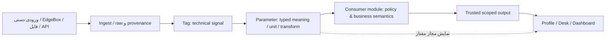

# فکر بلند ۲ — هسته چگونه آینده‌نگر باشد بدون اینکه سنگین شود؟

> **Status:** Reconstructed thinking, not final architecture approval  
> **Owner:** Core design exploration  
> **Sources:** [دفتر فکر بلند واقعی درباره Workspace و چندمسئولیتی](../../source-material/work-12/docs/workstreams/work-12/THINKING-ALOUD.fa.md)، [Product Blueprint](../../source-material/work-12/docs/PRODUCT-BLUEPRINT.md)، [داده و مصرف‌کننده‌ها](../../source-material/work-11/docs/core/DATA-POINTS-AND-CONSUMERS.fa.md)، [Training](../../source-material/work-11/docs/modules/training/PRODUCT.fa.md).  
> **Related:** [ممیزی مرزهای هسته](../../core/CANONICAL-BOUNDARIES.fa.md)، [مسائل باز](../../core/OPEN-QUESTIONS.md)، [فکر بلند ماژول‌ها](01-MODULE-LANDSCAPE-THINKING.fa.md).

## ۱. تنش اصلی

هدف «یک محصول برای همه شرکت‌ها» نیست که همه شرکت‌ها دقیقاً یک گردش کار داشته باشند. هدف، بستر قابل رشد است که **کارگاه کوچک را مجبور به ساختار اداری کارخانه بزرگ نکند** و در عین حال مدل شرکت بزرگ را با فرض‌های کارگاه کوچک مسدود نسازد.

- مشتری کوچک: یک نفر چند مسئولیت، فرم ساده، ثبت دستی، شاید بدون Shift، Order، Data Hub یا چارت سازمانی مفصل.
- مشتری بزرگ: چند سایت/تیم، مسئولیت ماتریسی، سیاست و شواهد کیفیت، دسترسی دامنه‌دار و ماژول‌های تخصصی.
- تصمیم‌های مربوط به قابلیت جاری یک کارخانه در هر Tenant را نباید با نیاز معماری آینده چندسایتی خلط کرد؛ [ممیزی وضع موجود](../../core/IDENTITY-AND-ENTITLEMENTS-AUDIT.fa.md).

**اصل پیشنهادی:** هسته باید نقاط توسعه و قراردادهای لازم را امروز بشناسد، نه اینکه همه نیازهای احتمالی را امروز پیاده کند.

## ۲. نام‌هایی که نباید با هم ادغام شوند

| مفهوم | چرا جدایی مهم است؟ |
|---|---|
| Person | یک شخص می‌تواند بدون Account فعال، در سوابق و شواهد وجود داشته باشد. |
| Account | هویت ورود و امنیت؛ یک نفر چندمسئولیت، لزوماً چند حساب نیست. |
| Organization/Position | ساختار شرکت و عنوان شغلی، نه همان Permission و نه اثبات Qualification. |
| Responsibility/Assignment | نقش یا مأموریت در محدوده و زمان مشخص؛ نیازی به تغییر سمت ثابت ندارد. |
| Permission/Scope | مجوز اجرای اقدام و دسترسی داده، سمت شغلی یا انتخاب میز نیست. |
| Qualification | شایستگی اثبات‌شده با شاهد در دامنه تخصصی؛ به‌تنهایی اجازه سیستم یا ایمنی نمی‌سازد. |
| Work authorization | تصمیم عملیاتی/ایمنی دارای زمینه و قاعده، جدا از قبولی آزمون. |

### ماجرای مأموریت موقت و اصلاح برداشت

در گفتگو درباره فردی با چند کار (مثال عملیاتی و مأموریت کوتاه)، یک گزینه این بود که هنگام ورود Role را عوض کند و برای مأموریت موقت میز/فرایند جدید بسازد. اعتراض مهم این بود که **مسئولیت، دسترسی و محیط نمایش نباید یکی شوند**.

بعد ایده ساده‌تری مطرح شد: بسیاری از کارهای کم‌خطرِ استثنایی، فقط یک ثبت کوتاه در گزارش روزانه لازم دارند؛ برای هر فعالیت موقت موتور Workflow نسازیم. در عین حال نیاز واقعی ایمنی/قانونی/کیفیت را نمی‌توان با سادگی ظاهری حذف کرد. این نتیجه مسیر فکر است، **نه تأیید موتور عمومی مأموریت یا «مجوز ارفاقی»**.

[اصلِ استدلال، اعتراض‌ها، اصلاح برداشت‌ها و سؤال‌های باز](../../source-material/work-12/docs/workstreams/work-12/THINKING-ALOUD.fa.md) در یادداشت دوم حفظ شده است.

## ۳. داده: چرا به Tag، Parameter و Domain Consumer رسیدیم؟

**چرا این تفکیک؟**
- نمایش دمای سالن نباید ماشین یا OP ساختگی لازم داشته باشد؛ Tag الزاماً متعلق به تجهیز نیست.
- یک Tag ممکن است چند مصرف‌کننده و چند نمودار داشته باشد، اما Raw/History بی‌دلیل تکثیر نشود.
- مقدار خام، واحد و بازه کافی نیستند؛ مصرف‌کننده باید قواعد بازه، کیفیت، معنی cumulative در برابر delta و مالکیت تصمیم را بداند.
- ثبت دستی تولید نیاز ندارد برای هماهنگی ظاهری «Tag جعلی» شود.
- داشبورد، داده را از منبع معتبر می‌خواند و نباید با کشیدن Widget، قواعد محاسبه یا مجوز را تغییر دهد.

**راه ناقصِ کنارگذاشته‌شده:** «هر تگ یک پارامتر و هر پارامتر خودش یک KPI/فرم بسازد». دلیل رد: بدون Context، زمان، مالکیت و قواعد دامنه، خروجی صنعتی معتبر نیست. این به معنی رد توسعه فرم‌ها و داشبوردهای قابل تنظیم نیست؛ قرارداد آن‌ها جدا باید طراحی شود.

## ۴. UI: چرا بحث Workspace، میز و داشبورد این‌قدر طول کشید؟

مسیر بحث به‌صورت خلاصه:

1. پوسته سه‌بعدیِ مفید برای پایش سالن کافی نیست تا همه کارکنان عملیات روزانه را انجام دهند.
2. تفکیک تنظیمات، «میز کار» و «نمای جامع» برای مسیرهای کاری متفاوت مطرح شد.
3. یک شخص ممکن است چند مسئولیت و چند میز داشته باشد؛ Workspace یا Desk نباید Role یا مجوز تازه اعطا کند.
4. یک چیدمان می‌تواند مشترک و داده‌های نمایش‌داده‌شده برای هر کاربر وابسته به مجوزش باشد.
5. نیاز به میز صرفاً تحلیلی شبیه Grafana مطرح شد؛ کپی کامل Grafana هدف نیست.
6. 3D می‌تواند نوعی Spatial Visualization باشد؛ نه منبع حقیقت و نه شرط همه ماژول‌ها.
7. Form Builder آزاد بدون Business Logic/Validation خطر ادعای دروغین «پشتیبانی از هر فرآیند» دارد.
8. نتیجه **هنوز قرارداد نهایی UI Plugin نیست**؛ باید با داده و ماژول واقعی آزموده شود.

### تفکیک مشارکت ماژول در UI

| سهم پیشنهادی ماژول | مثال | صاحب منطق |
|---|---|---|
| Profile section | سوابق شایستگی Person | Training |
| Asset section | تعمیرات تجهیز | Maintenance |
| Operational action | ثبت نتیجه تولید | Production |
| Assignment/Inbox | ارزیابی واگذارشده | مالک گردش‌کار |
| Metric widget | OEE یا KPI معتبر | ماژول یا data consumer |
| Configurable desk/dashboard | چیدمانِ مجاز | UI Host، نه مالک شاخص |

این جدول **قرارداد پیشنهادی** است. [UI Contract Draft](../../contracts/UI-CONTRIBUTIONS-DRAFT.md) و [دفتر تاریخی](../../source-material/work-12/docs/workstreams/work-12/THINKING-ALOUD.fa.md) برای جزئیات و اعتراض‌ها هستند.

## ۵. ماژول آموزش محکِ واقعیِ هسته است

یک ماژول Skill Gap نباید مجبور باشد Person جدیدی بسازد یا برای دوره/آزمون یک دستگاه/OP مصنوعی تعریف کند. مسیر «فعالیت → نیاز شایستگی → شواهد فرد → Gap → اقدام یادگیری» در ماژول تخصصی است؛ هسته فقط هویت/دسترسی/Context و قرارداد عمومی داده را پشتیبانی می‌کند.

اما اگر هر فراگیر حساب شخصی موبایل لازم دارد، سیاست ظرفیت Account هسته و Learner Seat با هم برخورد می‌کنند؛ این **موضوع باز تجاری و معماری** است، نه مجوز دورزدن ظرفیت با حساب جعلی. [ممیزی هویت و Seat](../../core/IDENTITY-AND-ENTITLEMENTS-AUDIT.fa.md).

## ۶. دو وسوسه‌ای که رد می‌کنیم، ولی دلیلشان باید بماند

| وسوسه | چرا ناکافی است | پاسخ مرحله‌ای |
|---|---|---|
| ساخت یک هسته عمومی عظیم از ابتدا | پیچیدگی، انتزاع بدون مثال، کندشدن پذیرش کاربران | حداقل Contract عمومی + آزمون ماژول واقعی |
| کدنویسی مستقیم برای فقط CNC و حل همه موارد بعداً | مرزهای Person/Permission/Data به موتور تخصصی قفل می‌شوند | شناسایی فشار ماژول‌های دیگر پیش از تثبیت Contract |
| هر فعالیت به ده‌ها فیلد و گردش نیاز دارد | استفاده واقعی کاهش می‌یابد | پیش‌فرض ساده، قواعد الزامی ریسک‌محور |
| فقط CRUD آزاد و Drag-and-drop کافی است | Context و Domain authorization/validation حذف می‌شود | UI contribution + مالکیت عملیات تخصصی |

## ۷. نتیجه در چه وضعیتی است؟

**جهت طراحی قابل دفاع:** قراردادهای عمومی هسته، ماژول‌های تخصصی مستقل از نظر معنا، داده معنی‌دار، و رابط قابل گسترش.  
**تصویب‌نشده:** شکل نهایی Schema، SDK، Workflow Engine، Form Builder عمومی و نسخه معماری هسته.  
**شرط اثبات:** اتصال حداقل یک ماژول مستقل دیگر به هسته با تست Permission، داده، نصب/غیرفعال‌سازی و UI، نه فقط نمودار.

برای تصمیم جدید از [Core](../../core/README.md)، [Contracts](../../contracts/README.md) و [ADR Registry](../../decisions/README.md) استفاده کنید؛ متن این فایل سند منشأ بحث است.
