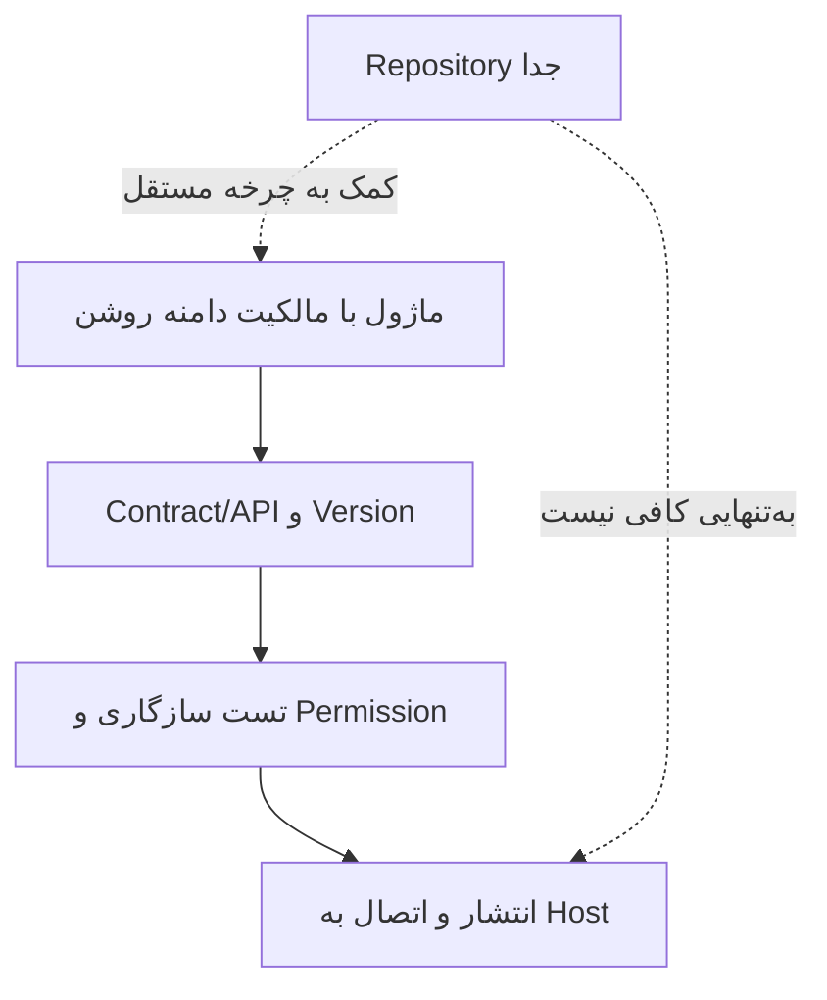

# فکر بلند ۳ — از برنچ‌های متعدد به مخزن اسناد و آزمون مستقل هسته

> **Status:** Mixed — owner-approved documentation-repo decision + reconstructed options still open  
> **Owner:** Product/architecture collaboration thinking · **Updated:** 2026-11-02  
> **Related approved decision:** [ADR-0001](../../decisions/ADR-0001-DOCUMENTATION-REPOSITORY.md)  
> **Related:** [Governance](../../governance/README.md)، [Implementation](../../implementation/README.md)، [Module Contract Draft](../../contracts/MODULE-CONTRACT-DRAFT.md).

## ۱. مسئله از کجا ایجاد شد؟

وقتی طراحی Training، Workspace و هسته روی برنچ‌های متفاوت همان ریپازیتوری کد رشد کردند، این خطر به وجود آمد که:
- منطق هسته، تصمیم‌های دامنه و تاریخچه گفتگو فقط در یک برنچ بماند؛
- Agent دیگری بخش مشابهی را دوباره با فرضیات قبلاً ردشده پیشنهاد کند؛
- Merge کردن «فقط اسناد» ناخواسته به تعارض کد در فایل‌های مشترک تبدیل شود؛
- یک سند بلند فکرکردن، پیدا کردن موضوع تخصصی را برای هر ایجنت پرهزینه کند.

**پرسش:** چه ساختاری اجازه می‌دهد چند نفر یا تیم در آینده هم‌زمان روی حوزه‌های متفاوت کار کنند و منشأ تصمیم‌ها از بین نرود؟

## ۲. گزینه‌هایی که بررسی شدند

| گزینه | چه مشکلی را حل می‌کند؟ | چه مسئله‌ای باقی می‌ماند؟ |
|---|---|---|
| یک ریپازیتوری کد + برنچ دائمی برای هر ماژول | ظاهر جدایی تیم‌ها | ادغام مکرر هسته، نسخه مشترک و history موازی؛ Branch مرز خودکار دسترسی یا انتشار نیست. |
| Monorepo با پوشه‌های ماژول و PR کوتاه‌عمر | تغییرهای Cross-module و تست end-to-end ساده‌تر | چرخه release و استقلال کد ماژول‌ها مشترک‌تر است. |
| Multi-repo برای Core و هر ماژول | release و تاریخچه و تیم‌بندی مستقل | قرارداد نسخه‌دار، تست سازگاری، migration، انتشار و مسئولیت integration لازم است. |
| **ریپازیتوری مستقل اسناد** + کد فعلی تا زمان تثبیت قرارداد | مرجع تصمیم واحد و بدون خطر Merge کد | باید صریحاً به کد و snapshotهای واقعی ارجاع دهد تا drift نکند. |

## ۳. چه چیزی تأیید شد و چه چیزی نشد؟

**تصمیم تأییدشده:** ساخت مخزن `sfp24-architecture` به‌عنوان مرجع دانش، فکر بلند، پژوهش، تصمیم و قراردادهای معماری. این تصمیم در [ADR-0001](../../decisions/ADR-0001-DOCUMENTATION-REPOSITORY.md) ثبت است.

**تصمیم معوق:** جداکردن فیزیکی هر ماژول و هسته به repository مستقل و انتخاب الگوی بسته/SDK. Multi-repo **هدف محتمل و قابل بررسی** است، نه دستور ساخت فوری همه ریپوها.

**توضیح مالک درباره تیم‌ها:** یک Branch می‌تواند محل کار یک نفر **یا یک تیم** باشد. فعلاً فرض عملیاتی این است که صاحب محصول همه کارها را خودش هدایت می‌کند؛ پیچیدگی دسترسی چندتیمی نباید طراحی امروز را منحرف کند.

## ۴. چرا «جداسازی ریپو = ماژولار بودن» نیست؟

اگر Production و OEE در دو مخزن باشند ولی OEE برای هر تغییر مجبور به اصلاح مستقیم جدول‌های Production و `App.vue` هسته باشد، استقلال واقعی حاصل نشده است. برعکس، ماژول می‌تواند مدتی در Monorepo با مرز سرویس/Domain دقیق توسعه یابد و بعد استخراج شود.

پس مقیاسِ تصمیم ما تعداد برنچ‌ها نیست؛ **مالکیت قرارداد، نسخه، داده، Security و تحویل** است.

## ۵. چرا هسته همراه با یک ماژول واقعی توسعه یابد؟

هسته خالی را می‌توان Unit Test کرد، اما بدون مصرف‌کننده مستقل نمی‌توان ثابت کرد سهم رابط، API، Permission، Version، Domain data و lifecycle آن واقعاً مناسب است. پیشنهاد مرحله‌ای:

1. وضع موجود Production را به‌عنوان یک سناریوی واقعی بشناسیم؛ هسته را از روی اسناد صرفاً ساخته‌شده فرض نکنیم.
2. قرارداد حداقلی مشترک را به‌صورت Proposed طراحی کنیم و با OEE/Training/MRP **روی کاغذ تست فشار** کنیم.
3. یک ماژول مستقل واقعی را انتخاب و بخش محدودی از آن را متصل کنیم تا نقاط شکست قرارداد مشخص شود.
4. تغییرهای لازم را به ADR و Contract برگردانیم؛ سپس درباره استخراج repository و SDK تصمیم بگیریم.

**هنوز انتخاب نخستین ماژول برای اجرای این آزمون تأیید نشده است.** Training و OEE هر دو مزایا/ریسک‌های متفاوت دارند.

## ۶. قواعد سندنویسی که همراه این تصمیم آمد

- AGENTS در ریشه مخزن معماری، یک مرجع قواعد؛ برای هر بخش AGENTS دلخواه و متناقض نسازیم.
- READMEهای لایه بالا کوتاه، فقط راهنما و پیوند؛ هر حوزه اسناد خودش را داشته باشد.
- متن اصلی تاریخچه و استدلال‌ها حفظ شود؛ نتیجه نهایی بدون «چرا» کافی نیست.
- تصمیم‌های شکست‌خورده یا ردشده پاک نشوند؛ وضعیت و لینک به جانشین ثبت شود.
- سند تاریخی مصوب در حوزه کوچک با تأیید نهایی قرارداد عمومی هسته یکی نیست.
- برای یک مفهوم دو مرجع مستقل تولید نکنیم؛ سند موضوعی به مرجع مالک لینک دهد.
- راهنماهای عملیاتی Runtime در مخزن کد بمانند؛ مخزن معماری وضعیت کد را با revision/شواهد ثبت می‌کند.

## ۷. چه اشتباه‌هایی نباید تکرار شوند؟

- «هر Branch یک ماژول دائمی» به‌عنوان راه‌حل خودکار تمام Mergeها؛
- کپی همه اسناد قدیمی به‌عنوان قوانین جدید، بدون provenance و تاریخ؛
- تبدیل جدول نام ماژول‌ها به تعهد اجرا؛
- ساخت موتور کامل Plugin قبل از تجربه یک ماژول مستقل؛
- حذف تاریخچه چون تنها نتیجه نهاییِ تمیز لازم است؛
- انتشار Manifest/Contract جدید بدون تست سازگاری و چرخه Migration.

**مرز ثبت:** تاریخ و متن دقیق همه جمله‌های اولیه این گفتگو در فایل منبع واحد موجود نبود؛ این یک **بازسازیِ استدلال‌محور** است. برای ثبت لفظ‌به‌لفظ، transcript واقعی لازم است.

[بازگشت به نقشه گفتگوهای قبلی](README.md) · [تصمیم رسمی ثبت‌شده](../../decisions/ADR-0001-DOCUMENTATION-REPOSITORY.md).
