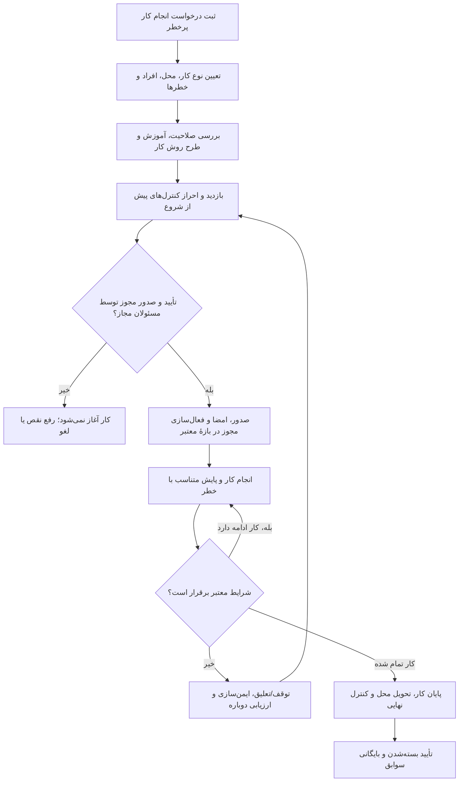

# نظام مجوز انجام کار — Permit to Work (PTW)

**وضعیت:** نامزد طراحی در حوزهٔ **IND-10 — ایمنی، بهداشت و محیط‌زیست (HSE/EHS)**؛ نیاز واقعی یک شرکت در ۲۰۲۶-۱۱-۰۳ ثبت شده، ولی هیچ موتور PTW، قرارداد API، جریان تأیید یا امضای الکترونیکیِ اجرایی برای این ماژول اثبات یا تصویب نشده است. [وضعیت کل محصول](../../STATUS.fa.md).

## هدف

**نظام مجوز انجام کار** یا Permit to Work (PTW) سازوکاری برای درخواست، ارزیابی خطر، آماده‌سازی شرایط، صدور مجوز معتبر، کنترل اجرای کار و بستن و بایگانی فعالیت‌هایی است که **طبق ارزیابی خطر و سیاست محل کار** به کنترل رسمی نیاز دارند. در PTW مشخص می‌شود **چه کاری، کجا، چه زمانی، توسط چه کسانی، با چه خطرات و اقدامات کنترلی و با اختیار چه مرجعی** مجاز است. صدور برگه یا تأیید نرم‌افزاری به‌تنهایی محل کار را ایمن نمی‌کند؛ ارزیابی خطر و اجرای واقعی کنترل‌ها ضروری‌اند. [راهنمای HSE بریتانیا](research/REFERENCES.fa.md#hse-humanfactors)؛ [تعریف و نقش Method Statement](research/REFERENCES.fa.md#hse-coshh).

**جایگاه در SFP24:** موضوع «مجوز کار» از قبل در ردیف [IND-10 فهرست حوزه‌ها](../CATALOG.fa.md) آمده بود، اما برای آن پوشهٔ اختصاصی وجود نداشت. این پوشه، شروع مستندسازی تخصصی PTW به‌عنوان **زیرحوزه یا نامزد ماژول مستقل در خانوادهٔ HSE** است؛ اینکه بعدها یک ماژول قابل خرید مستقل باشد یا زیرمجموعهٔ HSE، هنوز تصمیم نشده است.

## سناریوی مرجعِ بیان‌شده توسط شرکت

در مجموعه‌ای که کار پرخطر به کارکنان یا پیمانکاران واگذار می‌شود، مجری باید آموزش و صلاحیت مرتبط داشته باشد؛ مسئول یا ناظر مجاز شرایط اجرا را بررسی کند؛ خطرها، اقدامات ایمنی و **شرح روش انجام کار** (Method Statement) مشخص شوند؛ پس از تأیید و صدور مجوز، کار فقط در محدودهٔ مجاز شروع شود؛ حین کار پایش و بازدیدهای برنامه‌ریزی‌شده ثبت شوند؛ و در پایان پس از کنترل تحویل و اطمینان از وضعیت ایمن، مجوز با ثبت تأییدها بسته و بایگانی شود.

**مثال‌های شرکت:** کار در ارتفاع، بازکردن یا کار روی خطوط حاوی مواد شیمیایی پرخطر، حفاری و کار گرم. در شرح نیاز «ده فعالیت پرخطر» آمده است، ولی **فهرست دقیق آن ده مورد ارائه نشده**؛ ما عدد ده را به‌عنوان تعداد ثابت در نرم‌افزار یا الزام جهانی استاندارد ثبت نمی‌کنیم. دسته‌بندی باید متناسب با شرکت، حوزهٔ قضایی، سایت، ارزیابی خطر و نوع کار قابل تعریف باشد.

**خواستهٔ شرکت دربارهٔ تناوب بازدید:** ناظر در حین اجرای کار «هر دو ساعت» شرایط را بازبینی کند. این **یک نیاز پیشنهادی همان سناریو** است، نه قاعدهٔ جهانی PTW: برای برخی کارها، پایش پیوسته یا تناوب کوتاه‌تر لازم است. در آینده باید نوع کنترل، فاصلهٔ بازدید، نظارت مستمر، شروع مجدد، خطر و قوانین محل اجرا تعیین‌کننده باشند. [OSHA برای فضای بسته](research/REFERENCES.fa.md#osha-confined) نمونه‌ای از تناوب وابسته به خطر را مشخص می‌کند.

## جریان پیشنهادی برای بررسی؛ نه قرارداد اجرایی

**توضیح:** این فلوچارت **تصویر مفهومی** از نیاز ثبت‌شده است. ترتیب نهایی و تفکیک مسئولان صدور، اجرا، نظارت، کنترل مستقل، تعلیق، تمدید و بستن باید با متخصص HSE شرکت و ضوابط محل بررسی شوند. برای خطرات خاص، وظایف ناظر حاضر در محل یا پایش پیوسته را نمی‌توان با «ثبت بازدید هر دو ساعت» جایگزین کرد.

## اطلاعات و شواهد موردنیاز برای طراحی

| مرحله | داده یا شاهد احتمالی | موضوع باز |
|---|---|---|
| درخواست | نوع فعالیت، هدف، محل/سایت/تجهیز، مجری/پیمانکار، زمان و مدت | چه کسی می‌تواند درخواست یا اصلاح کند؟ |
| پیش‌شرط | ارزیابی خطر، آموزش/شایستگی، آشنایی با خطر، روش کار و نسخهٔ معتبر، تجهیزات حفاظتی، اقدامات ایزوله‌سازی یا مجوزهای وابسته | شواهد از ماژول آموزش می‌آیند یا مستقل ثبت و تأیید می‌شوند؟ |
| بازدید پیش از صدور | چک‌لیست ویژهٔ خطر، آزمون‌ها/اندازه‌گیری‌های لازم، وضعیت محل، امضای بازرسان/صادرکنندگان | نقش و استقلال تأییدکنندگان چگونه تعیین می‌شود؟ |
| صدور | شماره و نسخهٔ مجوز، مسئول صدور، دارندگان مجوز، دامنه و زمان اعتبار، شرط توقف/لغو | امضای دیجیتال/الکترونیکی چه الزام حقوقی و هویتی دارد؟ |
| اجرا و پایش | زمان شروع، وضعیت اجرای کار، بازدیدها، شواهد شرایط محیطی، رخداد و اقدام، تحویل شیفت | بسامد/نوع پایش خطرمحور؛ پیشنهاد دو ساعت مربوط به نیاز فعلی شرکت |
| تغییر، وقفه یا وضعیت ناایمن | علت تعلیق، افراد مطلع، اصلاح شرایط، ارزیابی مجدد و تأیید ادامه | تمدید، تعلیق، انقضا و صدور مجدد چه قاعده‌ای دارند؟ |
| پایان و بایگانی | کنترل نهایی محل، وضعیت ایمن تجهیزات، تأیید تحویل، بسته‌شدن با زمان و افراد، سوابق غیرقابل حذف پنهانی | مدت نگهداری، نسخه‌پذیری و الزامات قانونی بر اساس محل |

## نقش‌ها و ارتباط با هسته و ماژول‌های دیگر

**نقش‌های محتمل، نه نقش‌های قطعی نرم‌افزار:** درخواست‌دهنده، مسئول محل/دارایی، صادرکنندهٔ مجوز، ناظر ایمنی، مسئول اجرا/سرپرست پیمانکار، افراد مجری و مسئول بستن مجوز. تفکیک مسئولیت‌ها و شرایط امضای هر نقش باید بر اساس خطر و سیاست شرکت تأیید شود؛ یک شخص ممکن است چند مسئولیت داشته باشد اما جداسازی وظایف ضروری نباید دور زده شود.

- **هویت، شرکت، مجوز و سایت:** از [قواعد هسته](../../core/IDENTITY-AND-ACCESS.fa.md) استفاده شود؛ مجوز انجام کار PTW با Permission نرم‌افزاری، حق ورود به سایت یا صلاحیت آموزشی یک مفهوم نیست.
- **آموزش و شایستگی:** شواهد صلاحیت/آموزش می‌توانند از [ماژول آموزش](../training/README.md) بیایند؛ نبود خرید LMS نباید الزاماً PTW را ناممکن کند، اما احراز صلاحیت ایمنی همچنان ضروری است.
- **نگهداری و تعمیرات:** دستورکار تعمیر می‌تواند به PTW ارجاع دهد، ولی دستورکار تعمیراتی خودکار مجوز کار پرخطر ایجاد نمی‌کند. [نگهداری](../maintenance/README.md).
- **تجهیزات، تگ و دادهٔ سنسور:** اندازه‌گیری معتبر ممکن است به کنترل‌های HSE کمک کند؛ مقدار تگ به‌تنهایی گواه ایمن بودن شرایط نیست. [داده و پارامتر](../../core/DATA-AND-PARAMETERS.fa.md).
- **مستندات، پیمانکار و فضای کار:** نسخهٔ روش کار، امضا، محدودهٔ پیمانکار، دسترسی و نمایش مجاز باید در جای مالک اصلی خود باقی بمانند. [قواعد فضای کاری](../../core/WORKSPACES.fa.md).
- **مرز اجرا:** فرم و نمودار یا هوش مصنوعی به‌تنهایی نه مجوز معتبر صادر می‌کند، نه امضای قانونی را تضمین می‌کند، نه کنترل خطر را جایگزین می‌شود.

## مسیرهای مستندات این ماژول

| برای چه کاری؟ | از کجا شروع کنم؟ |
|---|---|
| پیدا کردن فکر اولیه، منشأ نیاز و وضعیت گفتگو | [فهرست سوابق و اتاق فکر](RECORDS.md) و [ثبت نیاز واقعی](journal/2026-11-03-ptw-company-need.fa.md) |
| فهم اصطلاحات PTW، نقش‌ها، روش کار و مرزهای ایمنی | [دانش دامنه PTW](research/PTW-KNOWLEDGE.fa.md) |
| خواندن منابع اولیه و تفکیک منبع از الزام داخلی شرکت | [منابع و شواهد](research/REFERENCES.fa.md) |
| پژوهش‌های تخصصی آینده | [فهرست تحقیق](research/README.md) |
| آزمایش‌ها و شکست‌های واقعی بعدی | [دفتر آزمایش‌ها](experiments/README.md) |
| تصمیم‌های تأیید یا ردشده | [فهرست تصمیم‌ها](decisions/README.md) |
| درخواست اتصال به بخش دیگر | [فهرست درخواست‌ها](requests/README.md) |
| کار قابل برنامه‌نویسی پس از تأیید | [فهرست پیاده‌سازی](implementation/README.md) |

## سؤال‌های باز قبل از هر طراحی اجرایی

1. حوزهٔ قضایی، صنعت، محل فعالیت و سیاست موجود شرکت چیست؟ آیا الگو یا فرم PTW فعلی دارند؟
2. کدام فعالیت‌ها واقعاً در «ده مورد» مدنظر شرکت قرار می‌گیرند و ریسک و کنترل هرکدام چیست؟
3. چه صلاحیت، آموزش، حضور فیزیکی، ناظر مستقر یا پایش محیطی برای هر نوع کار لازم است؟
4. از نقش‌های درخواست‌کننده، ارزیاب، صادرکننده، ناظر و اجراکننده، کدام جداسازی اجباری است؟
5. چه وقایع یا تغییراتی مجوز را معلق، باطل یا نیازمند صدور مجدد می‌کند؟
6. کنترل هم‌زمانی مجوزهای مرتبط و تداخل کار پیمانکاران یا کار در یک تجهیز چگونه انجام شود؟
7. شکل و اعتبار حقوقی امضا، تحویل شیفت، انقضا، بستن و نگهداری مدارک چیست؟
8. آیا PTW بستهٔ انتخابی مستقل است یا بخشی از ماژول بزرگ‌تر HSE؟ این موضوع هنوز باز است.

**گام بعدی:** اعتبارسنجی سناریوی واقعی با مسئول HSE، فرم مجوز و روش اجرایی شرکت، تعیین قوانین حاکم و مستندسازی نیازهای تخصصی؛ سپس در صورت تأیید، قرارداد، آزمایش و پیاده‌سازی. صرف ایجاد این پوشه هیچ مجوز اجرای کار پرخطر یا ساخت قابلیت نرم‌افزاری صادر نمی‌کند.
