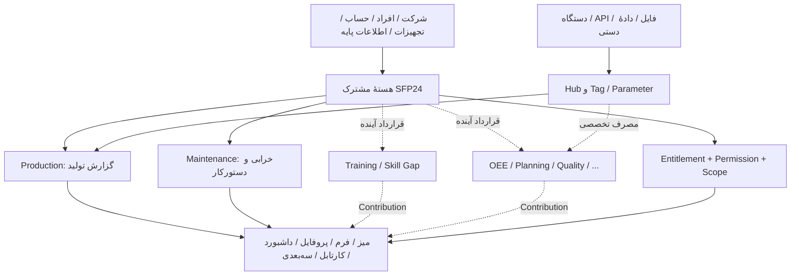

# SFP24 — راهنمای مفهومیِ صاحب محصول: چه می‌سازیم، اجزایش چه هستند و اکنون کجای مسیر ایستاده‌ایم؟

**تاریخ تدوین:** ۱۶ آبان ۱۴۰۵ / ۷ نوامبر ۲۰۲۶  
**نوع نوشته:** راهنمای توضیحی و جمع‌بندیِ وضعیت؛ مناسب صاحب محصول و همکار تازه‌وارد  
**وضعیت:** **پیش‌نویس برای بررسی**؛ نه ADR مصوب، نه سند قرارداد نهایی، نه دستور تغییر کد  
**منشأ:** گفت‌وگوی صاحب محصول، اسناد موجود پروژه و گزارش‌های تحویل پایلوت. این متن «توضیح و بازسازی آموزشی» است، نه رونوشت لفظ‌به‌لفظ گفتگو.  
**اسناد مبنا:** مخزن `hossein-aghaie/sfp24-architecture`، شاخهٔ `docs/recovered-session-core-workspace-2026-11-05` در کامیت `4410858b8f17aa8adad5d13b87a10eb12518a001`.  
**وضعیت کد هنگام ثبت این پیش‌نویس:** `hossein-aghaie/pouyeshgar-workshop`، شاخهٔ `codex/core-module-pilot-v1`، PR شمارهٔ ۱ با وضعیت Open/Draft و head مشاهده‌شدهٔ `93f9a2046ad1e36c5a3d72d78d6b1ecb1a046c56`. شاخهٔ این PR بر پایهٔ `codex/04-core-workspaces-dashboard` در commit `5c7ac617f95ee8b84cbd32d7fa8e7474a073ec97` قرار دارد. صاحب محصول اعلام کرده کار Codex تمام شده است؛ **نتیجهٔ آن هنوز در این نوشته ارزیابی نشده و باید جداگانه با گزارش، diff و آزمون قابل مشاهده بررسی شود**.

> **نکتهٔ مهم دربارهٔ واژهٔ «نهایی»:** ثبت‌شدن فایل در GitHub به معنی تصویب معماری نیست. اسناد متعدد هنوز `Proposed` یا `Draft` هستند. بخشی از Production و Maintenance واقعاً پیاده‌سازی و آزمایش شده است؛ اما موتور عمومی نصب ماژول‌ها، تجربهٔ نهایی اتاق/میز و توسعه‌پذیری کامل هنوز اثبات نشده‌اند.

## ۱. SFP24 را در یک دقیقه چطور معرفی کنیم؟

SFP24 قرار است **بستر ماژولار مدیریت عملیات شرکت‌ها** باشد؛ نه فقط برنامهٔ ثبت تولید، نه صرفاً سیستم تعمیرات، نه فقط داشبورد و نه نسخه‌ای از SCADA یا Home Assistant. یک کارگاه کوچک می‌تواند فقط ثبت دستی تعداد تولید و ضایعات بخواهد؛ یک شرکت بزرگ ممکن است نگهداری و تعمیرات، آموزش، کیفیت، برنامه‌ریزی، OEE، دریافت داده از دستگاه‌ها و گردش‌های تأیید پیچیده نیاز داشته باشد.

در هر دو حالت، شرکت و افراد و تجهیزات و حق دسترسی را یک‌بار در بخش مشترک تعریف می‌کنیم. ماژول‌ها داده‌ها و عملیات تخصصی خود را اضافه می‌کنند. سپس نرم‌افزار با توجه به مجوز، خرید شرکت، مسئولیت هر فرد و تنظیمات میز/صفحه، فقط آنچه لازم است نشان می‌دهد.

**هدف معماری:** افزوده‌شدن یک ماژول معمول نباید هر بار ما را مجبور به بازنویسی گستردهٔ هسته کند. این یک **هدف برای اثبات تدریجی** است، نه قابلیتی که اکنون کامل شده باشد.

### مثال: دو شرکت با یک نرم‌افزار

- **کارگاه کوچک:** یک مدیر که خودش برنامه و تعمیر را هم انجام می‌دهد، دو اپراتور، دو ماشین؛ شاید بدون برنامهٔ رسمی و بدون سنسور. اپراتور فقط «ثبت تولید»، «اعلام مشکل»، «سوابق من» را می‌بیند.
- **کارخانهٔ بزرگ:** چند سایت، چند بخش، چند نقش، دادهٔ دستگاه، دستورکار تعمیر، دو بازبین مستقل، آموزش و کنترل کیفیت. هر شخص متناسب با مسئولیت و مجوز خود میز، کارتابل و گزارش دارد.

نباید فرض کنیم هر کارگاه کوچک یک روز باید به شکل شرکت بزرگ برسد. این‌ها **دو مدل استفادهٔ متفاوت** از یک بستر هستند.

## ۲. تصویر کلی سیستم



این نمودار **هدف مفهومی** را نشان می‌دهد. خط‌چین یعنی اتصال یا قابلیت عمومی لزوماً ساخته نشده است.

## ۳. واژه‌ها، به زبان ساده

### ۳.۱. هسته، ماژول، قابلیت و رجیستری

| واژه | معنای ساده | یک مثال |
|---|---|---|
| **Core / هسته** | امکانات مشترکی که ماژول‌های مختلف دوباره نسازند | شرکت، افراد، حساب، مجوز، فهرست تجهیزات، امکانات مشترک نمایش |
| **Module / ماژول** | بخش تخصصی با داده و قانون خودش | Production مالک گزارش تولید است؛ Maintenance مالک دستورکار تعمیر است |
| **Domain / دامنهٔ تخصصی** | جهانِ مفاهیم و قوانین یک نوع کار | در تعمیرات، خرابی و دستورکار؛ در آموزش، ارزیابی و صلاحیت |
| **Domain Record / رکورد تخصصی** | یک پروندهٔ واقعی که ماژول مسئول آن است | گزارش تولید، درخواست خرابی، ارزیابی آموزشی |
| **Capability / قابلیت** | یک کار مشخص که ماژول می‌تواند ارائه کند | «ثبت گزارش تولید» یا «مشاهدهٔ سابقهٔ تجهیز» |
| **Module Registry / رجیستری** | فهرست مورداعتمادِ ماژول‌ها، قابلیت‌ها و اتصال‌هایشان | هسته می‌فهمد ماژول Maintenance چه Action یا نمایی معرفی می‌کند |
| **Contract / قرارداد** | قول دقیق دربارهٔ ورودی، خروجی، مالکیت، خطا و مجوز میان دو بخش | درخواست ثبت خرابی با شناسهٔ تجهیز و شرح، خروجیِ شناسهٔ درخواست |

**احتیاط:** تعریف ماژول در Registry به‌تنهایی کد، جدول، فرم یا APIِ آن را تولید نمی‌کند. نصب مستقل همهٔ ماژول‌ها و SDK عمومی هنوز از مسائل باز است.

### ۳.۲. شرکت و انسان: Person، Account، Position، Seat، Qualification

| واژه | معنای ساده | فرق مهم |
|---|---|---|
| **Tenant / شرکت** | مرز مستقل داده و تنظیمات شرکت | شرکت A حق دیدن پرونده‌های شرکت B را ندارد |
| **Person / شخص** | پروندهٔ یک انسان در شرکت | حتی ممکن است حساب ورود به نرم‌افزار نداشته باشد |
| **Account / حساب** | نام کاربری و هویت ورود | یک شخص ممکن است مسئولیت‌های متعدد داشته باشد ولی یک حساب کافی است |
| **Position / عنوان شغلی** | عنوان سازمانی مثل سرپرست | عنوان به‌تنهایی مجوز نرم‌افزاری یا صلاحیت واقعی نیست |
| **Assignment / انتساب** | اینکه چه کاری/سمتی در چه محدوده و زمانی به شخص سپرده شده | ممکن است موقت یا چندگانه باشد؛ قرارداد عمومی تاریخ‌دار هنوز کامل نشده |
| **Qualification / صلاحیت** | اثبات تخصصی اینکه فرد برای فعالیت مشخص، با شروط و شواهد معتبر، شایستگی دارد | داشتن Permission در نرم‌افزار با بلدبودن کار روی CNC فرق دارد |
| **Seat / ظرفیت حساب** | واحد شمارش/سهمیهٔ استفاده از حساب یا سرویس طبق سیاست محصول | «صندلی» در این بحث **میز کار گرافیکی نیست**. سیاست تجاری Seat فراگیران هنوز باز است |

مثال: یک فرد هم مدیر است و هم تعمیرکار. در سناریوی مناسب می‌تواند **یک Person و یک Account** داشته باشد، دو مسئولیت بگیرد و فقط Actionهای مجاز خود را انجام دهد. اگر سیاست تعمیر حساس دو بازبین مستقل بخواهد، دو عنوانِ همین یک نفر جای دو انسان مستقل را نمی‌گیرد.

### ۳.۳. خرید، مجوز، محدوده و آمادگی

- **Entitlement:** آیا این شرکت حق استفاده از ماژول/قابلیت را دارد؟ مانند خرید یا فعال‌سازی داخلی آن.
- **Readiness:** آیا خود قابلیت از نظر توسعه و عرضه آماده است؟ برای مثال Maintenance هنوز با `pilot_only` شناخته می‌شود.
- **Permission:** آیا این حساب حق انجام این کار را دارد؟ مثل ثبت یا تأیید خرابی.
- **Scope:** این مجوز **روی کدام قسمت** معتبر است؟ فقط دستگاه CNC-01، کل سالن یا تمام سایت.
- **Authorization:** بررسی عملی این موارد در سمت سرور؛ پنهان‌کردن دکمه به‌تنهایی امنیت نیست.

ممکن است شرکت Maintenance داشته باشد، اما اپراتور فقط اجازهٔ «اعلام خرابی» داشته باشد و نتواند دستورکار دیگران را تأیید کند.

### ۳.۴. اتاق، Workspace، میز و اجزای نمایش

| واژه | معنای ساده | وضعیت مفهومی |
|---|---|---|
| **Workspace / فضای کاری** | محیط کلی برای نوعی کار: وظایف روزمره، مدیریت، تحلیل | در کد فعلی چند فضای فنی داریم؛ معنای نهایی «اتاق» تصویب نشده |
| **Room / اتاق کاری** | استعاره‌ای برای مجموعه‌ای از میزها و ابزارهای در دسترس | هنوز **فرضیهٔ طراحی** است؛ موجودیت نهایی تثبیت‌شده نیست |
| **Desk / میز کار** | چیدمان ابزارها و کارهایی که کاربر باید ببیند | میز ذخیره و به حساب تخصیص داده می‌شود |
| **Desk Definition / تعریف میز** | دستور ساختِ یک میز: اسم، محتوای منتخب، ترتیب، دامنه و تنظیمات | نباید حاوی مجوزهای امنیتی جدید یا SQL دلخواه باشد |
| **Layout / چیدمان** | هر بخش در کدام قسمت و با چه تقدم و اندازه‌ای ظاهر شود | فقط ظاهر و ترتیب را تعیین می‌کند؛ قانون تخصصی را نمی‌سازد |
| **Widget / ابزار نمایشی** | یک عنصر کوچک یا بزرگ کاربردی در صفحه | کارت تعداد تولید، دکمهٔ اعلام خرابی، جدول کارتابل |
| **UI Contribution / مشارکت نمایشی ماژول** | بسته‌ای که ماژول به نرم‌افزار معرفی می‌کند تا در جای مجاز نمایش داده شود | مثل «فرم درخواست خرابی» متعلق به Maintenance یا «شایستگی» متعلق به Training |
| **Context / زمینهٔ کار** | اطلاعاتی که معلوم می‌کند کاربر *اکنون* با چه شخص، تجهیز، سایت، شیفت و کاری سروکار دارد | فرم نباید بی‌دلیل همه را دوباره بپرسد؛ Context مجوز هم نیست |
| **Form / فرم** | روشی برای گرفتن دادهٔ لازمِ یک عمل | فرم ثبت تولید یا ثبت شواهد؛ همهٔ فرم‌ها الزاماً با فرم‌ساز عمومی ساخته نمی‌شوند |
| **Profile / پرونده یا نمای موجودیت** | نمایش اطلاعات مربوط به شخص، تجهیز یا موضوع دیگر | Training می‌تواند بخش شایستگی شخص را اضافه کند؛ Maintenance سابقهٔ تجهیز را |
| **Dashboard / داشبورد** | نمایش خلاصه، روندها و شاخص‌ها با منبع معتبر | نمایش عدد، خودش به معنی محاسبهٔ معتبر OEE نیست |
| **Inbox / کارتابل** | فهرست کارهایی که برای اقدام به فرد رسیده است | با Notification و با خود Work Order فرق دارد |
| **3D / نمای سه‌بعدی** | نمایش و انتخاب مکانی تجهیزات و وضعیت‌های مجاز | یک شیوهٔ نمایش است؛ خودِ ماژول تعمیرات یا Permission نیست |

**نکتهٔ کلیدی:** لازم نیست هر قابلیت داخل یک کارت کوچک جا شود. برنامه‌ریزی می‌تواند Gantt یا صفحهٔ تمام‌صفحه داشته باشد، آموزش یک محیط درس و آزمون، و تعمیرات فرم‌های تخصصی. میز می‌تواند راه ورود به این ابزارها باشد، نه اینکه تمام آن‌ها را از نو بسازد.

### ۳.۵. Studio، Preview و Runtime

- **Studio / میزساز:** محیط **مدیر مجاز** برای تعریف و تنظیم میز؛ شبیه ویرایشگر.
- **Preview / پیش‌نمایش:** نشان می‌دهد همان میز چطور دیده خواهد شد؛ از دادهٔ شبیه‌سازی‌شده استفاده می‌کند و **ثبت عملیاتی واقعی نمی‌کند**.
- **Runtime / اجرای واقعی:** صفحه‌ای که **اپراتور یا کاربر واقعی** می‌بیند. اطلاعات را از دادهٔ شرکت می‌خواند و در صورت مجوز، Action واقعی را انجام می‌دهد.
- **User Runtime:** همان اجرای واقعی، از دید حسابی که وارد شده؛ اصطلاح یک محصول یا ماژول جدا نیست.

**مثال:** مدیر در Studio دکمهٔ بزرگ «ثبت تولید» را بالا و «سوابق من» را پایین می‌گذارد. Preview باید تقریباً همین تجربه را نشان دهد. اپراتور در Runtime هم **همان چیدمان** را ببیند، اما با دستگاه‌ها و گزارش‌های واقعی خودش.

**موضوعی که باید در تحویل بررسی شود:** در تجربهٔ قبلی، Studio Preview و Runtime نتیجهٔ یکسان و قابل اتکایی به کاربر نشان نمی‌دادند و تجربهٔ اپراتور Mihan نامنسجم گزارش شد. اصلاح این اختلاف بخشی از کار Codex بوده است؛ اما بسته‌شدن PR یا سبزشدن تست‌ها به‌تنهایی اثبات نمی‌کند که کاربر در Runtime واقعی، با حساب و دادهٔ قابل مشاهده، همان تجربهٔ درست را دریافت می‌کند.

### ۳.۶. Query، Action، Event، Task و Approval

| واژه | توضیح بی‌اصطلاح | مثال |
|---|---|---|
| **Query** | درخواست خواندن اطلاعات بدون تغییر عملیات | «تعداد تولید این شیفت چند بوده؟» |
| **Action** | درخواست انجام یک تغییر واقعی از ماژول مسئول | «این خرابی را ثبت کن» |
| **Event** | خبر ثبت‌شده از اتفاقی که رخ داده | «دستورکار تعمیر ایجاد شد» |
| **Task** | کاری که یک فرد یا گروه باید انجام دهد | «سرپرست، این خرابی را بررسی کن» |
| **Decision / Approval** | تصمیم ثبت‌شده نسبت به موضوع و نسخهٔ مشخص طبق سیاست معتبر | «شواهد تعمیر را تأیید کردم» |
| **Workflow** | ترتیب و قواعد پیشروی کار، اصلاح، تأیید یا بستن پرونده | از اعلام خرابی تا ارجاع و تحویل |
| **Notification / اعلان** | اطلاع به شخص دربارهٔ رخداد یا کار | «درخواست شما بسته شد»؛ اعلان خودش Task نیست |
| **Audit / سابقهٔ قابل رسیدگی** | چه کسی، چه زمانی، چه تغییری با چه دلیل و شواهدی ثبت کرده است | پرونده‌ای که ممیز بعداً بتواند مرور کند |

مهم: `Task completed` به‌تنهایی به معنی «تعمیر درست انجام شد» نیست؛ `Approval` به‌تنهایی همیشه به معنی «اکنون اجرای کار مجاز است» نیست. نتیجهٔ واقعی را قانون ماژول صاحب عملیات تعیین می‌کند. در کارگاه ساده ممکن است طبق سیاست شرکت ثبت مستقیم با شاهد کافی باشد و Task/Approval ساختگی اصلاً لازم نباشد.

### ۳.۷. دادهٔ دستگاه: Source، Hub، Tag و Parameter

- **Source / منبع:** دستگاه، Gateway، API، فایل یا ورودی دستی که داده از آن می‌آید.
- **Data Hub / هاب داده:** لایهٔ دریافت، شناسایی، ثبت و انتقال امن داده.
- **Tag / تگ:** شناسهٔ فنیِ یک سیگنال خام یا ارتباط با دستگاه؛ به زمان، کیفیت، نوع و جهت نیاز دارد.
- **Parameter / پارامتر:** معنای قابل مصرف برای شرکت، مثل «تعداد تولید ماشین ۱» با واحد، تبدیل و منبع معلوم.
- **Domain Record:** نتیجهٔ رسمی یک عملیات مثل «گزارش نهایی ۷ سالم و ۱ ضایعه»، نه صرفاً مقدار Tag.
- **Computed Output:** عدد محاسبه‌شده طبق روش و بازهٔ مشخص، مثل یک شاخص.

```
دستگاه / فایل / API ──> Data Hub ──> Tag ──> Parameter
                                              │
ورود دستی گزارش ──────────────────────────────┼──> منطق ماژول Production ──> گزارش معتبر
                                              │                                  │
                                              └──> نمایش مجاز                   └──> میز/گزارش/داشبورد
```

**قانون مهم:** نرسیدن داده «صفر تولید» نیست؛ قطع شبکه لزوماً «توقف دستگاه» نیست؛ شمارندهٔ خام به‌تنهایی سالم/ضایعات یا قطعه/OP را معلوم نمی‌کند. Tag خروجی و فرمان واقعی به دستگاه هم موضوع ایمنی و قرارداد جداست؛ پیاده‌سازی عمومی کامل آن را آماده فرض نکنیم.

## ۴. وقتی ماژول جدید نصب یا فعال شود، هسته و فرم‌ها چه می‌کنند؟

این همان مسئله‌ای است که دربارهٔ فیلدهای بیشترِ Person، تجهیزات و شرکت پرسیده شده بود. **جواب یک روش واحد برای تمام نیازها نیست.** دست‌کم سه حالت داریم:

### حالت الف: استفاده از اطلاعات مشترک موجود

ماژول ثبت تولید از شخص، شرکت، تجهیز، محصول و عملیات (OP) تعریف‌شده **در صورت نیاز و مطابق قواعد همان قابلیت** استفاده می‌کند. نباید همهٔ شرکت‌ها را از روز اول مجبور به تعریف ده‌ها فیلد مربوط به تمام ماژول‌ها کنیم.

### حالت ب: اضافه‌شدن فیلد به یک موجودیت موجود

مثلاً ماژول خاصی به یک مشخصهٔ اضافی روی «تجهیز» احتیاج دارد. در کد موجود سازوکاری مانند `masterDefinitionExtensions` و تعریف نیاز `requiredFor` داریم تا فیلدهای معتبرِ متعلق به ماژول برای فرم و اعتبارسنجی معرفی شوند. هسته فیلد را در محل مناسب نشان می‌دهد؛ سرور نیز نوع، اجازه و نحوهٔ ذخیرهٔ واقعی را کنترل می‌کند.

این راه به معنی آن نیست که هر مشتری بتواند با یک JSON دلخواه ستون دیتابیس یا کد اجرایی تولید کند. سازوکار قابل اعتماد، نسخه‌دار و آزموده‌شده لازم است.

### حالت ج: یک پروندهٔ مستقل متعلق به ماژول

**مثال مهارت:** «صلاحیت شخص برای کار با CNC» یک وضعیت سادهٔ متنی روی فرم Person نیست؛ نسخهٔ معیار، شواهد ارزیابی، Scope و اعتبار زمانی دارد. در سناریوی آموزش، **ماژول Training (یا مرجع معتبر صلاحیت که محصول تعیین می‌کند) مالک پروندهٔ Qualification است** و می‌تواند بخش مجازی از آن را در پروفایل همان Person نمایش دهد. هسته Person دوم نمی‌سازد.

**مثال حقوق:** اگر ماژول محاسبهٔ بهای تمام‌شده به حقوق نیاز داشت، نباید حقوق محرمانه را بی‌ملاحظه در فرم عمومی افراد به همه نشان دهیم. احتمالاً داده و مجوز تخصصی مالی/منابع انسانی و یک Query محدود لازم است. محل قطعی ذخیره‌سازی و قرارداد هنوز باید جدا بررسی شود.

**مثال خرابی:** در مرزبندی پایلوت، Maintenance مالک رکوردها و چرخهٔ تخصصی Maintenance Request و Work Order است. می‌تواند بخش «سابقهٔ خرابی» را در پروفایل تجهیز نمایش دهد؛ خودِ تجهیز را دوباره در ماژول تعریف نمی‌کند.

**نتیجه:** اطلاعات اولیه تا جای ممکن مشترک و کمینه‌اند، اما نیازهای ماژول‌ها در زمان مناسب با سه راه «مصرف دادهٔ موجود»، «توسعهٔ معتبر فیلد» یا «رکورد مستقل ماژول» پاسخ داده می‌شوند.

## ۵. یک جریان واقعیِ بسیار ساده

### شرکت کوچک؛ ثبت دستی

۱. مدیر شرکت و افراد و ماشین را تعریف می‌کند.  
۲. ماژول Production برای شرکت فعال و ثبت گزارش برای اپراتور مجاز می‌شود.  
۳. مدیر یک میز ساده می‌سازد و به حساب اپراتور می‌دهد.  
۴. اپراتور وارد Runtime می‌شود، ماشین/کار را انتخاب می‌کند و ۷ سالم و ۱ ضایعه ثبت می‌کند.  
۵. فرم با **Action معتبر** گزارش را به Production می‌فرستد. Production رکورد رسمی و سابقهٔ قابل پیگیری می‌سازد.  
۶. اپراتور در «سوابق من» نتیجه را با **Query مجاز** می‌بیند.  
۷. اگر خرابی رخ دهد، با Action جدا به Maintenance گزارش می‌دهد؛ رفع مستقیم، فقط اگر سیاست معتبر شرکت اجازه دهد.

### کارخانهٔ بزرگ؛ تعامل ماژولی و تأیید

۱. اپراتور خرابی را روی تجهیز شناخته‌شده اعلام می‌کند.  
۲. Maintenance مالک درخواست است و در صورت نیاز Task برای سرپرست ایجاد می‌شود.  
۳. سرپرست با Scope و Permission معتبر ارجاع می‌دهد؛ تعمیرکار کار و شاهد انجام را ثبت می‌کند.  
۴. اگر سیاست `factory_review` اعمال شود، بازبین فنی ممکن است اصلاح بخواهد؛ نسخهٔ جدید دستورکار دوباره بررسی می‌شود.  
۵. شخصی مستقل تأیید تحویل را ثبت می‌کند. ماژول تصمیم می‌گیرد چه زمانی WorkOrder واقعاً بسته شود.  
۶. Event به اعلان و کارتابل می‌رسد؛ مدیر خلاصهٔ مجاز را روی داشبورد می‌بیند.  
۷. اگر بعدها Training وصل شد، «صلاحیت تعمیرکار» می‌تواند یکی از پیش‌شرط‌های معتبر اقدام باشد؛ **این پیوندِ عمومی هنوز باید طراحی و اثبات شود**.

## ۶. اکنون چه چیز قطعی است، چه چیز در پایلوت اجرا شده و چه چیز باز مانده؟

| موضوع | وضعیت در زمان تدوین | معنای عملی |
|---|---|---|
| تعریف SFP24 برای طیف مختلف شرکت‌ها | جهت محصول ثبت‌شده | مبنای تصمیم‌هاست، نه ادعای پوشش کامل بازار |
| شرکت، حساب، مجوز، تعاریف پایه، ثبت تولید | پیاده‌سازی موجود با دامنه و محدودیت | قابل آزمون؛ نیازمند حفظ سازگاری |
| تعریف، نسخه‌بندی و تخصیص میز | وجود دارد؛ تجربهٔ اجرا در حال اصلاح | سازندهٔ کاملِ همهٔ تجربه‌ها هنوز نیست |
| Maintenance، Task و Approval پایلوت | کد در شاخهٔ `codex/core-module-pilot-v1` و PR #1 (باز و Draft؛ head `93f9a204`)؛ گزارش آزمون باید مستقل بازبینی شود | عرضهٔ عمومی `ready` یا سیستم کامل CMMS/PTW محسوب نمی‌شود |
| UI Contributions و Registry | بخشی پیاده؛ اتصال عمومی هنوز کامل نیست | افزودن ماژول جدید ممکن است فعلاً تغییر Host بخواهد |
| اتاق/Room، Dashboard Builder عمومی، Runtime افزونهٔ مستقل | باز/پیشنهادی | مدل نهایی و SDK تصویب و اثبات نشده |
| Training/Skill Gap عملیاتی کامل، OEE کامل، MRP/Planning | طرح/نیاز یا کار جدا با دامنه‌های متفاوت | آمادهٔ استفادهٔ عمومی فرض نشوند |
| سه‌بعدی | بخش‌هایی از صحنه و لایه‌ها موجود | همهٔ لایه‌های تخصصی به ماژول واقعی وصل نیستند |
| اتصال منبع، تگ و پارامتر | پیاده‌سازی محدود | مصرف عمومی همهٔ ماژول‌ها و خروجی فرمان واقعی کامل نیست |
| قرارداد عمومی بین‌ماژولی و انتشار مستقل ماژول | Draft/Open | پیش از تبدیل به پایهٔ همهٔ ماژول‌ها نیازمند تصمیم و آزمون مستقل |

**وضعیت Git در زمان ثبت این پیش‌نویس:** اسناد معماریِ مورد استناد در شاخهٔ `docs/recovered-session-core-workspace-2026-11-05` با commit `4410858` قرار دارند و بسیاری `Proposed` یا `Draft` هستند. در مخزن کد، PR #1 روی شاخهٔ `codex/core-module-pilot-v1` باز و Draft است؛ head آن `93f9a204` و base آن `codex/04-core-workspaces-dashboard` با commit `5c7ac617` است. کار Codex طبق اعلام صاحب محصول تمام شده، اما خروجی آن هنوز از نظر کد، محیط اجرا و آزمون انسانی ارزیابی نشده است. **این جدول پس از بررسی شواهد باید به‌روزرسانی شود.**

## ۷. پس چرا پایلوت ساختیم و الان باید چه کنیم؟

هدف پایلوت این نبود که تمام SFP24 تمام شود؛ می‌خواستیم چند فرضیهٔ مهم را با کار واقعی آزمایش کنیم: یک اپراتور ساده، یک کارخانهٔ با تأیید چندمرحله‌ای، دو شرکت جدا، ثبت تولید و خرابی، مجوز و کارتابل. در این مسیر کشف کردیم درستی Backend لزوماً تجربهٔ قابل‌فهم برای کاربر تولید نمی‌کند. اختلاف Studio Preview و Runtime و بعضی اتصال‌های ثابت Host شواهد واقعیِ این محدودیت‌اند.

**ترتیب پیشنهادی ادامه، پس از تحویل Codex (که پایان آن اعلام شده، اما نتیجه هنوز بررسی نشده است):**

۱. **دیدن و آزمودن توسط صاحب محصول در همان Start-All روزمره:** بررسی میز اپراتور Mihan و گردش Demo Factory؛ نه تکیه به تصویر یا PASS صرف.  
۲. **تفکیک نتیجهٔ آزمایش:** درستی Domain و امنیت، سلامت قراردادهای معماری، و قابلیت استفادهٔ انسانی سه نتیجهٔ مستقل‌اند.  
۳. **بازبینی مستقل معماری با کد جدید و اسناد مرجع:** نیازهای ماژول‌های متفاوت را به Core/Module/UX و مسائل باز Q01–Q11 نگاشت کنیم؛ بدهی‌های خطرناک را اولویت بدهیم.  
۴. **تصمیم‌گیری صاحب محصول دربارهٔ قراردادهای مشترکِ باز:** از جمله Room/Desk، Form/Profile/Dashboard Contributions، Task/Event و نصب/نسخه‌بندی ماژول. تصمیم‌های پذیرفته‌شده در ADR و سند مالک ثبت شوند؛ Proposal را خودکار مصوب اعلام نکنیم.  
۵. **سامان‌دهی ساختار کد و مستندات با دلیل فنی:** نه Refactor گسترده فقط برای زیباترشدن درخت پوشه‌ها.  
۶. **انتخاب یک آزمون معماریِ متفاوت:** مثلاً Training/Skill Gap برای Person و Qualification و Profile یا OEE برای دادهٔ زمانی/Tag و Parameter؛ اول برای آزمودن قرارداد، بعد توسعهٔ ماژول کامل.

**حکم اجرایی فعلی:** Codex کار را تمام‌شده اعلام کرده و PR #1 هنوز Open/Draft است. تا دریافت و بررسی گزارش، diff، شواهد محیط و آزمون انسانی، Merge، Deploy یا بازآرایی موازی آغاز نشود. بررسی این تحویل به‌خودی‌خود مجوز تغییرات تازهٔ کد نیست.

## ۸. در کدام مخزن چه چیزی باید ثبت شود؟

- **مخزن معماری:** هدف محصول، تعریف مفاهیم، دلیل تصمیم‌ها، قراردادهای مشترک و پرسش‌های باز. تحلیل گفتگو در Journal و تصمیم واقعاً تصویب‌شده در ADR/سند مرجع قرار گیرد.
- **مخزن کد:** قرارداد اجراییِ همان نسخه، migration، تست، گزارش QA، دستور اجرا و شواهد Screenshot واقعی. نباید نسخهٔ دوم و مستقل چشم‌انداز محصول باشد.

**جای پیشنهادی همین راهنما در مخزن معماری، پس از تأیید مالک:** `docs/reference/SFP24-CONCEPTS-AND-PLATFORM-EXPLAINER.fa.md` یا یک صفحهٔ قابل دسترس از `docs/START-HERE.md`. در صورتی که مرجع جدید ایجاد شود، باید فهرست `docs/START-HERE.md` یا `docs/core/README.md` به آن لینک دهد. این راهنما **جایگزین** اسناد تخصصی هویت، داده، Workspace و Draftها نمی‌شود؛ آن‌ها منابع دقیق و واحد حقیقت همان موضوع می‌مانند.

**جای تحلیلِ آسیب‌شناسی پایلوت و استمرار تصمیم‌ها:** [نقطهٔ استمرار و آسیب‌شناسی پایلوت](../journal/2026-11-07/PLATFORM-CONTINUITY-AND-PILOT-LESSONS.fa.md). این نوشتهٔ آموزشی و آن سندِ تحلیلی دو مسئولیت جدا دارند. سند تحلیلی بازسازیِ صریحاً برچسب‌خورده از شواهد موجود است، نه transcript لفظ‌به‌لفظ.

## ۹. لینک‌های واقعی GitHub برای مطالعهٔ بیشتر

همهٔ لینک‌های زیر به snapshot معماری `4410858b...` می‌روند؛ ممکن است نسخه‌های بعدی داشته باشند.

- [راهنمای شروع کل مخزن](https://github.com/hossein-aghaie/sfp24-architecture/blob/4410858b8f17aa8adad5d13b87a10eb12518a001/docs/START-HERE.md)
- [نقشهٔ کلی هسته و ماژول‌ها](https://github.com/hossein-aghaie/sfp24-architecture/blob/4410858b8f17aa8adad5d13b87a10eb12518a001/docs/core/PLATFORM-MAP.md)
- [هویت، Person، Account، Seat، Permission و Scope](https://github.com/hossein-aghaie/sfp24-architecture/blob/4410858b8f17aa8adad5d13b87a10eb12518a001/docs/core/IDENTITY-AND-ACCESS.fa.md)
- [Tag، Parameter، Source و Data Hub](https://github.com/hossein-aghaie/sfp24-architecture/blob/4410858b8f17aa8adad5d13b87a10eb12518a001/docs/core/DATA-AND-PARAMETERS.fa.md)
- [اتاق، میز، داشبورد و سه‌بعدی](https://github.com/hossein-aghaie/sfp24-architecture/blob/4410858b8f17aa8adad5d13b87a10eb12518a001/docs/core/WORKSPACES.fa.md)
- [گسترش ورودی‌های موجودیت با ماژول‌ها](https://github.com/hossein-aghaie/sfp24-architecture/blob/4410858b8f17aa8adad5d13b87a10eb12518a001/docs/core/EXTENSIONS.fa.md)
- [پیش‌نویس مشارکت ماژول در UI](https://github.com/hossein-aghaie/sfp24-architecture/blob/4410858b8f17aa8adad5d13b87a10eb12518a001/docs/contracts/UI-CONTRIBUTIONS-DRAFT.md)
- [پیش‌نویس تعامل ماژول‌ها، Task، Action و Approval](https://github.com/hossein-aghaie/sfp24-architecture/blob/4410858b8f17aa8adad5d13b87a10eb12518a001/docs/contracts/DOMAIN-INTERACTION-CONTRACT-DRAFT.md)
- [پیشنهاد پایلوت Production و Maintenance و حدود آن](https://github.com/hossein-aghaie/sfp24-architecture/blob/4410858b8f17aa8adad5d13b87a10eb12518a001/docs/implementation/core-module-pilot-v1/README.md)
- [مسائل باز هسته](https://github.com/hossein-aghaie/sfp24-architecture/blob/4410858b8f17aa8adad5d13b87a10eb12518a001/docs/core/OPEN-QUESTIONS.md)
- [Draft PR کد و وضعیت توسعهٔ واقعی](https://github.com/hossein-aghaie/pouyeshgar-workshop/pull/1)

---

**خلاصهٔ نهایی برای جلسهٔ معرفی:** SFP24 یک هستهٔ مشترک برای شرکت، افراد، تجهیزات، دسترسی و اتصال داده می‌خواهد. هر ماژول مالک کار تخصصی خودش است. ماژول با قرارداد معتبر، اطلاعات و ابزارهای لازم را به سیستم معرفی می‌کند. نمایش این ابزارها در میز، صفحه، پروفایل، داشبورد و سه‌بعدی با زمینهٔ کار و مجوز کنترل می‌شود. Production و Maintenance پایلوت نخست این ایده‌اند؛ تجربهٔ فعلی UI مشکلاتی را آشکار کرده، اما این مشاهده به‌تنهایی نه شکست معماری را ثابت می‌کند و نه سلامت Backend را. قرارداد همهٔ ماژول‌های آینده هنوز نهایی نشده و باید بر اساس شواهد، تصمیم و آزمون مستقل تثبیت شود.