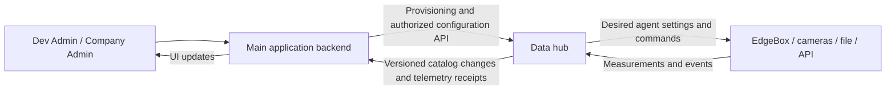

# سند هماهنگی هاب و برنامهٔ اصلی

تاریخ: ۲۰۲۶-۱۰-۱۸ — **پیشنهاد قرارداد اتصال؛ پیاده‌سازی و اتصال واقعی نیست.**

این سند پس از توضیح مالک دربارهٔ Dev Admin و Company Admin نوشته شده است. سشن برنامهٔ اصلی باید وضعیت واقعی کد و قواعد دامنه را تأیید کند. هیچ فایل، دیتابیس، حساب، سرویس یا سخت‌افزار برنامهٔ اصلی برای تهیهٔ این سند بررسی یا تغییر داده نشده است.

## ۱. الان چه چیزی موجود است؟

مرجع کد اجرایی بررسی‌شده: `11a74137a9ba235628fa01c5b92eaf94d9398225` در مخزن خصوصی `hossein-aghaie/pouyeshgar-industrial-platform`.

| موجود در آزمایش محلی                                                                                         | هنوز موجود نیست                                                                             |
| ------------------------------------------------------------------------------------------------------------ | ------------------------------------------------------------------------------------------- |
| Node 24.19.0، TypeScript، Fastify 5، Vue 3؛ هاب و شبیه‌ساز در دو فرایند مستقل                                | اتصال به برنامهٔ اصلی، همگام‌سازی شرکت/کاربر/ماژول و SSO                                    |
| شرکت محلی، owner/company_admin/viewer، دستگاه با کلید مستقل، تعریف سیگنال در دستگاه                          | مجوزهای ظریف منطبق بر Dev Admin و لایسنس‌های برنامهٔ اصلی                                   |
| HTTP و MQTT 3.1.1، ورود CSV/XLSX، دریافت دوره‌ای API، کد اتصال MariaDB آزمایشی                               | API مدیریتی سرویس‌به‌سرویس، provisioning خودکار و مجوز یکپارچه                              |
| سیگنال scalar از نوع number/boolean/string؛ gauge/minute_delta/cumulative/state؛ حداکثر۶۴ تعریف در هر دستگاه | signal_id مستقل، نسخه‌بندی تعریف، چرخهٔ غیرفعال‌سازی سیگنال، کاتالوگ مشترک و اعلان تغییر آن |
| timestamp دارای timezone، زمان دریافت مستقل، ثبت اتمیک نمونه/رسید/صف در SQLite مستقل                         | قرارداد رویداد ساختاریافتهٔ هشدار، تشخیص اپراتور و بازرسی قطعه                              |
| تشخیص تکرار و تعارض، صف ارسال با شناسهٔ ثابت و retry/receipt؛ گیرندهٔ محلی آزمایشی                           | نگاشت معتبر سیگنال به ماشین/منبع با بازهٔ اعتبار و اتصال به OP                              |
| قالب عمومی v1؛ adapter شکل دادهٔ processed_count دقیقه‌ای بر اساس گزارش تحویلی قبلی                          | آزمون واقعی adapter با گیرندهٔ برنامهٔ اصلی یا مصرف گزارش تولید                             |
| فرمان وضعیت/فاصلهٔ ارسال/توقف و ادامهٔ جمع‌آوری، ACK و نتیجه؛ شبیه‌ساز۵۰دستگاهی                              | پیکربندی desired/reported پایدار و نسخه‌دار، رفتار تأییدشدهٔ عامل واقعی                     |
| راهنمای گرافیکی، پنل دوزبانه، تاریخچهٔ مرورگر، Start/Stop ویندوز                                             | استقرار لینوکس، TLS عمومی، HA، نگهداری و پاکسازی دوره‌ای، کنترل ماشین فیزیکی                |

فیلد اختیاری `appBinding` در schema دستگاه، صرفاً جای نگهداری metadata است؛ اعتبارسنجی دامنه، نگاشت سیگنال و مسیریابی واقعی به resource را اجرا نمی‌کند. API فعلی مدیریت، session-based است و نباید بدون تغییر به‌عنوان API مدیریتی سرویس‌به‌سرویس استفاده شود.

تعریف سیگنال فعلی یک آرایه در رکورد دستگاه و با key محلی است؛ جایگزینی/ویرایش آن ممکن است، اما revision و اعلان تغییر مستقل ندارد. adapter دقیقه‌ای فعلی فقط کلید دقیق `processed_count` را انتخاب می‌کند؛ دو کانال `count_output_a/b` با معنی مشترک خودکار به آن تبدیل نمی‌شوند. پشتیبانی generic scalar از یک مقدار، جای قواعد دامنه و receiver ساختاریافتهٔ برنامهٔ اصلی را نمی‌گیرد.

قرارداد واقعاً موجود: [API.md](API.md). اجرای محلی: [RUNBOOK.fa.md](RUNBOOK.fa.md). این سند، پشتیبانی ساختاریافتهٔ دوربین یا synchronization را به نسخهٔ فعلی نسبت نمی‌دهد.

## ۲. مرجع هر موجودیت و محل کار کاربر

| موضوع                                                          | مرجع پیشنهادی                                          | رابط اصلی کاربر                                                                                        |
| -------------------------------------------------------------- | ------------------------------------------------------ | ------------------------------------------------------------------------------------------------------ |
| شرکت تجاری، فعال/تعلیق/حذف، سقف اپراتور، ماژول خریداری‌شده     | Dev Admin برنامهٔ اصلی                                 | همان Dev Admin                                                                                         |
| حساب و دسترسی مدیر شرکت                                        | احراز هویت برنامهٔ اصلی                                | همان برنامهٔ اصلی؛ رمزها به هاب کپی نمی‌شوند                                                           |
| کارخانه، سایت، ماشین/resource، اپراتور، شیفت، OP و گزارش نهایی | Company Admin و قواعد برنامهٔ اصلی                     | همان Company Admin                                                                                     |
| اتصال EdgeBox، کلید فنی دستگاه، کانال و تعریف سیگنال           | هاب؛ با رعایت مجوز و شرکتِ اعلام‌شده توسط برنامهٔ اصلی | صفحهٔ «اتصال داده» در برنامهٔ اصلی که از backend با هاب صحبت می‌کند؛ پنل هاب برای تنظیمات فنی/عیب‌یابی |
| معنی مصرف سیگنال و انتخاب ماشین/منبع و OP                      | برنامهٔ اصلی                                           | Company Admin با مجوز مربوط                                                                            |
| دریافت، اعتبارسنجی، تاریخچهٔ خام، صف و رسید تحویل              | هاب                                                    | نمایش خلاصه در برنامهٔ اصلی و تشخیص فنی در هاب                                                         |

پیشنهاد تجربهٔ کاربری: کاربر مجبور به ساخت دوبارهٔ شرکت یا ورود با حساب جدا در دو محصول نشود. اگر ورود مستقیم پنل هاب لازم شد، واگذاری هویت/SSO کوتاه‌عمر و دارای محدودهٔ شرکت باید جدا طراحی شود؛ اشتراک جدول کاربران یا انتقال رمز راه‌حل نیست.

هر فیلد فقط یک مرجع نوشتن داشته باشد. نمایش یک نسخهٔ محلی از نام شرکت در هاب، مالکیت شرکت را به هاب منتقل نمی‌کند. تغییر از دو رابط، اگر مجاز باشد، باید به همان API مرجع برسد؛ دو دیتابیس نباید دو نظر مستقل دربارهٔ یک فیلد داشته باشند.

## ۳. شرکت‌ها چگونه به هاب می‌رسند؟

پیشنهاد مراحل آینده:

۱. Dev Admin شرکت را در برنامهٔ اصلی می‌سازد؛ شناسهٔ ثابت همان برنامه مرجع است.
۲. backend اصلی در همان تراکنش تغییر شرکت، یک پیام provisioning در outbox خودش ثبت می‌کند.
۳. worker اصلی با هویت سرویس و مجوز محدود، درخواست idempotent ایجاد/به‌روزرسانی رکورد فنی را به هاب می‌رساند.
۴. هاب شناسهٔ اصلی و شناسهٔ محلی خود را با نگاشت یکتا ذخیره و رسید ثبت برمی‌گرداند. نام شرکت کلید ارتباط نیست.
۵. نتیجه در رابط اصلی «اعمال‌شده / در انتظار / خطا» نمایش داده می‌شود. کاربر دکمهٔ Sync نمی‌زند.

در قطع ارتباط، درخواست گم نمی‌شود و دوباره ارسال می‌شود. برای شرکت‌های قدیمی ابتدا snapshot مجاز، سپس تغییرات پس از cursor دریافت شود. نسخه یا ترتیب تغییرات باید مانع بازنویسی وضعیت جدید با پیام قدیمی شود. ایجاد مجدد یک نام نباید شناسه و دادهٔ شرکت حذف‌شده را تصاحب کند.

تعلیق باید سمت API اصلی بلافاصله مجوز را ببندد و در هاب نیز بعد از اعمال وضعیت، کلید/اتصال و تحویل را محدود کند. برای فاصلهٔ زمانی قطعی شبکه باید سیاست روشنِ اعتبار snapshot مجوز و fail-closed تعیین شود؛ «تعلیق آنی در تمام سرویس‌های قطع‌شده» ادعای قابل اتکا نیست. حذف تجاری به معنی پاک‌کردن فوری تاریخچهٔ فنی نیست؛ tombstone، حفظ ارجاعات و سیاست نگهداری جدا لازم است.

## ۴. کانال تنظیمات و کانال داده جدا هستند



این نمودار طراحی آینده است. اکنون APIهای provisioning، catalog changes، SSE و گیرندهٔ عمومی برنامهٔ اصلی ایجاد یا متصل نشده‌اند.

- تنظیمات کم‌تغییر: API بین backendها + اعلان تغییر دارای `event_id`، `entity_id` و `revision` + outbox/inbox و پردازش idempotent.
- تله‌متری: MQTT پایدار یا HTTP از عامل به هاب؛ ارسال batch مجاز از هاب به API اصلی؛ تأیید بعد از commit.
- اعلان رابط کاربری: پیشنهاد SSE از backend اصلی به مرورگر، با بازخوانی فقط بخش تغییرکرده. SSE reconnect و Last-Event-ID دارد؛ بازیابی پیام از cursor به نگهداری سمت سرور هم نیاز دارد. مرجع: [WHATWG](https://html.spec.whatwg.org/multipage/server-sent-events.html).
- پس از reconnect، تغییرات جاافتاده با cursor و در صورت نیاز snapshot جبران شوند. اتصال زنده به‌تنهایی جای ثبت پایدار را نمی‌گیرد.
- جدول مشترک بین دو برنامه یا خواندن مستقیم دیتابیس یکدیگر لازم نیست. هرکدام DB خودشان را دارند؛ برنامهٔ اصلی در صورت نیاز یک نمای محلی خواندنی از catalog هاب نگه می‌دارد.

نسخهٔ فعلی پنل هاب هر۵ثانیه bootstrap می‌خواند؛ این روش نمونهٔ فعلی است، نه طراحی نهایی همگام‌سازی بین دو محصول. برای مقیاس اولیه پیشنهاد راه‌اندازی Kafka/NATS/Redis جدید نداریم؛ ظرفیت باید پس از اتصال واقعی سنجیده شود.

## ۵. نگاشت باید تا سطح سیگنال باشد

هویت‌ها جدا بمانند:

- `company_id`: شناسهٔ مرجع شرکت در برنامهٔ اصلی؛ نگاشت آن به شناسهٔ مستقل هاب ثبت شود.
- `device_id`: رکورد فنی EdgeBox یا منبع ورودی؛ لزوماً معادل یک ماشین نیست.
- `signal_id`: شناسهٔ ثابتِ کانال/سیگنال در هاب، مستقل از عنوان نمایشی؛ **باید اضافه شود**.
- `signal_key`: کلید فنی مثل `count_output_a`؛ تغییر عنوان آن را عوض نمی‌کند.
- `semantic`: معنی توافق‌شده مثل `production.processed_count`؛ **باید اضافه شود**.
- `resource_id` و OP: متعلق به برنامهٔ اصلی؛ نتیجهٔ نگاشت معتبر، نه حدس فرستنده.

رابط پیشنهادی: `(company_id, signal_id, effective_from, effective_to) → resource_id + نقش مصرف`.

یک EdgeBox می‌تواند برای دو ماشین یا دو نقطهٔ یک ماشین سیگنال بفرستد. حتی اگر فعلاً فقط یک ماشین دارد، مبنا را صرفاً device→machine قرار ندهیم. دو شمارنده نباید خودکار جمع شوند: باید معلوم شود مستقل‌اند، ورودی/خروجی‌اند یا دو حسگر تکراری برای همان قطعه؛ سیگنال مرجع و قانون ترکیب را برنامهٔ اصلی تعیین می‌کند.

بازهٔ اعتبار نگاشت با **زمان رویداد** ارزیابی شود؛ دادهٔ دیررس پس از جابه‌جایی حسگر نباید به ماشین جدید نسبت داده شود. revision معتبر باید قابل بازیابی باشد. سیگنال بی‌نگاشت یا تعریف نامعلوم به حالت نیازمند بررسی برود؛ به شرکت یا ماشین پیش‌فرضی سرازیر نشود.

## ۶. مثال سیگنال‌ها و رویدادهای خواسته‌شده

نام‌های جدول زیر **نمونهٔ پیشنهادی قرارداد بعدی** هستند، نه سیگنال‌های از قبل پیاده‌شدهٔ دوربین.

| کلید نمونه             | معنی مصرف                          | شکل دادهٔ موردنیاز                                                                | نکته                                                                          |
| ---------------------- | ---------------------------------- | --------------------------------------------------------------------------------- | ----------------------------------------------------------------------------- |
| `count_output_a`       | `production.processed_count`       | delta صحیح غیرمنفی، واحد pcs، ابتدا/انتهای دقیقه، timezone                        | همین دقیقه؛ نه شمارندهٔ تجمعی و نه قطعهٔ سالم                                 |
| `count_output_b`       | همان معنی یا معنی مستقلِ توافق‌شده | همان شکل + signal_id مستقل                                                        | نگاشت/منبع مرجع جدا؛ جمع خودکار ممنوع                                         |
| `machine_alarm`        | `machine.alarm`                    | alarm_code، رخداد باز/رفع، alarm_instance_id، زمان و شدتِ اعلام‌شده               | خرابی یا علت توقف از count حدس زده نشود                                       |
| `operator_observation` | `operator.observed`                | شناسهٔ کاندید اپراتور از مرجع اصلی، confidence، camera/source، observation_id     | مشاهدهٔ دوربین به‌تنهایی انتساب شیفت، OP یا حضور رسمی نیست                    |
| `part_inspection`      | `quality.part_inspected`           | inspection_id، part_id در صورت وجود، pass/reject/unknown، defect_code، confidence | چند فریم یک قطعه نباید چند ضایعات ایجاد کند؛ تصمیم گزارش رسمی با برنامهٔ اصلی |

استنتاج تصویر روی EdgeBox/سرویس بینایی انجام شود. هاب رویداد نتیجه را حمل کند؛ پیش‌فرض، انتقال و تحلیل ویدئو یا تصویر خام در هاب نیست. مدل، confidence threshold، نسبت مشاهده به اپراتور اصلی و سیاست تأیید کسب‌وکار باید مشخص شوند. ایجاد اپراتور جدید از تشخیص دوربین انجام نشود.

در نسخهٔ فعلی scalarهای ساده قابل دریافت‌اند، ولی encodeکردن JSON دوربین داخل یک string معادل پشتیبانی درست از رویداد نیست. برای هشدار/دوربین، schema ساختاریافته و اعتبارسنجی/تکرارگیری/نگهداری متناسب باید اضافه شود.

## ۷. نمونهٔ envelope بعدی — DRAFT، نه API موجود

برای شمارش، شکل پیشنهادی زیر باید با گیرندهٔ اصلی نهایی شود؛ `schema_version: 2` هنوز پشتیبانی نمی‌شود:

```json
{
  "schema_version": 2,
  "event_id": "<stable-hub-event-uuid>",
  "company_id": "<main-company-uuid>",
  "hub_company_id": "<hub-company-id>",
  "device_id": "<edgebox-id>",
  "signal_id": "<stable-signal-uuid>",
  "signal_key": "count_output_a",
  "semantic": "production.processed_count",
  "definition_version": 3,
  "source_event_id": "<stable-edge-event-id>",
  "event_time": "2026-10-18T10:00:00Z",
  "received_at": "2026-10-18T10:01:02Z",
  "period": {
    "start": "2026-10-18T10:00:00Z",
    "end": "2026-10-18T10:01:00Z"
  },
  "data": { "delta": 12, "unit": "pcs" }
}
```

شناسهٔ resource در این مثال عمداً از هاب حدس زده نشده است؛ backend اصلی آن را از نگاشت معتبر استخراج می‌کند. اگر بعداً لازم شد binding_id/revision در مسیر رفت‌وبرگشت حمل شود، مرجع آن و اعتبارسنجی سمت گیرنده باید توافق شود. آیا timestamp شمارش ابتدای بازه است یا انتهای آن، باید برای همهٔ ورودی‌ها صریح و یکسان باشد؛ تغییر معنای نسخهٔ فعلی بدون adapter مجاز نیست.

گیرنده شرکت را علاوه بر body با مجوز سرویس، نگاشت معتبر و قرارداد مقصد تطبیق دهد؛ تکیه به company_id ارسالی کافی نیست. تکرار event_id نباید گزارش را دوباره مصرف کند. رسید ورودی، ثبت پایدار، تحویل، و مصرف در گزارش تولید چهار حالت متفاوت‌اند.

برای عقب‌افتادگیِ داده، event_id، source_event_id، زمان منبع و تعریف معتبر حفظ شوند. در نسخهٔ فعلی دریافت، هویت دقیقه‌ای بر مبنای شرکت+دستگاه+کلیدسیگنال+دقیقه است و تحویل با event_id هاب تکرارگیری می‌شود. قرارداد جدید باید مسیر ارتقا و حفظ این رفتار را روشن کند، نه اینکه آن را ناخواسته دور بزند.

## ۸. تغییر دستگاه، سیگنال و بازهٔ ارسال

- ثبت دستگاه جدید: API مرجع هاب، با actor/شرکت/مجوزِ تأییدشده از backend اصلی؛ کلید فنی جدا و قابل ابطال.
- تعریف سیگنال: signal_id پایدار، key، عنوان، type، unit، semantic، aggregation و revision. فهرست اصلی با اعلان خودکار به‌روز شود.
- تغییر عنوان: صرفاً نمایش؛ نگاشت‌ها و تاریخچه خراب نشوند. تغییر type/unit/معنی، تغییر ناسازگار و نیازمند نسخهٔ تعریف جدید است.
- غیرفعال‌سازی/حذف: رکورد و ارجاع تاریخی حفظ شود؛ پذیرش/تحویل جدید مطابق سیاست متوقف یا نگه داشته شود. حذف فیزیکی تاریخچه عملیات جداست.
- تغییر مستقیم در پنل فنی هاب، اگر مجاز شد، همان اعلان نسخه‌دار را منتشر کند؛ رابط اصلی به‌روز شود. ویرایش از برنامهٔ اصلی نیز از API مرجع هاب عبور کند.
- سیگنال تازه می‌تواند در فهرست اصلی خودکار ظاهر شود؛ ولی انتخاب ماشین، معنای مصرف یا تأیید signal ناشناخته ممکن است به تصمیم Company Admin نیاز داشته باشد. این «تصمیم دامنه» است، نه دکمهٔ دستی sync.
- همگام‌سازی دوطرفه برای همهٔ فیلدها پیشنهاد نمی‌شود؛ فقط انتقال تغییر از مرجع هر فیلد به خوانندگان آن. revision/optimistic concurrency مانع overwrite و حلقهٔ اعلان شود.

چهار فاصلهٔ زمانی را یکی نکنیم:

| تنظیم                | نمونه/معنی                                                                         |
| -------------------- | ---------------------------------------------------------------------------------- |
| sampling / inference | خواندن حسگر یا فریم دوربین در لبه                                                  |
| aggregation window   | بازهٔ حساب‌کردن delta؛ برای شمارش این قرارداد۶۰ثانیه                               |
| publish interval     | هر چند وقت بسته‌های آماده به هاب ارسال شوند؛ یک بسته می‌تواند چند نمونه داشته باشد |
| delivery / UI update | زمان batch و تحویل به backend اصلی و اعلان وضعیت به مرورگر                         |

تغییر publish از۶۰ به۵ثانیه به معنی تغییر پنجرهٔ یک‌دقیقه‌ای نیست. count نهاییِ یک دقیقه قبل از پایان آن دقیقه آماده نیست؛ هشدار و مشاهدهٔ دوربین نباید الزاماً منتظر بستهٔ دقیقه‌ای بمانند. تغییر نمونه‌برداری دوربین یا مدل از قابلیت‌های فرمان interval فعلی نتیجه نمی‌شود.

برای پیکربندی ماندگار، desired config و reported/applied revision پیشنهاد می‌شود. عامل آنلاین خودکار اعمال و ACK کند؛ عامل آفلاین آخرین revision را پس از reconnect بگیرد. رابط «در انتظار/اعمال‌شده/ناموفق» نشان دهد. فرمان فعلی set_interval با TTL۱۲۰ثانیه، به‌تنهایی این تضمین پیکربندی ماندگار را ندارد.

## ۹. شروط طراحی و موارد لازم از سشن اصلی

الزامات هاب در قرارداد مشترک: جداسازی شرکت، شناسهٔ ثابت، زمان و بازهٔ صریح، حفظ صفر، جلوگیری از دوباره‌شماری، رسید بعد از commit، نسخه‌بندی تعریف و عدم کنترل مستقیم ماشین. اینها محدودیت vendor نیستند؛ برای جلوگیری از انتساب اشتباه و گزارش تکراری‌اند.

سشن اصلی باید بر اساس کد واقعی پاسخ دهد:

۱. شناسه‌ها و چرخهٔ عمر company/site/resource/operator/OP و قواعد حذف/تعلیق دقیقاً چیست؟
۲. نقش‌های Dev Admin/Company Admin و entitlement ماژول‌ها چگونه سمت backend اعمال می‌شوند؟ محدودیت اپراتور چه نسبتی با مشاهدهٔ دوربین دارد؟
۳. کدام روش machine authentication و واگذاری مجوز tenant/actor مناسب است؟ SSO جداگانه لازم است یا UI اصلی کافی است؟ توکن یا رمز واقعی ارسال نشود.
۴. چه APIهای موجودی واقعاً این قالب‌ها را می‌پذیرند؟ گیرندهٔ شمارش فعلی با گیرندهٔ عمومی رویداد یکسان فرض نشود؛ schema و پاسخ sanitized بدهد.
۵. نگاشت signal_id→resource و بازهٔ اعتبار آن کجا ذخیره می‌شود؟ قانون دو شمارنده، تأخیر، تعارض، بازپخش و اصلاح داده چیست؟
۶. هشدار، مشاهدهٔ اپراتور و نتیجهٔ بازرسی چه اثر مجازی بر OP/شیفت/گزارش دارند؟ هیچ اثر خودکاری بدون قاعدهٔ صریح فرض نشود.
۷. تأخیر قابل قبول هر نوع داده، مدت قطعی قابل تحمل، نرخ/حجم، نگهداری و سقف منابع چیست؟ «کمترین سربار/بیشترین تازگی» بدون این بودجه‌ها SLA نیست.
۸. ظرفیت API برای batch، receipt بعد از commit، inbox idempotent و outbox تغییرات تنظیمات چیست؟ آیا SSE موجود است؟

انتخاب نهایی مشترک است: سشن اصلی قواعد دامنه و مرز مجوزها را تعیین کند؛ سشن هاب دریافت، registry، پایداری و قرارداد فنی طرف خود را طراحی کند. همسان‌کردن دیتابیس یا ارتقای runtime برنامهٔ اصلی پیش‌شرط اتصال نیست؛ Node24 این هاب، الزام خود هاب است.

## ۱۰. مسیر اجرا پس از توافق

۱. قرارداد و ماتریس دسترسی را نهایی و schema/receiptها را در هر دو repo یکسان ثبت کنیم.
۲. با گیرندهٔ ساختگی و شرکت مصنوعی، provisioning و اعلان catalog را تست کنیم؛ سپس یک سیگنال یک‌دقیقه‌ای را از ابتدا تا مصرف دامنهٔ ساختگی دنبال کنیم.
۳. lifecycle، signal-level binding، schema versioning و desired/applied config را اضافه کنیم؛ وضعیت‌های معلق در UI روشن باشند.
۴. هشدار و رویدادهای دوربین را پس از تعریف schema و قواعد کسب‌وکار اضافه کنیم؛ inference در لبه بماند.
۵. در محیط آزمایشی جدا، قطع شبکه، چندبار تحویل، تغییر نگاشت وسط بازه، شرکت تعلیق‌شده، پیام قدیمی تنظیمات، حذف سیگنال، دادهٔ دیررس، مجوز بین شرکت‌ها و batch/rate را آزمایش کنیم. منابع در حالت بیکار/اوج/بار واقعی اندازه‌گیری شوند.
۶. اتصال برنامهٔ اصلی یا محیط واقعی فقط پس از اجازهٔ مشخص مالک و برنامهٔ rollback؛ تهیهٔ این سند اجازهٔ تغییر آن محیط نیست.

## متن کوتاه برای فرستادن به سشن برنامهٔ اصلی

> هاب مستقل در مخزن خصوصی hossein-aghaie/pouyeshgar-industrial-platform آمادهٔ آزمایش محلی است. ابتدا README، docs/API.md، docs/ADR-001-COMPANY-OWNERSHIP.md و مخصوصاً docs/INTEGRATION-HANDOFF.fa.md را بخوان. Dev Admin اصلی مرجع شرکت/مجوز/ماژول/حساب مدیر است؛ Company Admin کارخانه/منابع/اپراتور/شیفت را مدیریت می‌کند. پیشنهاد اتصال این است که backend اصلی provisioning و تنظیمات مجاز را از API به هاب بدهد؛ هاب catalog و رویدادها را با نسخه و رسید برگرداند؛ UI خودکار به‌روز شود. نگاشت باید در سطح سیگنال به resource و دارای بازهٔ اعتبار باشد، چون یک EdgeBox ممکن است چند کانال یا ماشین داشته باشد. قرارداد عمومی v2 این سند فقط پیش‌نویس است؛ scalar v1 و adapter شمارش فعلی را با پشتیبانی هشدار/دوربین اشتباه نگیر. فعلاً فقط بر اساس کد خودت، شناسه‌ها، دسترسی‌ها، APIهای موجود، schema/receipt و موارد بخش۹ سند را بررسی کن و پاسخ/اصلاح قرارداد بده؛ تغییر production، migration، اتصال DB یا سخت‌افزار انجام نده و هیچ credential واقعی نفرست. نتیجه را به من بده تا با سشن هاب قرارداد مشترک را نهایی کنیم.
